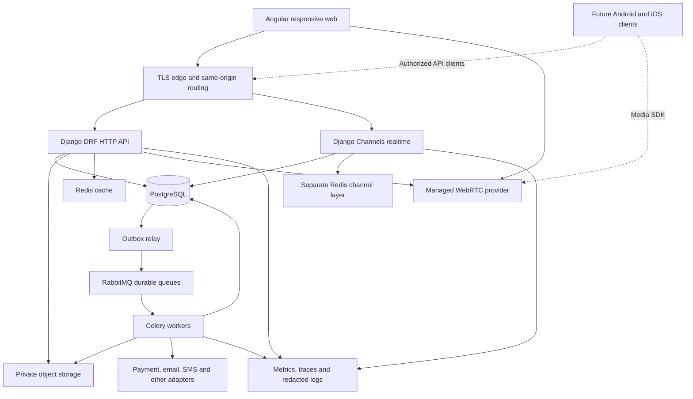
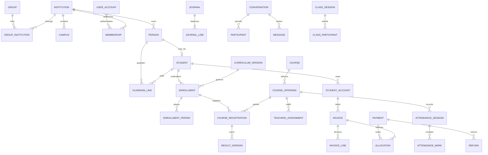
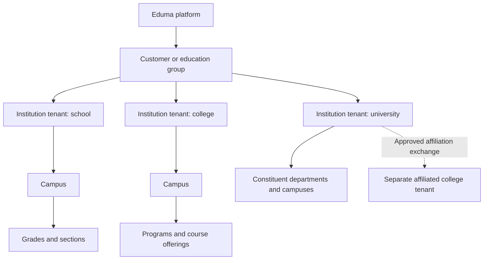
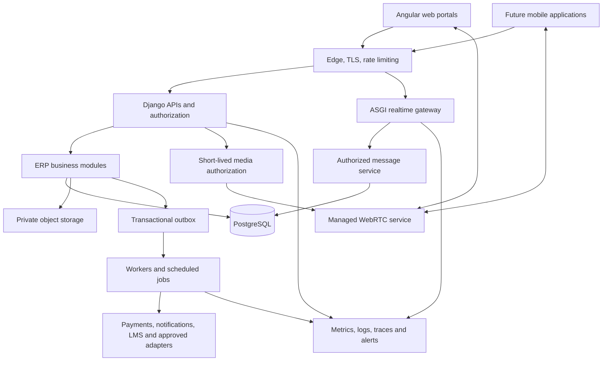

# Eduma — All Specifications

**Pack version:** 1.1 · **Prepared:** 12 October 2026

This is the portable merged copy of the 16 numbered documents in Eduma_Build_Pack. Attach the separate prompt.md and the logo. The responsive visual prototype is distributed separately as Eduma_UI_Preview; the Angular/Django/PostgreSQL application is not implemented. Each source is identified by BEGIN SOURCE FILE and END SOURCE FILE markers.

## Source documents

- [00_README.md](#source-00-readme)
- [01_PRD_and_Release_Scope.md](#source-01-prd-and-release-scope)
- [02_Roles_Tenancy_and_Permissions.md](#source-02-roles-tenancy-and-permissions)
- [03_Workflows_and_Business_Rules.md](#source-03-workflows-and-business-rules)
- [04_Navigation_and_Screen_Catalog.md](#source-04-navigation-and-screen-catalog)
- [05_Design_System_and_Responsive_UX.md](#source-05-design-system-and-responsive-ux)
- [06_Screen_Specs_and_Prototype_Review.md](#source-06-screen-specs-and-prototype-review)
- [07_Architecture_and_Decisions.md](#source-07-architecture-and-decisions)
- [08_Data_Model_and_Dictionary.md](#source-08-data-model-and-dictionary)
- [09_API_Events_and_Integrations.md](#source-09-api-events-and-integrations)
- [10_Security_Privacy_and_Operations.md](#source-10-security-privacy-and-operations)
- [11_Test_UAT_and_Migration.md](#source-11-test-uat-and-migration)
- [12_Delivery_Backlog_and_Build_Readiness.md](#source-12-delivery-backlog-and-build-readiness)
- [13_Traceability.md](#source-13-traceability)
- [14_Decisions_and_Assumptions.md](#source-14-decisions-and-assumptions)
- [15_Research_Baseline.md](#source-15-research-baseline)


---

<a id="source-00-readme"></a>

<!-- BEGIN SOURCE FILE: 00_README.md -->

# Eduma — Predevelopment Specification Pack

**Pack version:** 1.1  
**Prepared:** 12 October 2026  
**Status:** Specifications prepared; five responsive visual previews now available for review. The Angular/Django/PostgreSQL application has not been generated.

**Latest handoff:** The user supplied the Eduma logo and accepted the selected stack and documented defaults for local development. See 14 for the current decision record. The separate `Eduma_UI_Preview` folder/ZIP contains the interactive prototype and ten desktop/mobile screenshots. Review the prototype before authorizing the conditional application implementation; older research/design-status statements describe the initial document-only baseline.

This pack consolidates the Eduma requirements already supplied in the conversation and develops them into product, design and engineering specifications. It supports the requested flow: **review the documents → supply the logo → review concrete screens → approve the relevant decisions → build and verify connected stages**. A single enormous generation step would make errors and missing modules harder to detect; the supplied prompt instead maintains the complete agreed scope while guiding staged implementation.

## 1. Confirmed product direction

Eduma is a centralized, multi-institution education ERP for **India first**, with international expansion planned. **Schools, general colleges, engineering colleges and universities are all initial institution categories.** Groups, campuses and affiliated colleges are included through explicit authority and controlled data sharing.

The Eduma System Admin onboards institutions, uploads their initial details/images, invites Institution Admins, controls activation and platform entitlements, and monitors the platform. Institution Admins own institutional operations, users, academics, branding and available feature settings. Teacher–parent and authorized staff messages/calls are included; students join teacher-conducted online classes under institution policy.

Angular + Django + PostgreSQL remains the working stack recommendation, with alternatives and mobile implications documented. Web comes first; Android/iOS come later. Configurability means validated, versioned rules and workflows with history and delegated authority.

## 2. File manifest and review order

The folder contains **17 Markdown files**: 16 numbered specification/reference files plus the future-session prompt. Individual document revision numbers may differ from the pack version; every approval/evidence status remains explicit.

| File | Purpose | Suggested reviewer |
|---|---|---|
| [00_README.md](#source-00-readme) | Navigation, usage, precedence and actual status | Everyone |
| [01_PRD_and_Release_Scope.md](#source-01-prd-and-release-scope) | Product objectives, requirement families and complete scope | Product owner, institution representatives |
| [02_Roles_Tenancy_and_Permissions.md](#source-02-roles-tenancy-and-permissions) | Admin boundaries, roles, canonical action permissions and isolation | Product, security, backend |
| [03_Workflows_and_Business_Rules.md](#source-03-workflows-and-business-rules) | State transitions, exceptions and worked academic/financial examples | Academic, finance, operations |
| [04_Navigation_and_Screen_Catalog.md](#source-04-navigation-and-screen-catalog) | 49 screen identifiers, role navigation and device expectations | Product and design |
| [05_Design_System_and_Responsive_UX.md](#source-05-design-system-and-responsive-ux) | Proposed tokens, components, responsive behavior and accessibility | Design and frontend |
| [06_Screen_Specs_and_Prototype_Review.md](#source-06-screen-specs-and-prototype-review) | Representative layouts, actions, validations, states and review scenarios | Product, design, institution users |
| [07_Architecture_and_Decisions.md](#source-07-architecture-and-decisions) | Stack tradeoffs, modular architecture, tenancy and mobile strategy | Technical lead, operations |
| [08_Data_Model_and_Dictionary.md](#source-08-data-model-and-dictionary) | Entities, relationships, constraints, history and fee subledger | Backend, academic, finance |
| [09_API_Events_and_Integrations.md](#source-09-api-events-and-integrations) | Interface conventions, routes, events, callbacks and provider boundaries | Backend, frontend, integration owners |
| [10_Security_Privacy_and_Operations.md](#source-10-security-privacy-and-operations) | Privacy planning, access, India obligations, monitoring and recovery | Security, operations, legal/contract owners |
| [11_Test_UAT_and_Migration.md](#source-11-test-uat-and-migration) | Synthetic fixtures, acceptance scenarios, migration and release evidence | QA, institution owners, engineering |
| [12_Delivery_Backlog_and_Build_Readiness.md](#source-12-delivery-backlog-and-build-readiness) | 13 dependency-ordered build stages, readiness and completion criteria | Product owner, delivery lead |
| [13_Traceability.md](#source-13-traceability) | Requirements → workflows/screens/contracts/tests/build stages | Product, QA, technical lead |
| [14_Decisions_and_Assumptions.md](#source-14-decisions-and-assumptions) | Confirmed decisions, proposed defaults and unresolved choices | Product owner first |
| [15_Research_Baseline.md](#source-15-research-baseline) | Source-linked enterprise ERP knowledge document | All reviewers as needed |
| prompt.md (attached separately) | Portable instructions for the next review/build session | The future implementation assistant |

For the first review, read **00 → 14 → 01 → 02 → 03 → 04–06**. Review **07–11** with technical/operational owners, then **12–13** for delivery coverage. Consult 15 for research and definitions rather than treating its earlier high-level proposals as accepted implementation decisions.

## 3. How to transfer this work

Three equivalent ways to carry the specifications forward:

1. **Chat attachments:** attach `Eduma_All_Specifications.md`, this folder's `prompt.md`, and the logo when available. The merged document contains 00–15 with source-file markers; no need to attach the separate copies too.
2. **Repository workspace:** copy this folder into a documentation directory, preserve filenames, and ask the assistant to read 00 and prompt before implementation. The future project layout is proposed in 12; no project is created by this pack.
3. **Archive:** extract `Eduma_Build_Pack.zip` and use all 17 files. Some interfaces cannot read a ZIP directly, so extraction or the merged Markdown is more reliable.

The prompt defaults to **review** unless the user explicitly requests implementation. It also respects already approved decisions and requires honest evidence for actual progress. Attaching the files alone is not approval of every proposal. If an interface truncates or cannot access a document, the assistant must identify the missing input before relying on it.

## 4. Authority and conflict rules

Apply current explicit user instructions first, then accepted decisions recorded with evidence, then the confirmed requirements in 14. Detailed reviewed specifications govern their subject. Unapproved defaults remain proposals; source research informs decisions but does not approve them. External laws, institutional regulations and contracts must be checked for actual applicability and cannot be inferred from a generic example.

The user explicitly replaced the earlier school-first direction with all four institution categories at launch. **L1/L2 are proposed build order, not approval to omit categories or abandon operational modules.** L3 contains later mobile/international work or explicitly selected advanced scope. A smaller release needs a recorded scope decision.

If two documents conflict on permissions, tenancy, money, official results or release breadth, resolve the conflict and update affected files before implementing the dependent behavior. Do not silently choose the easier or more permissive interpretation. Prefer canonical permission names in 02 and data/interface conventions in 08/09.

The earlier standalone knowledge document and predevelopment plan are historical planning artifacts. This pack is the consolidated handoff; 15 preserves the research baseline. Keep user decisions and evidence in 14 or a clearly linked successor as the project develops.

## 5. Current readiness and next concrete work

| Area | Current state / next step |
|---|---|
| Requirements and written specifications | Prepared for review; proposals are labeled |
| Logo and visual direction | Logo supplied; five actual responsive previews created; user visual approval pending |
| Institution rules | Obtain sample academic, fee, receipt, transcript and approval rules for representative institutions; use labeled synthetic examples for development |
| Stack and tenant choices | Working recommendations are recorded; resolve consequential choices before their implementation |
| Providers | Payment, messaging, media, hosting and external-education access remain unselected/unverified where noted |
| Capacity, operating budget and commitments | Establish actual forecast, support ownership and recovery/service targets before contractual promises |
| Application, database and native apps | Not generated |
| Runtime tests and prototype/UAT evidence | 40 prototype checks passed; application/backend, accessibility-conformance and human UAT evidence remain unverified |

No additional planning files need to be invented just to delay useful work. The next review should resolve the decisions that affect the first design/build slice. During implementation, create executable subsystem plans, actual OpenAPI/event schemas, migration files, runbooks and evidence records when the corresponding code and environment make those artifacts meaningful.

## 6. Document quality checks

Preparation includes checks for the complete file manifest, internal file links, stable screen/test/build identifiers, valid JSON examples and balanced Markdown code fences; independent arithmetic checks cover the worked fee, marks, GPA and attendance examples. A consistency review checks all four institution categories, administrator boundaries, lifecycle terminology, applicant/case access and the distinction between proposals and evidence.

**Checked on 12 October 2026:** 17 Markdown files, 85 internal file links, 49 screen IDs, 35 acceptance-scenario IDs, 13 build stages, 14 requirement families, 80 tables and 6 JSON examples. The document checks found no missing file references, undefined catalog IDs, inconsistent table widths or invalid JSON examples. Worked arithmetic and the eight declared color-contrast pairs were independently recalculated. All 35 application acceptance scenarios remain **Not run**.

These are **document checks only**. They do not establish application security, WCAG conformance, financial correctness in code, successful external integrations, mobile background calling, legal compliance, recovery time or measured capacity. Those require the evidence described in 10–12. The research baseline links primary sources; changing legal/provider/version facts require revalidation when implementation or launch depends on them.

## 7. Recommended message for the next session

> Review the attached Eduma specification pack and follow prompt.md in review mode. Preserve the confirmed requirements for all four institution categories. Identify only material decisions needed next and prepare a concrete review of representative screens using my logo. Do not generate application code yet.

After the documents and visual direction are reviewed, use the implementation message at the end of prompt.md (attached separately). Build connected, verified stages and keep progress against 12/13; a scaffold or dashboard alone is not the requested enterprise ERP.

<!-- END SOURCE FILE: 00_README.md -->


---

<a id="source-01-prd-and-release-scope"></a>

<!-- BEGIN SOURCE FILE: 01_PRD_and_Release_Scope.md -->

# Eduma — Product Requirements and Release Scope

**Pack version:** 1.0  
**Prepared:** 12 October 2026  
**Status:** Substantive proposal for review. Confirmed user requirements are distinguished from recommended implementation defaults. No software or visual prototype is claimed complete.

## 1. Product outcome

Eduma lets an education organization run admissions, student records, academics, institutional operations and communication in one governed platform. Eduma's platform team onboards and operates the service; institution teams control their own workflows and data within assigned authority.

Success means that a teacher, parent, registrar, accountant or administrator can complete real work with correct permissions and reliable records. A dashboard containing sample numbers is not sufficient delivery of the underlying function.

## 2. Confirmed scope

| Topic | Confirmed requirement |
|---|---|
| Product and market | Eduma; India first, later international expansion |
| Institution categories | Schools, general colleges, engineering colleges and universities are supported at initial launch |
| Structure | Groups, campuses and affiliated colleges, with central management accounts |
| System Admin | Central onboarding, initial institution images/details and admin invitation, activation/deactivation, technical operations and metrics |
| Institution Admin | Institutional users, academics, feature settings, branding and operations |
| Communication | Teacher–parent and staff messages/calls; students join teacher-conducted classes under institution policy |
| Devices | Responsive web first; Android and iOS later |
| Technology | User proposed Angular, Django and PostgreSQL; the planning recommendation retains them |
| Process | Review the documents and design before generating the application; logo supplied later |

The scope is broader than one school template. Academic registration, curriculum versions, attempts, credits and university authority are first-class requirements.

## 3. Proposed delivery groups

These groups describe dependency order and review priorities. They are **not user-approved exclusions**. The full web catalog remains in the product scope. A smaller commercial launch must be explicitly selected in [the decisions register](#source-14-decisions-and-assumptions).

- **L1 — operational core across all four categories:** platform setup, identity, institution configuration, student lifecycle, academics, attendance, assessment/results, student fees, communication, reports, audit and required integrations.
- **L2 — institutional operational breadth:** library, transport, hostel/mess, HR/payroll interfaces, purchasing/assets/labs, student services, placements/alumni and quality/research administration as applicable.
- **L3 — later platform/depth:** native mobile applications, more advanced optimization, additional country/regulatory packs, and other explicitly selected advanced capabilities. Native mobile follows the web phase as requested.

An institution can enable only relevant modules. Unconfigured or unavailable features must say so honestly. A disabled menu, mock response, decorative screen or nonfunctional button does not count as a completed module.

## 4. Users and jobs to complete

| User | Principal job | Example completion evidence |
|---|---|---|
| System Admin | Bring an institution into service and keep it operating | Institution provisioned, admin invited, readiness checked, activated and monitored |
| Institution Admin | Configure and delegate institutional work | Academic structure, roles, modules and policies saved with version/audit |
| Group/university manager | Perform authorized shared governance | Aggregate or exchange available only for explicitly granted institutions/fields |
| Teacher/faculty | Teach, record progress and communicate | Assigned attendance/marks saved, parent contacted, class hosted |
| Registrar/exam officer | Maintain authoritative academic records | Curriculum, registration, results and awards follow approved rules |
| Finance officer | Collect and reconcile fees | Provider events, receipts, refunds and settlements match the ledger |
| Parent/guardian | Follow and support authorized children | Correct child selected; relevant notices, fees and contact actions available |
| Student | Complete own academic/service tasks | Appropriate registration, timetable, coursework, published results and class join |
| Domain staff | Operate assigned services | Correct loan, trip, room, leave, requisition or case workflow completed |

Detailed action authority belongs in [02](#source-02-roles-tenancy-and-permissions). Job titles do not grant global access.

## 5. Requirement families and observable acceptance

These IDs are the shared traceability keys. Domain documents may define narrower rules or test cases beneath a family.

| ID | Requirement family | Required observable behavior |
|---|---|---|
| REQ-TEN | Organization and isolation | One institution cannot access another's records; group/affiliation rights are explicit and revocable |
| REQ-ONB | Platform onboarding/lifecycle | Create institution, upload approved branding, invite admin, validate readiness, activate, restrict, suspend, reactivate and offboard |
| REQ-ACL | Identity and authorization | Role/action/scope/relationship/state checks work in APIs, exports, files, jobs and realtime channels |
| REQ-CFG | Dynamic configuration | Forms, modules, templates and supported rules are versioned, validated and effective-dated without rewriting history |
| REQ-ADM | Admissions and student lifecycle | Enquiry/application through enrollment, transfers, withdrawal and authorized guardian links |
| REQ-ACA | Academic structure and registration | School grade/section and higher-education curriculum/offering/credit models work for all four categories |
| REQ-ATT | Scheduling, teaching and attendance | Conflict-aware schedules, assigned rosters, attendance corrections and defined eligibility calculations |
| REQ-EXM | Assessment, results and awards | Versioned calculation, moderation, publication, revaluation, progression and reproducible academic records |
| REQ-FIN | Student fees and accounting boundary | Exact amounts, durable payment events, balanced subledger, receipts, refunds and reconciliation |
| REQ-COM | Messages, calls and online classes | Only authorized relationships communicate; teacher supervision and active-session revocation are enforced |
| REQ-OPS | Institutional services and platform operations | Enabled service workflows function; health, usage, audit, support and recovery are actionable |
| REQ-UX | Responsive and accessible experience | Role-specific navigation and critical workflows work on defined devices and in error/restricted states |
| REQ-MIG | Imports, exports and migration | Staged mapping, validation, safe retry, reconciliation and provenance preserve correctness |
| REQ-INT | Integrations and external exchange | Approved provider adapters show real states, retry safely and identify the source of truth |

## 6. Institution-type capability matrix

**Core** means required for that category's operational core. **Applicable** means enabled according to institutional need and reviewed scope; it does not mean deleted from the product backlog.

| Capability | School | College | Engineering college | University |
|---|---|---|---|---|
| Identity, configuration, admissions, people, fees, reporting | Core | Core | Core | Core |
| Grades/sections, school report cards, promotion | Core | Where attached school unit exists | Where attached school unit exists | Where governed school unit exists |
| Guardian links and teacher–parent communication | Core with child/privacy controls | Authorized relationships | Authorized relationships | Authorized relationships |
| Terms, programs, curricula, offerings, course registration | Subject structure as needed | Core | Core | Core |
| Credits, attempts, SGPA/CGPA and degree audit | Where applicable | Core | Core | Core |
| Timetable, attendance and assessment | Core | Core | Core | Core |
| Teacher-led online sessions and staff communication | Core | Core | Core | Core |
| Lab batches, projects and outcome evidence | Applicable | Applicable | Core | Core for applicable programs |
| Constituent campuses, affiliations and central examinations | Group/campus functions | Affiliation participation | Affiliation participation | Core |
| Library, transport, hostel, HR, assets and service cases | Applicable | Applicable | Applicable | Applicable |
| Placements, internships and alumni | Applicable alumni/careers | Applicable | Applicable | Applicable |
| Quality/accreditation evidence and research administration | Applicable | Applicable | Applicable | Applicable |

Every pilot institution must demonstrate an end-to-end journey. Supporting every board, regulation, accreditation route and specialized program is not implied until those rules are supplied and validated.

## 7. Platform and institutional configuration boundaries

System Admin sets supported capabilities, commercial entitlements, quotas, platform templates and operational limits. Institution Admin enables entitled modules, configures permitted rules and delegates authority. Campus/department overrides exist only where delegated.

Effective access is the intersection of deployed capability, entitlement, institution enablement, scope, user permission, relationship and current record state. Frontend visibility is not a security control.

Editable configuration includes typed custom fields, forms, labels, document layouts, workflows, notification templates, grading/attendance schemes and fee policies. It excludes arbitrary executable code, unrestricted SQL, bypass of consent/security controls and silent editing of posted financial or published academic history.

## 8. Communication requirements

- Teacher–parent contact requires an authorized guardian relationship and relevant teacher assignment.
- Staff communication respects institutional and organizational scope.
- Students can join teacher-conducted online classes and institution-approved moderated class interactions. Unrestricted student direct messaging/calling is outside the confirmed initial communication scope.
- Adult-student parent access requires a separate authorized relationship; parent payment does not grant all academic or private information.
- Audio is the proposed default for direct calls; video is supported where approved and needed for online classes.
- Recording remains off under the proposed default. Recording, transcription and their access/retention rules require separate approval.
- A teacher's departure or revoked relationship removes active as well as future access.
- If the final authorized host leaves, student participation pauses or the class ends according to a bounded policy.

## 9. Operational breadth retained in the catalog

| Module | Minimum functional boundary when selected for delivery |
|---|---|
| Library | Catalog/copies, loans, reservations, returns, lost items, policy-driven dues and clearance |
| Transport | Routes/stops, assigned trips and riders, boarding events, safe handover and authorized trip visibility |
| Hostel/mess | Bed allocations, occupancy, leave/out-pass, meal plans, incidents and charges |
| HR/payroll | Employee lifecycle, assignments, leave, attendance, approved payroll inputs, payslips or a reconciled payroll adapter |
| Purchasing/inventory/assets | Requisition, approval, order, receipt, stock movements, custody and maintenance |
| Laboratories | Resource availability, booking, experiment/project evidence and maintenance |
| Student services | Service requests, confidential grievance/counseling referral, case-specific access and deadlines |
| Placement/internship/alumni | Eligible opportunities, applications, outcomes, supervised internship evidence and consented alumni records |
| Quality/research | Approved evidence, outcome calculations, review periods, research supervision and milestone workflows |

Full tax/statutory payroll, general-ledger accounting, biometric integrations and jurisdiction-specific compliance engines are separate fit-and-responsibility decisions. The intended boundary must be visible; an export adapter must not be presented as a full engine.

## 10. Proposed nonfunctional targets

The following are planning targets only: WCAG 2.2 AA for applicable web journeys; reliable behavior at representative phone/tablet/desktop widths; 99.9% monthly core-service availability; p95 ordinary reads below 800 ms and writes below 2 s under a defined workload; proposed disaster RPO 15 minutes/RTO 4 hours.

Targets require measurement definitions, cost validation and evidence before contract commitments. [10](#source-10-security-privacy-and-operations) and [11](#source-11-test-uat-and-migration) define the validation process. Browser calling cannot imply native locked-phone reliability.

## 11. Explicit exclusions and deferred decisions

Confirmed later scope includes native Android/iOS development. Unsupported initial assumptions include unrestricted student social messaging, platform custody of tuition funds, silent call recording, automatic regulator submission without authorization, and AI deciding admissions, disciplinary outcomes or official grades.

The following remain decisions, not invented facts: first pilot boards/programs, release breadth, real scale, launch languages, budget/team/date, provider accounts, institution legal tenancy, document templates, exact retention, hosting/residency promises and final branding.

Synthetic academic examples in [03](#source-03-workflows-and-business-rules) demonstrate calculations only. They must not be labeled real CBSE, UGC or university regulations.

## 12. Product completion and review

A delivered feature has a reachable interface, persisted records, enforced authority, meaningful failure behavior, audit where needed and acceptance evidence. Business flows must work against the actual backend. Development fixtures and provider test doubles are identifiable and cannot report production readiness.

Review the launch matrix and decisions once, record resulting scope, then implement in connected slices. After the core, continue the approved operational modules before declaring the agreed web product complete. [12](#source-12-delivery-backlog-and-build-readiness) governs dependency order; [13](#source-13-traceability) connects requirements to evidence.

<!-- END SOURCE FILE: 01_PRD_and_Release_Scope.md -->


---

<a id="source-02-roles-tenancy-and-permissions"></a>

<!-- BEGIN SOURCE FILE: 02_Roles_Tenancy_and_Permissions.md -->

# 02 — Roles, Tenancy and Permissions

**Product:** Eduma  
**Prepared:** 12 October 2026  
**Status:** Draft specification for review; no permissions or infrastructure have been implemented.  
**Requirement families:** REQ-TEN, REQ-ONB, REQ-ACL, REQ-CFG, REQ-COM.  
**Related:** [PRD](#source-01-prd-and-release-scope), [workflows](#source-03-workflows-and-business-rules), [data model](#source-08-data-model-and-dictionary), [security](#source-10-security-privacy-and-operations), [decisions](#source-14-decisions-and-assumptions).

## 1. Boundary and vocabulary

Eduma supports schools, colleges, engineering colleges and universities from the initial product scope. An institution is the operational tenant: every tenant-owned record carries an immutable `institution_id` UUID. The institution owns its configuration, academic records, users' memberships, financial records and communication policies. A user's global identity may have several institution memberships, but personal records and permissions are not automatically merged between them.

| Object | Meaning | Access consequence |
|---|---|---|
| Platform | Eduma service and control plane | Operates provisioning, entitlements, health and service administration |
| Customer/group | Commercial or governance grouping | Group association alone grants no tenant data access |
| Institution | School, college, engineering college or university tenant | Primary isolation boundary; independently authorized membership |
| Campus | Operational location within an institution | Optional narrower scope; not automatically a separate tenant |
| Department/program | Academic ownership and enrollment structures | Narrows staff responsibilities and academic authority |
| Affiliation | Time-bound relationship between institutions | Allows only explicitly granted academic exchanges or reporting |
| Account / institution person | Account is global sign-in identity; Person is institution-owned biographic data | Neither implies student, guardian or employee status everywhere; do not merge institutional Person records globally |
| Membership/role assignment | Account's effective institutional authority | Includes role version, scope, start/end, status and assigning actor |

An independently governed affiliated college remains a separate institution tenant even when a university controls an examination scheme. University affiliation does not expose college payroll, health records, unrelated parent conversations or bank reconciliation. Conversely, a multi-campus university can be one tenant if the agreed governance and contractual model supports it. This is a proposed model to confirm with representative institutions; legal ownership must not be inferred from organization names.

## 2. Authorization decision

Permission names use `<resource>.<action>`, such as `attendance.submit`, `result.publish` and `fee_refund.approve`. A permission is necessary but insufficient: the server also checks scope, relationship, record state, policy and effective time.

For every request, worker, export, download and real-time subscription:

1. Authenticate the actor; validate session and account status.
2. Resolve the requested institution and its service state server-side.
3. Resolve active memberships or an explicit, unexpired exchange/support grant.
4. Check the action permission against the current role/policy revision.
5. Check institution, campus, department and record boundaries.
6. Check relevant relationship: assigned teacher, enrolled student, verified guardian, nominated reviewer or granted recipient.
7. Check workflow state, feature entitlement, legal/policy restrictions and separation of duties.
8. Return only permitted fields; record security-relevant access or mutations.

Default is deny. Explicit restrictive policy and protected-record rules take precedence over the union of ordinary role permissions. The browser may hide buttons for usability but never supplies the authorization decision. Changing `institution_id` in `/api/v1/institutions/{institution_id}/…` must not change the caller's authority. UUIDs reduce guessability; they are not an access control.

Campus-limited users cannot widen access through reports, counts, autocomplete, global search, CSV files or aggregate drill-down. Errors must not reveal another institution's record existence. A scheduled report must revalidate recipient authority when generated and again when delivered/downloaded.

## 3. Role templates

Templates are editable within protected platform boundaries. Institutions create named roles from allowed permissions, then assign narrow scopes. Role names are labels; code must check permissions and relationships.

| Template | Primary authority | Default limits |
|---|---|---|
| System Admin | Provision institutions, invite initial admins, manage lifecycle and entitlements | No routine institution record browsing or academic/financial editing |
| Platform Operations | Health, alerts, capacity, recovery and deployments | Redacted diagnostics; no student records by default |
| Platform Support | Handle cases and approved diagnostic sessions | Time-bound read access to named records; no implicit impersonation |
| Group Administrator | Manage authorized cross-institution governance | Only separately granted institutions and data categories |
| Institution Admin | Setup, staff membership, configuration and institutional operations | Cannot weaken platform security or silently bypass approvals |
| Principal/Director | Institutional oversight and delegated approvals | No automatic payment gateway secrets or confidential case access |
| Registrar/Academic Administrator | Enrollment, term setup, registration and academic records | Finance and result-publication permissions separately granted |
| Dean/Head of Department | Department planning, workload and academic approvals | Assigned departments and programs only |
| Teacher/Faculty | Assigned teaching, attendance, assessment and authorized communication | No unrelated classes, mass finance exports or peer employee records |
| Examination Officer | Exam setup, scrutiny and result publication | Maker/reviewer/publisher authority separated where configured |
| Admissions Officer | Applications, documents, verification and admission preparation | Sensitive document fields restricted; concessions separately approved |
| Applicant / authorized application guardian | Create and manage specifically owned applications | Application-only membership; no enrollment, student directory or staff access; adult applicant delegation verified separately |
| Accountant/Cashier | Charges, collections, reconciliation and fee reporting | Refund approval and reversal authority separately assigned |
| HR/Payroll Officer | Employee and payroll workflows | Student academic/health records unavailable by default |
| Librarian/Transport/Hostel/Asset Officer | Their operational module | Minimum student contact or assignment data required for service |
| Service / Grievance / Safeguarding Officer | Assigned case triage, action and resolution | Case confidentiality and explicit assignment; institution-wide admin role alone does not disclose private case notes |
| Student | Own enrollment, learning, published results, dues and permitted meetings | Cannot host unrestricted calls or access peers' private records |
| Parent/Guardian | Permitted records of explicitly linked learners | Per-child and per-purpose scope; no inherited whole-family access |
| Auditor | Approved record categories and audit trails | Read/export only where granted, with expiry and purpose |

A person may hold multiple roles. A teacher who is also a parent switches context clearly; employment authority must not expand parent access. Emergency contacts, fee payers and pickup nominees are separate relationships from academic guardians.

## 4. Action matrix

This is the starting permission contract. “Scoped” always includes the authorization checks above. “Separate grant” means the capability is not inherent in that role. Institutional permissions can be delegated without transferring ownership of the whole tenant.

| Action permission | Default eligible role | Scope / relationship | Required constraint |
|---|---|---|---|
| `institution.create` | System Admin | Platform | Idempotent provisioning; verified organization request |
| `institution.activate` / `institution.suspend` | System Admin | Named institution | Reason, impact preview, audit; suspension is not deletion |
| `institution_brand.update` | Institution Admin; System Admin during setup | Own institution | Scan assets; version published branding |
| `platform_health.read` | System Admin, Operations | Platform | Redacted diagnostics and secret filtering |
| `entitlement.update` | System Admin | Named institution | Cannot grant prohibited processing or overwrite historical records |
| `role.manage` / `membership.assign` | Institution Admin | Own institution; assigned campus if delegated | Grant ceiling; cannot award platform authority or exceed own delegated authority |
| `affiliation_grant.approve` | Authorized institution owners | Named sender, receiver and purpose | Acceptance, expiry, allowed fields and revocation rules |
| `student.read` / `student.update` | Registrar; assigned administrative roles | Own institution and assigned students | Field rules; changes to identity/enrollment history audited |
| `admission.approve` | Admissions approver/Registrar | Assigned campaign/program | Required checks complete; prevent own approval if policy requires |
| `application.review` / `application.request_information` | Admissions Officer | Assigned cycle/program/applications | Restricted documents and field access; review is distinct from admission approval |
| `application.own_create` / `application.own_view` / `application.own_edit` | Applicant / authorized application guardian | Published admission cycle and explicitly owned application | Backend creates only a limited applicant membership; edit only draft or returned fields, never other applicants |
| `application.own_submit` / `application.own_accept` | Applicant / authorized application guardian | Own verified application/offer | Required fields/documents complete; offer valid; admission payment status comes from verified finance events |
| `course_registration.approve` | Registrar/academic approver | Program/term | Versioned prerequisites and authorized override reason |
| `attendance.submit` | Assigned teacher/substitute | Teaching session and roster | Submission window; enrollment effective dates |
| `attendance.correct` | Authorized academic approver | Submitted session | Reason, prior value and approval history retained |
| `mark.enter` | Assigned evaluator | Component/course/term | Allowed mark range and missing/absent statuses |
| `result.verify` / `result.publish` | Examiner / publisher | Approved exam cycle | No silent self-approval; locked rule version and reconciled cohort |
| `fee_charge.issue` / `fee_payment.record` | Accountant/Cashier | Institution/campus ledger | Decimal money, approved schedule and immutable posting history |
| `fee_concession.approve` / `fee_refund.approve` | Named finance approver | Allowed amount/category threshold | Independent maker/checker where required; step-up authentication |
| `message.send` / `call.initiate` | Teacher, guardian, authorized staff | Institution-approved relationship | Availability, recipient policy, abuse controls and restrictions |
| `meeting.host` | Assigned teacher/authorized staff | Scheduled class or approved audience | Policy-controlled invitation, waiting room and removal |
| `meeting.join` | Enrolled invited student; authorized participants | Meeting roster | Short-lived token; recheck revoked invitation |
| `report.export` | Role with explicit export grant | Authorized dataset and fields | Purpose, size limits, audited delivery and expiry |
| `privacy_request.manage` | Designated privacy owner | Named institution/request | Identity verification and separate legal-hold decision |
| `support_access.request` | Platform Support | Named ticket/institution | Institution approval or recorded emergency procedure |
| `configuration.edit` / `configuration.publish` | Institution Admin or designated configuration approver | Permitted settings and effective scope | Publication authority separated for high-impact rules; locked constraints cannot be weakened |
| `academic_structure.manage` / `timetable.publish` | Registrar / academic coordinator | Assigned institution/campus/program | Rule and conflict checks; versioned publication |
| `library.manage` / `library.issue` / `library.return` | Librarian | Assigned library and authorized borrower | Atomic copy allocation and controlled fine corrections |
| `transport.manage` / `transport.record_boarding` | Transport manager / assigned attendant | Assigned routes/trips/riders | Active trip and pickup authority; no broad location-history access |
| `hostel.allocate` / `hostel.approve_leave` | Authorized warden | Assigned hostel/building | Occupancy constraints and approved handover/leave policy |
| `employee.manage` / `leave.approve` / `payroll.process` | HR / designated leave or payroll officer | Assigned employees and employment period | Salary fields protected; independent payroll approval as configured |
| `procurement.approve` / `inventory.move` / `asset.manage` | Authorized purchasing/store/asset officer | Assigned budget/store/resources | Approval thresholds, atomic stock movements and custody history |
| `lab_booking.create` / `lab_booking.approve` | Authorized requester / lab manager | Assigned lab/resources and permitted booking audience | Capacity/conflict/safety/maintenance checks |
| `service_case.create` / `service_case.read` | Authorized requester / assigned case officer | Own or explicitly assigned case | Own read excludes confidential internal notes; third-party details protected |
| `service_case.update` / `service_case.assign` / `service_case.resolve` | Assigned officer / case supervisor | Case and confidentiality scope | State, delegation and separation rules; never institution-wide implicit access |
| `service_case.appeal` | Eligible requester or authorized representative | Own closed/resolved case within permitted window | Preserve original decision and appeal authority |
| `placement.manage` / `research.manage` / `quality_evidence.manage` | Assigned placement / research / quality officer | Approved programs/projects/evidence periods | Data-purpose consent, committee authority and official publication boundaries |

Read-only access never implicitly includes export. Financial approval limits use currency-specific decimal values. A UI role editor shows permission descriptions, dependencies and a before/after impact preview; it must warn on conflicting duties and reject protected combinations rather than relying on a warning alone.

## 5. Guardian and adult student relationships

Store relationship type, learner, institution, permitted record categories, verification method/reference, effective dates, restrictions and review status. Do not expose custody or safeguarding notes to ordinary teachers or other guardians. A shared phone number or surname cannot establish a guardian link. Invitation acceptance proves control of an account, not legal authority.

For minor learners, access follows verified authority and the applicable purpose/policy. Record restrictions independently for multiple guardians. A guardian may be allowed to pay fees without receiving confidential wellbeing records. Changes require an authorized institutional review, with evidence minimization.

Adult students require a separately justified relationship and access policy; do not automatically extend parental access into college. Provide student-authorized delegation where appropriate, per category and time period, with revocation. Turning 18 triggers a review workflow using verified date of birth and policy jurisdiction; it must not silently broaden access or delete records. Under-18 college students still require the relevant child-related handling.

## 6. Groups and affiliated institutions

An exchange grant names granting institution, receiving institution/group principal, purpose, data categories, filters, permitted actions, effective dates and approval evidence. Financial, safeguarding and communications records require separate consideration from academic exchange. A group dashboard queries only active grants and shows reporting freshness and scope.

Submitted affiliation snapshots preserve who supplied them and their revision; the receiver cannot change the source college's student record. Corrections create new versions and reconcile accepted submissions. Revocation stops new access, future jobs and live sessions; retained lawful submissions follow their documented retention and correction rules, not a false promise that every recipient copy disappears immediately.

## 7. Provisioning, delegation and suspension

System Admin creates the institutional profile, verified contact, initial image assets, institution category and entitlements, then sends a single-use expiring invitation to Institution Admin. The invite is bound to institution and intended authority; no shared default password. Institution Admin completes academics, memberships, policy and feature setup. Activation must show unresolved readiness checks and record any authorized exceptions.

Delegated admins cannot grant beyond their own grant ceiling, move records into another tenant, or approve their own privilege escalation. Removing the last active Institution Admin requires a replacement or approved recovery process. Departure revokes sessions, service tokens, assignments and queued exports as appropriate while preserving record authorship.

Restriction and suspension follow the distinct lifecycle states in 03. Billing restrictions may preserve approved read/export continuity; a security suspension revokes affected interactive sessions and media access. Provider payment callbacks still require controlled processing and reconciliation so money is not lost. An institution cannot reactivate itself by changing configuration. Archive/offboarding is a separate workflow with export, retention and deletion review.

## 8. Support and emergency access

Normal support starts with redacted telemetry. If tenant data is necessary, use a ticket-bound grant with institution approval, named support actor, purpose, records/actions, expiry and visible session banner. Default grant is read-only. Export, impersonation and mutations require explicit additional authority; ordinary support must not edit financial postings or issued results.

Emergency access uses named privileged accounts, strong authentication, a recorded incident, restricted duration and independent review. A proposed 60-minute maximum session is a configurable operational policy, not a legal standard. Capture actor, effective identity, grant, institution, accessed records, action, reason, timestamp and outcome. Notify the designated institution contact according to the incident policy. Approval authority and reviewer cannot be the same person acting alone. Group membership is independent of support access and cannot bypass its controls.

## 9. Mandatory denial cases and acceptance

The implementation must deny and test: swapped institution IDs; another tenant's attachment URL; expired affiliation grants; teacher access to an unassigned class; guardian access to an unlinked learner; revoked adult delegation; publishing a result with only mark-entry rights; approving one's own refund where separation is required; stale-role access after removal; permission escalation through custom role JSON; export continuation after revocation; and joining a class with a forwarded token.

Evidence must include API, worker, database connection reuse, object storage, cache, search and WebSocket paths. Database row-level security is defense in depth, not a replacement for these checks. Review the matrix with one representative of each launch institution type and reconcile every action to [UAT tests](#source-11-test-uat-and-migration). Approval remains pending; this document is not an access-control audit or proof of isolation.

<!-- END SOURCE FILE: 02_Roles_Tenancy_and_Permissions.md -->


---

<a id="source-03-workflows-and-business-rules"></a>

<!-- BEGIN SOURCE FILE: 03_Workflows_and_Business_Rules.md -->

# Eduma — Workflows and Business Rules

**Version/date:** 1.0 / 12 October 2026  
**Status:** Proposed rules for review. Worked examples are synthetic and do not represent any board, regulator or university's official regulations.

## 1. Contract used by every workflow

Each operation has an actor, institution context, permission, relevant relationship, permitted source state, input validation, resulting state, audit requirement and failure behavior. The server is authoritative. UI, imports, jobs and API consumers use the same business rules.

- An identifier alone never authorizes access.
- Atomic database changes either all commit or all fail.
- External notifications occur from committed events, not before the transaction succeeds.
- Duplicate submissions are recognized with business uniqueness and idempotency keys.
- `version` is an integer changed on update. A stale edit fails with a conflict and current-version context; it does not overwrite newer data silently.
- Dates, timestamps and academic periods have distinct meanings. Store instants in UTC, render institutional timezone, and preserve date-only values.
- A rejected request returns a stable error code and actionable field/detail information without disclosing another institution's records.
- Audit actor, institutional scope, operation, record, before/after or safe diff, reason, timestamp and request trace. Do not log passwords, secrets or full private-message content in operational logs.

Concrete endpoint/error contracts are in [09](#source-09-api-events-and-integrations); permissions are in [02](#source-02-roles-tenancy-and-permissions).

## 2. WF-ONB — institution onboarding and lifecycle

**Actor:** authorized platform onboarding/admin role. Institution setup subsequently belongs to the invited Institution Admin.

1. Enter customer/group relationship, institution legal/display names, category, contacts, campuses, country/timezone and applicable identifiers.
2. Check duplicates and authorized group relationship; allocate immutable institution UUID.
3. Save `draft`; provision storage/configuration/invitation resources through resumable steps.
4. Move to `provisioning`, then `setup` when required resources exist. On failure, preserve diagnostics and retry missing steps without duplicate tenants/invitations.
5. Upload initial branding through validated/scanned files; private and public variants are separate.
6. Send expiring single-use admin invitation. Verification and account recovery never rely on a shared permanent password.
7. Institution Admin sets academic structure, roles, communication policy, templates and enabled entitled modules; imports staged data.
8. Readiness review checks required setup, at least one valid admin, permissions, import reconciliation and applicable configured integrations.
9. Authorized activation changes state to `active` and records actor/time/configuration version.

| Transition | Additional rule |
|---|---|
| `active` → `restricted` | Name restricted capabilities and show reason/remediation; preserve essential authorized retrieval according to policy |
| `active/restricted` → `suspended` | Record reason and scope; revoke affected sessions, realtime subscriptions and media membership |
| `restricted/suspended` → `active` | Revalidate administrator, memberships, integration credentials and outstanding work |
| `active/restricted/suspended` → `archived` | Stop new operations according to closure policy; preserve lawful access/retention |
| `archived` → `deletion_pending` | Verify export, obligations, holds, contractual authority and deletion scope |
| `deletion_pending` → `deleted` | Execute documented data/processor/backup policy; retain only authorized minimal evidence |

Maintenance is a separate bounded operational condition. Suspension does not erase academic or financial history, and valid in-flight payment confirmations still need reconciliation.

## 3. WF-ACL — membership, guardian and affiliation changes

Identity may be shared across authorized memberships; academic records remain institution-scoped. A user selects an institution only from verified active memberships.

**Invitation:** create → delivered/failed → accepted or expired/revoked. Acceptance verifies the intended recipient and applies only the permissions in the invitation. Reinvitation invalidates older active tokens if policy requires it.

**Guardian relationship:** proposed → verified → active → expired/revoked. Record learner, adult, institution, relationship, permitted categories, effective dates, verification evidence and restrictions. An adult student relationship requires appropriate authorization. Custody restrictions cannot be removed through an ordinary contact edit.

**Role/grant change:** validate grantor's authority → preview changed permissions → approve sensitive changes → publish → revoke stale access → audit. Prevent self-escalation and removal of the last active Institution Admin without an approved replacement/recovery path.

**Affiliation exchange:** record parties, academic authority, scope/fields, period, purpose and approving parties. An affiliation record alone grants no read access. Revocation stops future exchange and applies retention/access policy to already received authorized records.

## 4. WF-CFG — configuration publication

Configuration objects move through `draft` → `validated` → `approved` where required → `published` → `superseded`. Keep institution/campus scope, parent template, version, effective interval and allowed override rules.

Before publication:

- Validate types, references, formula constraints and dependency compatibility.
- Show a diff and affected scopes/records.
- Simulate affected academic/financial examples.
- Require designated approval for high-impact changes.
- Prevent overlapping incompatible effective intervals.

Published instances reference the rule version that produced them. Rollback publishes a safe replacement or changes future applicability; it does not erase audit history or blindly recalculate past results. New behavior requiring unsupported expressions is a product change, not arbitrary code entered by an admin.

**Example:** a grading rule introduced for the 2027 cohort must not recalculate a 2026 transcript. A correction for 2026 requires the result-revision workflow and an authorized rule decision.

## 5. WF-ADM — admissions and enrollment

**States:** `draft` → `submitted` → `under_review` → `needs_information` / `eligible` / `rejected` → `offered` → `accepted` → `enrolled`; `withdrawn` may apply at approved points.

The application stores cycle, institution/program/grade choice, required documents, eligibility evidence, seat/category data where applicable and responsible reviewer. Applicants can change only permitted fields during permitted states.

Before enrollment, confirm offer validity, required verification and the applicable admission-payment policy. Use an atomic seat allocation/uniqueness check so parallel admissions do not exceed an approved capacity. A verified payment event may satisfy payment conditions; a browser redirect alone cannot.

Create the student/person link, institution enrollment, academic placement and approved guardian relationships without losing applicant provenance. Keep enrollment number uniqueness scoped to its declared institution/year/program rule. Names, dates of birth or phone numbers alone must not trigger automatic person merges.

Withdrawal after enrollment records effective date, academic consequences, clearance and fee/refund decision separately. Cancellation of enrollment is not automatically a refund and does not delete receipts.

## 6. WF-ACA — curriculum, registration and progression

### 6.1 School model

An academic-year `EnrollmentPeriod` is assigned to grade/section and subject groups inside the enduring `Enrollment` study episode. Teacher assignments determine teaching access. Promotion uses the approved scheme, attendance treatment, review decisions and permitted exceptions. Rollover creates a new `EnrollmentPeriod` within that episode while preserving the previous year's section, results and attendance history. A real new study episode or transfer is modeled separately.

### 6.2 Higher-education model

The learner has an active program enrollment and pinned curriculum/regulation version. A course offering identifies term, section, instructors, capacity and any linked lecture/lab/tutorial requirements.

Registration checks active membership/enrollment, registration window, holds, prerequisites/corequisites, eligible elective group, credit limits, timetable conflicts and available seats. Each failed condition has a separate code and authorized override rule.

**Registration states:** `requested` → `pending_approval` / `waitlisted` / `registered` / `rejected`; registered records can become `dropped` or `withdrawn` only under approved windows/policies.

Seat claims and linked-section registration occur transactionally. Two simultaneous requests for the final seat cannot both succeed. Waitlist promotion rechecks current eligibility before consuming a seat. Duplicate submissions do not create duplicate active registration.

### 6.3 Attempts, equivalence and degree audit

Every assessed course attempt remains identifiable. A repeat may replace the grade contribution according to the pinned rule but does not erase the previous attempt. Credit is counted once unless the applicable approved curriculum explicitly allows multiple distinct credit awards.

Store transfer source, equivalence decision, evidence, approved credits, classification and awarding authority. Separate earned credits from credits accepted toward a particular award. Apply credit categories, substitutions/waivers, transfer/residency limits and minimum performance rules.

Multiple entry/exit, intermediate awards and re-entry apply only where the program's approved regulations permit them. Advisory degree progress and hypothetical program-switch calculations never constitute an issued award.

### 6.4 Rollover

Preview destination year/term/program, eligible students, retained students, withdrawals, pending results, carried balances and staff assignments. An authorized user resolves exceptions before publication. Idempotent batch execution creates no duplicate enrollment and leaves a reconciliation report.

## 7. WF-ATT — timetable, attendance and corrections

Timetable publication checks instructor, room, cohort, resource and accessibility constraints. Draft conflicts are visible; no schedule becomes authoritative merely because an automated solver produced it. Changes create a new published version and notify affected authorized users.

Attendance references the session and roster context, not an arbitrary student list. A teacher can submit only assigned sessions during the allowed window. Student/session uniqueness prevents duplicate marks. Status options must declare whether they contribute to the denominator and numerator.

**States:** `draft` → `submitted` → `locked`. Corrections to submitted/locked records follow a reasoned, authorized amendment; preserve original values and actor.

Offline capture uses a client operation ID and last-known roster/version. Reconnection revalidates authority, session state and roster; a stale conflict is shown for resolution. Display pending local work separately from server-confirmed attendance.

Online-class join events provide supporting evidence. Reconnect events must not double-count time, and room presence is not proof of engagement. The teacher remains responsible for approved academic attendance.

## 8. WF-EXM — assessment to published award

1. Create a scheme tied to curriculum/cohort/period; define components, maxima, weights, pass conditions, grade bands and rounding.
2. Validate scheme completeness and publication authority.
3. Create assessment/exam attempts and approved roster/eligibility snapshots.
4. Assigned evaluators enter/import marks with range, absence and state validation.
5. Submit for moderation; reviewers resolve missing marks and exceptions.
6. Compute results using the pinned rule and record inputs, formula version and rounding behavior.
7. Preview aggregate and individual outputs; an authorized publication action freezes an issued result version.
8. Generate report cards/transcripts/awards with template and signing authority versions.

Mark/result states distinguish draft, submitted, moderated, published, withheld, absent and invalidated outcomes where applicable. An absent mark is not silently stored as a numeric zero. Missing components block publication unless the approved scheme has an explicit alternative.

Recount/revaluation/correction creates a case, records authority, recomputes an approved revision and supersedes the issued result. Preserve old issued versions and their verification status. QR/public verification reveals minimal necessary information and indicates superseded/revoked documents.

## 9. WF-FIN — fee accounting and payment lifecycle

### 9.1 Charge and receipt principles

A fee plan generates identified charges/invoice lines with institution, payer/student account, academic period, due date, amount, currency and applicable rule version. Draft estimates can change; posted charges are corrected by an authorized adjustment or credit note.

Concessions and scholarships have approved eligibility, amount/percentage, period and funding/account mapping. Deposit liabilities remain separate from earned fees. Store exact decimal values and currency; do not use binary floating point.

Use a balanced accounting subledger or equivalent rigorously reconciled journal. The full institution general ledger remains a separately selected boundary. Unallocated money is visible as credit rather than silently attached to an arbitrary fee.

### 9.2 Online payment

`created` → provider order pending → `pending` → `succeeded` / `failed` / `expired`; later refund/dispute states are separate records/events, not destructive edits of the payment.

The backend creates the order. A verified provider callback/event or reconciliation query establishes authoritative payment status. Persist the inbound event and deduplicate by provider/merchant/event identifier before financial effects. Apply payment and issue receipt in a controlled transaction; create notifications after commit.

A payment may succeed after a browser timeout. Show “confirmation pending” and reconcile rather than prompting a blind second payment. Verify amount, currency, merchant and institution mapping. Quarantine mismatches; never post them to a guessed student.

### 9.3 Refunds, reversals and settlement

- A refund returns money. It does not automatically reduce the amount owed.
- A credit note or approved charge reduction changes what is owed.
- Receipt void/reversal retains reason, authority, original reference and accounting reversal.
- Gateway transaction success and bank settlement are separate states.
- Refund request, independent approval where required, provider execution and reconciliation are distinct steps.
- Failed or duplicate refund events must not return/post funds twice.
- Chargebacks/disputes have evidence and accounting treatment; do not silently mark the student unpaid without the approved policy.

Receipt numbering is issued atomically under a defined institution/series/period policy. Never reuse a canceled number. Changes to bank destination require independent verification and approval.

## 10. WF-COM — conversations, calls and classes

Conversations have an institution, purpose, permitted participants and membership history. Teacher-parent threads link the authorized child/assignment. New participants receive only the history allowed by policy. Durable messages are saved before delivery events; a provider acknowledgment is not a read receipt.

**Call sequence:** authorize relationship/policy → create expiring session → notify registered devices → accept/decline → recheck access → issue short-lived room credentials → connect → reconcile end state and usage. States include requested, ringing, accepted, connecting, connected, reconnecting, declined, canceled, missed, failed and ended.

One accepted device cancels ringing on other devices. Stale pushes cannot reopen a completed session. Device denial, unavailable recipient, provider failure and network loss have distinct user messages. Personal phone numbers remain private by default.

Teacher-led classes require an assigned host, enrolled/approved participants and institutional enablement. Students cannot self-start an unsupervised room. Host controls include admission, removal, microphone/camera policy, screen sharing and ending for everyone. After the final host disconnects, pause participation; apply a bounded configured grace period before closing. The proposed initial grace is 60 seconds, subject to review and provider capability.

Revoke active sockets/media membership on suspension or relevant relationship removal. Recording is disabled until an approved policy, explicit visible recording flow, purpose/access/retention settings and provider support exist. Microphone permission alone is not recording consent.

## 11. WF-OPS — operational service workflows

These contracts retain the web catalog's breadth. Enable only applicable modules and record exact institution rules before live use.

| Module | Main transition | Validation and exception behavior |
|---|---|---|
| Library | available → reserved/issued → returned; lost/damaged alternative | Atomic copy allocation, borrower eligibility, due-date calendar, renewal limits; return twice has no duplicate effect; fines use approved finance posting |
| Transport | planned trip → dispatched → in_progress → completed/canceled | Assigned driver/attendant/riders, vehicle capacity, duplicate boarding detection, approved pickup identity; tracking scoped to relevant active trip |
| Hostel | requested → approved → allocated → checked_out | No overlapping active bed allocation; authorized transfer/out-pass; occupancy and deposit reconciled at exit |
| Mess | plan assigned → meal entitlement → attendance/consumption record → period reconciliation | Prevent duplicate entitlements; institution policy determines missed-meal adjustments and sensitive dietary-data access |
| HR leave | draft → submitted → approved/rejected → canceled | Leave balance and overlap checks, delegated approver, employment validity; cancellation reverses balance effects once |
| Payroll | inputs prepared → validated → approved → exported/processed → reconciled | Restricted salary access; calculation/version evidence; adapter output is not proof of bank payment; posted cycles use approved correction |
| Procurement | requisition → approved → ordered → partially_received/received → reconciled | Budget/authority and supplier checks; receipt cannot exceed approved tolerance; returns preserve stock/journal history |
| Inventory/assets | receive → issue/transfer → return/maintenance → dispose | Stock movements atomic, negative stock only under explicit approved policy, custodian and disposal authority recorded |
| Lab booking | requested → confirmed → used/canceled | Resource/instructor availability, equipment limits, safety prerequisites and maintenance blocks |
| Student service case | submitted → triaged → assigned → actioned → resolved/appealed | Case-specific visibility; confidential content not visible to all admins; escalation clock and decision reason |
| Placement | opportunity → approved → applications → shortlist → offer → accepted/declined | Eligibility snapshot, applicant consent, employer scope, placement reports distinguish offers from accepted placements |
| Internship | proposal → approved → active → evidence_review → completed | Assigned supervisor, duration/evidence, rubric and academic-credit approval are separate |
| Alumni | eligible record → consented contact profile → activity | Contact permissions and withdrawal; no perpetual student portal access by default |
| Research | scholar/project created → supervisor assigned → milestones → review → award/closure | Committee authority, evidence and confidentiality; award follows approved university process |
| Accreditation/quality | evidence requested → submitted → reviewed → frozen/exported | Evidence owner, academic period, framework version and traceable calculations; export is not automatic accreditation |

## 12. Synthetic worked examples and expected outcomes

Use these fixtures in development/tests only. Show a “Synthetic demonstration policy” label if they appear in an interface. Replace them with approved institution rules before live academic use.

### EX-01 — fee balance and refund

Currency INR, exact two-decimal display:

1. Posted tuition charge `10000.00`.
2. Approved concession/credit note `1000.00`; net receivable `9000.00`.
3. Successful applied payment `6000.00`; outstanding `3000.00`.
4. Return `1000.00` of that payment without changing the charge; net applied cash `5000.00`, outstanding `4000.00`.
5. A separate approved credit note `1000.00` after that refund reduces outstanding to `3000.00`.

Do not subtract the refund from debt as if it were another payment. Repeat delivery of the same payment/refund event changes none of these totals.

Illustrative net balanced effects before step 5: debit receivable 10000 / credit fee income 10000; debit concession 1000 / credit receivable 1000; debit cash/provider clearing 6000 / credit receivable 6000; debit receivable 1000 / credit cash/provider clearing 1000. File 08 specifies the actual two-stage journal: receipt first creates unapplied student-funds liability, allocation reduces receivable, and a refund reverses the relevant allocation before returning funds. The net effects shown here combine those stages; do not post both the combined and detailed journals. Actual chart/tax/accounting policy needs institution approval.

### EX-02 — weighted assessment

Synthetic scheme: internal maximum 40 contributes 40%; final maximum 60 contributes 60%. Marks 32/40 and 45/60 yield `(32/40 × 40) + (45/60 × 60) = 77.00/100`.

Validate maxima and weights separately. If an institution instead has internal maximum 50 but weight 40%, a raw mark of 40 contributes 32 points. Do not round intermediate contributions unless the scheme explicitly requires it. Pass conditions and grade bands remain separate configured rules; 77 alone does not establish pass status if component minimums apply.

### EX-03 — SGPA and repeated attempts

Synthetic courses: course A has 4 credits at grade point 8; course B has 3 credits at grade point 7. The weighted total is 53 and denominator is 7; the exact result is 53/7 = 7.571428…; configured two-decimal rounding gives 7.57.

If course B is repeated under a replacement policy and the new grade point is 9, its contribution becomes 27 and the result is 59/7 = 8.428571… → 8.43. Retain the old attempt and count course B's credits once. Other institutions may require a different policy; do not assume replacement universally.

### EX-04 — attendance denominator

Synthetic policy: 20 scheduled sessions, 2 canceled sessions removed, 1 approved excused session excluded. The eligible denominator is 17. Attending 15 gives 15/17 × 100 = 88.235294… → 88.24%. If excused absence instead remains eligible, the denominator would be 18 and the result 83.33%; the chosen rule must be visible and versioned.

### EX-05 — final seat

An offering has capacity 30 and 29 active registrations. Two eligible users submit concurrently. Exactly one receives a registered seat; the other receives a waitlist/full outcome according to policy. Replaying either accepted request creates no additional registration or capacity consumption.

### EX-06 — cross-institution guardian

A guardian has one child in schoolA and one in schoolB. Switching child changes authorized institution context. SchoolA's teacher cannot open schoolB's child record or start a conversation about that child merely because the guardian identity is shared.

### EX-07 — suspended institution and pending payment

An institution is suspended after a payment was initiated. New prohibited actions are blocked and active affected sessions revoked. A genuine signed success event for the in-flight order is processed into a restricted reconciliation path without reopening general institution access.

## 13. Exception inventory and publication gates

| Condition | Required outcome |
|---|---|
| Missing authority or another institution's ID | Deny without leaking record details; audit suspicious attempts appropriately |
| Stale record version | Conflict response; preserve draft and provide reload/review path |
| External provider unavailable | Honest unavailable/pending state; bounded retry; no invented success |
| Duplicate submission/event | Return prior result or equivalent no-additional-effect outcome |
| Invalid academic formula | Prevent publication; identify invalid input/rule |
| Conflicting configuration versions | Prevent ambiguous effective applicability |
| Unauthorized historical change | Route to correction/revision process; no direct overwrite |
| Large bulk change | Preview affected counts and errors; resumable batches with per-record status |
| Partial import failure | Preserve validated/failed row accounting and authorized rollback boundaries |

Before adopting real institution policy, an academic or finance owner must review sample calculations and exception outcomes. The acceptance matrix in [11](#source-11-test-uat-and-migration) turns these examples into test evidence; the existence of this document does not mean those tests have run.

<!-- END SOURCE FILE: 03_Workflows_and_Business_Rules.md -->


---

<a id="source-04-navigation-and-screen-catalog"></a>

<!-- BEGIN SOURCE FILE: 04_Navigation_and_Screen_Catalog.md -->

# Eduma — Navigation and Screen Catalog

**Version:** 0.1 · **Date:** 12 October 2026 · **Status:** Review-ready proposal, not approved design.  
**Purpose:** Define reachable workspaces and stable screen identifiers before UI implementation.  
**Related:** [Design system](#source-05-design-system-and-responsive-ux), [representative screen specifications](#source-06-screen-specs-and-prototype-review), [authority model](#source-02-roles-tenancy-and-permissions).

## 1. Navigation contract

Eduma is one product with distinct workspaces. A user with several assignments chooses an active institution and workspace; combining roles must not silently combine permissions across institutions. The header always identifies the active institution and, when relevant, campus, academic period and selected child. Group views display their reporting scope and explicitly granted institutions.

`institution_id` is the initial tenant boundary. Campus is a scope inside an institution. Group membership or affiliation is not permission to open another institution's records. An institution-context route is proposed as `/i/:institutionId/...`; its API counterpart uses `/api/v1/institutions/{institution_id}/...`. UUID identifiers in a URL must be authorized server-side. Platform screens use `/platform/...`; group screens use `/groups/:groupId/...` with explicit grants. Routes below are UI proposals, not implemented endpoints.

The applicant entry route `/apply/{institution_slug}/...` identifies an institution's published admissions information. The slug grants no access to application data. Saving, submitting or opening `/apply/{institution_slug}/applications/{application_id}` requires an authenticated applicant or specifically authorized applicant guardian linked to that application UUID. This applicant relationship does not require an enrolled Student record or grant ordinary staff/student membership rights. Staff review remains a distinct authorized mode of SCR-017.

Navigation exposes entitled modules and allowed tasks. An invisible menu is only a usability behavior: authorization still governs direct routes, requests, exports and downloads. If a user once had access and follows an old bookmark, show a neutral unavailable/access-denied page without disclosing confidential record names. If access changes during editing, preserve only a safe recoverable draft under the retention policy and block submission.

Use six or fewer top-level menu groups in most role workspaces. Secondary pages appear under the selected group. A contextual page title and breadcrumb explain location; a single clearly named primary action explains the main task. Favorites and recent items are optional personal conveniences and obey current access checks.

## 2. Workspace menus

| Workspace | Proposed main navigation | Landing priority |
|---|---|---|
| System Admin | Overview; Institutions; Operations; Usage & Plans; Support; Audit & Access | Onboarding exceptions and actionable platform incidents |
| Institution Admin | Home; People; Academics; Finance; Communication; Administration | Setup gaps, approvals, deadlines and failed jobs |
| Group/university management | Overview; Institutions; Academic Exchange; Reports; Approvals; Access | Scope-specific consolidated figures and pending submissions |
| Teacher/faculty | Today; Teaching; Attendance; Assessments; Messages; Classes | Next session, unsubmitted attendance, marking deadlines |
| Parent/guardian | Home; Progress; Fees; Messages; Services | Tasks for selected authorized child, then information |
| Student | Home; Learning; Timetable; Academics; Fees; Services | Own deadlines, published records and teacher-led classes |
| Finance | Collection; Accounts; Reconciliation; Approvals; Reports | Exceptions, pending settlement and approved collections |
| Examination office | Exams; Evaluation; Moderation; Publication; Records | Controlled preparation and publication work queues |
| Applicant | Application; Documents; Status; Payments; Help | Next application task and explicit submission state |
| Service/case officer | Queue; Assigned Cases; Escalations; Reports | Assigned cases and policy-governed deadlines, with confidential fields restricted |

Labels follow institution terminology without redefining entities: a school sees grade/section while a college sees program/course offering. Administrator-configured labels are length-limited and previewed in menus; they cannot rename a dangerous action to hide its meaning. A teacher's workspace may include a mentor task only for assigned cohorts. Student messaging has no general peer directory or self-created calling rooms in the proposed launch scope.

Parent/student notices remain reachable from Home and its notification center. Services opens the user's permitted requests in SCR-049. Institution staff reach case queues under People/Administration; an Institution Admin title alone does not open confidential cases.

## 3. Screen inventory

The catalog contains **49 screen areas**, several with list/detail/create modes. It is not an estimate of component count. **L1** is the proposed first implementation sequence for common and sector-specific core workflows. **L2** follows with operational breadth; these labels are build order, not approved exclusions from the complete web product. A narrower launch requires the user's explicit scope decision. **L3** denotes later native mobile work. **P** means phone-first task; **R** means responsive; **W** means complex desktop workspace with a useful phone summary and necessary approval/detail actions. W does not excuse inaccessible forms or prevent phone users from viewing their own records.

| ID | Screen / route after context prefix | Audience and primary task | Device | Stage / requirement family |
|---|---|---|---|---|
| SCR-001 | Access `/auth/...` | Sign in, accept invitation, MFA, recovery | R | L1 · REQ-ACL |
| SCR-002 | Context chooser `/select-context` | Choose authorized institution/workspace | P | L1 · REQ-TEN |
| SCR-003 | Profile `/me` | Sessions, preferences, contact verification | P | L1 · REQ-ACL |
| SCR-004 | Platform overview `/platform/overview` | System Admin identifies urgent work | W | L1 · REQ-OPS |
| SCR-005 | Institution directory `/platform/institutions` | Find institution and onboarding status | R | L1 · REQ-ONB |
| SCR-006 | Onboarding `/platform/institutions/new` | System Admin creates institution and invites admin | R | L1 · REQ-ONB |
| SCR-007 | Institution lifecycle `/platform/institutions/:id` | Review, activate, suspend or restore with reason | R | L1 · REQ-ONB |
| SCR-008 | Health `/platform/operations` | Investigate API, database, queue and storage signals | W | L1 · REQ-OPS |
| SCR-009 | Usage/plans `/platform/usage` | Review quotas, subscriptions and entitlement changes | W | L1 · REQ-CFG |
| SCR-010 | Support/audit `/platform/support` | Open approved support session and inspect scoped events | W | L1 · REQ-ACL + REQ-OPS |
| SCR-011 | Institution home `/home` | Prioritize institution setup and operations | R | L1 · REQ-UX |
| SCR-012 | Setup `/settings/setup` | Institution Admin completes profile, branding and academic period | R | L1 · REQ-CFG |
| SCR-013 | Features/configuration `/settings/features` | Preview, publish and inspect effective settings | W | L1 · REQ-CFG |
| SCR-014 | Users/roles `/settings/access` | Invite users and assign allowed scoped roles | W | L1 · REQ-ACL |
| SCR-015 | Organization/grants `/settings/organization` | Manage campuses and explicit group/affiliation grants | W | L1 · REQ-TEN |
| SCR-016 | Admissions `/admissions` | Monitor intake, applications and available seats | R | L1 · REQ-ADM |
| SCR-017 | Applicant self-service `/apply/{institution_slug}/...`; staff review `/admissions/:applicationId` | Applicant manages own draft/documents/submission/offer; staff independently verifies and approves admission | R | L1 · REQ-ADM |
| SCR-018 | Student directory `/students` | Search and filter authorized student records | R | L1 · REQ-ACA |
| SCR-019 | Student record `/students/:studentId` | View permitted identity, enrollments and history | R | L1 · REQ-ACA |
| SCR-020 | Guardian links `/students/:studentId/guardians` | Verify relationships and separately grant access | R | L1 · REQ-ACL |
| SCR-021 | Academic setup `/academics/structure` | Define periods, curricula, grades/programs and offerings | W | L1 · REQ-ACA |
| SCR-022 | Timetable `/academics/timetable` | Allocate sessions, rooms and substitutions | W | L1 · REQ-ACA |
| SCR-023 | Teacher home `/teaching/today` | Open assigned sessions and pending work | P | L1 · REQ-UX |
| SCR-024 | Attendance `/attendance/:sessionId` | Mark, submit and request corrections | P | L1 · REQ-ATT |
| SCR-025 | Learning `/learning/:offeringId` | Publish materials/assignments, submit work | R | L1 core · REQ-ACA |
| SCR-026 | Examination setup `/exams` | Define assessment, eligibility and schedules | W | L1 · REQ-EXM |
| SCR-027 | Marks/results `/exams/:examId/results` | Enter, moderate, approve and publish results | W | L1 · REQ-EXM |
| SCR-028 | Course registration `/academics/registration` | Select eligible offerings and confirm registration | R | L1 HE · REQ-ACA |
| SCR-029 | Degree/progression `/academics/progression` | Review credits, attempts, promotion and award eligibility | R | L1 · REQ-ACA |
| SCR-030 | Engineering outcomes `/academics/outcomes` | Record lab/project rubrics and inspect outcome evidence | W | L1 engineering · REQ-ACA + REQ-EXM |
| SCR-031 | Affiliation exchange `/academics/exchanges` | Submit/review approved central-exam and award data | W | L1 university · REQ-TEN + REQ-EXM |
| SCR-032 | Fee plans/accounts `/finance/accounts` | Define charges and review student balances | W | L1 · REQ-FIN |
| SCR-033 | Collection `/finance/collect/:accountId` | Collect against valid dues and issue confirmed receipt | R | L1 · REQ-FIN |
| SCR-034 | Reconciliation/refunds `/finance/reconciliation` | Resolve unmatched events and approve corrections | W | L1 · REQ-FIN |
| SCR-035 | Parent home `/family/home` | Select child, review tasks and contact assigned teacher | P | L1 · REQ-UX + REQ-COM |
| SCR-036 | Student home `/student/home` | See own classes, tasks, dues and published results | P | L1 · REQ-UX |
| SCR-037 | Inbox `/communication/messages` | Teacher-parent/staff conversation and scoped attachments | P | L1 · REQ-COM |
| SCR-038 | Call `/communication/calls/:callId` | Request/receive authorized call and handle reconnect | P | L1 · REQ-COM |
| SCR-039 | Live classes `/communication/classes` | Teacher schedules/hosts; students join assigned class | P | L1 · REQ-COM |
| SCR-040 | Notices `/communication/notices` | Compose approved announcement and review delivery | R | L1 · REQ-COM |
| SCR-041 | Reports `/reports` | View scoped reports with filters and provenance | W | L1 core · REQ-OPS |
| SCR-042 | Data transfer `/settings/data` | Map imports, review dry run and retrieve permitted exports | W | L1 · REQ-MIG |
| SCR-043 | Library `/library` | Catalog, circulation, reservations and fines | R | L2 · REQ-OPS |
| SCR-044 | Transport `/transport` | Routes, roster, trips and authorized handover | R | L2 · REQ-OPS |
| SCR-045 | Hostel/mess `/residence` | Allocation, leave, meals and issues | R | L2 · REQ-OPS |
| SCR-046 | HR/payroll `/people/employees` | Employee lifecycle, leave and payroll handoff | W | L2 · REQ-OPS |
| SCR-047 | Assets/procurement `/operations/assets`; laboratory booking `/operations/labs/bookings` | Assets, stores, purchasing, maintenance and authorized laboratory-resource bookings | W | L2 · REQ-OPS |
| SCR-048 | Institutional development `/institutional-development` | Placement, alumni, accreditation and research work queues | W | L2 · REQ-OPS |
| SCR-049 | Service requests and restricted cases `/services/cases` | Requester sees own authorized cases; assigned staff triage, resolve and process appeals | R | L2 · REQ-OPS + REQ-ACL |

Do not show unimplemented modules as working features. A module in progress may appear in a clearly labelled availability/settings area, never as a populated fake operational dashboard. L2 task patterns are specified in the companion screen document; institution-specific details must be resolved before their implementation. Their placement later in build order does not remove them from the requested complete product.

## 4. Connected journey coverage

| Journey | Screen sequence | Required exception |
|---|---|---|
| Platform onboarding | 005 → 006 → 007 → 001 → 012 → 011 | Duplicate institution; expired invitation; incomplete activation |
| School daily work | 023 → 022 → 024 → 019 → 037 | Absent child; correction after attendance lock |
| Admissions to fees | 016 → 017 → 019 → 032 → 033 | Duplicate applicant; waitlist; pending payment |
| Applicant self-service | 017 public information → 001 → 017 own application → 017 staff review | Unauthorized application UUID; missing document; expired offer |
| College registration | 036 → 028 → 022 → 029 | Prerequisite, capacity or timetable conflict |
| Engineering evidence | 025 → 030 → 027 → 029 | Missing rubric evidence; repeat attempt; invalid weight total |
| University examination | 015 → 031 → 026 → 027 → 029 | Grant expiry; rejected batch; corrected award submission |
| Parent contact | 035 → 037 → 038 | Restricted relationship; quiet hours; recipient unavailable |
| Teacher-led online class | 023 → 039 → 024 | Waiting room; teacher disconnect; attendance review |
| Finance exception | 033 → 034 → 041 | Duplicate callback; uncertain status; refund approval conflict |
| Student service request | 036/035 → 049 own request → 049 assigned queue → 049 outcome/appeal | Restricted case note; reassignment; expired appeal window |
| Laboratory booking | 047 resource availability → 047 request/review → 022 scheduled session | Concurrent reservation; maintenance block; unmet safety prerequisite |

Numbers in this table abbreviate the stable `SCR-` identifiers. Preserve origin context when returning from details. A notification opens a current authorized state, not an obsolete action taken directly from notification text. The browser Back action restores safe filters and scroll location; it must not resubmit a payment, publication or configuration change.

## 5. Search, notifications and work queues

Institution search remains within the active institution by default. A separately granted group search labels every result's institution and requires a deliberate context switch before editing. Do not expose counseling notes, private message content or hidden academic results through generic search. Display scope, result count and applied filters; empty results distinguish “no matching records” from “no records yet” without leaking restricted counts.

Notifications have read state, event time, institution, subject and safe destination. Batch similar routine notifications where useful; urgent notices require clear purpose and an accessible text label. A notification read receipt is not legal consent or evidence that an academic instruction was understood. Separate announcements from personal messages and approval queues.

Work queues explain why an item needs attention, the permitted next action, due date and owner. Counts are scoped and timestamped; unavailable data shows “Unavailable” rather than zero. A financial total states currency, period and whether it measures assessed, received or settled amounts.

## 6. Review and handoff conditions

Before UI implementation, check every L1 requirement against a screen or justified background process. Review at least one connected journey per institution type with a representative user. Check a parent with children in different institutions, a faculty member with multiple roles, revoked group access and an inactive institution. Confirm that active academic period and institution are visible during sensitive actions.

The catalog is ready for review when all L1 routes have a defined audience, permission scope, primary task, responsive pattern and state owner. It becomes accepted only when review evidence records actual decisions. These Markdown descriptions are not rendered wireframes or proof that users can complete the tasks.

For focus behavior and native semantic elements, implementation should follow the [Angular accessibility guidance](https://angular.dev/best-practices/a11y), verified 12 October 2026. Route transitions must update title and focus deliberately; accessibility still requires testing of the assembled application.

<!-- END SOURCE FILE: 04_Navigation_and_Screen_Catalog.md -->


---

<a id="source-05-design-system-and-responsive-ux"></a>

<!-- BEGIN SOURCE FILE: 05_Design_System_and_Responsive_UX.md -->

# Eduma — Design System and Responsive UX

**Version:** 0.1 · **Date:** 12 October 2026 · **Status:** Proposed visual and interaction specification.  
**Evidence boundary:** No logo, rendered wireframes, clickable prototype, screenshots or usability test results have been supplied or generated for this document. Token contrast below was calculated; the assembled UI has not been tested.  
**Related:** [Screen catalog](#source-04-navigation-and-screen-catalog), [screen review specification](#source-06-screen-specs-and-prototype-review).

## 1. Visual direction and component approach

Proposed direction: a calm professional interface with neutral surfaces, a restrained indigo-blue accent, readable data, deliberate spacing and clear action hierarchy. Administrative workspaces favor comparison and review; teacher, student and parent workspaces favor the next task. Avoid decorative charts, large empty dashboard cards, excessive gradients and icon-only navigation where labels would help.

Use Angular Material and CDK as the proposed primary component foundation, with Eduma theme tokens and a small set of domain components. Angular documents Material as its reusable component library and CDK accessibility utilities for focus and announcements. This is a foundation, not a certification of the resulting application. Confirm compatible supported versions during implementation and evaluate complex grids before committing to any additional library. [Angular accessibility](https://angular.dev/best-practices/a11y), [Angular Material](https://material.angular.dev/), accessed 12 October 2026.

Prefer Material/CDK plus ordinary semantic HTML for forms, navigation, overlays and tables. Introduce a separate dependency only when a demonstrated requirement cannot be met maintainably; record size, licensing, accessibility and styling impact. Do not combine several competing design systems. Keep domain components such as student context, permission scope, academic period, fee allocation and publication review independent from third-party service SDKs.

## 2. Provisional tokens

These are draft values for discussion, not approved brand assets. CSS variables will use semantic names; components must not embed institution-specific colors.

| Token | Proposed value | Use |
|---|---|---|
| `surface.canvas` | `#F8FAFC` | Page background |
| `surface.default` | `#FFFFFF` | Forms, tables, dialogs |
| `surface.subtle` | `#F1F5F9` | Quiet grouping and table header |
| `text.primary` | `#0F172A` | Titles and body text |
| `text.secondary` | `#475569` | Supporting text, persistent labels |
| `text.muted` | `#64748B` | Less prominent text on white only |
| `border.subtle` | `#CBD5E1` | Decorative separators; not sole input boundary |
| `border.control` | `#64748B` | Essential input/interactive outline |
| `action.primary` | `#1D4ED8` | Primary button, links and selected controls |
| `action.primary.hover` | `#1E40AF` | Hover/pressed emphasis |
| `focus.ring` | `#1D4ED8` | Focus ring with contrasting offset |
| `success.text / background` | `#166534 / #F0FDF4` | Successful or active status |
| `warning.text / background` | `#92400E / #FFFBEB` | Pending attention |
| `danger.text / background` | `#B91C1C / #FEF2F2` | Error, failed validation |
| `info.text / background` | `#6D28D9 / #F5F3FF` | Informational state |

Calculated contrast ratios using relative sRGB luminance: primary text on white **17.85:1**; secondary **7.58:1**; muted **4.76:1**; white on primary action **6.70:1**; success pair **6.81:1**; warning **6.84:1**; danger **5.91:1**; info **6.48:1**. These calculations cover only the named pairs at full opacity. Muted text on another surface, overlays, disabled styles, focus against imagery and chart combinations need separate checks. Do not describe the entire theme as accessibility-tested.

Use a text label or icon plus label with every status. “Pending” and “Failed” must never rely on amber/red alone. A primary button is filled, a secondary button outlined or neutral, and a tertiary action a clearly identifiable text button. Use at most one visually dominant primary action in a local task area; destructive confirmation uses a specific action name such as “Suspend institution”.

## 3. Typography, spacing and density

Use a system sans-serif stack for the initial implementation; introduce a licensed, self-hosted brand font only if approved. Add tested script fallbacks for selected Indian languages. Launch language coverage remains open; text must be externalizable and the layout must tolerate expansion. Names remain Unicode, without forced capitalization or assumptions about surname structure.

| Element | Size / line height | Weight |
|---|---|---|
| Page title | 28 / 36 px; 24 / 32 on phone | 600 |
| Section title | 20 / 28 px | 600 |
| Card or dialog heading | 18 / 26 px | 600 |
| Body and form value | 16 / 24 px | 400 |
| Table body and supporting text | 14 / 20 px | 400 |
| Control label | 14 / 20 px | 500 |
| Dense metadata only | 12 / 18 px | 400 |

Use rem equivalents in implementation and support browser text resizing. Do not make essential instructions tiny metadata. Numeric amounts use tabular numerals and right alignment; identifiers remain selectable text. Meaningful labels wrap instead of being cut off. Provide a full-name detail where compact columns legitimately truncate.

Spacing scale: **4, 8, 12, 16, 24, 32, 48, 64 px**. Standard control height **44 px**, phone actions **48 px** where practical, row height **48–56 px** according to content. Dense mode may reduce administrative table spacing but not hide labels, keyboard focus or touch alternatives. Page padding: 16 px phone, 24 px tablet, 32 px desktop. Typical form width: 720 px; reading width about 70 characters; data workspaces may use available width up to 1600 px with sensible margins.

Corners: 8 px controls, 12 px panels, 16 px dialogs. Use subtle shadow for overlays and separation only; tables and forms rely on spacing and borders. Proposed motion durations are 120–180 ms for ordinary transitions; honor reduced-motion preferences and preserve all meaning without animation.

## 4. Responsive layout contract

Breakpoints describe content behavior and are draft implementation guidance: **compact <600 CSS px**, **medium 600–1023**, **wide ≥1024**; enhance spacious layouts above 1440. Review at 360, 390, 768, 1024 and 1440, plus 320 CSS-pixel reflow where applicable. Zoom, long translations, browser chrome and on-screen keyboards matter more than a device brand list.

| Component | Wide | Compact |
|---|---|---|
| Application shell | 240 px navigation + header + content | Drawer; visible institution label; stable page heading |
| Role navigation | Grouped sidebar | Parent/student may use 4–5 main destinations plus More; admins use drawer |
| Record form | Related fields in two columns | One column in meaningful reading order |
| Table | Comparable columns and controlled selection | Key fields plus detail view; true grids may scroll inside named region |
| Filters | Search and common filters visible | Search visible, filter sheet and applied chips |
| Detail page | Main column with side information | Ordered sections with status and primary action first |
| Timetable | Week grid and agenda alternatives | Day/agenda view, date navigation and session details |
| Marks grid | Spreadsheet-like entry with keyboard support | Student-by-student editor and review summary |
| Messages | Conversation list and selected thread | List or thread, visible back action, keyboard-safe composer |
| Live class | Main media with roster/control panels | Reachable media controls; panels as tabs/sheets |
| Approval | Side-by-side proposed/current values | Stacked labeled comparison and explicit decision area |

No global horizontal scroll for ordinary forms. A timetable or dense academic comparison may need two-dimensional scrolling; label the scroll region, retain understandable headers, and supply an agenda or individual-record alternative. Sticky actions must not cover the last form control, error message, caption or keyboard focus. The page must work in portrait and landscape without orientation locking.

## 5. Component interaction rules

**Forms:** persistent label, optional helper text, explicit required status, inline validation after meaningful interaction and error summary on submission. Preserve correct values after a recoverable failure. Use input modes appropriate to amount, email and telephone; a phone number is not a numeric quantity. Date-only fields remain date-only. Show the institution timezone on scheduled activities and preview the participant's local time when different.

**Tables:** named columns, visible sort direction, page-size control, scoped totals and server-backed filters. Selection clearly states “this page” versus a validated full result set. Bulk actions preview affected count, scope, exclusions and reversibility; partial failures produce downloadable authorized error details. Export is a separate permission and an auditable job, not a shortcut around masked columns.

**Dialogs:** reserve for bounded decisions. Long data collection uses a page. Opening a dialog moves focus into it; closing restores focus to the trigger or safe successor. Destructive actions show named resource, effect, reason and alternatives. A confirmation dialog cannot replace server state or permission checks.

**Uploads:** show allowed type and size before selection, per-file progress and processing state. Distinguish “uploaded” from “scan complete/accepted”. Provide retry and remove before submission. Institution branding requires image crop/preview but a meaningful text fallback always remains. A rejected file must not look available to other users.

**Dashboards:** every number has meaning, scope and freshness. Prefer actionable lists to decorative graphs. Graphs need a text/table alternative and intelligible axes; no invented growth percentages or synthetic data presented as live production metrics. Unknown and no data are separate from zero.

**Saving:** label draft, submitted, approved and published states distinctly. A local draft or pending request is not “Saved”. Server confirmation returns the new record version; stale-write conflicts show changed fields and safe reload/reapply choices. Never silently overwrite marks, attendance, permission assignments or finance data.

## 6. Common states and copy

| State | Required presentation and recovery |
|---|---|
| First use | Explain the next authorized setup task; avoid dead-end empty cards |
| No matches | Keep filters visible and offer clear/reset |
| Loading | Stable skeleton/indicator; mark affected region busy; avoid repeated announcements |
| Partial failure | Preserve usable data, identify unavailable portion, allow scoped retry |
| Validation error | Plain-language problem, field association and correction hint |
| Permission denied | Neutral explanation and legitimate contact path; no sensitive record detail |
| Read only/locked | Explain status, allowed view/export and correction process |
| Offline | Indicate connectivity; distinguish unsent drafts from committed records |
| Conflict | Show newer version exists; compare/reload without silent replacement |
| Session expired | Recover sign-in, then return to safe context if still authorized |
| Success | Specific result with next action; do not rely only on a disappearing toast |

Example copy: “Payment received; confirmation is pending” only when provider state supports that message. Otherwise use “Payment status is not yet confirmed. Check status before trying again.” Attendance uses “Draft saved” versus “Attendance submitted”. Configuration uses “Preview changes” then “Publish version”, not an ambiguous “Update all”.

Use human-readable dates such as **12 Oct 2026** for records; localized controls must resolve ambiguous dates. Start with INR and institution locale/timezone defaults, while retaining currency codes and international number formats in the data model. Amounts display their currency; avoid adding different currencies into one total.

## 7. Accessibility acceptance

Target WCAG 2.2 AA. Relevant requirements include normal-text contrast 4.5:1, large-text contrast 3:1, non-text control contrast, reflow, keyboard access, visible/unobscured focus, accessible names, error identification and live captions where applicable. The WCAG 2.2 AA minimum target-size criterion is 24 CSS px with exceptions; Eduma's proposed 44–48 px controls are a separate usability choice. [W3C quick reference](https://www.w3.org/WAI/WCAG22/quickref/), accessed 12 October 2026.

Test with keyboard only and representative screen readers, not automated checks alone. Verify skip navigation, logical headings, dialog focus, route-change focus, table headers, checkbox names and non-disruptive announcements. No interaction may require dragging alone; provide buttons or keyboard alternatives for timetable placement and file ordering. Do not block password managers or paste. Financial/result submissions have review/correction steps. Live media needs an explicit accessibility review including caption-provider capability; do not claim overall AA while an in-scope media requirement remains unaddressed.

## 8. Branding authority and review evidence

System Admin supplies initial images/details during onboarding. Institution Admin can replace authorized institutional branding and select validated theme accents. Preserve Eduma identity in shared/platform areas, institution identity in institution areas, and a clear active context. Theme editing previews real components and validates allowed contrast pairs; reject inaccessible combinations with a usable alternative. Institutions cannot change semantic error colors, authorization behavior or remove required status labels.

When the logo arrives, collect SVG or high-resolution transparent artwork, light/dark variants if available, minimum-space guidance and usage rights. Until then use the text “Eduma”, not a fabricated approved logo. A second dark theme is an open scope decision, not automatically included.

Review five examples together: platform directory, institution configuration, attendance, parent home and payment exception. Record screenshot/prototype link, viewport, data fixture, reviewer, issue, decision and date. The current status of each is **not yet rendered or reviewed**. This document supplies the criteria for that review and can be revised without generating the application.

<!-- END SOURCE FILE: 05_Design_System_and_Responsive_UX.md -->


---

<a id="source-06-screen-specs-and-prototype-review"></a>

<!-- BEGIN SOURCE FILE: 06_Screen_Specs_and_Prototype_Review.md -->

# Eduma — Screen Specifications and Prototype Review

**Version:** 0.1 · **Date:** 12 October 2026 · **Status:** Review-ready written specification.  
**Evidence boundary:** These are task, layout and state specifications. No clickable prototype, rendered design, visual approval or application exists as evidence in this document.  
**Related:** [Screen catalog](#source-04-navigation-and-screen-catalog), [design system](#source-05-design-system-and-responsive-ux), [business rules](#source-03-workflows-and-business-rules), [test plan](#source-11-test-uat-and-migration).

## 1. Rules shared by all screens

All data and actions use the current authorized institution and scope. Action permissions use the canonical `<resource>.<action>` registry in [02](#source-02-roles-tenancy-and-permissions); the representative mappings below must not be replaced with role-name checks or alternate permission names. UI availability never grants access. APIs under `/api/v1/institutions/{institution_id}/...` validate identity, entitlement, scope, relationship and record state independently. Mutating an existing record submits its integer `version`; conflicts require deliberate review.

Every screen supports loading, populated, no records, no matching results, validation failure, server failure, access denied and session expired states. Relevant screens additionally specify read-only, offline, stale data and reconnect states. Preserve recoverable draft input where policy allows, but do not persist sensitive student/financial data in browser storage by default. Field-level errors reference the visible label. Financial, publication and bulk actions include review of their actual effect.

The 15 walkthroughs below cover representative connected tasks. They establish reusable behavior, not a claim that every sector rule or future screen state is finally approved. L1 and L2 denote proposed build order; all listed web areas remain part of the intended complete product until an explicit scope change.

### Representative action-to-permission mapping

Each entry identifies action authority, not blanket read access to every field on the page. All relationships, scopes, separation of duties and state restrictions in [02](#source-02-roles-tenancy-and-permissions) still apply. Other screen actions must use their separately registered permission; do not infer them from a nearby allowed action.

| Screen group / action | Canonical permission | Additional boundary |
|---|---|---|
| SCR-006 create; SCR-007 activate/suspend | `institution.create`; `institution.activate`; `institution.suspend` | Platform authority and named-institution lifecycle checks |
| SCR-008 view health | `platform_health.read` | Redacted platform diagnostics |
| SCR-009 change entitlement; SCR-012 branding | `entitlement.update`; `institution_brand.update` | Platform entitlement ownership versus institutional branding authority |
| SCR-014 edit role / assign membership | `role.manage`; `membership.assign` | Grant ceiling; prevent escalation and last-admin removal |
| SCR-015 approve affiliation access | `affiliation_grant.approve` | Named parties, fields, purpose and validity |
| SCR-017 applicant read/edit/submit/accept | `application.own_view`; `application.own_edit`; `application.own_submit`; `application.own_accept` | Authenticated application owner or explicitly authorized applicant guardian; state-specific edits |
| SCR-017 staff final admission approval | `admission.approve` | Assigned campaign/program; separate from the applicant's offer acceptance |
| SCR-018/019 read/update student | `student.read`; `student.update` | Assigned students and allowed fields; own/guardian views also require their relationship scope |
| SCR-024 submit/correct attendance | `attendance.submit`; `attendance.correct` | Assigned session and submission/correction workflow |
| SCR-027/030 enter marks; SCR-027 verify/publish results | `mark.enter`; `result.verify`; `result.publish` | Assigned assessment and separate official publication authority |
| SCR-028 approve registration or override | `course_registration.approve` | Authorized academic role; student course selection does not grant this approval |
| SCR-032 charge; SCR-033 record payment; SCR-034 approve refund | `fee_charge.issue`; `fee_payment.record`; `fee_refund.approve` | Finance authority and maker/checker rules; payer checkout is not manual posting authority |
| SCR-037 send; SCR-038 initiate call | `message.send`; `call.initiate` | Authorized teacher-parent or staff relationship and communication policy |
| SCR-039 host / join | `meeting.host`; `meeting.join` | Assigned host or enrolled/invited participant; no unrestricted student room creation |
| SCR-041/042 export report | `report.export` | Authorized data/fields; recheck at generation and download |
| SCR-049 request/read/update case | `service_case.create`; `service_case.read`; `service_case.update` | Own permitted case or assigned case role; confidential fields independently scoped |
| SCR-049 assign/resolve/appeal | `service_case.assign`; `service_case.resolve`; `service_case.appeal` | Triage/resolution authority or eligible requester appeal; not a general private-message channel |

## 2. Fifteen representative walkthroughs

### 1. Access and institution selection — SCR-001/002

**Task:** A user accepts an institution invitation or signs in and chooses an authorized workspace. Invitation contains institution, invited contact and proposed role; acceptance never grants extra scope from client fields. Inputs are verified identifier, authentication challenge and required security setup. Recovery responses avoid revealing whether an account exists. MFA applies to privileged users under the access policy.

**Layout:** Centered narrow form; institution invitation context above fields; help/recovery below. On phone, controls remain above the keyboard and labels stay visible. After authentication, show only valid memberships, institution name/type and role summary. One membership can open directly; switching context clears incompatible filters and in-memory records.

**States/check:** Expired/revoked/used invitation has a safe recovery path; suspended institution shows its permitted service state. An expired invitation cannot create a membership. Verify a user with two institutions never opens the second institution's last-viewed student in the first context.

### 2. System Admin institution directory — SCR-005

**Task:** An onboarding operator locates institutions needing action. Columns: institution name, type, group, lifecycle state, onboarding progress, last activity and assigned operator. Filters: type, state, group and onboarding exception; default ordering is actionable recent work. Primary action: “Add institution”. Row opens SCR-007; bulk suspension is not an ordinary list shortcut.

**Layout:** Page title/action, search/filter bar, summary of selected scope, table, pagination. Phone cards prioritize name/type/state and a details link. Empty first-use state offers onboarding; no matches offers filter reset. Loading never substitutes zero institutions for unknown count.

**Validation/check:** Search and pagination retain scope; returned counts obey operator grants. Institution names are not unique identifiers. Verify long names, duplicate display names, a failed onboarding job and revoked operator access.

### 3. Institution onboarding and activation — SCR-006/007

**Task:** System Admin creates the tenant, uploads initial branding, provides Institution Admin details and invites the admin. Steps: identity/type and location; campuses/group relationship; initial images; entitled modules; admin invitation; review. Fields include legal/display name, institution type, country, timezone, primary campus, contact email, admin name/contact and applicable identifiers. Show board/UDISE/AISHE or affiliation identifiers only where relevant; do not require all identifiers for all types.

**Layout:** Step list with saved status and main form; on phone use current step/total and forward/back controls. Review displays all effects and unresolved requirements. Save draft differs from creating an active institution. Images show uploaded, scanning, accepted or rejected states.

**Validation/check:** Duplicate checks use institution identifiers and a human review path; email verification is not a personal identity guarantee. Invitation retry does not create another tenant. Activation requires the agreed checklist. Suspension requires reason, impact preview and authorized reauthentication, without deleting records or silently dropping pending financial reconciliation.

### 4. Platform health and incident detail — SCR-008

**Task:** Operations staff distinguish an actionable incident from missing telemetry. Show API availability/latency/error rate, database connectivity/replication/storage, worker/queue age, object storage, media provider and integration health. Each tile contains observation time, environment, threshold and source. An incident detail shows timeline, affected services/tenants, owner and runbook reference.

**Layout:** Incident banner, service table, selected time window, detail panel. Phone prioritizes active incidents and key readings, with graphs behind detail. Actions are acknowledge, assign and permitted remediation workflow; no arbitrary shell command box or database browser.

**States/check:** Unknown telemetry is gray “Unknown”, not healthy green. Partial failure leaves independent metrics usable. Stale metrics show their age. Secret values, raw student data and message bodies never enter this UI. Test dependency outage, recovery, missing heartbeat and insufficient operator privilege.

### 5. Institution home and configuration — SCR-011/012/013

**Task:** Institution Admin completes setup and changes available features. Home shows setup progress, pending approvals, academic deadlines and domain exceptions with links. Configuration shows entitlement, enabled state, inherited source, effective value and change history. Inputs include institutional branding, calendar, academic labels, feature settings and notification rules.

**Layout:** Task-focused home; configuration has category navigation, editor and effective-value preview. Phone uses sections and a final review page. Actions: save draft, validate, preview impact, request approval where required, publish version and inspect history.

**Validation/check:** Validate typed values, dependencies, allowed override scope and effective dates. Disabling fees cannot erase receipts; changing grading rules cannot rewrite published results. Concurrent edits show a version conflict. A failed publish retains the previous effective configuration and a recoverable draft. Verify inherited settings, locked entitlement, invalid color contrast and a scheduled future change.

### 6. Roles, campuses and cross-institution grants — SCR-014/015

**Task:** Institution Admin invites staff and delegates scope; authorized group management receives explicit cross-institution grants. Inputs: verified user, role template, campus/department/record relationship, start/end time and reason. Grant review lists actions and data categories actually exposed, including export separately. Affiliation is displayed as a relationship independent from its grants.

**Layout:** User list and assignment detail; readable permission categories with current/proposed comparison. Phone reviews one assignment at a time instead of shrinking a permission matrix. Actions include invite, assign, revoke and access review.

**Validation/check:** Prevent self-escalation, removal of the last viable Institution Admin and prohibited duty conflicts. A school-wide assignment cannot be inferred from a teaching role. Expired grants show inactive status. Save conflict requires refreshed comparison. Test an affiliated college with result-submission permission but no access to the university's private messages or unrelated student details.

### 7. Student directory, record and guardian links — SCR-018/019/020

**Task:** Authorized staff finds a student and manages permitted identity/enrollment fields. Filters include campus, academic period, grade/program, cohort and enrollment state. Detail separates identity from each enrollment, with tabs/sections for academic history, attendance, fees and documents according to access. Sensitive categories are separate restricted areas.

**Layout:** Searchable directory, then record heading with enrollment context and relevant actions. Phone shows identity and current enrollment before historical sections. Guardian editing records relationship, verification state and specific allowed access; paying fees does not automatically authorize academic or communication access.

**Validation/check:** Detect possible duplicates without auto-merging people. Required fields vary through approved templates; birth date is not a timezone timestamp. Revoked guardian access immediately removes related content. Adult-student access follows an explicitly approved authorization rule. Failures preserve authorized edits; audit shows changes without exposing restricted former values to an unauthorized viewer.

### 8. Teacher attendance — SCR-024

**Task:** Assigned teacher records attendance for a scheduled session. Header: offering/section, date/time, campus and roster version. Rows: roll/identifier, name, status and permitted short note. Configured statuses have explicit meanings; unmarked is not absent. Actions: mark selected/all present, edit exceptions, save draft, review and submit; correction follows the lock policy.

**Layout:** Roster list with visible counts and keyboard-friendly status controls. Phone provides large per-student actions and search; a sticky summary must not obscure the last row. Bulk defaulting requires review of remaining exceptions.

**Validation/check:** Reject unassigned sessions, duplicate submission and invalid dates. New roster changes require reconciliation. Offline UI indicates unsent work; no promise of durable offline storage unless separately implemented and approved. Test two teachers editing, network loss after submission and locked-session correction without duplicate attendance rows.

### 9. Collection and reconciliation — SCR-033/034

**Task:** Finance officer or authorized payer settles valid dues; finance reviews provider exceptions. Collection fields: student/account, invoice lines, amounts, currency, mode and reference. Show allocation and remaining balance before commitment. Online provider handling may use approved hosted payment UI; Eduma does not ask users to type card credentials into custom ERP fields.

**Layout:** Outstanding items, allocation panel and review summary. Phone shows one clear amount/action; after return, display authoritative status and a “Check status” action for uncertain cases. Reconciliation table compares expected payment, provider event and bank settlement separately. Refund is a request/review workflow with reason and remaining refundable amount.

**Validation/check:** Decimal currency precision, allocation limits, concessions and refund totals follow approved rules. Pending is not success. Do not encourage immediate repay after a timeout. Duplicate/out-of-order events must not issue duplicate receipts; posted receipts use correction/reversal history. Confirm the user initiating a refund cannot approve it when separation of duties applies.

### 10. Assessment, moderation and publication — SCR-026/027

**Task:** Evaluator enters assigned marks; moderator reviews exceptions; exam authority publishes. Inputs: assessment component, maximum mark, attempt, grade/rubric and authorized absence/exemption code. Display approved scheme/version and lock state. School reports and higher-education results use the appropriate academic rules rather than a universal averaging formula.

**Layout:** Desktop marks grid with keyboard navigation and sticky identifiers; phone individual-student editor. Review page lists missing marks, invalid ranges, rule version, expected publication audience and sign-off. Actions are save draft, submit, return for correction, approve and publish according to role.

**Validation/check:** Missing differs from zero and absent. Marks cannot exceed allowed bounds. Weights/rounding follow the approved scheme; published versions remain immutable with explicit amendment process. Submission never equals publication. Test stale edits, partial import failure, embargo, revaluation and publication retry without duplicate records or notices.

### 11. College registration and degree progress — SCR-028/029

**Task:** Student chooses term offerings against the applicable regulation; academic adviser handles permitted exceptions. Display course code/name, credits, prerequisites, schedule, capacity, requirement category and prior attempts. Review shows selected load, conflicts and effect on degree requirements. Degree progress distinguishes completed, in progress, planned and unmet credits.

**Layout:** Course finder beside selection summary on desktop; phone alternates finder/selection with persistent count. Confirm is explicit and returns a registration record; a visual selection alone reserves no seat.

**Validation/check:** Server checks current capacity and timetable conflict at commit, plus prerequisites and limits. Override requests carry reason and authorized approval; no hidden bypass checkbox. Repeat courses show the applicable counting rule. A failed confirmation retains candidate choices but labels them unconfirmed. Test last-seat race, repeated course, dropped course and academic hold.

### 12. Engineering lab/project and outcome evidence — SCR-030

**Task:** Faculty records lab/project assessment; coordinator reviews outcome evidence. Inputs: offering, student/team, rubric criterion, score, assessor, evidence file and mapped course/program outcome. Display regulation, approved weights and calculation method. Team membership and each student's contribution remain explicit.

**Layout:** Rubric/evidence entry with side summary; phone supports one criterion at a time and file capture/upload subject to policy. Aggregate view offers table drill-down to underlying assessments. Actions: draft, submit, review, return and publish authorized evidence/report.

**Validation/check:** Prevent invalid weight totals, unmapped required criteria and missing required evidence. Distinguish no assessment evidence from zero attainment. Failed upload does not count as evidence. An outcome graph is not proof of accreditation compliance. Review a shared project with individual marks, repeat assessment and a changed rubric version without altering historical outcomes.

### 13. University affiliation exchange — SCR-031

**Task:** Affiliated college submits an approved batch for central examination or award; university reviewer validates and accepts/returns it. Show source/destination institutions, governing relationship, grant expiry, purpose, permitted fields, regulation and submission version. Preview shows exactly what will cross the tenant boundary.

**Layout:** Submission work queue, batch summary and validation error table. Phone supports status/review decisions and record detail; extensive batch mapping is a desktop task. Actions: validate, submit, receive, reject with reasons, correct and resubmit.

**Validation/check:** Recheck grants on submit and download; affiliation alone is insufficient. Partial rejection produces row-level correction guidance without replacing accepted records silently. Retries preserve batch identity. Test expired grant, wrong curriculum version, duplicate batch, revoked access after submission and a corrected award record with history.

### 14. Parent home — SCR-035

**Task:** Guardian sees relevant actions for an explicitly linked child. Header shows selected child and institution; cards summarize attendance exceptions, pending dues, upcoming classes/meetings and published progress. Prioritize due actions over charts. Contact options list only authorized teachers and current availability.

**Layout:** Phone-first chronological tasks and compact service links; desktop adds secondary progress and notices. Switching child across institutions changes the full context and clears previous child's sensitive content. Payment, teacher contact and acknowledgment are separate named actions.

**Validation/check:** Hide inaccessible categories without showing suggestive counts. A removed relationship produces a neutral access update. Adult-student restrictions are enforced independently from fee-payer status. Test two children in different institutions, one disabled communication entitlement, overdue but disputed fee and delayed progress data.

### 15. Messages, calls and teacher-led classes — SCR-037/038/039

**Task:** Authorized teacher-parent and staff participants communicate; students join assigned teacher-led classes under policy. Composer has recipient context, message, attachment and send status. Calls show recipient, media permissions, availability and explicit accept/decline/end. Classes show host, offering, schedule/timezone, roster and policy. Students cannot create open calling rooms or initiate unrestricted direct calls in this baseline.

**Layout:** Desktop inbox has list/thread; phone a single focused thread with keyboard-safe composer. Call controls remain labelled and reachable. Class UI provides waiting room, roster, raise hand, captions where supported, permitted chat and distinct “Leave”/“End for everyone” actions for the host.

**Validation/check:** Messages distinguish queued, accepted, failed and optional read states. Retry preserves message identity. Recheck participant membership and policy when joining/reconnecting. Quiet hours show next permitted contact action. Recording is off by default and never hidden; enabling requires the separately approved policy. Test blocked microphone, teacher disconnect, connection loss, revoked membership, rejected attachment and call missed/declined/busy states. Provider/browser mobile limits remain to be validated; a web mockup proves no native incoming-call reliability.

## 3. Applicant self-service and operational screen patterns

### Applicant self-service mode — SCR-017

The public route `/apply/{institution_slug}/...` displays only published admission-cycle information, available programs/grades, deadlines and help. The institution slug is a locator, never an access credential. Creating/saving a draft or opening `/apply/{institution_slug}/applications/{application_id}` authenticates the applicant and checks ownership or an explicitly verified applicant-guardian relationship for that UUID. Applicants can exist before enrollment and receive no ordinary student/staff authority through this flow.

Inputs are the approved cycle-specific form fields, selected program/grade/campus, required documents, applicant contact and acknowledgments. A sectioned form shows draft/submitted state, saved time, missing items and next action; phone uses one column and resumable sections. Actions are save draft, upload/replace permitted documents, review, submit, respond to a specific information request and accept a valid offer. Admission-payment status links to the authorized payment workflow; a successful browser redirect alone does not enroll the applicant or confirm funds.

Validation checks cycle/deadline, eligibility fields, document processing, permitted edits and current offer version/expiry. Submitted versions remain preserved; staff-requested corrections affect only reopened fields and create a new revision. No applications shows “Start application”; no active cycle shows its real availability. Expired offer, rejected document, stale update and pending payment each explain a valid next action. Session recovery retains only a safe server-side draft. Test another applicant's UUID, a guardian with revoked authority, repeated submission and concurrent offer acceptance. Staff review uses its own institution/campaign permissions, with final admission authority `admission.approve`; applicant `application.own_accept` must never perform staff approval.

These are substantive first patterns for later build-order areas, not permission to replace them with empty pages. Each needs domain-owner examples before production acceptance.

| Screen | Inputs and primary actions | Validation and difficult states |
|---|---|---|
| SCR-043 Library | Title/edition, copy barcode, borrower, due date; accession, issue, return, renew, reserve, assess/waive authorized fine | Unique copy; borrower eligibility; concurrent issue; lost/damaged copy; empty catalog offers import; scanning failure permits authorized manual lookup; fines link to finance without duplicate charge |
| SCR-044 Transport | Route, stop, vehicle, capacity, driver, trip and assigned student roster; allocate, start trip, board, hand over, report incident | Capacity/time conflicts; authorized pickup; unavailable GPS clearly labelled; no trip data differs from “not boarded”; outage queues only supported safe tasks; student location access is purpose-scoped |
| SCR-045 Hostel/mess | Building/room/bed, resident, allocation period, leave permission and meal plan; allocate, transfer, check out, approve leave | Prevent overlapping occupied-bed allocations; apply eligibility rules; pending leave differs from approved exit; no rooms offers setup; failed allocation preserves uncommitted draft and rechecks bed availability |
| SCR-046 HR/payroll | Employee, appointment, department, contract, leave, attendance and pay components; onboard, approve leave, prepare payroll handoff | Restricted salary/bank fields; overlapping leave/contract rules; payroll period lock; no employee data offers scoped import; integration failure gives retry/reconciliation without repeated payment instruction |
| SCR-047 Assets/procurement/laboratories | Item, asset tag, location, custodian, requisition, supplier, quantities and budget; request, approve, purchase, receive, assign, maintain. Lab mode adds resource, time interval, session, supervisor and prerequisite evidence; request, approve, cancel and record use | Unique asset tag; receiving cannot exceed permitted order; approval thresholds; stock correction reason; no stock differs from failed lookup; partial receipt remains explicit. Lab booking rejects overlapping reservations, exceeded capacity, maintenance blocks and unmet prerequisites; unavailable calendar differs from no bookings; recheck availability when committing a retry |
| SCR-048 Institutional development | Placement opportunity/eligibility/application; alumni consent; accreditation criterion/evidence; research project/supervision/milestone | Separate subworkspaces and permissions; deadline/eligibility checks; verified evidence version; restricted research/case data; no matching opportunity offers filters; failed evidence upload cannot mark criterion complete; do not claim regulatory submission until verified |
| SCR-049 Student services/restricted cases | Category, requester relationship, subject, permitted narrative/files, urgency and preferred safe contact; create, read, update permitted details, triage/assign, resolve and appeal | Own-case access does not include internal safeguarding/counseling notes; staff needs case-specific assignment and field authority. Validate state transitions, safe assignment, deadlines and appeal eligibility. Empty own list offers a new request; an empty staff queue means no assigned visible cases, not no institutional incidents. Failed submit preserves safe draft; duplicate retry creates one case; revoked access removes detail and attachments |

SCR-049 separates ordinary service requests from counseling, health, grievance and safeguarding cases through case types, participant grants and field restrictions. The requester sees only their permitted submissions, safe status, disclosed response and appeal action; assignment does not expose every internal note to them. The officer sees assigned work, due/escalation time and authorized actions. Confidential cases are absent from general student search, ordinary administrator dashboards and unrestricted exports. Case updates go through this controlled workflow, not unrestricted student direct messaging. Review the institution's case-specific fields, retention and urgent-contact guidance before live use; the application must not imply that an ordinary asynchronous case queue is continuously monitored. Vendor/recruiter or guest access opens only the assigned transaction, not the full staff workspace.

## 4. Prototype review plan

| Review batch | Connected path and fixture | Review question | Current evidence |
|---|---|---|---|
| A | Onboarding → invitation → setup; long university name, two campuses | Can both admin levels understand ownership and activation? | Written specification only |
| B | Teacher today → attendance → parent contact; roster correction | Can a teacher finish safely on a phone? | Written specification only |
| C | Account → pending payment → reconciliation/refund | Are uncertainty and posted-versus-settled states unmistakable? | Written specification only |
| D | School result + college registration + engineering evidence + affiliation exchange | Does each academic model retain its own rules and authority? | Written specification only |
| E | Parent child switch → call; class waiting room → reconnect | Are identity, privacy and media controls clear during interruptions? | Written specification only |
| F | Library issue, transport handover, hostel transfer, payroll exception, asset receipt | Can operational staff resolve the common exception without data loss? | Written specification only |
| G | Applicant draft → document correction → offer acceptance; own case → assigned response → appeal; laboratory booking conflict | Are self-service authority, private case fields and reserved resources correctly distinguished? | Written specification only |

Create the actual wireframes/prototype in a later expressly requested design step; do not substitute this text for visual review. Use synthetic fixtures, including 60-student class, duplicate names, 120-character institution name, multi-campus staff, adult student with limited guardian access, low connectivity and expired grant. Review 390 and 1440 CSS px first, then the full responsive matrix. Apply the actual supplied logo before final brand review.

Record task completion, wrong turns, misunderstood labels and severe errors; a task is not “passed” solely because a reviewer liked its appearance. Capture issue ID, screen/state, fixture, viewport, expected/observed behavior, severity, owner and disposition. Test keyboard order, focus restoration, announcement behavior, captions and meaningful reflow against the [W3C accessibility reference](https://www.w3.org/WAI/WCAG22/quickref/). These are future review criteria, not results.

## 5. Design handoff evidence

A screen is implementation-ready when its applicable fields, action permission, state transition, validation, responsive layout, empty/error behavior and acceptance scenario are resolved. Shared components must be referenced consistently. Record outstanding provider or regulation dependencies explicitly and identify which task they block. Do not require a new approval for every spacing change; escalate material scope, authority, academic/financial rule and branding decisions.

Before calling the visual baseline approved, attach real design/prototype references and dated user decisions. Before calling the product complete, test the implemented journeys with actual APIs, database, authorization, persistence, provider callbacks and responsive UI. The planning pack cannot supply that evidence in advance.

<!-- END SOURCE FILE: 06_Screen_Specs_and_Prototype_Review.md -->


---

<a id="source-07-architecture-and-decisions"></a>

<!-- BEGIN SOURCE FILE: 07_Architecture_and_Decisions.md -->

# Eduma — Architecture and Decisions

**Baseline:** 12 October 2026 · **Status:** proposed implementation architecture; not approved or implemented.

Read with [roles and tenancy](#source-02-roles-tenancy-and-permissions), [data model](#source-08-data-model-and-dictionary), [API contracts](#source-09-api-events-and-integrations), and [decision register](#source-14-decisions-and-assumptions). Confirmed product requirements take precedence over recommendations. All four institution categories belong in the launch product; implementation sequence does not silently remove any category.

## 1. Architectural intent

Build one centrally operated, configurable education product. The platform onboards institutions and manages service availability, entitlements and operations. Each Institution Admin manages their institution within those entitlements. Group oversight and university affiliation require explicit grants; they are not permission inheritance from an organization tree.

The proposed foundation is an Angular application, a Django/DRF modular backend and PostgreSQL. Choose a modular monolith initially so admissions, enrollment, fees and academic publication can use clear transactional boundaries without distributed transaction machinery. Separate process types for HTTP, realtime and workers do not require separate business microservices. Extract a service only when measured scale, ownership or isolation requirements justify the operational cost.

The architecture must preserve official academic and financial history, support responsive task-oriented interfaces, and make subsequent Android/iOS clients possible through stable contracts. It does not assume that a web wrapper automatically delivers reliable native incoming calls.

## 2. Proposed component map



| Component | Proposed responsibility | Explicit boundary |
|---|---|---|
| Angular + Material/CDK | Accessible components, routing, forms, design tokens, permission-aware workspaces | Menus and disabled buttons never enforce authorization alone |
| Django + DRF | Business commands, validation, permissions, transactions, REST contracts | Avoid business rules duplicated in serializers, views and jobs |
| PostgreSQL | Authoritative records, constraints, audit/outbox and transactional subledger | Redis or browser state never becomes the official balance/result |
| Channels + Redis channel layer | Presence hints, typing, message notifications, call signaling metadata | Persist messages first; channels are not a message archive |
| Celery + RabbitMQ | Imports, exports, notifications, reconciliation, scheduled work | Queue delivery is not proof of business completion |
| Separate Redis cache | Short-lived computed data and rate-limit support | Keys include institution and applicable permission/configuration version |
| Private S3-compatible storage | Images, attachments, generated documents and import files | Authorization before upload/download; no public student-document bucket |
| Managed WebRTC adapter | Audio/video rooms, participant tokens and media transport | Django is not an SFU or TURN server |
| Observability stack | Operational evidence, alerts and correlation | No message bodies, credentials or unrestricted student data in logs |

Select supported compatible stable dependency versions when implementation starts, record exact versions and lockfiles, and establish upgrade ownership. Avoid hard-coding today's newest version in a long-lived planning document. Angular publishes an explicit release/support policy; verify the selected line and dependent libraries together. [Angular release guidance](https://angular.dev/reference/releases)

## 3. Module boundaries and dependency rules

| Module | Owns | May consume |
|---|---|---|
| Platform | Institution lifecycle, service plans, entitlements, subscription records, support grants | Operational projections; not routine private academic content |
| Identity/access | Login identity, institutional membership, role grants, relationships, sessions | Institution active status and scoped policies |
| Organization/configuration | Campuses, departments, templates, typed settings and revisions | Platform entitlements; approved defaults |
| Admissions/registry | Applicants, offers, people, guardian links, enrollment, transfer | Configuration and academic catalog |
| Academic structure | Years, terms, curricula, courses, offerings, registrations, timetables | Registry and identity |
| Teaching/assessment | Attendance, assignments, assessments, results and publication | Offering assignments, rule versions and enrolled learners |
| Finance | Fee plans, invoices, concessions, receipts, allocation, refunds and reconciliation | Enrollment and approved fee rules |
| Communication | Conversations, messages, call requests, class sessions, delivery records | Membership, guardian/teaching relationships and policy |
| Institutional operations | HR, library, hostel, transport, procurement, assets, placements, research | Shared identity and accounting interfaces; each owns its records |
| Integration/reporting | Provider adapters, import/export jobs, authorized read models | Versioned domain interfaces and events |

Modules expose application services and events. A service responsible for enrollment orchestrates admission acceptance, seat allocation and enrollment inside a transaction; it does not allow unrelated modules to mutate its tables freely. Shared utilities contain identifiers, money/time value types, authorization context and observability primitives, not a second hidden domain layer.

Reporting uses reviewed query services/read models with the same data scope. A dashboard may lag and must display its freshness. Publication, payment status and seat allocation read authoritative transaction state rather than a dashboard cache.

## 4. Tenant isolation and cross-institution access

**Proposed isolation boundary: one `institution_id`.** Campus and department are scopes inside that institution. Do not introduce an interchangeable `tenant_id` that sometimes means a group, campus or institution. Independent affiliated colleges keep distinct institution IDs. One university institution can own constituent departments and campuses when governance matches that model.

Every institution-owned record has a non-null `institution_id`. Global login identities and platform commercial records are separate, deliberately global families. Institution data references use institution-aware constraints; UUID randomness is not an isolation control. Cross-institution associations exist only through named grant/exchange tables with source, recipient, purpose, allowed data, validity and revocation.

The service derives context from an authenticated membership or approved service grant, compares it with the route institution, and evaluates action, scope, relationship and record state. Body/header IDs alone do not authorize access. Group reports enumerate approved institutions and allowed measures; they do not run an unrestricted query merely because the user belongs to a group.

Add PostgreSQL row-level security as defense in depth. PostgreSQL documents that table owners normally bypass RLS, and superusers/BYPASSRLS roles bypass it; therefore ordinary application runtime accounts must neither own tables nor have those privileges. Use a separate migration owner and consider forced RLS on tenant tables. RLS is not a substitute for field, relationship or approval authorization. [PostgreSQL row security](https://www.postgresql.org/docs/current/ddl-rowsecurity.html)

Each database unit of work begins an explicit transaction, sets its verified institution context transaction-locally, performs authorized operations and ends the transaction. Missing context fails closed. Never leave institution context attached to a pooled connection. A WebSocket connection is not one long database transaction: each message handler/service call opens its own scoped unit. Workers carry institution ID plus actor/service purpose, revalidate grants and use the same transaction wrapper. Tests must alternate two institutions on reused connections, including failures and rollbacks. Backend code possessing arbitrary SQL credentials remains a trusted component; RLS limits mistakes and access paths, not every consequence of a fully compromised backend.

## 5. Authentication and client separation

Use first-party web session authentication with a Secure, HttpOnly session cookie, deliberately configured SameSite behavior, CSRF protection and restricted origins. Prefer serving `/api` behind the same origin as the Angular app. Rotate sessions at authentication/privilege changes; invalidate appropriate sessions after membership revocation. Login and recovery endpoints need their own CSRF/abuse controls, not only authenticated endpoint defaults. DRF explicitly documents CSRF requirements for session-authenticated unsafe requests and warns about login-view handling. [DRF authentication](https://www.django-rest-framework.org/api-guide/authentication/)

Privileged roles require MFA, and sensitive approval actions require recent authentication where appropriate. Authentication proves the user; authorization selects which institution, children, course offerings or records they may access. A guardian with children in two institutions switches context explicitly.

Future native clients need a separate reviewed authentication design, normally OAuth/OIDC authorization code with PKCE through the system browser and OS-protected token storage. Choose the identity provider and revocation/session model before implementing that client. Do not make browser localStorage bearer tokens the default merely to anticipate mobile. Enterprise SSO is an adapter capability, not an assumption that every institution already owns an identity provider.

## 6. Configuration and institution flexibility

Settings use registered typed definitions: key, data type, validation, scope, inheritance, default, sensitivity, permitted editors, effective date and migration behavior. Proposed precedence is non-overridable platform constraint, explicit institution policy, campus override where allowed, then default. Group templates are proposed/importable policy baselines unless a specific governance grant permits enforcement. They do not bypass institution boundaries.

Editing creates a draft revision. Validation and impact preview identify affected cohorts, forms, permissions or fee plans. Sensitive changes require approval. Publishing creates an immutable revision with effective dates and actor/reason. Existing transactions retain the rule revision they used. Rollback publishes a new revision; it does not erase change history or recalculate issued receipts/results silently.

Configuration can rename labels, add validated custom fields, choose permitted grading formulas and adjust workflows. It cannot execute arbitrary Python/JavaScript/SQL, disable tenant isolation, grant permissions the editor lacks, edit committed ledger entries, or replace academic evidence. A rule language, if adopted, must be declarative, bounded and versioned with worked examples.

## 7. Transactions, events and concurrent work

Write business state, audit metadata and an outbox event in one database transaction. A relay publishes durable work from the outbox. It may crash between publish and acknowledgment, so consumers deduplicate by event and operation IDs. After-commit callbacks are useful triggers, but callback dispatch alone is not a durable outbox. Django documents transaction and on-commit behavior; the outbox is an Eduma design choice built around those boundaries. [Django transactions](https://docs.djangoproject.com/en/stable/topics/db/transactions/)

Use optimistic `version` checks for editable resources and row locking/unique constraints for contested seats, receipt numbers and ledger posting. Return meaningful conflicts instead of last-write-wins overwrite. External network requests do not run while holding long database locks. Persist the intent, commit, call the provider, and reconcile the resulting state.

Jobs have timeout, retry classification, bounded exponential backoff, deduplication, dead-letter handling and authorized replay. Split long imports/exports from short transactional notifications so one workload cannot starve the other. Celery documents task acknowledgment and redelivery tradeoffs; configure workers around idempotent commands rather than claiming exactly-once execution. [Celery tasks](https://docs.celeryq.dev/en/stable/userguide/tasks.html)

## 8. Messaging, calls and online classes

Message submission checks membership and relationship, saves durable content and sequence number, then broadcasts a notification. Reconnecting clients fetch missing messages by sequence. Redis loss can interrupt live delivery, but must not lose acknowledged persisted messages. Channels' documented production channel-layer options inform infrastructure choice; persistence remains a separate Eduma requirement. [Channels channel layers](https://channels.readthedocs.io/en/stable/topics/channel_layers.html)

Teacher–parent and staff calls respect availability, quiet hours and permitted relationships. Student meeting participation is through teacher-hosted sessions governed by institution policy; no default student-to-student or unrestricted adult-to-student calling. Tokens are short-lived and bound to room, identity and role. Revalidate admission, revoke tokens/participants when access ends, and have a defined teacher-disconnect/end-session policy. Recording defaults off; actual provider recording and participant notices must follow the approved institution policy.

A managed media provider is proposed, not selected. Validate TURN connectivity, host controls, regional processing, accessibility, mobile SDK compatibility, webhook integrity and usage cost before commitment. Unconfigured integration must display a truthful disabled/setup-required state. A demo may use explicitly labeled synthetic call states but cannot be accepted as a working call integration.

## 9. Deployment, scaling and recovery boundaries

Use distinct development, test/staging and production environments, separate secrets and nonproduction synthetic data. Proposed deployment is containerized application process types on a managed platform with managed PostgreSQL and private networking; hosting vendor and region remain open. Begin with one suitable Indian region if contractual/provider requirements support it, while keeping timezone, locale, currency and institution residency configuration explicit.

Scale stateless HTTP and realtime processes independently. Size database connections across all replicas/workers, not per process in isolation. Separate cache and channel Redis workloads to prevent cache eviction policy or memory pressure disrupting realtime delivery. Do not add search clusters, data lakes, read replicas or Kubernetes simply because the product is described as enterprise; introduce them against evidence.

Monitor API latency/errors, database saturation and locks, queue age, outbox backlog, import failures, reconciliation lag, realtime reconnects, provider failures, storage growth and backup age. A health page distinguishes process alive, dependencies ready and actual synthetic business transaction success. Institution users see their service condition without hostnames, credentials or other institutions' metrics.

Backups, point-in-time recovery, object versioning, restore rehearsal and export are separate capabilities. Shared database recovery is a whole-system operation; selective institution recovery needs a reviewed extraction/reconciliation procedure and must not overwrite other institutions. Targets, retention and costs are proposals until agreed and tested; see [operations](#source-10-security-privacy-and-operations).

## 10. Architecture decision register

| ADR | Proposed choice | Alternative and tradeoff | Revisit when |
|---|---|---|---|
| A-01 | Angular + Material/CDK | React/Next adds a different frontend ecosystem; Flutter favors shared native UI but changes web implementation | Team expertise or validated UX needs favor another stack |
| A-02 | Django/DRF modular monolith | FastAPI or NestJS are viable but require equivalent admin/domain/security conventions | Team skills, measured bottleneck or service ownership changes |
| A-03 | PostgreSQL shared schema + institution keys/RLS | Schema/database per institution improves some isolation/restore properties but complicates fleet operations | Contracts require dedicated infrastructure |
| A-04 | Durable outbox, Celery/RabbitMQ | Simpler single queue is possible; distributed workflow engine adds operating and modeling cost | Cross-service durable orchestration genuinely emerges |
| A-05 | Managed WebRTC | Self-hosting improves infrastructure control but creates specialist media operations obligations | Cost/residency requirements justify staffing and testing |
| A-06 | Responsive web, then mobile feasibility study | Capacitor can reuse web technology; Flutter/native can suit deeper device integration | Device prototype establishes call, push and background reliability |
| A-07 | Fee subledger with external accounting adapter | Full general ledger/payroll product adds substantial rules and compliance | Product owner explicitly commits scope and finance ownership |

Capacitor describes a native runtime and plugin approach, not proof that every required communication feature works in every OS state. Test locked screen, terminated app, revoked microphone permission and weak-network recovery before choosing the mobile implementation. [Capacitor documentation](https://capacitorjs.com/docs)

## 11. Evidence required before calling the architecture ready

1. Confirm representative institution rules and launch module scope across all four categories.
2. Review two-institution isolation, explicit affiliation exchange and revoked-access scenarios.
3. Independently check fee/refund and academic result examples against immutable history requirements.
4. Validate component accessibility and responsive complex tables/forms against actual screen specifications.
5. Resolve hosting scale/budget, provider contracts and operating ownership; distinguish known facts from assumptions.
6. During implementation, demonstrate integration failures, concurrency, restore and mobile feasibility with evidence rather than architectural promises.

No source code, deployment or successful integration is implied by this document. Decisions become approved only through recorded review in the decision register.

<!-- END SOURCE FILE: 07_Architecture_and_Decisions.md -->


---

<a id="source-08-data-model-and-dictionary"></a>

<!-- BEGIN SOURCE FILE: 08_Data_Model_and_Dictionary.md -->

# Eduma — Data Model and Dictionary

**Baseline:** 12 October 2026 · **Status:** proposed logical schema and critical integrity contract; not a generated database or final migration specification.

Use [architecture](#source-07-architecture-and-decisions), [business rules](#source-03-workflows-and-business-rules) and [API contracts](#source-09-api-events-and-integrations) together. The dictionary defines concrete core records and boundaries for the full catalog. Detailed physical indexes and every optional module column are to be finalized with that module's implementation specification; this is not a claim of a complete production DDL schema.

## 1. Universal conventions

| Convention | Contract |
|---|---|
| Identifier | UUID primary key `id`; human codes separate and scoped |
| Institution ownership | Non-null `institution_id` on each institutional row; never interchangeable with group/campus |
| References | Institutional references constrained by `(institution_id, referenced_id)` against a unique `(institution_id,id)` target pair |
| Mutable record metadata | `created_at`, `updated_at` in UTC; actor reference; positive integer `version` incremented atomically |
| Dates | Birth, due and local academic dates use date type; instants use timezone-aware timestamps; institution timezone is an IANA identifier |
| Amounts | Fixed-precision decimal in database; proposed `numeric(20,6)` storage; currency-aware permitted precision and rounding; decimal strings + ISO currency in APIs |
| Enums | Stable machine codes with configurable display labels; allowed state changes through services |
| History | Published results, posted journals and effective configurations immutable; corrections reference originals |
| Deletion | Archive/reference protection by default for institutional masters; category-specific lawful erasure is a separate process |
| Custom fields | Versioned typed definitions and validated values; critical relational keys are never hidden inside JSON |
| Nullability | Only explicitly optional fields nullable; absence differs from zero, unknown and not applicable |

Amounts cannot be binary floating point. An INR API value has two fractional digits; a three-minor-unit currency follows its approved currency metadata. FX is an explicit conversion transaction with rate/source/time and rounding account, not implicit mixing inside one invoice or journal. Contact numbers are normalized contact attributes, never universal person identifiers. Use Unicode names without assuming all people have first/last-name splits.

## 2. Relationship overview



The diagram simplifies junctions and temporal relationships. A guardian link does not automatically grant every record category. An affiliation is deliberately absent from direct person ownership: it provides an approved exchange contract, not shared ownership of student rows.

## 3. Platform, organization and access dictionary

All institution-owned rows inherit the universal metadata unless immutable evidence uses creation-only metadata.

| Entity | Essential fields | Integrity/lifecycle |
|---|---|---|
| Institution | `id`, code, legal_name, display_name, category, country_code, timezone, base_currency, lifecycle_status | Category school/college/engineering_college/university; active state separate from billing/health |
| Group / GroupInstitution | group ID/name; group ID, institution ID, relationship, valid_from/to | Membership in group does not authorize data access |
| Campus / Department | institution, code, name, active dates; department optional parent/campus | Unique institution+code; prevent hierarchy cycles |
| AffiliationAgreement | source/recipient institution IDs, academic scope, permitted exchange types, dates, approvals | Deliberate cross-institution record; expire/revoke without deleting prior exchanges |
| UserAccount | global ID, login identifiers, credential/SSO metadata, state | Holds authentication identity; no global shared student dossier |
| Membership | institution, user ID, optional person ID, state, valid_from/to | One logical membership per institution+user; role assignments separately repeatable |
| RoleDefinition / PermissionGrant | institution, role code, revision; membership, action, scope type/IDs, validity | Editor cannot grant powers outside delegation authority; scoped references verified |
| RelationshipGrant | institution, subject, resource/relationship, permitted actions, dates, basis | Guardian/advisor access can differ per child and record category |
| SupportAccessGrant | institution, platform actor, purpose, allowed actions, approvers, expiry | Time limited; routine System Admin account is not student-content superuser |
| InstitutionEntitlement | institution, module, limit, effective dates, status | Platform allocation; distinct from institution's enabled setting |
| SettingDefinition / SettingRevision | key, type/schema, permitted scopes; scope, revision, values, status, effective_from | Immutable published revision and provenance/inheritance |
| BrandingAsset | institution, file ID, purpose, alt text, approved revision | Initial assets uploaded by onboarding admin; ongoing management delegated institutionally |

Global tables require their own access controls; lack of `institution_id` does not mean public. Explicit cross-institution tables validate both ends and only expose permitted fields. Ordinary institutional queries still run in one institution context.

## 4. People, admission and enrollment

| Entity | Essential fields | Integrity/lifecycle |
|---|---|---|
| Person | institution, full_name, preferred_name, date_of_birth optional, contact/address references | Institution-owned profile; restricted sensitive fields isolated |
| Student | institution, person ID, student_number, admission_date, state | Unique institution+student_number; person-to-student one-to-one within institution |
| GuardianLink | institution, guardian person ID, student ID, relationship, authority basis, access flags, start/end | Duplicate concurrent equivalent link prevented; verify consent/legal authority where applicable |
| Employee | institution, person ID, employee_number, joining/leaving dates, status | Unique institution+employee_number; person can also be learner/guardian |
| AdmissionCycle / PublishedApplicationForm | institution, cycle+campus/program, window, status; cycle, public slug, published revision, public field schema and notices | Public slug resolves only sanitized published configuration; no applicant, internal-review or unpublished field data |
| Application | institution, cycle, applicant person/draft profile, owner membership ID, form revision, stage, submitted_at | Self-service creation assigns institution and owner on server; submission freezes revision; owner cannot set reviewer decisions or admission outcome |
| ApplicationAuthority | institution, application, subject membership, kind (owner/guardian/delegate), allowed actions, authority basis, verified_by, valid_from/to, revoked_at | Explicit per-application authority; sharing a contact number, URL or household does not grant access |
| ApplicationSubmission / InformationRequest | application, revision, applicant-visible answers/file references, submitted_at; requested fields, due date, visible request text, response revision | Applicant edits only permitted fields in draft/requested-information state; internal review notes stored separately |
| ApplicationDocument / Review | application, file, requirement code, verification state; reviewer, decision, reason | Scanned file access scoped; reviewer cannot fabricate provider verification |
| Offer / AdmissionDecision | application, offered track, expiry, conditions; acceptance/rejection reason, approval | Seat commitment and acceptance transactionally consistent |
| Enrollment | student, track ID, program optional, curriculum revision optional, entry_date, exit_date, status | One active episode per institution+student+track; concurrent distinct programs require policy |
| EnrollmentPeriod | enrollment, academic_year ID, period_key, term optional, campus, grade/section/cohort, state | Unique enrollment+academic_year+non-null period_key; canonical period_key avoids null uniqueness gaps |
| Transfer / ProgressionDecision | source enrollment/period, target, rule revision, outcome, reason, approver | Prior enrollment preserved; cross-institution transfer imports approved evidence separately |

`Enrollment` describes a study-track episode; `EnrollmentPeriod` describes its placement during an academic year/term. This prevents duplicating a student's identity each year. The active-episode constraint excludes draft/rejected/historic episodes. A repeat-year learner receives a new period with explicit repeat status rather than a duplicate active episode. Registration and result history remain attached to the original episode/period.

Admission source records may begin without an institutional Student row; conversion links the application to a verified Student/Enrollment exactly once. Duplicate detection assists review; it does not automatically merge people based only on names or phone numbers.

The public `/apply/{institution_slug}/...` journey reads only an active published admission form. After authentication, a server-controlled creation operation resolves its institution/cycle, creates or reuses a limited applicant membership and records the application owner in the same transaction. That membership grants only applicable `application.own_create`, `application.own_view`, `application.own_edit`, `application.own_submit` and `application.own_accept` actions on owned or explicitly delegated applications. It never grants student-directory, employee or institution-configuration access. An applicant person may be a child represented by an authorized guardian; the submitting login identity and the prospective learner are separate fields. Guardian/delegate authority is purpose-specific, verified as policy requires, revocable and audited; adult-student authorization follows the approved policy. Staff-created unclaimed applications have no applicant access until a verified ownership claim/invitation completes.

Applicant acceptance acknowledges an existing approved offer; it cannot approve its own admission. `application.review` and `application.request_information` belong to scoped staff, while `admission.approve` controls the decision/offer authorization. Internal notes, risk indicators, reviewer identities where restricted and deliberations remain staff-only in list, detail, export, attachment and notification projections. Application UUIDs and routes are identifiers, not ownership evidence.

## 5. Academic structure, learning and official results

| Entity | Essential fields | Integrity/lifecycle |
|---|---|---|
| AcademicYear / Term | institution, code, local start/end dates; year ID, kind, ordinal | End >= start; overlaps governed by institutional calendar policy |
| GradeLevel / Section / Cohort | institution, code/name; period/campus; intake and track | School grade and HE program remain distinct concepts |
| Program / CurriculumVersion | code, qualification, department; program, regulation code, revision, effective cohort, status | Published curriculum immutable; new regulation creates revision |
| Course / CurriculumCourse | course code/title/type/credits; curriculum, course, category, term recommendation, prerequisites | Unique institution+course code; curriculum relation carries versioned rules |
| CourseOffering | course, term, campus, delivery_group, capacity, status | Code unique institution+term; capacity >= confirmed registration count |
| TeachingAssignment | offering, employee/membership, teaching role, valid dates | Authorization follows active assignment; multiple instructors allowed |
| CourseRegistration / CourseAttempt | enrollment, offering, state, approved_at; enrollment, course, attempt_no, registration, outcome | One registration per enrollment+offering; attempt numbers unique per enrollment+course |
| TimetableSlot | term, room, instructor, offering/section, recurrence, exception dates | Room/instructor collision checked across actual occurrences |
| AttendanceSession / Mark | offering/section, local_date, slot, policy revision; session, learner enrollment, code, reason | One session per scope/date/slot; one mark per session+enrollment; unmarked is not absent |
| AttendanceCorrection | mark ID, previous/new value, reason, requester/approver | Preserve original and correction history after lock |
| Assignment / Submission | offering, deadline, rubric revision; learner registration, attempt, files, submitted_at | Late policy and extensions explicit; no overwrite of assessed submission |
| Assessment / Component / Mark | offering, scheme revision, publication scope; weight/max/pass rules; component, registration, score/status | Absent/exempt/withheld distinct from numeric zero; validations against max and revision |
| ResultVersion / PublicationBatch | registration, revision, calculated totals/grade/credits, inputs hash, rule revision; scope, approver, published_at | Immutable after publication; correction supersedes while preserving prior version |
| OutcomeMapping / AttainmentRun | curriculum/course outcomes, assessment mappings; revision, method, inputs and calculation | Engineering OBE result traceable to marked evidence, not manually claimed accreditation |
| Award / Transcript | enrollment, approved qualification, issue date, document ID, verification token | Issued artifact preserved; revoke/reissue explicitly with reason |

School reporting aggregates subject outcomes for a period. Higher education adds attempted/earned credits, prerequisites, elective capacity and repeat rules. Engineering adds laboratory, project, internship and outcome evidence. University central examinations/awards consume explicitly approved affiliation exchanges. One generic `marks` JSON field cannot encode these distinctions safely.

Academic rounding occurs at defined calculation stages, never wherever a UI happens to display fewer digits. Store raw marks and method/rule revision. Publish is an atomic state transition for the intended batch, or an explicitly represented partial batch with unresolved records; never silently omit failures.

## 6. Fee subledger: exact financial contract

Eduma's proposed core is an institutional fee subledger, not a complete statutory general ledger. A qualified finance owner must approve account mapping and treatment; student fees and Eduma subscription billing are separate books.

| Entity | Essential fields and constraint |
|---|---|
| StudentAccount | student, currency, status; unique institution+student+currency |
| FeePlanVersion | fee heads, schedule, rounding, concessions policy, effective cohort; published immutable |
| Invoice / InvoiceLine | account, number, issue/due dates, currency, state; head, quantity, amount, tax treatment reference; issued lines immutable |
| CreditNote | original invoice/line, amount, concession/cancellation reason, approver, posting journal; positive reduction, never a receipt |
| Payment | account, amount/currency, channel, provider/account IDs, external transaction ID, state; external uniqueness scoped to provider account |
| Allocation / AllocationReversal | payment, invoice, positive amount, posted journal; original allocation, reversed amount/reason |
| Receipt | payment, institution sequence, issued_at, immutable document/hash; unique receipt number and source issuance operation |
| Refund | payment, amount, reason, request/approval, provider_ref, state; sum successful/reserved refunds cannot exceed refundable amount |
| RefundAllocationReversal | refund, original allocation, amount; ties reopened invoice debt to particular refund |
| Journal / JournalLine | source type/ID, posting key, date, currency, state; account, debit/credit, student/invoice dimensions |
| Settlement / SettlementLine | provider batch, bank reference, gross, fee, tax, net; linked payment/refund/chargeback IDs |
| ReconciliationCase | source reference, expected/observed amount, discrepancy, assignee, resolution evidence |

Every posted journal has at least two lines, each line has exactly one positive debit or credit, and total debits equal total credits in one currency. Posting is transactional and has a unique source-operation key. Enforce balancing in the posting service plus a database-level deferred verification/controlled posting mechanism; a simple row check cannot validate a multi-row sum. Posted journals are append-only under runtime permissions. Reversal journals identify the original; no direct update/delete endpoint exists.

Proposed account classes: student receivables (asset), provider clearing/bank/cash (asset), unapplied student funds (liability), fee income, concession/fee reversal (contra-income or approved mapping), provider expense and rounding. Final income-recognition and tax policy are configurable approved mappings, not legal assumptions.

| Operation | Debit | Credit |
|---|---|---|
| Issue charge 10,000 | Student receivable 10,000 | Fee income 10,000 |
| Approved concession credit 1,000 | Concession/reversal account 1,000 | Student receivable 1,000 |
| Confirm receipt of 6,000 | Provider clearing/cash 6,000 | Unapplied student funds 6,000 |
| Allocate payment 6,000 | Unapplied student funds 6,000 | Student receivable 6,000 |
| Refund 1,000 of allocated money: first reverse allocation | Student receivable 1,000 | Unapplied student funds 1,000 |
| Complete refund 1,000 | Unapplied student funds 1,000 | Provider clearing/cash 1,000 |

For one invoice, `net_charges = issued_charges − posted_credit_notes`; `net_allocated = posted_allocations − posted_allocation_reversals`; `outstanding = net_charges − net_allocated`. Enforce `0 <= net_allocated <= net_charges`. The example therefore moves from 9,000 net charges to 3,000 outstanding after payment, then **4,000 outstanding after the refund**. A refund does not forgive the charge. Reducing the charge requires a separate approved credit note. Do not subtract refunds a second time after already reversing their allocations.

Payments exceeding charge balances remain unapplied liability. Refunds consume unapplied funds first or explicitly reverse specified allocations; policy determines the selection, with user-visible impact preview. Refund requests reserve refundable capacity under lock. Pending/failed provider refunds do not prematurely post completed cash movement. Approved credit notes that reduce charges below existing allocations must deallocate the excess into unapplied funds atomically; refunding that balance is a separate operation. Chargebacks are distinct provider adjustments with dispute state, allocation reversal and journal evidence, not deletion of the original payment.

A browser payment-success redirect cannot create a `succeeded` payment. Trusted provider confirmation/reconciliation does. Bank settlement is separate: provider settlement moves clearing to bank and records fees; it does not collect the student's fee again. Invoice balances reconcile to the receivable subledger, and unapplied balances to liabilities. Never combine invoice totals and journal totals as if both were new revenue.

## 7. Communication, files and operational evidence

| Entity | Essential fields and constraint |
|---|---|
| Conversation / Participant | kind, policy revision, context; membership, joined/left, permitted history window |
| Message | conversation, sender, monotonic sequence, client_message_id, body/file references, state; unique conversation+sequence and sender+client_message_id |
| MessageReceipt | message, participant, delivered/read timestamps; separate delivery from read acknowledgment |
| CallRequest | participants, policy revision, requested/expiry time, state, provider room reference; permitted teacher-parent/staff relationships only |
| ClassSession / ClassParticipant | offering/cohort, host assignment, start/end, policy revision, room; attendee role, admitted/joined/left, evidence source |
| FileObject | institution, opaque object key, original_name, MIME, byte size, checksum, scan state, classification, uploader |
| AuditEvent | actor/service, institution, action, resource, time, reason, safe before/after summary, trace ID; append-only |
| OutboxEvent / ConsumerReceipt | event ID/type/schema/resource/version/payload; consumer ID+event ID unique |
| ImportJob / ImportRow | file, template revision, scope, mode, status, totals; source key, normalized values, validation errors and resulting ID |
| ExportJob | requester, allowed scope, filter snapshot, status, file/expiry; permission rechecked at creation and download |

Message content and recordings have separate access/retention rules from operational call duration. File rows must pass malware/content validation before becoming downloadable attachments. A user-controlled file name never becomes the storage key or authorization rule.

## 8. Full-catalog operational entity boundaries

L1/L2 sequencing is a proposal for dependency order, not permission to omit the full web catalog. These records need their own business/UI/acceptance contracts before their slice is called complete.

| Domain | Records with required links | Critical invariants |
|---|---|---|
| Library | BibliographicItem, Copy(barcode), Loan(copy,borrower,due), Reservation, Fine | One active loan per copy; return/reversal auditable; fine integrates fee subledger |
| Transport | Vehicle, Route, Stop, StudentRouteAssignment, Trip, BoardingEvent, Handover | Valid assignment and authorized pickup; location not public; corrections retain safety evidence |
| Hostel/mess | Hostel, Room, Bed, Allocation(student,start/end), LeavePass, MealPlan | No overlapping confirmed occupancy per bed; capacity and release dates enforced |
| HR/leave/payroll | EmployeeContract, LeavePolicyVersion, LeaveRequest, LeaveBalanceEntry, PayrollRun, Payslip, PayrollExport | Approved leave and balance postings atomic; payroll revisions/approval separated from external accounting export |
| Procurement/assets | Supplier, Requisition, PurchaseOrder, GoodsReceipt, StockMovement, Asset, CustodyAssignment, Maintenance | Receipt cannot exceed permitted ordered quantity; immutable stock movements and custody history |
| Laboratory booking | Laboratory(campus,department,capacity), LabResource(lab,asset/exclusive resource), LabBooking(requester,offering/purpose,start/end,participants,state,policy revision), BookingResource, BookingApproval, UsageIncident | Institution-aware references; end after start; approved bookings cannot exceed capacity or overlap exclusive resources; qualifications/safety approvals and cancellations recorded |
| Placement/internship | Employer, Opportunity, EligibilityRule, StudentApplication, Offer, Internship, Evaluation | Access limited to consent/purpose; no public student CV directory |
| Services/grievance/wellbeing | ServiceCase(case_type,requester,subject,classification,state,assigned team,policy revision), CaseParticipant, CaseNote(visibility), AssignmentHistory, Escalation, Resolution, Appeal | Case-specific permissions; ordinary academic roles have no blanket access; requester-visible and internal notes have separate projections and file grants |
| Research | ScholarEnrollment, SupervisorAssignment, Milestone, EthicsApproval, Grant, Disbursement | Approval validity and evidence traceable; grant accounting via approved adapter/subledger boundaries |
| Accreditation | EvidenceItem, CriterionMapping, ReviewCycle, SubmissionSnapshot | Evidence versions preserved; export is not a certification claim |

Lab booking corresponds to SCR047 and requires `lab_booking.create` for eligible requests and `lab_booking.approve` for scoped approval. A request is not an approved reservation. Approval transactionally checks the current timetable, resource availability and prerequisites; a stale availability preview cannot authorize an overlap. Staff override, when allowed, records the reason and accountable approver rather than editing conflict evidence away.

Generic services and grievances share the `ServiceCase` aggregate for SCR049, discriminated by `case_type` and classification. `service_case.create/read/update/assign/resolve/appeal` each retain actor, relationship, state and case-scope checks. A requester can update only permitted submission fields or visible replies; assignment, internal triage, resolution and appeal outcomes use their authorized commands. `CaseNote.visibility` is an allowlisted audience such as `requester_visible` or `internal`; server-side serialization, search, counts, attachments, exports and notifications honor that audience. Restricted safeguarding/health cases can narrow staff visibility further. An appeal creates new review evidence and never overwrites the original resolution.

## 9. Indexing, retention and verification

Start with institution-prefixed access-path indexes for status/date lists, parent relationships, offering registrations, unread conversation sequence and outstanding reconciliation. Foreign-key indexes, selective unique constraints and query plans must be reviewed using realistic volume. Partition only when measured volume/lifecycle warrants it; partitioning complicates uniqueness and operational recovery.

Classify data as public branding, internal operations, personal educational, restricted welfare/health, financial, credential/security or operational telemetry. Define retention per category, contract and applicable law in [security/operations](#source-10-security-privacy-and-operations). Archived is not erased; backup expiry is not immediate deletion. Legal holds and official financial/academic retention can limit erasure and require restricted processing rather than blind cascade deletion.

Mandatory schema tests include cross-institution references rejected; active enrollment duplicates rejected; repeated course attempts preserved; concurrent seat allocation bounded; duplicate payment confirmation posted once; refund math above reconciled; published results immutable; membership revocation respected by export/file jobs; applicant ownership cannot be reassigned through submitted fields; revoked delegates lose application/file access; conflicting lab approvals cannot both succeed; internal case notes cannot enter requester-visible outputs; and selective restore preserving other institutions. Use synthetic fixtures covering all four institution categories and an independently governed affiliated college.

<!-- END SOURCE FILE: 08_Data_Model_and_Dictionary.md -->


---

<a id="source-09-api-events-and-integrations"></a>

<!-- BEGIN SOURCE FILE: 09_API_Events_and_Integrations.md -->

# Eduma — API, Events and Integrations

**Baseline:** 12 October 2026 · **Status:** proposed interface contract for review. JSON examples are documentation, not an application implementation.

Use [architecture](#source-07-architecture-and-decisions), [data dictionary](#source-08-data-model-and-dictionary), [workflows](#source-03-workflows-and-business-rules) and [permissions](#source-02-roles-tenancy-and-permissions). The later build must produce machine-readable OpenAPI and event schemas from these reviewed contracts and verify frontend/backend compatibility. Do not claim this route catalog alone is complete production API documentation.

## 1. Contract conventions

| Item | Proposed contract |
|---|---|
| Institutional base | `/api/v1/institutions/{institution_id}`; abbreviated `I` below |
| Platform base | `/api/v1/platform`; abbreviated `P` below; separate platform permissions |
| Self-service/auth base | `/api/v1/session` and `/api/v1/me`; no untrusted institution selection grants access |
| Admission bootstrap | Public form read `/api/v1/public/admissions/{institution_slug}`; authenticated applicant creation `/api/v1/applicant/institutions/{institution_slug}/applications` with server-resolved institution and limited membership |
| Content | UTF-8 JSON; `application/problem+json` for errors; multipart/direct storage workflow for files |
| Identifiers | UUID strings; route ID must match verified institutional membership/context |
| Amount/time | Decimal strings with currency; UTC ISO timestamps; date-only values retain local date meaning |
| Lists | `{items, next_cursor, previous_cursor}`; opaque cursor; default limit 25, maximum 100 proposed |
| Sort/filter | Explicit allowlist; stable `(sort_value,id)` ordering; no arbitrary SQL/field lookup expressions |
| Updates | Integer `version` required for existing mutable resource commands; atomic check and increment |
| Creation | `201` with resource/Location; long work `202` with authorized job resource; never success for unconfigured integration |
| Deletion | Archive action where history exists; hard deletion only defined record types and approved retention flows |
| Compatibility | Additive optional fields within v1; incompatible semantics require migration/deprecation and version review |

Cursor tokens bind institution, query filters, ordering and relevant authorization context. Reject a cursor replayed with different filters or institution; never allow it to override access scope. Total counts are optional separate aggregations because large lists should not require expensive exact counts on every request. Export is a separate asynchronous authorized operation, not `limit=unlimited`.

First-party web uses protected session cookies and CSRF on unsafe methods, including login. Do not place long-lived credentials in localStorage or URLs. DRF session authentication may return 403 for unauthenticated access; normalize its problem `code` to `authentication_required`, distinct from `permission_denied`. Future bearer/OIDC clients may receive 401 with the applicable authentication challenge. Clients handle the machine code, not a guessed redirect from status alone. [DRF authentication behavior](https://www.django-rest-framework.org/api-guide/authentication/)

## 2. Errors, conflict and retry rules

Use RFC 9457 Problem Details plus Eduma extension members. Do not leak stack traces, SQL, provider credentials or existence of inaccessible records. [RFC 9457](https://www.rfc-editor.org/rfc/rfc9457.html)

```json
{
  "type": "urn:eduma:problem:version_conflict",
  "title": "This record changed",
  "status": 409,
  "detail": "Reload the latest record and review your changes.",
  "instance": "urn:eduma:request:17b5f9e0-4b36-4eeb-97ba-2d0c849885aa",
  "code": "version_conflict",
  "errors": [],
  "trace_id": "17b5f9e04b364eeb97ba2d0c849885aa",
  "current_version": 8
}
```

| Status / code | Meaning and UI behavior |
|---|---|
| 400 / `invalid_request` | Malformed JSON, unsupported filter/cursor; fix request |
| 403 / `authentication_required` | Web session missing/expired; preserve permissible draft and sign in |
| 403 / `permission_denied` | Known context but disallowed action; no retry loop |
| 404 / `not_found` | Missing or deliberately concealed cross-scope resource |
| 409 / `version_conflict`, `invalid_transition`, `capacity_exhausted` | Refresh/review; do not silently overwrite |
| 409 / `idempotency_mismatch`, `integration_not_configured` | Same key/different payload or required setup absent |
| 422 / `validation_failed` | Valid JSON but failed domain rules; `errors` includes field/path/code/message |
| 429 / `rate_limited` | Respect Retry-After; show remaining retry time where useful |
| 503 / `dependency_unavailable` | Temporary provider/dependency failure; preserve uncertain financial state |

A client must not blindly retry non-idempotent writes after a timeout. Every payment/refund, enrollment acceptance, publication, import confirmation and message submission has an idempotency key or equivalent client operation ID. Scope the key to institution, actor/service principal, method and route; persist payload hash, processing status and original response. Identical retries return the original outcome or in-progress operation; a different payload gets conflict. Proposed general replay retention is at least seven days, subject to reviewed workload needs; durable business-source uniqueness remains even after response-cache expiry. Financial/provider event identifiers follow financial retention policy.

## 3. Core route and authority catalog

All reads are scoped; all state-changing commands validate current state, supplied version when applicable and action-specific authority. UUID parameters shown as `{id}` belong to the route institution.

| Routes | Principal action / authority |
|---|---|
| `POST /session/login`, `POST /session/logout`, `GET /me` | Authenticate/logout; list own memberships and permitted context |
| `POST /api/v1/accounts/registration-requests`, `/api/v1/accounts/verification-completions` | Policy-enabled applicant account creation and verified contact; generic responses, single-use expiring challenges and abuse limits; no staff role or institutional directory access |
| `GET/POST P/institutions`, `GET/PATCH P/institutions/{id}` | Authorized platform onboarding and institution metadata |
| `POST P/institutions/{id}/activate`, `/suspend`, `/reactivate` | Reasoned lifecycle transition; session/job/communication effects audited |
| `POST P/institutions/{id}/admin-invitations` | Invite designated Institution Admin; no password sharing |
| `POST P/institutions/{id}/branding/upload-requests`, `/branding/{asset_id}/finalize` | Authorized platform onboarding upload for the named institution; same quarantine/scan/ownership controls as institutional files; no blanket access to learner documents |
| `GET P/health`, `/incidents`, `/usage`, `/audit-events` | Operational metadata only; permission-specific sensitive detail |
| `GET/PATCH I/profile`, `GET/POST I/campuses`, `I/departments` | Institution setup and delegated configuration |
| `GET I/entitlements`, `GET I/module-settings`, `POST I/module-settings/{id}/change` | Enable available features subject to active-record/dependency impact |
| `GET/POST I/configurations/{key}/revisions`, `POST .../{id}/preview`, `/publish` | Draft, validate, impact preview and publish typed settings |
| `GET/POST I/memberships`, `POST I/memberships/{id}/revoke`, `I/role-grants` | Access delegation constrained by grantable authority |
| `GET /api/v1/public/admissions/{institution_slug}` | Sanitized published form/cycles for `/apply/{institution_slug}/...`; no applicant records or internal configuration |
| `POST /api/v1/applicant/institutions/{institution_slug}/applications` | Authenticated `application.own_create` bootstrap; server assigns institution, limited membership and owner |
| `GET/POST I/applications`, `GET/PATCH I/applications/{id}`, `POST .../{id}/submit`, `/accept` | Staff-scoped access or applicable `application.own_view/edit/submit/accept`; own/delegated object and field scope enforced |
| `POST I/applications/{id}/reviews`, `/information-requests`, `/approve`, `/offer` | `application.review`, `application.request_information` and `admission.approve` as applicable; applicant cannot grant its own admission |
| `GET/POST I/students`, `GET/PATCH I/students/{id}`, `I/guardian-links` | Registry and specifically authorized relationships/fields |
| `GET/POST I/enrollments`, `POST I/enrollments/{id}/transfer`, `/withdraw` | Authorized study-track lifecycle; history retained |
| `GET/POST I/academic-years`, `I/terms`, `I/programs`, `I/curricula`, `I/courses` | Academic catalog configuration with published-rule protection |
| `GET/POST I/course-offerings`, `POST I/course-registrations`, `/course-registrations/{id}/withdraw` | Eligibility, capacity and student/registrar permissions |
| `GET/POST I/timetable-slots`, `POST I/timetable/validate` | Room/instructor conflict checks and approved scheduling |
| `GET/POST I/attendance-sessions`, `PUT I/attendance-sessions/{id}/marks`, `POST .../submit`, `/correction-requests` | Assigned teacher; correction approval after lock |
| `GET/POST I/assignments`, `POST I/assignments/{id}/submissions` | Teacher assignment and enrolled student submission |
| `GET/POST I/assessment-batches`, `PUT .../{id}/marks`, `POST .../validate`, `/submit`, `/approve`, `/publish` | Separated marking/review/publication powers |
| `GET I/results`, `POST I/result-corrections`, `GET I/transcripts` | Published results by permitted owner; formal correction/reissue |
| `GET/POST I/outcome-mappings`, `POST I/attainment-runs` | Engineering outcome evidence and versioned method |
| `GET/POST I/affiliation-exchanges`, `POST .../{id}/approve`, `/release` | Explicit university/college exchange contract and both-side scope |
| `GET/POST I/invoices`, `POST I/invoices/{id}/issue`, `I/credit-notes` | Finance creation/approval; issued history immutable |
| `POST I/payment-intents`, `GET I/payments/{id}`, `POST I/cash-collections` | Initiate provider checkout or authorized offline receipt |
| `POST I/allocations`, `POST I/refunds`, `POST I/refunds/{id}/approve` | Ledger rules, dual control and idempotency |
| `GET I/reconciliation-cases`, `POST .../{id}/resolve` | Evidence-backed finance exception resolution |
| `GET/POST I/conversations`, `GET/POST .../{id}/messages`, `POST .../read` | Allowed participants/relationships, durable messages |
| `POST I/call-requests`, `POST .../{id}/accept`, `/decline`, `/end` | Teacher-parent/staff calls within policy |
| `GET/POST I/class-sessions`, `POST .../{id}/start`, `/join`, `/admit`, `/end` | Assigned teacher host; authorized students join only |
| `POST I/files/upload-requests`, `/files/{id}/finalize`, `GET .../download` | Scoped upload quarantine, scan state and authorized retrieval |
| `POST I/imports`, `POST .../{id}/validate`, `/commit`, `GET .../errors` | Dry run and explicit commit; source-key deduplication |
| `POST I/exports`, `GET I/jobs/{id}`, `GET I/reports/{report_code}` | Field/scope restrictions and data freshness |

Platform suspension preserves records and documented obligations. It must not discard confirmed financial callbacks, emergency incident evidence or retention jobs. User-facing access and new external activity are restricted according to the approved lifecycle policy.

## 4. Worked request/response contracts

### 4.1 Institution creation

`POST P/institutions` with `Idempotency-Key`. Platform role must permit onboarding. Body contains no infrastructure secrets; admin invitation is a subsequent command so retries do not send duplicate invitations.

```json
{
  "code": "EDU-SYN-001",
  "legal_name": "Synthetic Institute of Engineering",
  "display_name": "Synthetic Engineering",
  "category": "engineering_college",
  "country_code": "IN",
  "timezone": "Asia/Kolkata",
  "base_currency": "INR"
}
```

```json
{
  "id": "0f33dd82-077d-4ca4-8b73-b9e020010001",
  "code": "EDU-SYN-001",
  "lifecycle_status": "draft",
  "version": 1,
  "onboarding_required": ["institution_admin", "campus", "academic_setup"]
}
```

Activation requires completed mandatory setup and permitted entitlements; an invitation alone does not prove the admin accepted or the institution is ready.

### 4.2 Attendance and concurrent edits

`PUT I/attendance-sessions/{id}/marks` is an atomic batch update of specified learner marks, not replacement/deletion of omitted learners. An assigned teacher supplies:

```json
{
  "version": 4,
  "marks": [
    {"enrollment_id": "cfce04fd-007b-4871-87ac-d1cec0020001", "code": "present"},
    {"enrollment_id": "cfce04fd-007b-4871-87ac-d1cec0020002", "code": "absent", "reason": null}
  ]
}
```

Return session ID, `version: 5`, `state: "draft"`, saved count and remaining unmarked count. Invalid learners cause 422 with indexed field errors and no partial mutation. A stale version causes 409. Submission validates all required marks; later changes use correction requests with reason and approval, not direct edits to locked evidence.

### 4.3 Course registration

`POST I/course-registrations`, with idempotency key, takes `enrollment_id`, `course_offering_id` and `curriculum_version_id`. The service checks active enrollment, prerequisites, allowed workload, registration window, offering capacity and timetable conflicts under the applicable rule revision. Return `201` registration, state, recorded rule revision and attempt number. Concurrent acceptance of the last seat results in one confirmed registration and one 409 `capacity_exhausted`; a displayed cached seat count is not a reservation.

### 4.4 Invoice balance and refund

`GET I/invoices/{id}` returns server-computed amounts:

```json
{
  "id": "b8ebf06b-dd47-4da9-a33c-2a9400030001",
  "currency": "INR",
  "issued_charges": "10000.00",
  "credit_notes": "1000.00",
  "net_charges": "9000.00",
  "net_allocated": "6000.00",
  "outstanding": "3000.00",
  "state": "partially_paid",
  "version": 7
}
```

`POST I/refunds` takes payment ID, amount/currency, reason, selected allocation-reversal amounts and current payment version. The service returns `201` a refund in `requested` state and an impact preview; it does not claim money returned. Approval reserves refundable capacity and queues the provider operation. A completed INR 1,000 refund that reverses INR 1,000 allocation changes `net_allocated` to 5,000 and `outstanding` to 4,000. No credit note is created automatically. Financial state changes occur only after appropriate provider/offline confirmation and balanced posting. Rejection or provider failure releases/reconciles reservations explicitly.

### 4.5 Configuration publishing

`POST I/configurations/assessment_rules/revisions/{id}/preview` returns affected cohorts, incompatible existing records, warnings, blocking validations and a preview token tied to draft version. `/publish` requires version, preview token, effective date and approval evidence if required. A changed draft invalidates the preview. Return new effective revision and unchanged historical revision references; never silently recalculate published results.

### 4.6 Teacher-hosted session admission

`POST I/class-sessions/{id}/join` checks current enrollment/assignment, institution policy, host state and session window. A waiting student receives `202` with `admission_state: "waiting"`; an admitted participant receives short-lived provider connection details bound to attendee role. Tokens never permit an attendee to become host. Missing provider configuration returns 409 `integration_not_configured`, not a fake room URL. Provider outage returns an actionable failure or pending state; persisted schedules remain visible.

### 4.7 Applicant self-service and ownership

The `/apply/{institution_slug}/...` browser routes use `GET /api/v1/public/admissions/{institution_slug}` for allowlisted institution branding, published cycle options, deadlines, field definitions, public requirements and notices. Unpublished, closed or unavailable forms receive an appropriate unavailable state; the endpoint cannot enumerate applicants, internal reviewer configuration or stored documents. Public reads are rate limited. Creating or reading an application requires authentication, CSRF protection for session requests and request-level ownership checks.

`POST /api/v1/applicant/institutions/{institution_slug}/applications` takes `admission_cycle_id`, `form_revision_id`, the allowed applicant `answers`, optional permitted applicant-file references and an idempotency key. It does **not** accept client authority over `institution_id`, `owner_membership_id`, reviewer fields or stage. The server resolves the active published institution/cycle, creates or reuses a limited applicant membership, binds the authenticated actor as owner and creates a draft atomically. Return `201` with application ID, assigned institution ID, `stage: "draft"`, version, applicant-visible values and computed `allowed_actions`. The returned institution ID supports routing; possessing it grants no additional access.

An existing account signs in; a new applicant uses the policy-enabled account verification flow. Before institutional membership exists, the bootstrap service evaluates eligibility against the published intake policy rather than requiring a staff invitation. It can grant only the fixed limited applicant permissions for that intake. If a membership already exists, preserve its valid roles without granting additional staff powers. A client-supplied role or permission list is never accepted. New drafts can be created without attachments; subsequent upload requests bind to that authorized application.

Subsequent `GET/PATCH I/applications/{id}` and `/submit` or `/accept` actions require matching ownership or an active, specifically authorized guardian/delegate grant. A `GET I/applications` by an applicant returns only their permitted applications; it cannot become a staff directory through query parameters. Draft editing requires `application.own_edit` and expected version. After submission, further editing is limited to specifically requested information in the allowed state, preserving the original submission. File finalization/download checks the same application authority and field state. A revoked delegate loses these capabilities, including export/download links requiring authorization.

Guardian/delegate grants record verified authority basis, permitted actions and expiry; creating one is a controlled institution policy workflow, never automatic from a shared phone or client-supplied child UUID. A guardian submitting for a minor is the submitting identity; the learner profile remains separate. Staff can review/request information through their permissions. Applicant `/accept` with `application.own_accept` accepts an existing valid approved offer, but cannot invoke `admission.approve`, change offered track/price or bypass outstanding conditions. Any promised enrollment conversion must follow the approved workflow and transaction rules.

Applicant serializers explicitly exclude internal notes, reviewer-only attachments, hidden scoring, risk/triage fields and staff deliberations; the exclusion applies to list/detail, search, notifications and exports. Unknown/inaccessible application UUIDs return the concealed 404 contract. Test two applicants within the same institution, one owner across two institutions, a guardian delegate with narrowed authority, ownership-field injection and a delegate revoked during file access.

## 5. Full-catalog route boundaries

These routes define planned operational breadth; they require actual implementation and acceptance before being presented as available. L1/L2 is delivery order, not an approved reduction of web scope.

| Domain routes under I | Commands and integration boundary |
|---|---|
| `/library/items`, `/library/copies`, `/library/loans`, `/library/loans/{id}/return`, `/library/reservations` | Barcode uniqueness, borrower eligibility, due/renewal/fine policy; fine posting through finance service |
| `/transport/routes`, `/transport/assignments`, `/transport/trips`, `/transport/trips/{id}/boarding-events` | Authorized route roster, boarding/handover and incident corrections; location provider optional/configured |
| `/hostel/beds`, `/hostel/allocations`, `/hostel/leave-passes`, `/mess/plans` | Capacity and overlap constraints, wardens/guardians per policy |
| `/employees`, `/leave-requests`, `/leave-requests/{id}/approve`, `/payroll-runs`, `/payroll-runs/{id}/export` | Restricted HR, immutable approved payroll snapshot and external accounting adapter; statutory engine scope explicit |
| `/requisitions`, `/purchase-orders`, `/goods-receipts`, `/assets`, `/assets/{id}/custody-events` | Procurement approvals and stock/custody reconciliation |
| `/laboratories`, `/lab-resources`, `/lab-bookings`, `/lab-bookings/{id}/approve`, `/lab-bookings/{id}/cancel` | SCR047: `lab_booking.create/approve` with scoped eligibility, safety policy and atomic capacity/exclusive-resource conflict checks; cancellation follows ownership/delegated state policy |
| `/placement/opportunities`, `/placement/applications`, `/internships` | Eligibility and consented employer access; employer scope never broad directory access |
| `/service-cases`, `/service-cases/{id}`, `/service-cases/{id}/notes`, `/service-cases/{id}/assign`, `/service-cases/{id}/resolve`, `/service-cases/{id}/appeals` | SCR049: generic service/grievance `case_type`; `service_case.create/read/update/assign/resolve/appeal`, case-specific participant/staff scope and audience-filtered notes |
| `/research/scholars`, `/research/milestones`, `/research/grants`, `/research/ethics-approvals` | Supervisor/office scope, valid approvals, evidence and accounting links |
| `/accreditation/evidence`, `/accreditation/review-cycles`, `/accreditation/submissions` | Versioned evidence assembly; export status is not accreditation approval |

`POST I/lab-bookings` accepts laboratory/resource IDs, purpose or offering, start/end times and required participant/safety declarations; the server derives requester and institution. Return a requested booking with version and approval requirements. `/approve` requires current version and `lab_booking.approve`; overlapping exclusive resources/capacity exhaustion returns 409 and no reservation mutation. Requesters cannot self-approve by setting `state` in the creation body. Approval and cancellation generate auditable allocation/release evidence.

`POST I/service-cases` accepts allowlisted `case_type`, subject, requester-visible description and authorized attachment IDs; server-derived requester and policy select routing/classification. A requester cannot set assignee, internal classification, private notes or resolved state. `GET/PATCH I/service-cases/{id}` uses `service_case.read/update` with ownership/participant/case-team scope and field/state restrictions. `/assign`, `/resolve` and `/appeals` require their respective permission and expected version; an appeal preserves the original resolution and enters an explicit review state. Notes have a server-validated audience: requester-visible replies and internal staff notes use separate response projections. Unauthorized staff and requesters never receive internal note text, attachment URLs or excerpts through lists, notification previews, exports or search. This generic route replaces a parallel `/grievances` API; grievance behavior is selected by case type and policy.

## 6. Events, realtime and webhook delivery

Business updates and outbox records commit together. Proposed event envelope:

```json
{
  "event_id": "a0c33377-7bfe-4128-a6f7-fb7d00040001",
  "event_type": "finance.payment.confirmed",
  "schema_version": 1,
  "institution_id": "0f33dd82-077d-4ca4-8b73-b9e020010001",
  "occurred_at": "2026-10-12T09:30:00Z",
  "aggregate_type": "payment",
  "aggregate_id": "7d4df275-e846-4ae4-b7d3-dbd900050001",
  "aggregate_version": 3,
  "correlation_id": "17b5f9e0-4b36-4eeb-97ba-2d0c849885aa",
  "data": {"amount": "6000.00", "currency": "INR"}
}
```

Other event types include `institution.activated`, `membership.revoked`, `enrollment.confirmed`, `attendance.submitted`, `result.published`, `refund.completed`, `configuration.published`, `message.created` and `class.ended`. Event data is minimal; authorized consumers retrieve sensitive detail through scoped services. A global log collector must not receive whole student/message records.

Assume at-least-once delivery, possible duplicates and out-of-order arrival. Each consumer records event ID and processing outcome atomically with its effect. Use aggregate version to detect gaps/stale state; do not discard a necessary older financial fact merely because a newer status event arrived first. Re-read authoritative state or replay ordered source history when needed. Retry transient failures with bounded backoff; permanent validation failures enter an actionable dead-letter state. Authorized replay preserves original event identity.

Realtime endpoint proposal: `/ws/v1/institutions/{institution_id}`. Authenticate session and validate Origin before subscription. Authorize each conversation/session subscription and each event payload; revoke subscriptions when membership or relationship changes. HTTP commands remain canonical writes initially; WebSocket sends event hints with sequence numbers. On reconnect, client fetches missing messages through REST. A network-level send acknowledgment is not a persisted/read acknowledgment. Rate-limit connections and subscriptions; never put long-lived credentials in the WebSocket URL.

Provider webhooks use `/api/v1/integrations/{provider}/webhooks/{connection_id}`. The opaque connection ID resolves the configured provider account and institution; incoming body institution IDs never select tenancy. Verify provider signature over raw bytes, allowed timestamp/replay window and event identifier before durable acceptance. Return success only after durable capture, then process asynchronously. Duplicates are acknowledged without reposting. Preserve enough sanitized evidence for reconciliation; provider payloads follow restricted retention rules.

Outgoing institution webhooks, if enabled, use signed timestamped envelopes, per-connection secrets, event allowlists, retry/delivery records and destination validation against SSRF. Do not allow arbitrary private-network destinations. Delivery failure must not roll back a committed academic/financial action.

## 7. Integration inventory and provider acceptance

| Interface | Eduma responsibility | External responsibility / required evidence |
|---|---|---|
| Payment | Fee obligation, allocation, receipt, refund approval, reconciliation | Authorized account, payment/refund IDs, signed events, settlement reports, refunds, timeout/duplicate semantics |
| Media/WebRTC | Policy, permitted contacts, teacher role, class schedule and admission | Browser/mobile SDKs, room role controls, token expiry, revocation, TURN, region, recording controls, accessibility and billing |
| Email/SMS/push | Recipient authority, templates, preference/quiet-hour policy, notification intent | Delivery IDs/status, authenticated callbacks, template/account requirements, rate limits and cost |
| Accounting/payroll | Approved export snapshot, chart mapping and reconciliation cases | Account mapping, period locks, import acknowledgment, reversals and error report |
| LMS | Authoritative enrollment mapping and approved outcome exchange | Versioned roster/content/grade APIs and explicit source of truth; prevent bidirectional update loops |
| SSO | Institution-domain connection, membership policy and revocation handling | OIDC/SAML metadata as selected, verified issuer/audience, lifecycle and recovery process |
| Government/education systems | Validated identifiers, consent/access workflow, approved export | Official documented and authorized access; portal existence is not an available public API |
| Storage/scan | File metadata, access control, retention and quarantine | Private storage, scoped upload/download, integrity and malware scan outcome |

For India-specific identifiers/reporting, evaluate UDISE+, AISHE, APAAR/ABC, DigiLocker and applicable board/university submissions individually. Do not invent endpoints or state that all are connected. Provide validated manual export/import workflows where officially authorized APIs are unavailable, with clear operator steps and audit evidence. Numeric identifiers remain strings so leading zeros survive.

Each adapter exposes explicit `unconfigured`, `validating`, `ready`, `degraded`, `disabled` and `revoked` states as appropriate, capability flags, connection health time and safe error details. Secrets live in a secret manager; APIs return references/masked status, never secret values. Vendor changes preserve source transaction mapping and replay/reconciliation history.

## 8. Acceptance evidence

Contract tests must cover unknown/mismatched institution IDs, revoked membership during export and WebSocket activity, conflicting updates, duplicate and out-of-order payment/refund events, failed provider calls, upload quarantine, class admission controls, disabled modules and replayed commands. Test the complete request-to-database-to-UI outcome, not only mocked 200 responses. An adapter is complete only after authorized sandbox/live-equivalent evidence verifies the capabilities required for its slice. Unconfigured adapters remain clearly unconfigured and are not counted as delivered integrations.

<!-- END SOURCE FILE: 09_API_Events_and_Integrations.md -->


---

<a id="source-10-security-privacy-and-operations"></a>

<!-- BEGIN SOURCE FILE: 10_Security_Privacy_and_Operations.md -->

# 10 — Security, Privacy and Operations

**Prepared:** 12 October 2026  
**Status:** Proposed engineering and operating requirements; not a security audit, legal opinion, compliance certification or production readiness claim.  
**Requirement families:** REQ-TEN, REQ-ACL, REQ-OPS, REQ-COM, REQ-FIN, REQ-INT.  
**Related:** [permissions](#source-02-roles-tenancy-and-permissions), [architecture](#source-07-architecture-and-decisions), [data model](#source-08-data-model-and-dictionary), [tests](#source-11-test-uat-and-migration), [decisions](#source-14-decisions-and-assumptions).

## 1. Operating responsibilities

Eduma operates the shared platform and institution provisioning. Each institution owns its academic policy, staff delegation and purposes of institutional processing. Legal roles must be assessed by processing purpose: Eduma's service telemetry, institution-held learner records and an external media provider may involve different responsibilities. Contracts must name instruction authority, subprocessors, incident contacts, data location, retention and exit assistance.

System Admin needs actionable service health, usage and lifecycle controls; that does not require unrestricted access to student records. Platform Operations receives redacted diagnostics. Institution Admin receives institution-specific operational status and authorized business metrics. Infrastructure configuration, secrets and privileged database operations belong in controlled operating systems, not an unrestricted browser SQL or shell console.

Assign named owners before production: platform engineering, security/incident response, institution privacy contact, academic records, finance, support and recovery. A small team may combine jobs, but high-risk self-approval restrictions must remain explicit.

## 2. India legal baseline and verification

As of 12 October 2026, the November 2025 DPDP commencement notification stages provisions at publication, one year and eighteen months. Core processing duties are in the later group; do not describe the entire Act as already operational. Record the Gazette publication basis and recheck subsequent notifications when setting deadlines. The omission of IT Act section 43A is also in the later commencement group. [Official commencement notification](https://www.meity.gov.in/static/uploads/2025/11/c56ceae6c383460ca69577428d36828b.pdf)

The DPDP Rules also commence in stages. Their education-related exceptions are conditional and do not authorize all ERP processing or commercial profiling. Plan notices, appropriate consent evidence, child-related safeguards, correction/erasure workflows and processor controls now, with counsel mapping each obligation to purpose and commencement. Future log/security retention rules must be reconciled with existing schedules. [DPDP Rules 2025](https://www.meity.gov.in/static/uploads/2025/11/53450e6e5dc0bfa85ebd78686cadad39.pdf)

During transition, assess current IT Act/SPDI applicability and the distinction between directly collected information and contractual processing. No universal exemption should be assumed merely because the customer is an educational institution. [Government SPDI clarification](https://www.pib.gov.in/newsite/erelcontent.aspx?lang=2&reg=48&relid=74990)

For covered entities and specified incidents, CERT-In directions include reporting within six hours of noticing or being informed, synchronized clocks, a designated contact and rolling 180-day ICT log retention within India. Counsel/security owners must confirm applicability and reporting responsibility. This is distinct from future/applicable DPDP notifications and customer notices. [CERT-In directions](https://www.cert-in.org.in/PDF/CERT-In_Directions_70B_28.04.2022.pdf)

Maintain a legal applicability register: jurisdiction, processing purpose, provision, commencement, responsible entity, technical control, evidence owner and next review. Government identifiers and APIs require specific authorized access; Eduma must remain usable without pretending that every institution can connect to APAAR, DigiLocker, UDISE+, AISHE or other systems. International expansion requires a new country review before selling country-specific compliance.

## 3. Privacy by purpose

Classify data before collection: public branding; internal operational records; confidential identity, academic, HR and finance records; and tightly restricted health, disability, safeguarding, identity-document or biometric information. A sensitive classification does not automatically require collecting the field. Use optional fields with a defined purpose where possible; do not make Aadhaar a universal admission requirement.

Notices state purpose, data categories, recipients, retention, contact and relevant choices. Consent is versioned evidence with subject/guardian, purpose, notice revision, channel, time, status and withdrawal event; a generic admission checkbox is insufficient for every future use. Distinguish compulsory institutional records from optional media publication or recording. Consent withdrawal triggers purpose-specific cessation/review while legitimate retention requirements are separately documented.

Guardian verification and adult student delegation follow [permissions](#source-02-roles-tenancy-and-permissions). Parent access is never inferred from payment or matching contact information. Do not expose a student's full contact details to other class participants. Private chat/call content is unavailable to general admin dashboards; reported content enters a separately authorized review workflow. Recordings default off, with purpose, audience, access expiry and retention approved before enablement.

Privacy requests use identity verification, scope clarification, legal-hold review, assigned ownership and a logged response. Exports minimize third-party data and use secure delivery. No marketing use of student records or AI model training is included in the baseline. New analytics or AI processing requires its own purpose, provider and data review.

## 4. Threat scenarios and required controls

This is a focused planning table, not an exhaustive threat model or penetration test.

| Scenario | Required design | Verification evidence |
|---|---|---|
| Tenant ID or object URL substitution | Server membership checks, scoped queries, tenant-safe foreign keys, private storage | Cross-tenant API/file/job/socket tests |
| Pooled connection retains previous tenant | Transaction-scoped context, reset/fail-closed behavior, non-bypass service role | Concurrent reuse and rollback tests |
| Compromised admin escalates authority | Strong authentication, grant ceilings, sensitive-action step-up, approval separation | Role-escalation and self-approval denials |
| Payment webhook forged, replayed or out of order | Signature verification over required payload, provider event identity, idempotency, state machine | Duplicate/reorder/refund reconciliation suite |
| Malicious attachment or spreadsheet | Type/size validation, quarantine and malware scan, safe rendering, formula-injection controls | Unsafe file, disguised MIME and CSV fixtures |
| Forwarded class link or harassment | Server roster checks, short-lived scoped tokens, waiting room, host removal, reporting | Unauthorized join, revocation and abuse tests |
| Logs leak secrets or children’s data | Allowlisted structured fields, redaction, restricted access, sampled diagnostics | Log-content inspection and access tests |
| Bulk export misused | Separate export permission, field filtering, recipient checks, expiry, download audit | Revoked recipient and excessive-scope tests |
| Destructive migration or ransomware | Least privilege, protected backups, restore drills, immutable audit copy where required | Measured restore and reconciliation evidence |
| One institution exhausts workers/storage | Tenant quotas, fair queues, concurrency/rate limits and metering | Mixed-tenant load and noisy-tenant tests |

Baseline application controls include TLS, secure cookie/session settings, CSRF defenses for cookie authentication, safe output encoding, parameterized database queries, input schemas, restrictive file handling, dependency scanning and authentication throttling. Restrict outbound integration destinations to prevent server-side request abuse. Service accounts have purpose-specific permissions and short-lived credentials where supported. Password resets and invitations are single-use, expiring and revocable; account recovery must not bypass institutional authority checks.

## 5. Encryption, secrets and audit

Use managed key storage or an equivalently controlled secrets system. Never place production credentials in source control, browser bundles, logs or institution-editable settings. Store integration references and masked status in the UI, while secret values remain backend-only. Define rotation, revocation, emergency replacement and provider credential ownership. Backups must be encrypted with recoverable, independently protected keys; a backup without accessible keys is not a recovery plan.

Separate production, staging and development identities, databases, buckets and provider accounts. Use synthetic or approved anonymized data outside production. Deployment identities cannot casually browse learner records. Record privileged access and periodically review inactive accounts, grants and secret age.

Audit fields: event UUID, timestamp, actor and effective actor, institution, action, object identifiers, changed field names, safe prior/new values or references, reason, grant/approval ID, request correlation ID and outcome. Exclude secrets and unnecessary message bodies. Protect audit records from ordinary edits/deletion, restrict readers and maintain independent retention controls where required. “Append-only to application users” must not be marketed as mathematically tamper-proof.

## 6. Retention and deletion register

Durations below are named policy variables to be populated by accountable owners; blank values are unresolved production decisions, not infinite retention. The register must store approved duration, start event, jurisdiction/basis, version and approver.

| Category | Owner and policy variable | Trigger | Deletion/hold handling |
|---|---|---|---|
| Applicant records/documents | Admissions + privacy; `RET_APPLICATION` | Final decision/withdrawal | Remove rejected drafts after approved period; hold disputes separately |
| Enrollment, transcript and award history | Registrar; `RET_ACADEMIC` | Departure/award or prescribed event | Preserve mandated records; minimize unrelated attachments |
| Charges, receipts, refunds and reconciliation | Finance + legal; `RET_FINANCE` | Financial period closure | Immutable corrections; tax/dispute holds verified |
| Employee/payroll | HR + legal; `RET_HR` | Separation/financial closure | Restricted archive and statutory record review |
| Messages and attachments | Institution communications owner; `RET_MESSAGE` | Message/conversation event | Delete body, attachment derivatives and indexes coherently |
| Call metadata / recordings | Privacy + academic owner; `RET_CALL_META`, `RET_RECORDING` | Call/session end | Independent schedules; recording disabled until approved |
| Health/safeguarding | Designated restricted-record owner; `RET_RESTRICTED` | Case closure or applicable event | Restricted hold and reviewed access, not ordinary class export |
| Security/ICT logs | Security + legal; `RET_SECURITY_LOG` | Event time | Meet applicable CERT-In baseline and other effective duties |
| Backups | Operations + privacy; `RET_BACKUP` | Backup creation | Fixed expiry; legal constraints and recovery needs reconciled |
| Report exports/import staging | Data operations; `RET_EXPORT`, `RET_IMPORT_STAGE` | Completion or failure | Expire private objects and delivery tokens; preserve minimal provenance |

A retention job supports preview, approval for exceptional purges, batch limits and evidence. Legal holds name an authority, scope, reason and review date. Deletion covers primary data, objects, thumbnails, search, cache and processors. Backups expire through their approved schedule; after restore, replay deletion/hold records before allowing user access. Publicly issued academic verification documents may require a different retention policy from portal profile data.

## 7. Health dashboard and alerting

Every widget shows measurement time, scope, source and stale/unknown state. Missing telemetry must not appear green. Business correctness metrics accompany infrastructure metrics.

| Signal | Proposed starting alert / budget | Action and owner |
|---|---|---|
| Core API availability | Draft 99.9% monthly SLO; eligible requests defined separately | Burn-rate alert; incident lead reviews failing journeys |
| API latency/errors | Candidate p95 ordinary read under 800 ms, write under 2 seconds at agreed load | Trace slow paths; distinguish provider and database delay |
| Database | Connection use above 80% for 10 min; sustained locks/replication lag | Operations investigates pool, queries and capacity |
| Worker queues | Oldest time-critical task over 60 seconds for 5 min | Inspect failures; throttle heavy imports; route retries |
| Payment reconciliation | Any unexplained settled-versus-ledger mismatch | Finance/engineering investigate; do not auto-invent entries |
| Message/call service | Rising delivery failures, join failures or stale provider status | Show degraded service; retry safely and notify support |
| Storage/cost | Tenant budget at 80% warning, 100% policy action | Institution/Admin sees usage; avoid deleting data automatically |
| Backups and audit | Backup overdue, restore check failed, audit sink unavailable | Operations/security escalates; preserve local protected buffers |

These thresholds are hypotheses to tune with measured pilot traffic. Define numerator, denominator and exclusions for SLOs; planned maintenance and dependency treatment require agreement. A 99.9% availability target does not prove capacity or imply a contractual SLA. Monitor fleet summaries without placing unbounded tenant/user IDs into high-cardinality metric labels. Keep audit, security, application and business event purposes distinct.

## 8. Recovery, incidents and releases

Provisional recovery targets are **RPO ≤15 minutes** and **RTO ≤4 hours** for an agreed database/platform failure scenario. They are not validated promises. Specify whether a regional failure, key loss, object deletion or provider outage is included. Back up PostgreSQL with point-in-time recovery capability, object data/version history as appropriate, configuration and necessary key recovery material. Inventory dependencies and test them together.

Whole-platform restore occurs in an isolated environment, checks application/database compatibility, validates objects and keys, reapplies holds/deletions, reconciles finance, then restores access. Individual-tenant recovery in a shared database restores a separate copy, extracts only that tenant, reconciles intervening events and applies controlled corrections. Never rewind every institution to repair one. External settlements and notifications cannot be undone by restoring a database; replay and reconciliation are mandatory.

Incident sequence: detect and timestamp; assign lead/severity; contain with minimum necessary disruption; preserve evidence; assess data/service impact; activate applicable reporting and customer-notification clocks; restore and validate; review causes and corrective work. Do not wait for a complete investigation before an applicable reporting deadline. Keep runbooks for database saturation, compromised account, media outage, payment backlog, tenant suspension and failed deployment.

Use reviewed changes, reproducible builds, dependency inventory, migration previews and staged releases. Prefer backward-compatible database expansion followed by later removal. A rollback plan must cover data written by the new version; reverting an executable alone may be unsafe. Production readiness requires restore evidence, incident ownership, secret inventory, tested access boundaries and approved service/retention commitments. No such evidence is claimed by this planning file.

<!-- END SOURCE FILE: 10_Security_Privacy_and_Operations.md -->


---

<a id="source-11-test-uat-and-migration"></a>

<!-- BEGIN SOURCE FILE: 11_Test_UAT_and_Migration.md -->

# 11 — Testing, UAT and Migration

**Prepared:** 12 October 2026  
**Status:** Test specification only. No application, tests, migrations, device prototype or restore drill have been executed.  
**Requirement families:** All REQ families, especially REQ-TEN, REQ-ACL, REQ-FIN, REQ-EXM, REQ-COM, REQ-UX, REQ-MIG and REQ-OPS.  
**Related:** [scope](#source-01-prd-and-release-scope), [workflows](#source-03-workflows-and-business-rules), [permissions](#source-02-roles-tenancy-and-permissions), [security/operations](#source-10-security-privacy-and-operations), [delivery](#source-12-delivery-backlog-and-build-readiness).

## 1. Verification strategy

L1, L2 and L3 describe proposed implementation order, not approval to remove modules. L1 must include representative usable workflows for schools, colleges, engineering colleges and universities; L2 expands the web operational modules; L3 covers mobile and advanced capabilities. Track acceptance at requirement and release level. Passing foundation tests cannot mean the whole ERP is complete.

Use deterministic unit tests for business calculations, database/integration tests for transactions and tenancy, contract tests for provider adapters, and end-to-end tests for critical user journeys. Add accessibility, visual, performance, recovery and human UAT evidence. Tests must exercise outcomes and invariants, not simply repeat implementation details. External sandbox results must identify provider, account mode and limitations; a fake adapter cannot prove a live integration.

Each evidence record contains test ID, requirement family, build/commit, environment/configuration, fixture version, performer, timestamp, expected/actual result, artifact link, status and defect reference. Status values are Not run, Pass, Fail, Blocked and Not applicable with rationale. Begin every entry as Not run. An accepted exception needs owner, risk, containment and review date; tenant leaks or silent financial corruption are release blockers.

## 2. Synthetic fixture set

All names and identities below are fictional. Generate deterministic UUIDs during implementation and maintain a fixture manifest; never use real children's data in shared demos. Reserved example email domains and provider sandbox accounts should be used without sending real notifications.

| Fixture | Institution and academic model | Required records and relationships |
|---|---|---|
| FIX-SCH | Aster School; annual grades, sections and report cards | Grade 8 A/B, two teachers, 12 learners, verified guardian with two children, a restricted guardian, new mid-year enrollment |
| FIX-COL | Meridian College; semester/credit programs | Two departments, elective capacity, prerequisite failure, adult student with revocable parent delegation, under-18 learner |
| FIX-ENG | Vector Engineering College; theory/lab and attempt history | Four-credit and three-credit courses, internal/external components, practical component failure, backlog and repeated course |
| FIX-UNI | Summit University; departments plus affiliated college | Two internal campuses; explicit academic grant from FIX-ENG; grant excludes college finance, HR and messages |

Include a second unrelated school tenant to test similar record names and local admission numbers. A teacher also acts as a guardian under separate context. One account belongs to two institutions with different permissions. Seed active, suspended, invited, expired and revoked memberships; valid/expired support grants; different time zones; long names; Unicode text; missing optional fields; files awaiting scan; and disabled features.

Keep small correctness fixtures separate from large generated load datasets. Reset provider state, storage, queue messages and event deduplication records between tests. Scenario assertions must not depend on test order.

## 3. Authoritative worked results

### 3.1 Fees and payments

For INR, use decimal money with explicit currency and no binary floating-point arithmetic. Fixture fee charge is ₹10,000. An approved concession of ₹1,000 makes net charge ₹9,000. A provider-confirmed successful payment of ₹6,000, allocated to the charge, leaves **₹3,000 outstanding**. A ₹1,000 refund of that payment, without reducing the charge, makes net allocated payment ₹5,000 and **₹4,000 outstanding**. A separate approved credit note reducing the charge would be a distinct transaction and a different expected balance.

Assert charge, concession, payment, allocation, refund and reversal histories separately. Repeated provider events must not create extra receipts. A success screen without trusted provider confirmation cannot mark payment `succeeded`. Bank settlement is independently reconciled and is not required to redefine a captured payment as a second collection. Pending/refunded/failed states and settlement reconciliation must match the approved state machine. Fee rates, concessions and rounding policies are versioned; changing a schedule must not rewrite issued charges.

### 3.2 Marks and credit calculations

For components whose maximums are already weighted 40 and 60, marks 32/40 and 45/60 total **77/100**. Do not multiply by 40%/60% again. If a different scheme stores raw percentages, specify the conversion separately. Passing overall does not override a scheme's mandatory component pass minimum: an external failure may still fail the course.

For grade points 8 on a 4-credit course and 7 on a 3-credit course, the weighted result is `(4×8 + 3×7) / 7 = 53/7 = 7.571428…`, displayed as **7.57** under the fixture's two-decimal display policy. Store sufficient precision; do not average already rounded semester results. Repeats preserve every attempt and apply the approved replacement/inclusion rule without double-counting earned credits. Absent, missing, withheld, exempt and failed are distinct states, not interchangeable zeroes.

## 4. Acceptance test catalog

These tests specify Given/When/Then outcomes. Expand each into automated and/or reviewed cases during implementation; the IDs remain stable.

| ID / family | Given / When / Then |
|---|---|
| TST-001 / REQ-ONB | Given a valid onboarding request, when provisioning is retried with the same operation identity, then exactly one institution, initial invitation and owned asset set exist; interrupted steps can resume. |
| TST-002 / REQ-TEN | Given a FIX-SCH member, when another tenant UUID is substituted in read/write/search/export/file requests, then access is denied without disclosing that tenant's data or counts. |
| TST-003 / REQ-TEN | Given concurrent worker/API requests and pooled database connections, when tenant context changes or a transaction fails, then subsequent queries cannot inherit the previous tenant and missing context fails closed. |
| TST-004 / REQ-ACL | Given a revoked role and existing session/export/socket, when the user retries or the job delivers, then current authorization prevents further disallowed access and a changed role cannot self-escalate. |
| TST-005 / REQ-TEN | Given FIX-UNI's academic grant from FIX-ENG, when it requests approved results, then only granted fields appear; finance/messages are denied, and grant expiry prevents new delivery. |
| TST-006 / REQ-ACL | Given two guardians and an adult learner's delegation, when one relationship is restricted/revoked, then only that authorized scope changes; unrelated sibling data and confidential records remain protected. |
| TST-007 / REQ-ACL | Given a support ticket, when a read-only grant expires or support tries a write/export, then the action is denied; emergency access has independent approval/review and complete audit identity. |
| TST-008 / REQ-CFG | Given a new academic/fee policy version, when previewed and approved for a future period, then affected cohorts are shown and published results/issued charges retain their original rule versions. |
| TST-009 / REQ-ADM | Given a verified application, when admission is approved twice or required verification is incomplete, then only one enrollment is created or the incomplete transition is rejected with an actionable reason. |
| TST-010 / REQ-ACA | Given prerequisite failure or a full elective, registration is blocked/waitlisted; a permitted academic-rule override records reason, authority and version and does not bypass capacity. Given two concurrent claims for the final seat, exactly one registers; linked lecture/lab claims commit atomically. |
| TST-011 / REQ-ATT | Given FIX-SCH and a mid-year enrollment, when attendance is submitted, then only eligible roster dates count; teacher scope is enforced and approved corrections preserve original values. |
| TST-012 / REQ-EXM | Given the 32/40 and 45/60 fixture, when results are calculated, then 77 is produced, component failure policy is honored, and missing/absent/withheld values are not silently converted. |
| TST-013 / REQ-EXM | Given the seven-credit fixture and a later repeated attempt, when GPA/credits are recalculated, then display is 7.57 for the original case, all attempts remain and credits follow the approved repeat rule. |
| TST-014 / REQ-EXM | Given entered marks, when an unauthorized maker publishes or a published mark is edited, then denied; an authorized correction creates an approved revision with reproducible prior results. |
| TST-015 / REQ-FIN | Given the ₹10,000 charge, ₹1,000 concession and ₹6,000 provider-confirmed successful payment/allocation, when ₹1,000 is refunded without reducing charges, then outstanding changes from ₹3,000 to ₹4,000 and all ledger entries reconcile. Bank settlement remains separately tracked. |
| TST-016 / REQ-FIN | Given duplicate/out-of-order payment events and a transient failure, when callbacks retry, then one economic posting exists, invalid signatures are rejected and final provider/ledger totals reconcile. |
| TST-017 / REQ-COM | Given an assigned teacher and linked guardian, when messaging/calling is initiated, then institution policy and availability apply; unrelated parents and unauthorized student-initiated calling are blocked. |
| TST-018 / REQ-COM | Given a teacher-led meeting, when a participant is revoked or the final authorized host disconnects, then revoked active media access ends and reused tokens fail; student participation pauses immediately and closes after the bounded configured grace (proposed 60 seconds) unless an authorized host returns. Recording remains off unless authorized. |
| TST-019 / REQ-UX | Given 360-pixel, tablet and desktop viewports, when critical journeys run with keyboard/screen reader/zoom, then labels, focus, contrast, errors and reflow remain usable without losing essential actions. |
| TST-020 / REQ-UX | Given slow/offline/reconnected network, empty lists and provider failure, when a user submits or retries, then honest status appears, duplicate mutation is prevented and draft/conflict behavior is clear. |
| TST-021 / REQ-OPS | Given a malicious attachment and redaction-sensitive request, when processed, then quarantined content cannot be downloaded and logs exclude tokens, secrets and unnecessary personal data. |
| TST-022 / REQ-OPS | Given an approved deletion plus a held record, when retention runs and a backup is restored, then permitted data is removed, holds remain and deletion records are reapplied before access. |
| TST-023 / REQ-OPS | Given the agreed disaster and separate single-tenant recovery scenarios, when restore is rehearsed, then measured recovery, objects/keys, financial reconciliation and unaffected tenants meet approved objectives. |
| TST-024 / REQ-OPS | Given mixed-tenant peak traffic, when one tenant imports heavily, then interactive budgets and fair processing meet agreed thresholds and stale/missing telemetry reports unknown rather than healthy. |
| TST-025 / REQ-MIG | Given valid and invalid staged imports, when previewed, committed and retried, then row errors, provenance and reconciliation are deterministic with no duplicate learner or financial posting. |
| TST-026 / REQ-INT | Given unavailable government/provider credentials, when the integration screen is used, then it reports unconfigured/unsupported honestly, preserves manual authorized workflows and never displays fabricated synchronization. |
| TST-027 / REQ-OPS | Given two users requesting the last library copy, when both issue it, then only one active loan succeeds; return/fine corrections retain history and lost-book status is distinct. |
| TST-028 / REQ-OPS | Given transport/hostel assignments with date ranges, when seats/beds conflict or pickup authority changes, then capacity and overlap rules hold and restricted contact/location access stays scoped. |
| TST-029 / REQ-OPS + REQ-ACL | Given HR leave and payroll/finance roles, when leave is approved or payroll exported, then employee scope, approval separation and protected compensation fields are enforced. |
| TST-030 / REQ-OPS | Given a laboratory asset booking and procurement request, when conflicts or approval thresholds arise, then unavailable assets cannot be double-booked and purchase approval follows the configured rule version. |
| TST-031 / REQ-CFG | Given a document approval workflow and final issued certificate, when template or branding changes, then pending rules are versioned and previously issued document content remains reproducible. |
| TST-032 / REQ-COM | Given the later mobile client on supported Android/iOS devices, when incoming calls arrive across foreground/background/terminated states, then measured OS/provider behavior meets the selected mobile promise or its limitation is explicitly documented. |
| TST-033 / REQ-ADM + REQ-ACL | Given a published intake and two authenticated applicants, when either creates, edits, uploads, submits or accepts an offer, then only their owned or explicitly delegated application is accessible; spoofed institution/owner IDs, staff-only fields and another applicant's file UUID are rejected. Duplicate acceptance creates one enrollment, and limited applicant membership exposes no student directory. |
| TST-034 / REQ-OPS + REQ-ACL | Given a service/grievance case with internal notes, when the requester, an assigned officer and an unrelated staff member list/search/read/export/receive notifications, then each sees only permitted fields; confidential notes never reach requester views and reassignment/revocation removes obsolete access. Eligible appeals preserve resolution history and do not create unrestricted student messaging. |
| TST-035 / REQ-ACA | Given an existing school study episode and a new academic year, when progression or repeat-year placement is approved and retried, then one new EnrollmentPeriod is created within the existing Enrollment; previous placement, attendance and results remain reproducible and no duplicate student or active episode appears. |

## 5. Performance and usability evaluation

Illustrative sizing scenario only: 20 institutions, 50,000 active enrollment records, 500 simultaneous signed-in users, an 80-request/second API burst, 20 concurrent 40-participant classes, a 50,000-row import and a 10,000-row export. These are planning inputs, not promised capacity or the user's approved forecast. Media participant load is measured separately from Django request traffic.

Agree infrastructure size, data distribution, query mix, p95/p99 latency, error rate, queue age and duration before running. Test warm/cold caches, burst attendance, result publication and retries. Track per-tenant fairness, database connections, locking, memory, storage and provider quotas. State device/network conditions for browser performance; a fast API does not establish good mobile usability.

Perform automated accessibility scans plus manual keyboard, screen-reader and contrast checks on onboarding, attendance, fee payment, result reading and meeting entry. Include 200% zoom, narrow reflow, text expansion, reduced motion and large table navigation. Review representative screens with actual role representatives; screenshots alone do not prove a task can be completed.

## 6. Import contracts and cutover

Imports use private staging, schema/version identification, preview, validation, approval and a committed batch manifest. Never import arbitrary CSV directly into production tables. Every row includes `source_system`, `source_record_id` and `batch_id`; uniqueness is institution + source system + entity type + source record ID. A checksum detects changed content on retry. Source IDs are provenance, not trusted Eduma UUIDs.

| Contract | Required fields | Key validation |
|---|---|---|
| Learner | source identity, legal/display name, institution mapping, date of birth or explicit unknown status | Valid dates, identity duplicate review; do not merge by name/phone alone |
| Enrollment | learner source ID, academic year/term, program/grade, section/campus, start date, status | Resolved references, non-overlapping incompatible enrollments, valid institution |
| Guardian link | learner/account source IDs, relationship, scope, verification status/reference | Quarantine unverified links; no invitations until relationship review |
| Fee opening position | learner source ID, currency, charge/debit, credit/concession, receipts/refunds or approved opening balance, as-of date | Balanced source totals; never count both full history and opening balance twice |
| Academic history | learner, course/subject, term, attempt, component marks/status, rule/version reference, credits/grade | Range, status and weighting checks; preserve unknown legacy rule status |
| Staff assignment | employee source ID, role template, campus/department/course, start/end dates | Grant ceiling, no platform role imports, effective-date validation |

All money is a decimal string plus ISO currency; dates use an agreed unambiguous ISO form; timestamps identify timezone. Document rows carry source filename/checksum and authorized ownership mapping. Error exports neutralize spreadsheet formula interpretation and avoid unnecessary sensitive fields. Report row number, field, error code, safe explanation and corrective action. Reference/domain failures block related commits; approved independent batches can commit separately.

Cutover sequence: inventory and source-owner sign-off; mapping/dry run; resolve exceptions; source freeze or defined delta window; final private backup/export; commit approved batches; reconcile; user/role verification; institution acceptance; release notifications. Record source counts by status, net fee totals, receipt/refund totals, academic course/attempt counts, document checksums and unresolved exceptions. No readiness claim without zero unexplained discrepancies in critical counts and money.

Before general use, an imported batch may be reversed only if dependencies permit and the source is preserved. After users transact, rollback becomes controlled corrections with finance/academic approvals; do not delete legitimate subsequent activity. Roll back application versions separately from data. Preserve import provenance, mapping revision and reconciliation evidence through the approved retention period.

## 7. UAT and release decision

Nominate institution owner, administrator, teacher, finance officer, registrar/examination officer, guardian/student representatives and platform operations. Each institution type completes its applicable end-to-end scenario with agreed expected documents and balances. Users review desktop and phone flows, error recovery, permissions and real terminology, not only dashboard appearance.

Release evidence must identify completed scope, untested paths, open defects, provider limitations, migration reconciliation, security checks, recovery drill and agreed operating support. Logo/brand review and a clickable prototype remain separate design evidence; this test plan does not create or approve them. The product owner accepts the specific release scope only after reviewing evidence. Keep uncompleted L2/L3 capabilities visible in delivery tracking rather than presenting empty screens as finished modules.

<!-- END SOURCE FILE: 11_Test_UAT_and_Migration.md -->


---

<a id="source-12-delivery-backlog-and-build-readiness"></a>

<!-- BEGIN SOURCE FILE: 12_Delivery_Backlog_and_Build_Readiness.md -->

# Eduma — Delivery Backlog and Build Readiness

**Version/date:** 1.0 / 12 October 2026  
**Status:** Proposed implementation sequence and acceptance contract. No task below is implemented or verified. This is a delivery specification, not an already approved executable Superpowers implementation plan.

## 1. Delivery principle

Deliver working slices connecting UI, APIs, database, authorization, audit, failures and tests. Keep all four institution categories in the core design. L1/L2 identify dependency order; they do not authorize abandoning operational modules. Native mobile comes later as requested.

Before code, reconcile [01](#source-01-prd-and-release-scope), [14](#source-14-decisions-and-assumptions), logo/design status and the current user's explicit direction. After the design is reviewed, convert the current subsystem into a detailed implementation plan with exact paths, dependencies and runnable verification commands. Superpowers `writing-plans` can support that step if available. It does not replace the agreed product scope.

## 2. Readiness categories

| State | Meaning | Evidence |
|---|---|---|
| Draft specification | A proposed behavior exists | Current Markdown pack |
| Reviewed specification | Relevant owner accepted scope/design/rules | Dated decision and reviewed version |
| Implemented | Real connected code exists | Changed files and working persistence/API/UI |
| Locally verified | Relevant automated/manual checks ran | Commands, results, browser evidence and known limits |
| External integration validated | Required provider/authority connection tested | Sandbox/live authorization and reconciled evidence, accurately labeled |
| Pilot approved | Institution users completed acceptance | Signed/recorded UAT against its actual rules |
| Production ready | Operational and release gates met | Security, accessibility, recovery, migration and support evidence |

Do not equate a successful build command with business completion, or a local development provider with a validated payment/calling integration.

## 3. Proposed repository organization for later creation

The following paths describe responsibilities; they are not files created by this planning task. Adapt exact structure during implementation planning while preserving separation of concerns.

| Proposed area | Responsibility |
|---|---|
| `apps/web/` | Angular application, shared design primitives and feature areas |
| `apps/api/` | Django project, domain modules, HTTP/realtime entry points and workers |
| `docs/specs/` | Reviewed copy of this pack with decision history |
| `docs/plans/` | Small executable subsystem plans after design review |
| `docs/runbooks/` | Local development, operations, incidents and recovery |
| `contracts/` | Machine-readable OpenAPI/event schemas generated from reviewed contracts |
| `infra/` | Local service setup and approved deployment definitions |
| `tests/e2e/` | Role/institution business journeys and browser checks |
| `tests/fixtures/` | Synthetic institution scenarios and deterministic expected outcomes |

The architecture document is authoritative for domain boundaries. Keep UI logic, domain decisions and provider adapters distinct. Do not add a second frontend framework to implement unrelated screens.

## 4. Dependency-ordered backlog

Every slice includes developer documentation and meaningful regression tests. Checks shown are work to be performed later, not completed checkboxes.

### BUILD-01 — foundation, identity and tenant context

**Depends on:** reviewed scope, roles, primary stack and initial architecture.

- [ ] Establish reproducible local setup, pinned compatible toolchain, example environment variables without secrets and health endpoints.
- [ ] Create domain foundations, custom identity/memberships and institution context with server authorization.
- [ ] Apply database/runtime isolation controls and safe tenant context in jobs/connections.
- [ ] Build login/invitation/recovery/context selection and the shared responsive shell.
- [ ] Verify cross-institution denial, permitted context switching, session revocation and accessible navigation.

**Completion evidence:** a named user can access only allowed institution context; backend and file/job access checks cannot be bypassed by changing an ID.

### BUILD-02 — platform onboarding and lifecycle

**Depends on:** BUILD-01.

- [ ] Implement institution directory, onboarding wizard, branding upload, administrator invitation and setup state.
- [ ] Provision resources idempotently; show partial failure and resumable progress.
- [ ] Implement activation/restriction/suspension/reactivation/archive with reason and audit.
- [ ] Verify suspension revokes active access while preserving authorized reconciliation/retention paths.

**Completion evidence:** System Admin creates an institution; its invited Institution Admin signs in and completes setup without manual database edits.

### BUILD-03 — configuration and delegated administration

**Depends on:** BUILD-02.

- [ ] Implement role assignments, scope, guardian/grant administration and approval restrictions.
- [ ] Implement module entitlement/enablement, inherited settings, typed fields and template versions.
- [ ] Add draft validation, impact preview, approval, scheduled effective period and rollback/supersession.
- [ ] Verify historical outcomes do not change when future configuration changes.

**Completion evidence:** institution administrators can configure supported behavior safely; disabled UI actions are also denied by the backend.

### BUILD-04 — admissions, people and imports

**Depends on:** BUILD-03.

- [ ] Implement applicant/student/employee records, document handling and authorized guardian relationships.
- [ ] Complete enquiry/application/review/offer/enrollment/withdrawal states.
- [ ] Add staged CSV/import mapping, row errors, duplicate review, provenance and reconciliation.
- [ ] Verify real student detail screens reflect persisted changes and retain history.

**Completion evidence:** synthetic pilot records for all four categories are admitted/enrolled with correct authority and traceable source data.

### BUILD-05 — academic structures for all four categories

**Depends on:** BUILD-04.

- [ ] Implement grades/sections and higher-education departments/programs/curricula/course offerings.
- [ ] Add registration windows, seats/waitlists, prerequisites, linked sections and overrides.
- [ ] Implement regulation versions, course attempts, credit equivalence and advisory degree progress.
- [ ] Add university affiliation grants and scoped academic exchange.
- [ ] Verify concurrent final-seat allocation and distinct school/college/university record behavior.

**Completion evidence:** all four academic scenarios work; university support is not merely a renamed school interface.

### BUILD-06 — timetable, teaching and attendance

**Depends on:** BUILD-05.

- [ ] Implement room/resource/instructor schedule checks, publication and substitutions.
- [ ] Implement teacher day view, assigned rosters, attendance and approved corrections.
- [ ] Implement planned offline draft/sync behavior only if selected and tested.
- [ ] Add teaching resources/assignments or an explicitly scoped LMS adapter.
- [ ] Verify attendance denominator/roster rules and institution-specific visibility.

**Completion evidence:** an assigned teacher completes attendance and a permitted guardian/student sees the correct result with clear sync state.

### BUILD-07 — assessments, results and awards

**Depends on:** BUILD-05 and relevant BUILD-06 rules.

- [ ] Implement schemes, attempts, marks entry/import, moderation and publication.
- [ ] Add school report card/promotion, college SGPA/transcript, engineering project/lab outcomes and university examination/award flow.
- [ ] Add revaluation/revision, pinned calculations, document version and public verification limits.
- [ ] Verify synthetic calculations and preservation of prior published versions.

**Completion evidence:** report cards/transcripts can be reproduced from recorded input/rule versions and revisions are auditable.

### BUILD-08 — fees, payments and reconciliation

**Depends on:** BUILD-04; can progress beside academic slices after shared identity/data contracts stabilize.

- [ ] Implement fee plans, charges, concessions, subledger, payment allocation and receipt generation.
- [ ] Implement approved provider interface, webhook validation, deduplication and reconciliation.
- [ ] Add refund/credit-note separation, manual collection, settlement exceptions and accounting export boundaries.
- [ ] Verify exact finance examples, duplicate/out-of-order events and concurrency.

**Completion evidence:** balances, receipts, refunds and settlement reports agree; an unconfigured provider produces no fake success.

### BUILD-09 — communication and teacher-led classes

**Depends on:** BUILD-03/04/05 relationships; media feasibility decision for its integration.

- [ ] Implement persistent conversations, participants, messages, attachments and notification preferences.
- [ ] Enforce teacher–guardian/staff permissions and institutional communication policy.
- [ ] Implement call invitation/state machine, device cancellation, provider tokens and revocation.
- [ ] Implement teacher-led class scheduling, admission/host controls and attendance evidence.
- [ ] Verify quiet hours, blocked/removed participants, stale pushes, provider failure and final-host departure.

**Completion evidence:** authorized users can conduct the confirmed interactions; students cannot turn a class into an unsupervised room.

### BUILD-10 — institutional operational breadth

**Depends on:** shared people, workflow, document and finance foundations.

- [ ] Library catalog/loans/returns/reservations and fines/clearance.
- [ ] Transport routes/trips/boarding/safe handover and authorized GPS adapter if selected.
- [ ] Hostel/mess allocations, leave/out-pass, occupancy and charges.
- [ ] Employee leave/attendance and the reviewed payroll engine or adapter boundary.
- [ ] Procurement, stock movements, assets, laboratory booking and maintenance.
- [ ] Student service/grievance cases, placement/internship/alumni and selected research/quality workflows.

Split this slice into separate executable subsystem plans. Each selected module needs its own end-to-end demonstration and error/permission tests. A module may be unavailable while work continues, but must not be called delivered.

### BUILD-11 — reporting, platform operations and automation

**Depends on:** operational domains; instrumentation starts earlier in each slice.

- [ ] Implement permission-aware reports, approved group aggregates, exports and scheduled jobs.
- [ ] Add database/service/queue/storage/media/integration metrics, incidents, support and quota views.
- [ ] Add actionable alerts, diagnostics, usage metering and bounded remediation workflows.
- [ ] Implement backup/restore procedures and run recovery drills in the chosen environment.

**Completion evidence:** service failure produces a useful alert; reports cannot bypass record permissions; recovery has measured evidence.

### BUILD-12 — quality, migration rehearsal and pilot readiness

**Depends on:** the reviewed first-release scope, not merely all code compiling.

- [ ] Run requirement-linked backend/API/browser tests and cross-tenant adversarial cases.
- [ ] Review representative desktop/mobile screens, keyboard/focus behavior and accessibility.
- [ ] Perform defined workload tests, security review and failure/retry/recovery exercises.
- [ ] Rehearse imports/cutover and reconcile academic/finance counts and values.
- [ ] Conduct UAT for all four institution categories using approved real rules and safe data.
- [ ] Record remaining limitations, provider dependencies and support ownership.

**Completion evidence:** the accepted scope has evidence, no concealed placeholder implementations and a controlled release plan.

### BUILD-13 — later native mobile and international expansion

**Depends on:** reviewed separate mobile/country scope and native provider feasibility.

Use the existing backend contracts and design system as inputs, not a promise of automatic frontend conversion. Validate push, locked/background calling, secure storage, permissions, low-bandwidth behavior, app-store requirements and country-specific rules. This slice is not part of web completion unless explicitly re-scoped.

## 5. Definition of done for a slice

- Scope and affected requirements are recorded.
- Real UI actions reach the backend and persist data; data shown belongs to the current authorized context.
- Role, field, object and record-state rules are enforced server-side.
- Failure, empty, loading, conflict and relevant offline/reconnect states exist.
- Audit, idempotency and history preservation are implemented where required.
- Applicable tests execute successfully, with commands/output summarized truthfully.
- Responsive behavior is checked at target and intermediate widths.
- Secrets are excluded and integration state is accurately represented.
- Setup and operator documentation are updated.
- Open external dependencies are explicit and prevent false production claims.

## 6. Build-readiness checklist

- [ ] Scope/release breadth in 01 and decision D-02 are accepted, including treatment of L2.
- [ ] Institution/affiliation boundaries and privileged authority are understood.
- [ ] Pilot academic rules are supplied or synthetic development rules are explicitly accepted for nonproduction work.
- [ ] Representative screens/design direction are reviewed; logo is supplied or a provisional wordmark is explicitly allowed.
- [ ] Stack and component defaults are accepted or replaced by a recorded choice.
- [ ] Initial data/API/permission contracts agree.
- [ ] Media/integration risks have a planned validation path; real provider capability is not assumed.
- [ ] Team/budget/capacity assumptions are recorded to the extent needed for the next slice.
- [ ] The user has asked to begin code generation against the reviewed baseline.

Missing production credentials do not necessarily prevent independent local development. Use unconfigured integrations and isolated test adapters, label their limits, and validate real services before claiming them complete.

## 7. Handoff and continuation protocol

Use prompt.md (attached separately) with the entire pack or the merged attachment. The receiving build session should read the manifest, identify current user direction and inspect an existing workspace before creating files.

After implementation begins, maintain a progress record with completed slice/test evidence, current files, remaining work and decisions. On a new session, read that record and repository state rather than regenerating the application. Do not declare the full project finished after a scaffold, a single attractive dashboard or a subset of the agreed scope.

<!-- END SOURCE FILE: 12_Delivery_Backlog_and_Build_Readiness.md -->


---

<a id="source-13-traceability"></a>

<!-- BEGIN SOURCE FILE: 13_Traceability.md -->

# Eduma — Requirements and Acceptance Traceability

**Version/date:** 1.0 / 12 October 2026  
**Status:** Documentation coverage map. Every application acceptance test is **Not run**. A linked specification is not implementation evidence.

## 1. How to use this map

Requirement families are defined in [01](#source-01-prd-and-release-scope); action permissions in [02](#source-02-roles-tenancy-and-permissions); workflow IDs in [03](#source-03-workflows-and-business-rules); screen IDs in [04](#source-04-navigation-and-screen-catalog); test IDs in [11](#source-11-test-uat-and-migration); build IDs in [12](#source-12-delivery-backlog-and-build-readiness). Screen details and state behavior are in [06](#source-06-screen-specs-and-prototype-review). Data and interfaces are proposed in [08](#source-08-data-model-and-dictionary) and [09](#source-09-api-events-and-integrations).

The matrix records representative coverage, not an exhaustive endpoint-by-endpoint test inventory. During each build slice, add atomic acceptance cases, actual routes/entities, test files, evidence and unresolved defects. Cross-cutting authorization, accessibility, audit and failure recovery apply to every row even when not repeated. Never mark an entire requirement family complete because one linked test passed.

## 2. Product-to-build coverage

| Requirement | Workflow / rule | Screens | Data and interface boundary | Acceptance examples | Delivery |
|---|---|---|---|---|---|
| REQ-TEN | WF-ACL; institution boundary and explicit exchanges | SCR-002, SCR-015, SCR-031 | Institution, Membership, GroupInstitution, AffiliationAgreement; institution context and exchange routes | TST-002, TST-003, TST-005 | BUILD-01, BUILD-05, BUILD-12 |
| REQ-ONB | WF-ONB; resumable onboarding and lifecycle | SCR-005, SCR-006, SCR-007, SCR-012 | Institution, BrandingAsset, invitations; platform institution commands | TST-001; lifecycle exception in EX-07 | BUILD-02, BUILD-12 |
| REQ-ACL | WF-ACL; action/field/relationship authority | SCR-001, SCR-003, SCR-010, SCR-014, SCR-020 | RoleDefinition, PermissionGrant, RelationshipGrant, SupportAccessGrant; current authorization on every surface | TST-004, TST-006, TST-007, TST-033, TST-034 | BUILD-01, BUILD-03, BUILD-12 |
| REQ-CFG | WF-CFG; effective-dated publication | SCR-009, SCR-012, SCR-013, SCR-021 | SettingDefinition/Revision, InstitutionEntitlement; preview/publish and module dependency checks | TST-008, TST-031 | BUILD-03, BUILD-05 |
| REQ-ADM | WF-ADM; application through enrollment | SCR-016, SCR-017, SCR-018, SCR-019, SCR-020 | Application, Offer, Student, Enrollment; published intake form, own application actions and staff review | TST-009, TST-025, TST-033 | BUILD-04 |
| REQ-ACA | WF-ACA; curricula, capacity, progression | SCR-018, SCR-019, SCR-021, SCR-028, SCR-029, SCR-030, SCR-031 | EnrollmentPeriod, CurriculumVersion, CourseOffering, CourseAttempt; registration, grants and degree audit | TST-010, TST-013, TST-035 | BUILD-05, BUILD-07 |
| REQ-ATT | WF-ATT; assigned rosters and corrections | SCR-022, SCR-023, SCR-024, SCR-025 | TeachingAssignment, TimetableSlot, AttendanceSession/Mark, Assignment; save/submit/correct | TST-011, TST-020; EX-04 | BUILD-06 |
| REQ-EXM | WF-EXM; moderation, publication and revision | SCR-026, SCR-027, SCR-029, SCR-030, SCR-031 | Assessment, ResultVersion, PublicationBatch, Transcript, AttainmentRun; review/publish/correct | TST-012, TST-013, TST-014, TST-031 | BUILD-07 |
| REQ-FIN | WF-FIN; immutable postings and reconciliation | SCR-032, SCR-033, SCR-034, SCR-035, SCR-036 | Invoice, Payment, Allocation, Refund, Journal, Settlement; commands and authenticated provider callbacks | TST-015, TST-016, TST-025 | BUILD-08 |
| REQ-COM | WF-COM; policy-authorized communication | SCR-037, SCR-038, SCR-039, SCR-040 | Conversation, Message, CallRequest, ClassSession; durable REST writes, scoped realtime events and media tokens | TST-017, TST-018, TST-020; later TST-032 | BUILD-09; mobile BUILD-13 |
| REQ-OPS | WF-OPS and platform operating rules | SCR-004, SCR-008, SCR-009, SCR-010, SCR-041, SCR-043–SCR-049 | Operational domain records, AuditEvent, jobs and health/usage signals; scoped module commands | TST-021–TST-024, TST-027–TST-030, TST-034 | BUILD-10, BUILD-11, BUILD-12 |
| REQ-UX | Role-specific journeys and shared screen states | SCR-001–SCR-049; particularly SCR-011, SCR-023, SCR-035, SCR-036 | Permission-aware view models, consistent validation/problem details and honest asynchronous states | TST-019, TST-020; human prototype review | Every slice; BUILD-12 |
| REQ-MIG | Staging, reconciliation, cutover and corrections | SCR-042, relevant domain review screens | ImportJob/Row, ExportJob, source identity/provenance; validate/commit/download authorization | TST-002, TST-022, TST-025 | BUILD-04, BUILD-11, BUILD-12 |
| REQ-INT | Authorized adapters and explicit source of truth | SCR-008, SCR-012, SCR-031, SCR-034, SCR-038, SCR-039, SCR-042 | Integration connections, outbox, consumer receipts, signed callbacks and provider reconciliation | TST-016, TST-018, TST-026; mobile TST-032 | Relevant slices; BUILD-11, BUILD-13 |

Ranges such as SCR-043–SCR-049 mean all intervening IDs; they do not create additional identifiers. The test catalog contains a mixture of scenario families and individual examples; split them into independently executable cases when implementing.

## 3. Coverage of all four institution categories

| Category / fixture | Required representative journey | Documents and evidence |
|---|---|---|
| School / FIX-SCH | Application → grade/section placement → timetable and attendance → report card → guardian fees/communication | WF-ADM, WF-ACA, WF-ATT, WF-EXM, WF-FIN, WF-COM; TST-009, TST-011, TST-012, TST-015, TST-017, TST-035 |
| General college / FIX-COL | Admission → curriculum/semester placement → prerequisite/capacity registration → attempts and credits → transcript | WF-ACA, WF-EXM; TST-010, TST-013, TST-014; adult delegation in TST-006 |
| Engineering college / FIX-ENG | Linked theory/lab registration → practical assessment → backlog/repeat → project/internship and outcome evidence | SCR-028, SCR-030, SCR-047, SCR-048; TST-010, TST-012, TST-013, TST-030; domain acceptance cases added in BUILD-10 |
| University / FIX-UNI | Internal campus context → approved affiliated-college exchange → central review/publication → award/degree evidence | SCR-015, SCR-027, SCR-029, SCR-031, SCR-048; TST-005, TST-014; university authority does not expose ungranted college records |

These journeys are a minimum for checking the architecture. They do not replace the full approved web catalog or actual institutional academic regulations. One institution type's successful demo cannot establish the other three are supported.

## 4. Operational breadth checklist

| Capability | Screen / workflow evidence | Acceptance dependency |
|---|---|---|
| Library | SCR-043; issue, return, renewal, loss and fine history in WF-OPS | TST-027 plus borrower policy and finance integration |
| Transport | SCR-044; routes, capacity, boarding and authorized handover | TST-028 plus safety/incident corrections and permitted location visibility |
| Hostel/mess | SCR-045; bed allocation, leave and meal plan | TST-028 plus date overlaps and warden/guardian scope |
| HR/leave/payroll boundary | SCR-046; employee, approval, snapshot and export | TST-029 plus agreed statutory/accounting scope D-11 |
| Procurement/assets/laboratories | SCR-047; approvals, receipts, custody, maintenance and bookings | TST-030 plus quantity reconciliation and linked equipment availability |
| Placement/internship/alumni | SCR-048; opportunities, consented sharing and evaluations | Add concrete consent, eligibility and export cases in BUILD-10 before claiming delivery |
| Research and accreditation evidence | SCR-048; supervisor milestones, approvals and evidence snapshots | Add grant/ethics validity, restricted reviewer access and reproducibility cases in BUILD-10 |
| Service requests/grievances | SCR-049; own submission, triage, restricted notes, resolution and appeal | TST-034 plus approved escalation rules; not an unrestricted student messaging route |

Shared components may support these modules, but each needs its actual domain rules and role-visible states. The absence of a dedicated test ID for every module action remains an implementation planning task, not permission to omit verification.

## 5. Verification status and maintenance

- Documentation references, catalog identifiers and worked arithmetic are checked during preparation; the performed checks are recorded in [00](#source-00-readme).
- Application behavior, integrations, rendered UI, accessibility conformance, device calling, tenant recovery and capacity are unverified because the application has not been generated.
- Add evidence links against the smallest applicable case. Separate local synthetic verification from provider sandbox evidence, human UAT and production authorization.
- When a requirement changes, update its workflow, permission, data/API contract, screen states, acceptance cases and backlog together. Record the accepted change in [14](#source-14-decisions-and-assumptions).
- Preserve stable IDs. Retire superseded cases with a reason and replacement reference rather than silently reusing their identifiers.

<!-- END SOURCE FILE: 13_Traceability.md -->


---

<a id="source-14-decisions-and-assumptions"></a>

<!-- BEGIN SOURCE FILE: 14_Decisions_and_Assumptions.md -->

# Eduma — Decisions, Assumptions and Review Status

**Version/date:** 1.1 / 12 October 2026  
**Status:** Authoritative planning register for this pack. “Proposed” never means user-approved. This replaces the earlier standalone decision register for the purpose of this portable handoff.

**Latest user direction:** The user supplied `logo_eduma.png`, explicitly selected Angular + Django REST Framework + PostgreSQL, and accepted documented proposed defaults for local development. They authorized a concrete desktop/mobile preview of System Admin, Institution Admin, teacher attendance, parent and student screens. Actual application implementation remains conditional on their visual approval. This update supersedes the initial “logo not supplied” and stack-selection status in older baseline documents. Prototype files and review evidence are distributed separately in `Eduma_UI_Preview`; they are not the production application.

## 1. Confirmed requirements

| ID | Confirmed from the user |
|---|---|
| C-01 | The product is named Eduma |
| C-02 | Initial market is India, with international expansion |
| C-03 | Schools, colleges, engineering colleges and universities are all initial institution categories |
| C-04 | Support institution groups, multiple campuses and affiliated colleges |
| C-05 | System Admin onboards institutions, uploads initial institution images/details and primary admin information, activates/deactivates institutions and manages platform health/metrics |
| C-06 | Institution Admin controls institutional operations, users, branding and feature settings within platform availability |
| C-07 | Teacher–parent and staff messaging/calling; students participate in teacher-conducted online classes under institution policy |
| C-08 | Angular + Django REST Framework + PostgreSQL is explicitly selected; later Android/iOS are intended |
| C-09 | Planning and visual review precede application implementation; the logo has now been supplied |
| C-10 | Generate the required Markdown documents and `prompt.md` for attachment to a later build session |
| C-11 | Use the prior conversation/application context and review it through the requested Superpowers planning workflow before implementation |
| C-12 | Use documented defaults for local development; first create the five requested responsive previews, then implement after visual approval |

The user authorized this document pack and the interactive visual preview. The preview has been created for review; user visual approval and production approval have not been received.

## 2. Decision classes

- **Foundation decision:** resolve before dependent architecture or irreversible implementation choices.
- **Design decision:** resolve before representing a visual direction as approved; independent domain specification may continue.
- **Integration decision:** resolve before claiming that provider capability works; unrelated local work can continue.
- **Production decision:** resolve before using real institutional rules/data or making operational/legal promises.

Routine reversible choices can use clearly recorded proposed defaults once the user authorizes building with those defaults. Ask only for missing choices that materially affect the next work; do not re-ask confirmed requirements.

## 3. Decisions and suggested defaults

The table below preserves the original decision inventory. Proposed defaults in D-02, D-07, D-08, D-10, D-11, D-13, D-15 and D-18 are now accepted for local development by the latest user instruction, with application work starting after design approval. This does not select unconfigured providers, approve production rules/SLAs, choose a future native framework or approve the visual direction. D-19 is now **preview authorized; implementation conditional on visual approval**. D-20 is **logo supplied; visual review pending**. D-21's primary stack is accepted; exact compatible versions and hosting remain implementation choices.

| ID | Question | Proposed default or required evidence | Class / status |
|---|---|---|---|
| D-01 | Which real boards, programs and university regulations define the pilots? | One representative case per confirmed category; use explicitly synthetic rules only for development until institutional rules are supplied | Production; open |
| D-02 | What first-release breadth is approved? | Preserve full web catalog; build L1 operational core then L2 breadth. A smaller launch requires explicit scope approval | Foundation; proposed |
| D-03 | What is the capacity target? | Use the illustrative test scenario in 11 for engineering discussion, never as approved forecast/SLA | Production/cost; open |
| D-04 | Which visual direction is approved? | Calm neutral surfaces, restrained indigo accent, task-focused layouts; review representative screens in 06 | Design; proposed |
| D-05 | Which languages and devices are required? | English draft with Unicode/localization architecture and phone/tablet/desktop coverage; actual launch language set needs confirmation | Design/production; open |
| D-06 | What team, budget and deadline are available? | Estimate after release breadth and external dependencies are known; no invented schedule | Delivery/cost; open |
| D-07 | Which organizations are separate tenants? | One independently governed institution per `institution_id`; campuses within it; groups/affiliations connect via explicit grants | Foundation; proposed |
| D-08 | What institution branding is editable? | Institution logo and validated accent/theme tokens; preserve semantics/accessibility/security | Design; proposed |
| D-09 | One mobile app or per-institution apps? | One Eduma application with authorized institution/role switching; native implementation later | Future mobile; proposed |
| D-10 | Which Angular UI foundation? | Angular Material/CDK plus shared Eduma tokens; assess specialized grid need separately | Design/technical; proposed |
| D-11 | What accounting/payroll depth is in scope? | Fee subledger is core; clearly scoped adapters or separately reviewed engines for full accounting/statutory payroll | Foundation/integration; proposed |
| D-12 | Which external providers/accounts are usable? | Select payment, mail/SMS, storage and WebRTC providers by contract/capability; explicit unconfigured state until configured | Integration; open |
| D-13 | Is call/class recording needed? | Off. Enable only after purpose, notice/consent, access, retention, provider and jurisdiction review | Privacy/integration; proposed |
| D-14 | What residency, retention, RPO/RTO commitments apply? | Category-specific responsibilities; operational targets in 10 remain provisional until tested and agreed | Production; open |
| D-15 | What may admins configure? | Typed versioned fields/rules/workflows, impact preview and historical preservation; no arbitrary code or security bypass | Foundation; proposed |
| D-16 | Which source documents/import formats must be supported? | Collect blank/redacted samples; use deterministic synthetic fixture set in 11 during development | Workflow/production; open |
| D-17 | What support coverage and service tier are promised? | Assign owners, response channels and incident coverage before contracts | Production; open |
| D-18 | Is dark mode included? | Deliver one complete accessible theme first; second theme only if explicitly included | Design/scope; proposed |
| D-19 | Is the next session review or build? | Default to reviewing the pack and missing consequential choices. A direct instruction to build is authorization after applicable design/readiness review | Start gate; open until that session |
| D-20 | Where is the logo and has branding been reviewed? | Logo not supplied. Request the promised asset when needed; a text wordmark requires user acceptance as a provisional alternative | Design; open |
| D-21 | Which stack and deployment versions? | Supported compatible stable versions selected/locked at implementation; no mandatory cloud vendor chosen | Technical; open |
| D-22 | Which mobile framework? | Evaluate Ionic/Capacitor against native-calling requirements; retain Angular web and backend if another mobile client is selected | Future mobile; open |

## 4. Proposed defaults connecting the documents

These defaults reduce contradiction while remaining reviewable:

1. `institution_id` is the initial data boundary; it is not interchangeable with group/campus.
2. UUID record IDs, server-verified membership, integer record version and UTC instants.
3. Exact money and explicit currency; synthetic fees/marks/credits in 03 and 11 are test expectations only.
4. Angular/TypeScript + proposed Material/CDK; Django/DRF modular monolith; PostgreSQL; Channels; Celery/RabbitMQ; separate Redis purposes; private object storage.
5. First-party web sessions with CSRF. Mobile authentication is a later reviewed client design.
6. Managed WebRTC transport is proposed; provider is not selected. Persistent chat is a separate durable domain.
7. Teacher-supervised student meetings, no unrestricted student direct communication, recording off.
8. Library/transport/hostel/HR/assets/service/placement/quality/research web capabilities remain tracked even when delivered after core workflows.
9. No currently unavailable integration is silently represented by fabricated success.
10. Technical operations show healthy/degraded/unavailable/unknown based on evidence, not constant green indicators.

## 5. Evidence and design-review status

| Item | Actual status |
|---|---|
| Research baseline | Written with linked sources; changing legal/provider facts need revalidation before use |
| Detailed Markdown specifications | Written as proposed/review-ready requirements |
| Internal document checks | To be recorded in 00 when performed; not application testing |
| Brand/logo | Supplied as `logo_eduma.png`; used unchanged in the preview |
| Rendered wireframes or clickable prototype | Five interactive responsive role previews created in `Eduma_UI_Preview`; visual approval pending |
| User visual approval | Not obtained |
| Implemented application or database | Not generated |
| Integration credentials/partnerships | Not provided/verified by this task |
| Runtime, isolation, performance, media/device tests | Application/backend/native tests not run; 40 prototype layout/interaction checks passed separately |
| Legal sign-off and institution-specific rule approval | Not obtained |
| Production deployment | Not performed |

## 6. Handling open items in a future session

Read this register first. State the current mode and identify only the unresolved decisions that affect the next action. Present a concrete default/alternative and consequence. Continue independent authorized work while awaiting a genuinely required answer.

Do not make a production-rule guess to hide a missing regulation. Use labeled synthetic examples for development. Do not let a missing live provider secret prevent designing its interface, but do not call that integration delivered.

When the user approves a decision, record the option, date/message evidence, affected documents and reconsideration condition. Keep prior decisions as superseded. Merely attaching this pack does not approve every proposed default; a clear instruction to proceed with the documented defaults can do so for their stated development scope.

## 7. Change record

| Version | Change | Authority |
|---|---|---|
| 1.0, 12 October 2026 | Consolidated existing user requirements; produced full specification pack and future-session prompt | User requested Markdown preparation, not code generation |
| 1.1, 12 October 2026 | Logo received; stack/defaults accepted for local development; five responsive previews prepared with synthetic data and browser evidence | User explicitly requested preview first and application implementation after visual approval |

Future implementation sessions add actual decision and evidence records here or in a repository-linked successor. Never fill approval/date fields with fictional reviewers or assumed consent.

<!-- END SOURCE FILE: 14_Decisions_and_Assumptions.md -->


---

<a id="source-15-research-baseline"></a>

<!-- BEGIN SOURCE FILE: 15_Research_Baseline.md -->

# Eduma — Enterprise Education ERP Knowledge Document

> **Pack context:** This is the source-linked research baseline preserved from the earlier planning work. Use [00](#source-00-readme) for the consolidated handoff and [14](#source-14-decisions-and-assumptions) for confirmed decisions and open proposals. The detailed specifications 01–13 refine this baseline; its suggested phases, defaults and references do not constitute design approval, successful tests or implementation evidence. Time-sensitive legal, provider and version facts need revalidation before dependent implementation or launch.

**Version:** 1.0 — research and product-planning baseline  
**Prepared:** 12 October 2026  
**Initial market:** India, with international expansion  
**Launch institution types:** Schools, colleges, engineering colleges, and universities  
**Deliverable:** Knowledge document only; no application project has been generated.

### Contents

- [1. Purpose, confirmed requirements, and recommendations](#1-purpose-confirmed-requirements-and-recommendations)
- [2. Research findings and product positioning](#2-research-findings-and-product-positioning)
- [3. Organization, tenancy, and academic structure](#3-organization-tenancy-and-academic-structure)
- [4. Identity, roles, and authorization](#4-identity-roles-and-authorization)
- [5. System Admin console — complete operational scope](#5-system-admin-console--complete-operational-scope)
- [6. Institution onboarding, activation, and offboarding](#6-institution-onboarding-activation-and-offboarding)
- [7. Institution Admin workspace](#7-institution-admin-workspace)
- [8. Dynamic configuration without customer-specific code forks](#8-dynamic-configuration-without-customer-specific-code-forks)
- [9. Shared functional catalog](#9-shared-functional-catalog)
- [10. School-specific academic requirements](#10-school-specific-academic-requirements)
- [11. College, engineering college, and university requirements](#11-college-engineering-college-and-university-requirements)
- [12. In-app messaging, calling, and teacher-led online classes](#12-in-app-messaging-calling-and-teacher-led-online-classes)
- [13. Representative end-to-end workflows](#13-representative-end-to-end-workflows)
- [14. Dashboards, reporting, and metric definitions](#14-dashboards-reporting-and-metric-definitions)
- [15. Stack recommendation and alternatives](#15-stack-recommendation-and-alternatives)
- [16. Logical architecture and module boundaries](#16-logical-architecture-and-module-boundaries)
- [17. Multi-tenant isolation and core data model](#17-multi-tenant-isolation-and-core-data-model)
- [18. Mobile strategy and client experience](#18-mobile-strategy-and-client-experience)
- [19. Integration strategy and India-specific ecosystem](#19-integration-strategy-and-india-specific-ecosystem)
- [20. Privacy, security, and compliance planning](#20-privacy-security-and-compliance-planning)
- [21. Reliability, recovery, and operational standards](#21-reliability-recovery-and-operational-standards)
- [22. Data migration and institutional adoption](#22-data-migration-and-institutional-adoption)
- [23. Commercial model, usage, and cost planning](#23-commercial-model-usage-and-cost-planning)
- [24. Delivery plan that supports all institution types at launch](#24-delivery-plan-that-supports-all-institution-types-at-launch)
- [25. Acceptance criteria and enterprise readiness](#25-acceptance-criteria-and-enterprise-readiness)
- [26. Risks, unresolved decisions, and next planning artifacts](#26-risks-unresolved-decisions-and-next-planning-artifacts)
- [27. Requirement traceability](#27-requirement-traceability)
- [28. Glossary and research notes](#28-glossary-and-research-notes)

## 1. Purpose, confirmed requirements, and recommendations

Eduma is a centralized education platform that onboards independent institutions, education groups, universities, campuses, and affiliated colleges. It combines a student information system (SIS), academic administration, institutional operations, communication, and enterprise platform management.

### 1.1 Confirmed requirements

| Area | Agreed direction |
|---|---|
| Product name | Eduma |
| Market | India first; architecture supports international expansion |
| Initial segments | Schools, colleges, engineering colleges, and universities together |
| Central administration | Eduma System Admin onboards institutions, uploads initial institution images/details and Institution Admin information, and activates or deactivates institutions |
| Institutional ownership | Institution Admin manages institution operations, branding, academic configuration, users, and institution feature settings |
| Organizational structure | Education groups, multiple campuses, and affiliated colleges under appropriately authorized central accounts |
| Communication | Teacher–parent communication, staff communication, and teacher-conducted student meetings for online classes, controlled by institution policy |
| Client platforms | Web first; Android and iOS later |
| Proposed stack | Angular + Django + PostgreSQL; evaluate alternatives before implementation |
| Flexibility | Configurable fields, workflows, roles, academic rules, templates, and modules |

### 1.2 Recommended product direction

Keep **Angular + Django REST Framework + PostgreSQL** as the default. Build one modular product with a shared foundation and institution-specific academic capabilities. Evaluate **Ionic + Capacitor** for mobile reuse through an early calling prototype. Use managed WebRTC infrastructure for calls and classes unless scale, residency, or contractual requirements justify operating it yourselves.

The distinction between the two admin levels is fundamental:

- **Eduma System Admin:** Operates the platform, commercial entitlements, onboarding, availability, security, and technical support.
- **Institution Admin:** Operates their institution and configures features available to it. They can delegate scoped responsibility to campus, department, academic, finance, and other administrators.

“Everything editable” should mean **controlled configuration**, with validation, history, approval, and rollback. It must not allow arbitrary changes to issued receipts, published results, audit evidence, tenant boundaries, or security controls.

### 1.3 How to read this document

The requirements below are **proposed Eduma requirements**, synthesized from research and the confirmed product scope. They are not claims that every competitor provides every feature. Source-backed facts have links near the relevant discussion. Numeric service targets are planning proposals, not measured performance or contractual promises.

This is a comprehensive baseline, not a claim that every board, university regulation, or jurisdiction is fully specified. Detailed rules must be validated with representative institutions before development.

## 2. Research findings and product positioning

School ERP products commonly connect admissions, student records, attendance, timetables, examinations, fees, HR, transport, library, hostel, communication, and reports. Higher education adds program and curriculum management, course registration, progression, institutional examinations, and graduation. Learning management adds teaching content, assignments, quizzes, and learning activity. Eduma needs clear ownership across these overlapping areas.

For example, Fedena's official feature catalog includes core school operations, communication, finance, transport, hostel, library, and multi-school capabilities. These are useful baseline categories, not evidence of implementation quality or a recommendation to copy the product. [Fedena feature catalog](https://fedena.com/feature-tour)

Outcome-based education introduces a separate need to map course outcomes, program outcomes, and assessments. Eduma should preserve the underlying evidence and approved calculation method. [Academia ERP OBE overview](https://www.academiaerp.com/faq/how-does-an-academic-erp-help-automate-outcome-based-education/)

Additional reference models help define boundaries: Frappe Education links student records to guardians, enrollment, attendance, assessment and fees; Moodle documents course-management workflows; Ellucian emphasizes higher-education advising and degree planning. Eduma should own authoritative institutional records and explicitly define any LMS integration boundary. [Frappe Education student model](https://docs.frappe.io/education/student), [Moodle course management](https://docs.moodle.org/en/Managing_a_Moodle_course), [Ellucian SIS](https://www.ellucian.com/products/student/student-information-systems)

Recommended differentiation for Eduma:

1. One coherent platform across school and higher education, with distinct academic models.
2. Institution-controlled configuration that does not require customer-specific code forks.
3. Strong separation of institutional data, including within groups and affiliations.
4. Integrated parent communication and teacher-led classes with clear permissions.
5. Reliable finance reconciliation, examination auditability, and migration tools.
6. Operational visibility and automation that reduce onboarding and support effort.
7. India-ready reporting and identifiers, with integration availability represented honestly.

## 3. Organization, tenancy, and academic structure

### 3.1 Do not treat organization hierarchy and data access as the same thing

| Concept | Meaning in Eduma | Example |
|---|---|---|
| Platform | The complete Eduma service | All customers and shared operations |
| Customer/group account | Commercial or management relationship | A trust operating 12 institutions |
| Tenant | A contractual and data-isolation boundary | One independently administered college |
| Institution | An education organization | School, engineering college, university |
| Campus | A physical or administrative location | North campus and city campus |
| Faculty/school within a university | Academic organizational unit | School of Engineering |
| Department | Academic or administrative unit | Computer Science, Finance |
| Program | Qualification or structured course of study | B.Tech CSE, B.Com, M.Sc |
| Curriculum/regulation version | Rules applying to an intake/cohort | B.Tech CSE 2026 regulations |
| Course/subject | A taught academic unit | Mathematics VIII or Data Structures |
| Course offering | A course delivered in a particular term | Data Structures, semester 3, section A |
| Cohort/batch | Students grouped by intake or academic progression | B.Tech 2026 intake |
| Class/section | School grouping or teaching section | Grade 8, section B |
| Affiliation | An academic relationship with another institution | College affiliated to a university |

**Default:** an independently governed institution is a tenant; campuses sit within that tenant. A university with constituent units may be one tenant when governance and contractual responsibilities align. An independently governed affiliated college normally remains a separate tenant.

A central group or university account receives explicit grants for approved cross-institution functions. Affiliation alone never grants unrestricted access to student records, finance, messages, or employee data. A group contract can cover multiple tenants without merging their databases logically.

### 3.2 Recommended relationship model



### 3.3 Academic modeling rules

- Support annual, semester, trimester, and other approved term structures.
- Keep academic year, financial year, admission cycle, and examination cycle separate.
- Store dates and timestamps appropriately: a date of birth is a date; a meeting is a timezone-aware event.
- Version curricula and grading schemes by cohort, effective date, and institution.
- Provide academic-year/term rollover with preview, exception lists and approval. Carry forward approved enrollments, balances and assignments without rewriting historical records; handle repeaters, leavers and unresolved results explicitly.
- A student can have multiple enrollments over time; a person record is not the same as an enrollment.
- Cross-listed courses, shared electives, transfers, repeat courses, and changing regulations require explicit relationships.
- Use configurable labels in the interface without changing the underlying meaning of entities.

## 4. Identity, roles, and authorization

### 4.1 Platform roles

| Role | Responsibility | Default boundary |
|---|---|---|
| Platform Owner / Super Admin | Platform governance and privileged administration | Small, named group with MFA; emergency access is audited |
| System Operations Admin | Service health, deployment visibility, incidents, capacity | Operational metadata; no routine academic-record editing |
| Institution Onboarding Admin | Provisioning, branding setup, import coordination, admin invitations | Assigned institutions; no unrestricted finance or message access |
| Support Agent | Tickets and approved troubleshooting | Masked information; time-limited support access when justified |
| Platform Billing Admin | Eduma subscriptions, invoices, plans, quotas | Platform commercial records, separate from student fees |
| Security / Privacy Officer | Security events, access reviews, privacy requests, breach coordination | Approved investigations and audit evidence |
| Platform Auditor | Review platform controls and changes | Read-only, scoped, time-limited access |

“System Admin” can initially group these duties in the interface, but permissions must support separation as the company grows.

### 4.2 Institution and group roles

| Role | Principal functions |
|---|---|
| Group Management / Trust / University Management | Approved consolidated dashboards, policies, shared services, oversight |
| Institution Admin | Institution setup, modules, users, permissions, workflows, branding, integrations |
| Campus Admin | Campus operations within delegated scope |
| Principal / Director / Vice Chancellor | Leadership dashboards and designated academic/administrative approvals |
| Registrar / Academic Office | Official enrollment, regulations, progression, transfers, academic records, awards |
| Dean / Head of Department / Program Coordinator | Department programs, workload, curriculum, course offerings, approvals |
| Academic Coordinator / Timetable Officer | Academic calendar, scheduling, substitutions, room allocation |
| Teacher / Faculty | Assigned teaching, attendance, content, assessments, parent communication, classes |
| Class Teacher / Mentor / Advisor | Assigned cohort welfare, consolidated progress, mentoring, parent coordination |
| Admissions Officer | Enquiries, applications, document checks, eligibility, offers, admission |
| Examination Controller / Exam Cell | Exam setup, eligibility, scheduling, evaluation, moderation, publication |
| Evaluator / Moderator / External Examiner | Assigned assessment tasks with restricted identity/result visibility |
| Finance Manager / Accountant | Fee plans, reconciliation, accounting, concessions and refund approvals |
| Cashier | Authorized collections and receipts; separate approval for refunds/reversals |
| HR / Payroll Officer | Employee records, leave, contracts, payroll processing |
| Librarian | Catalog, circulation, reservations, fines, inventory |
| Transport Manager / Driver / Attendant | Routes, vehicles, assigned trips, safe boarding and handover |
| Hostel Warden / Mess Manager | Allocation, leave, attendance, visitors, meals, issues |
| Store / Procurement / Asset / Lab Manager | Purchasing, stock, assets, bookings, maintenance, laboratory resources |
| Counselor / Health Officer | Restricted wellbeing or medical records and referrals |
| Placement / Internship / Alumni Officer | Employers, opportunities, applications, internships, alumni relations |
| Research Office / Supervisor | Research scholars, supervision, milestones, grants and ethics workflows |
| IQAC / Accreditation Coordinator | Evidence collection, reporting, outcome assessment, review cycles |
| IT / Integration Admin | Institution SSO, devices, import/export and integration settings within scope |
| Grievance / Safeguarding Officer | Confidential case routing and case-specific access |
| Student | Own academic and service records; teacher-led class participation |
| Parent / Guardian | Specifically authorized children and permitted interactions |
| Applicant / Applicant Guardian | Own application and admission tasks |
| Auditor / Inspector | Approved read-only records for a defined period |
| Vendor / Recruiter / Guest | Narrow portal access for assigned transactions or meetings |

Roles are templates. Institutions may rename roles and create combinations using approved permissions. A job title alone never grants access.

### 4.3 Permission design

Evaluate access using **role + action + institution/campus/department scope + relationship + record state**. Examples:

- A teacher marks attendance only for assigned offerings and allowed dates.
- A guardian sees only linked children, with separate permissions for fees, records, communication, and pickup.
- A faculty evaluator edits draft marks for assigned scripts but cannot publish final results alone.
- A finance user may create a refund request while a different authorized user approves it.
- A group manager can see approved aggregates without automatically seeing counseling notes.

Support view, create, edit, approve, publish, export, delete/archive, configure, and impersonation/support-session permissions separately. Enforce them in APIs, WebSockets, background jobs, reports, search, and file downloads, not only menus.

Default protections:

- Deny access unless explicitly granted; do not let admins grant permissions they do not control.
- Require MFA for privileged accounts; re-authenticate for sensitive changes.
- Prevent removal of the last active Institution Admin without an approved recovery path.
- Detect conflicting duties, especially refunds, payroll, bank details, and examination publication.
- Make temporary assignments expire automatically; revoke access when employment or enrollment ends.
- Keep multiple institutional memberships separate, even if one user has one login.
- Do not use a shared family phone number as the sole student or guardian identity key.
- For adult students, parent access must follow approved authorization and applicable rules; fee payment alone does not grant full academic access.

### 4.4 Selected authority matrix

| Action | System Admin | Institution Admin | Domain officer | Teacher / guardian / student |
|---|---|---|---|---|
| Create or suspend tenant | Authorized platform role | Request only | No | No |
| Set commercial module entitlement | Authorized platform role | View/request | No | No |
| Enable entitled institution module | Set availability/override with reason | Yes | If delegated | No |
| Change academic rules | Provide versioned templates | Authorize | Configure within scope | No |
| Edit student information | Approved support procedure only | Scoped authority | Assigned records | Own permitted fields/request corrections |
| Publish results | No routine authority | Designated approval only | Exam authority | View published own/linked records |
| Read private conversation content | No blanket access | No blanket access | Approved safeguarding case only | Authorized conversation participants |
| View service infrastructure health | Yes | Institution service status only | No | Status notice if relevant |
| Delete audit trail | No ordinary role | No | No | No |

## 5. System Admin console — complete operational scope

### 5.1 Institution portfolio and lifecycle

- Search and filter institutions by type, group, status, location, plan, onboarding stage, account owner, and health.
- Create institutions and group/campus relationships; prevent duplicate institutions and identifier conflicts.
- Upload initial logos, banners, campus images, institution metadata, and primary admin details.
- Invite, replace, or recover Institution Admin accounts through verified workflows.
- Activate, place into maintenance, restrict, suspend, archive, reactivate, and offboard institutions with reason and effective time.
- Set plan entitlements, user/student/storage limits, communication quotas, trial periods, and authorized add-ons.
- View onboarding progress, data import quality, training status, support cases, and renewal readiness.
- Support controlled bulk actions with preview, impact counts, exclusions, and audit history.

### 5.2 Product configuration and release management

- Maintain institution-type starter templates and a module/dependency catalog.
- Separate commercial entitlements from release flags and security emergency switches.
- Stage rollouts by internal test tenant, pilot cohort, institution type, region, and general release.
- Track schema/configuration compatibility, migration status, release version, rollback readiness, and affected tenants.
- Maintain notification templates, supported languages, approved integration providers, default policies, and feature documentation.
- Give institutions advance visibility of changes that affect their workflows.
- Publish maintenance notices and product updates through approved communication workflows.

### 5.3 Support, audit, and incident operations

- Ticketing with institution, severity, module, owner, SLA clock, attachments, and diagnostic correlation ID.
- Institution-visible support history and escalation path.
- Time-limited support sessions with reason, approver where required, visible banner, and action log.
- Read-only diagnostics first; no unrestricted “login as anyone” button.
- Incident register with impact, start/end times, affected services/tenants, actions, and follow-up tasks.
- Security event review, suspicious login patterns, role changes, bulk exports, and unusual tenant activity.
- Consent/privacy request tracking and legal-hold administration through authorized workflows.
- Audit export with integrity verification and restricted delivery.

### 5.4 Health and capacity dashboard

Monitoring should combine user experience and service internals. Google's SRE guidance emphasizes latency, traffic, errors, and saturation; OpenTelemetry supplies traces, metrics, and logs that can be correlated during investigation. [Google SRE monitoring](https://sre.google/workbook/monitoring/), [OpenTelemetry signals](https://opentelemetry.io/docs/concepts/signals/)

The following is the proposed Eduma monitoring catalog:

| Area | Required signals | Operational response |
|---|---|---|
| User journeys | Login, attendance save, fee receipt, result view, message delivery, class join | Detect a broken workflow even if servers are running |
| Frontend | JavaScript errors, page load, failed requests, stale client versions | Identify browser/device/release regressions |
| API/backend | Request rate, p50/p95/p99 latency, error rate, timeouts, worker utilization | Route-specific diagnosis and bounded scaling |
| Hosts/containers | CPU, memory, restarts, disk, network, deployment health | Capacity alerts and resource correction |
| PostgreSQL | Connections, pool wait, slow-query fingerprints, locks, deadlocks, transaction age, replication lag, storage growth | Diagnose contention, query regressions, exhaustion |
| Database maintenance | Vacuum/analyze status, backup freshness, WAL archive failures, restore-test status | Prevent hidden recovery and maintenance failures |
| Cache | Hit rate, memory, evictions, latency, unavailable cache behavior | Detect inefficient caching and dependency failures |
| Background work | Queue depth, oldest-job age, retries, failed jobs, scheduler heartbeat | Avoid silently delayed reminders, reports, imports |
| WebSockets/chat | Active connections, rejected authorization, reconnects, delivery delay | Detect communication degradation |
| Calls/classes | Join success, setup time, packet loss, jitter, drop rate, relay/media usage | Distinguish app issues from device/network/provider issues |
| Storage/CDN | Per-tenant usage, growth, failed uploads, malware scan backlog, download errors, egress | Quota warnings, capacity planning, cost control |
| Integrations | Provider status, webhook age, signature failures, retries, rate limits, credentials nearing expiry | Escalate delayed payments, messages, or record exchange |
| Security | Privileged changes, failed logins, anomalous downloads, scan findings, key/certificate expiry | Route security events without exposing sensitive content |
| Business | Active institutions, onboarding completion, adoption, support burden, quota use, collections for Eduma subscriptions | Prioritize customer and product work |

PostgreSQL exposes activity/statistics views, while `pg_stat_statements` provides planning and execution statistics useful for query diagnosis. Limit access to these diagnostics and redact query content where necessary. [PostgreSQL statistics](https://www.postgresql.org/docs/current/monitoring-stats.html), [pg_stat_statements](https://www.postgresql.org/docs/current/pgstatstatements.html)

Show **healthy, degraded, unavailable, maintenance, and unknown/stale** states with last-check time and affected capabilities. A green database ping is not proof that fee collection or examination publication works.

### 5.5 Automation that reduces manual work

- Idempotent tenant provisioning with resumable steps and cleanup of failed partial provisioning.
- Scheduled quota forecasts and notices before storage or communication limits are reached.
- Retry recoverable jobs with bounded backoff; route repeated failures to a review queue.
- Automatically reconcile successful provider events that arrived late.
- Detect expired integrations, missed schedules, stale imports, and overdue onboarding tasks.
- Automate backups, integrity checks, restore drills, and evidence collection.
- Expire temporary access and request periodic privileged-access reviews.
- Trigger approved scaling, throttling, or feature degradation when documented thresholds are met.

Automated actions need an owner, maximum scope, audit record, rate limit, and stop condition. Destructive data fixes and production database restores require controlled operator procedures.

## 6. Institution onboarding, activation, and offboarding

### 6.1 Onboarding wizard

1. **Establish customer and scope:** legal/display names, institution type, ownership/group, contacts, campuses, affiliations, country, timezone, language, and intended modules.
2. **Capture identifiers where applicable:** board/affiliation code, UDISE code, AISHE code, regulator identifiers, tax/billing details. Validate format and applicability; do not make every identifier mandatory for every type.
3. **Record agreement and responsibilities:** service terms, institutional contacts, data-processing arrangements, support and recovery tier.
4. **Provision tenant:** unique internal ID, permitted domains, storage namespace, initial settings, audit context, and quotas.
5. **Upload initial branding:** logo, favicon, cover images, colors, contact details, address, website and document-header information.
6. **Invite primary Institution Admin:** verified email/phone, expiring single-use invitation, MFA enrollment and recovery details. Never email a permanent shared password.
7. **Select academic template:** school, general college, engineering college, university; configure actual rules before use.
8. **Institution Admin completes setup:** calendar, structure, staff, roles, subjects/programs, fee plans, communication policy, templates and integrations.
9. **Import and validate data:** staged mapping, duplicate checks, preview, trial import, reconciliation and sign-off.
10. **Complete readiness checklist:** permissions, finance test, academic workflows, communication, backups, training, and approved migration totals.
11. **Activate:** record approver, activation date, enabled features, initial configuration version and support ownership.

### 6.2 Institution lifecycle

| State | Meaning | Required behavior |
|---|---|---|
| Draft | Institution details entered | No user access to production records |
| Provisioning | Resources and settings being prepared | Resumable, observable, safe to retry |
| Setup / trial | Admin completing setup | Clearly identified limitations and expiry |
| Active | Institution operating | Normal entitled access |
| Restricted | Specific functions limited | Explicit rules; show reason and remediation |
| Suspended | Access suspended under an authorized policy | Revoke affected sessions/tokens; preserve records |
| Archived | Operations ended, retained records remain | Defined authorized retrieval and retention |
| Deletion pending | Approved offboarding and retention review | Export, holds, dependency and backup checks |
| Deleted | Approved deletion completed | Evidence of deletion process and remaining legal retention |

Maintenance can be a separate time-bounded service condition instead of permanently changing business status. Reactivation must validate integrations, memberships, and configuration before reopening access.

Billing suspension, security suspension, and institution closure require different playbooks. Do not delete records on deactivation. Define contractual and lawful access to essential records during restrictions and offboarding. Process legitimate in-flight payment confirmations even if new payment initiation is temporarily disabled.

### 6.3 Branding and file handling

Institution Admin can replace institution images and edit permitted information after onboarding. Store files in private object storage by tenant; generate public variants only for approved public branding. Validate file type, dimensions, size and content; scan uploads, strip unnecessary metadata, generate thumbnails, track ownership and revision, and avoid breaking historical issued documents when branding changes.

## 7. Institution Admin workspace

The Institution Admin is responsible for day-to-day institution configuration and delegation.

| Workspace | Capabilities |
|---|---|
| Institution profile | Branding, contacts, addresses, campuses, identifiers, authorized signatories |
| Academic setup | Years/terms, grades/programs, subjects/courses, curricula, grading and attendance rules |
| Users and permissions | Invite/import users, role templates, scopes, guardian links, deactivation, access reviews |
| Modules and features | Enable entitled modules, campus rollout, allowed actions, visible navigation |
| Workflows | Approval chains, delegations, deadlines, escalation, separation of duties |
| Communication | Allowed relationships, staff office hours, classroom policy, channels, templates, consent |
| Finance configuration | Fee structures, scholarships, concessions, approved gateways and reconciliation mappings |
| Documents | Admission forms, ID cards, receipts, certificates, report cards, letterheads |
| Integrations | Authorized SSO, accounting, LMS, payment, transport and statutory adapters |
| Data management | Imports, quality checks, scheduled exports, retention requests and migration status |
| Dashboards | Role dashboards, report visibility, KPI definitions, permitted scheduled delivery |
| Audit and support | Institution audit logs, support tickets, service status, approved support access |
| Subscription and usage | Plan, enabled entitlements, quota consumption and upgrade requests |

Institution Admins see their own service impact and usage. They do not receive raw platform logs, database credentials, or other customers' metrics.

## 8. Dynamic configuration without customer-specific code forks

### 8.1 Configuration layers and authority

Use this hierarchy: **platform policy → institution-type template → group policy where authorized → institution configuration → campus/department override where delegated**.

The most specific applicable value wins only when its parent allows an override. Mandatory security/privacy constraints cannot be weakened by a lower layer. Show the effective value, origin, lock reason, and allowed editor.

Effective feature access requires all of the following:

> Feature deployed and available + institution entitled + institution enabled + campus/user scope permitted + action authorized + record/workflow state permits action.

A feature flag is not an authorization check. Hiding a menu is not sufficient to disable its API.

### 8.2 Configuration catalog

| Configurable area | Examples | Required guardrails |
|---|---|---|
| Forms and fields | Admission questions, student/staff custom fields, document requirements | Types, validation, sensitivity, indexing limits, translation, permissions |
| Academic structure | Terms, sections, programs, electives, credits | Referential integrity and effective academic periods |
| Academic rules | Pass rules, weights, attendance thresholds, progression | Versioned formulas, sample calculations, approved publication |
| Finance | Fee heads, installments, late fees, concessions, receipt format | Approval, currency precision, tax review, immutable posted transactions |
| Workflows | Admission, leave, refund, marks moderation, procurement | Allowed states, no bypass of required controls, delegation expiry |
| Communication | Office hours, message categories, call limits, class policies | Relationship checks, consent, safeguarding, usage caps |
| Documents | Layouts, logos, fields, signatures, QR verification | Sanitized templates, controlled signing authority, historical version preservation |
| Reports | Approved fields, filters, charts, schedules | Row/field security, export limits, no arbitrary production SQL |
| Localization | Labels, languages, date/number display, calendar terms | Consistent translations and stable underlying identifiers |
| Notifications | Event, audience, channel, timing, templates | Deduplication, quiet hours, required-service notices, opt-out rules |
| Integrations | Approved provider connection and mapping | Vault-held secrets, scopes, test connection, audited rotation |

### 8.3 Configuration lifecycle

Every significant change supports draft → validation → preview/simulation → approval if needed → scheduled publication → audit → rollback or superseding version.

Record author, approver, version, effective date, scope, before/after values, rationale and affected records. Show impact before enabling or disabling a dependency. Preserve data when a module is disabled; explain retained read access and outstanding workflows.

Example: changing the pass mark from 40 to 45 for the 2027 intake must not silently recalculate 2026 published results. Correcting an old result requires a dedicated revision workflow with a new issued version.

### 8.4 Boundaries to configurability

- Core tenant identifiers, audit integrity, encryption policy and platform security boundaries are protected.
- Use typed custom fields and controlled rule expressions; do not allow arbitrary Python, JavaScript, SQL, shell commands, or unrestricted templates from admin screens.
- Core academic and financial relationships remain structured relational data; avoid placing the entire ERP in unvalidated JSON or generic key/value tables.
- New business capabilities can still require development. Configuration cannot safely invent any conceivable workflow.
- Publish compatibility rules, migration tools and supported extension APIs instead of maintaining a separate codebase for each institution.

## 9. Shared functional catalog

All institution types use this shared foundation. Institutions enable relevant modules; not every school needs research administration or a hostel.

### 9.1 Enquiries, admissions, and enrollment

- Enquiry capture, follow-ups, source tracking, counselor assignment, application forms and admission campaigns.
- Online/offline applications, application fees, document checklist, verification, corrections and status tracking.
- Configurable eligibility, seats, categories/quotas where applicable, entrance/interview steps, merit lists, waitlists and offers.
- Offer acceptance, fee confirmation, approved concessions, enrollment number generation, class/program allocation.
- Transfers, lateral entry, readmission, withdrawal, cancellation, refunds and record retention.
- Separate applicant records from enrolled student records; retain decision reasons and approved exceptions.
- Controlled duplicate detection and merge review; never automatically merge students only because names or phone numbers match.

### 9.2 Student information and lifecycle

- Personal/contact information, enrollment history, academic identifiers, emergency contacts, guardian relationships and documents.
- Prior education, approved credit transfer, language and accommodation requirements.
- Promotions, repeating a year/course, transfers, program changes, leave of absence, withdrawal, graduation and alumni transition.
- ID cards, certificates, transfer/leaving certificates, bonafide letters, conduct certificates, transcripts and verification.
- Restricted medical, counseling, disciplinary and safeguarding information in separately protected records.
- Correction requests with evidence and approvals; preserve legally important historical values.

### 9.3 Calendar, timetable, and resource scheduling

- Institution/campus calendars, holidays, academic events, teaching days, exams, staff duties and parent meetings.
- Teacher workload, room/lab capacity, equipment, accessibility, availability and conflict checking.
- Manual timetable editor and optional automated scheduling with declared constraints and human approval.
- Rotating weeks, split batches, practical/tutorial sessions, electives, substitutions, cancellations and makeup classes.
- Versioned timetable publication and targeted change notifications.
- Room/resource bookings, online-class links, meeting slots and examination room allocation.

### 9.4 Attendance and leave

- Daily, session/period, course, laboratory, hostel and staff attendance as separate contexts.
- Present, absent, late, excused, leave and institution-defined statuses with explicit calculation rules.
- Correction window, reason, approver and audit; no silent overwriting of finalized attendance.
- Leave requests, medical evidence, attendance thresholds, warnings and authorized condonation.
- Teacher offline capture with safe sync and conflict review where required.
- QR/RFID/biometric/device adapters only when justified; detect duplicates and provide manual correction paths.
- Guardian absence notices routed to authorized contacts; no sensitive message previews by default.

### 9.5 Teaching and learning

- Lesson plans, syllabus coverage, learning resources, homework, assignments, submissions and rubrics.
- Question banks, quizzes, feedback, accommodations and learning progress.
- Teacher-led live classes, schedules, attendance evidence and controlled recordings where permitted.
- Resource access by active enrollment and course assignment.
- Integrate an established LMS when advanced content sequencing, assessment delivery or learning analytics is required; define which system owns each grade and record.
- Online meeting attendance is evidence to review, not an automatic guarantee of academic attendance.
- Keep activity completion, competency achievement, LMS course completion, approved credits and official results as separate states. A completion flag must not automatically award academic credit. Moodle's completion model illustrates why completion criteria need an explicit mapping to institutional rules. [Moodle course completion](https://docs.moodle.org/en/Course_completion)

### 9.6 Assessment, examinations, and results

- Exam cycles, components, weights, grading scales, pass conditions and assessment blueprints.
- Eligibility checks, exam applications, fees, hall tickets, seating, invigilation and accommodations.
- Question-paper workflow, secure document access, distribution logs and separation of duties.
- Marks entry/import, absence/withheld/malpractice states, validation, moderation and approval.
- Result computation using pinned regulation versions; publication preview and scheduled release.
- Recounting, revaluation, supplementary exams, repeat attempts, corrections and result revision history.
- Report cards, grade sheets, transcripts, rank/merit reports where permitted and award eligibility.
- Published results must be reproducible from source marks, approved rules and calculation versions.

### 9.7 Student fees, collections, and accounting

- Fee heads, plans, installments, due dates, optional services, category/program-specific rates and deposits.
- Scholarships, sponsorships, concessions, waivers, fines and approved exceptions.
- Online gateway collection, cash, cheque, bank transfer and verified offline collection workflows.
- Partial payments, multiple payers, advances, refunds, reversals, chargebacks and settlement tracking.
- Receipts with controlled numbering; canceled receipts remain traceable.
- Student receivables subledger, reconciliation, arrears, collection summaries and accounting export.
- Maker/checker approval for bank changes, refunds, large concessions and manual payment adjustments.
- Explicit treatment of bounced cheques, failed payments, duplicate webhooks and money received after withdrawal.
- Institution student fees and Eduma subscription invoices are separate financial domains.
- Default launch boundary: fee subledger plus accounting integration. Offer full general ledger, AP/AR, budgeting and financial statements only as a separately validated finance module.

### 9.8 HR, payroll, and staff administration

- Employee records, qualifications, employment contracts, documents, joining and exit clearance.
- Recruitment workflow where needed, positions, departments, reporting lines and assignments.
- Leave, attendance, shifts, workload, substitution and expense claims.
- Salary structures, earnings/deductions, arrears, advances, payroll approval, payslips and bank export.
- Institution-specific statutory payroll/tax treatment through reviewed rules or specialist integration.
- Performance reviews, training and qualification-expiry reminders with restricted visibility.
- Staff separation automatically revokes assignments, communication rights and privileged access.

### 9.9 Library, resources, and digital access

- Catalog, copies, accession identifiers, barcode/RFID adapters and catalog imports.
- Issue/return, reservation, renewal, fines, lost/damaged items and clearance.
- Role-based borrowing limits and holidays in due-date calculations.
- Stock verification, acquisitions, supplier and subscription management.
- Digital-resource entitlement links and integration with specialist library systems when required.

### 9.10 Transport and safe handover

- Routes, stops, vehicles, drivers, attendants, contracts, permits and maintenance.
- Student allocation, transport charges, route changes, pickup/drop authorization and trip rosters.
- Boarding/deboarding events, missed-stop alerts, trip incidents and guardian notifications.
- GPS-provider integration where justified; access only to relevant active trips and authorized viewers.
- Location retention and staff/student tracking limited to the approved transport purpose.
- Emergency contacts and manual procedures for device/network failure.

### 9.11 Hostel, mess, and campus services

- Buildings, rooms, beds, eligibility, allocation, deposits, occupancy and transfers.
- Hostel attendance, leave/out-pass, visitor permissions, incidents and warden approvals.
- Mess plans, menus, meal counts, dietary requirements, purchases and charges.
- Maintenance requests, service tickets and exit clearance.
- Canteen, parking or stored-value services only with a separately reviewed payment/accounting design.

### 9.12 Procurement, inventory, assets, and laboratories

- Requisitions, budgets, quotations, approvals, purchase orders, receipt and supplier invoices.
- Stock locations, issue/return, transfers, consumables, reorder levels and stock counts.
- Asset tags, custodians, warranty, maintenance, disposal and accounting-system mappings.
- Laboratory equipment booking, experiment resources, calibration, safety checks and damage records.
- Limit external vendor accounts to assigned requests/orders.

### 9.13 Student services, wellbeing, and institution engagement

- Counseling referrals, appointments, accommodations and carefully separated confidential notes.
- Grievance intake, confidential routing, response deadlines, appeals and case-specific permissions.
- Discipline and safeguarding workflows with fair review, evidence access control and escalation.
- Clubs, sports, events, competitions, participation and achievements.
- Visitor management, reception appointments, gate passes and authorized pickup.
- Surveys, feedback, parent meetings, announcements and institution helpdesk.
- Emergency broadcasts with authorized senders, acknowledgment, drills and approved fallback channels.

### 9.14 Documents, workflows, reporting, and audit

- Searchable document metadata, versions, expiry, approvals, signatures and access restrictions.
- Document generation from published templates; QR/public verification reveals only necessary information.
- Generic approval tasks, delegation, reminders, escalations, service deadlines and task history.
- Report builder over approved datasets with row/field security and versioned metric definitions.
- Scheduled exports, authorized recipients, expiring download links and export audit.
- Data quality dashboards and institution-wide correction queues.
- Search respects the same access rules as opening the record; hidden data must not appear in result snippets or counts.

## 10. School-specific academic requirements

- Board, medium, grades, sections, subject groups, streams and academic-year structure.
- Class teacher assignments, subject teachers and age-appropriate student access.
- Subject and co-scholastic evaluation, rubric/grade-based reporting and approved promotion rules.
- Board-specific report-card layouts through reviewed templates; do not assume CBSE, CISCE and every state board share the same schema.
- Parent/guardian linking, sibling navigation, custody/contact restrictions, pickup permissions and emergency contacts.
- Daily attendance, homework diary, teacher notes, parent acknowledgments and parent–teacher meeting booking.
- School transfer/leaving certificates, enrollment registers and applicable reporting exports.
- Transport, student safety and school calendar integration.
- Adaptable support for special education and accommodations without exposing diagnoses to all teachers.

The first school pilot must validate an actual board/grade combination end to end. A configurable label called “board” is insufficient proof of academic support.

## 11. College, engineering college, and university requirements

### 11.1 General colleges

- Departments, programs, specializations, academic regulations, batches and terms.
- Course catalog, credits, prerequisites/corequisites, elective baskets and credit limits.
- Registration, add/drop, waitlists, advisor approval and seat allocation.
- Registration windows, academic/administrative holds, documented override authority and time-limited exceptions. Distinguish approved restrictions from arbitrary denial of essential records.
- Transaction-safe seat allocation under concurrent registration; coordinate linked lecture/lab/tutorial choices and prevent duplicate or incompatible registration.
- Validate deadlines, holds, prerequisites/corequisites, capacity and schedule conflicts separately; exception authority is specific to the failed condition. These are established registration concerns, not a single generic eligibility flag. [Ellucian registration documentation](https://anthology-help.ellucian.com/prt/26.2/admin/content/studentportal/degreeauditregistration.htm)
- Major/minor/honors structures and flexible pathways only where the applicable institution regulations support them.
- Multiple entry/exit, approved intermediate awards, re-entry and curriculum/credit mapping on return where permitted. Verify the applicable program rules rather than hardcoding one national threshold. [UGC multiple-entry/exit initiative](https://www.ugc.gov.in/KeyInitiative?ID=0wBmFB1Rb4JGVzq9UP%2FiOg%3D%3D)
- Attendance eligibility, internal/external assessment, grading, SGPA/CGPA, progression and graduation audit.
- Degree audit with credit-category requirements, equivalence, repeated-course treatment and controlled double-counting rules. Separate advisory progress estimates from formally certified award eligibility.
- Include approved substitutions/waivers, transfer-credit limits and residency requirements where applicable. Keep optional advisory “what-if” scenarios separate from the official student record. [Ellucian degree-audit guidance](https://anthology-help.ellucian.com/prt/26.2/admin/content/studentportal/DegreeAudit.htm)
- Backlogs, supplementary exams, repeat courses, grade replacement rules and maximum completion duration.
- Credit transfer, equivalence, mobility and previous-learning recognition with approval evidence.
- Scholarships, internships, placements, alumni, hostels and student services.

### 11.2 Engineering colleges

- Laboratory/tutorial batches, equipment constraints, practical sessions and faculty/lab-assistant assignments.
- Projects, mini-projects, capstones, teams, guides, reviews, rubrics and external evaluation.
- Internships, industrial visits, training, industry mentors and completion evidence.
- Course outcomes (CO), program outcomes (PO), program-specific outcomes (PSO), assessment mapping and attainment methods.
- Direct/indirect attainment evidence, calculation versions, gap analysis and improvement actions.
- Accreditation evidence management; collecting evidence does not establish accreditation or guarantee compliance.
- Regulation changes, autonomous versus affiliated exam authority, lateral entry and course equivalence.
- Placements: eligibility, consented profiles, employer drives, applications, shortlist, offers and accepted placements.

### 11.3 Universities and groups

- Faculties/schools, constituent colleges, departments, campuses and explicitly linked affiliated institutions.
- Governance and academic approval records: boards of studies, academic council and authorized curriculum publication.
- Affiliation/renewal workflows, program approvals and approved data exchange with affiliated colleges.
- Centralized examination registration, centers, evaluators, moderation, results and award processing where the university is the authority.
- Cross-campus offerings, shared electives, inter-department teaching and consolidated approved reporting.
- Credit transfer and equivalence across programs/institutions with documented academic authority.
- Convocation, degree eligibility, award registers, verification and alumni transition.
- Research scholars: supervisor/co-supervisor allocation, coursework, committees, milestones, thesis submission, examination and award.
- Grants, projects, publications, ethics approvals and research administration as enabled modules.

### 11.4 Critical modeling distinction

A university is not a school with more classes. Course registration, credit accumulation, regulation versions, repeated attempts, affiliation authority and award eligibility must be modeled explicitly from the first release that serves higher education.

For engineering and university pilots, demonstrate a student with a failed course, a later repeat attempt, a changed curriculum mapping, and a correctly reproduced transcript. This exposes weaknesses that a simple marks-entry demonstration misses.

## 12. In-app messaging, calling, and teacher-led online classes

### 12.1 Confirmed communication boundaries

| Relationship | Initial behavior | Conditions |
|---|---|---|
| Teacher ↔ parent/guardian | Messages and app-to-app audio calls | Verified child relationship, assigned teacher, active institution policy |
| Authorized staff ↔ staff | Messages, calls, approved staff groups | Role, department and institution scope |
| Teacher → students in scheduled class | Teacher-conducted online meetings | Assigned students, teacher host, institution policy |
| Student interaction during class | Moderated class chat/questions and requested audio/video participation | Teacher and institution controls |
| Student direct/peer communication | Disabled in initial scope | Any future change requires an explicit product/policy decision |
| Institution → audience | Announcements and service notices | Approved sender, scoped audience and templates |

For college/university students, a parent's communication relationship must be explicitly authorized; use school defaults only for the appropriate age and context. Staff availability and institution working hours apply to parent contact.

Default one-to-one calling is audio. Enable video where approved; teacher-led online classes need an audio/video design with an audio-only fallback for weak networks. Phone-network/PSTN calling is a separate optional capability, not implied by in-app calling.

### 12.2 Messaging requirements

- Persistent conversations with explicit participants, topic/context and membership history.
- Teacher–guardian conversations linked to the relevant child and academic assignment.
- Direct staff conversations, moderated staff groups and announcement-only groups as permitted.
- Text, approved file types, images and optional voice notes; attachment scanning and size limits.
- Sent, delivered, failed and read states with clearly defined meaning and configurable read receipts.
- Retry without duplicate messages; offline drafts; safe reconciliation after reconnect.
- Message edit/retraction policy with revision evidence where retention is required.
- Search within authorized conversations; no global cross-institution message search for ordinary admins.
- Mute, report, contact restrictions and safeguarding escalation with defined responsibilities.
- Contact-hour policy, scheduled messages, out-of-office state and parent meeting requests.
- Minimal push previews; protected content retrieved only after authentication.
- Departed staff lose access promptly; reassignment of institutional conversations follows an explicit handover policy.
- A newly added participant does not automatically gain the entire prior conversation history.
- Define retention per message category, attachments, reports and legal holds.

Chat history needs durable storage. LiveKit's text streams, for example, do not provide long-term message persistence, so media-room chat is not a replacement for the ERP's persistent messaging model. [LiveKit text streams](https://docs.livekit.io/transport/data/text-streams/#no-message-persistence)

### 12.3 Calling lifecycle

1. Initiator selects an authorized contact or scheduled meeting.
2. Backend checks active memberships, relationship, entitlement, policy, availability, rate limits and sanctions.
3. Create an expiring call session with permitted participants and an idempotency key.
4. Send an in-app event and supported incoming-call push to registered devices.
5. Recipient accepts, declines or lets the invitation expire; cancellation propagates to every device.
6. Recheck permission and issue short-lived, room-scoped media tokens.
7. Connect audio/video through the media service; handle reconnection, network changes and device interruptions.
8. End the session consistently; record outcome and reconcile provider events.

Required states: requested, ringing, accepted, connecting, connected, reconnecting, declined, canceled, missed/expired, failed and ended. Define who can transition each state and ensure stale notifications cannot revive ended calls.

Revocation must affect active sessions: disconnect or reauthorize existing WebSocket subscriptions and media participants when relevant memberships, guardian relationships or institution access change. Expiring a future join token alone does not remove someone already connected.

Call logs record participants, institutional context, start/end, outcome and technical quality indicators. Do not store audio merely because a call took place. Use in-app identities so personal phone numbers need not be revealed.

### 12.4 Teacher-led online classes

- Schedule from the timetable or approved meeting workflow.
- Restrict join to assigned students and approved guests; links alone do not authorize participation.
- Teacher/co-host controls, waiting room, admission/removal, lock meeting and end for everyone.
- Microphone/camera defaults, hand raise, moderated questions, controlled screen sharing and participant permissions.
- Prevent students from starting the class, creating unsupervised breakout rooms, or privately contacting arbitrary participants.
- If the last authorized teacher/co-host disconnects, pause student participation or end the session after a bounded grace period; do not leave an unsupervised student meeting running.
- Reconnect safely after network loss; distinguish late join, reconnect and genuine attendance duration.
- Record session attendance evidence with timezone, join/leave events and manual review.
- Prevent attendance spoofing from being treated as proof of engagement; the teacher approves academic attendance.
- Guest/external lecturer permissions expire with the meeting.
- Optional recordings require a separately enabled policy, visible indication, appropriate notice/consent, access controls and expiry.

### 12.5 Media architecture and provider selection

Use WebRTC media infrastructure for connectivity, NAT traversal, relay and multiparty delivery. Django handles authorization, schedules, room access and call metadata. Do not route audio/video through ordinary Django HTTP workers or PostgreSQL.

| Candidate | Why evaluate | Procurement and prototype checks |
|---|---|---|
| LiveKit Cloud | Managed realtime rooms and a potential self-hosting path | Regions, web/mobile SDK support, Capacitor integration, concurrency, recordings and total usage cost |
| Agora | RTC options across multiple client platforms | Target-network audio quality, SDK support, privacy settings, regions and support terms |
| Twilio | Voice SDKs and a possible future telephony path | App-to-app versus PSTN scope, Indian availability, native integration, pricing units and contractual handling |

This is a shortlist, not a completed provider benchmark. Compare like-for-like audio, video, messaging persistence, recording, support and residency requirements. [LiveKit deployment options](https://docs.livekit.io/transport/self-hosting/), [Agora SDK catalog](https://docs.agora.io/en/api-reference/sdks), [Twilio Voice SDKs](https://www.twilio.com/docs/voice/sdks)

Assess media routing, stored messages, recordings, logs, backups, support access and subprocessors separately. A region setting for media does not prove every data category stays in that region. [LiveKit region pinning](https://docs.livekit.io/deploy/admin/regions/region-pinning/)

Keep recording off by default. Transport encryption and end-to-end encryption are different promises; key management and compatibility with recording/transcription must be designed explicitly. [LiveKit encryption model](https://docs.livekit.io/transport/encryption/)

### 12.6 Communication abuse and reliability controls

- Per-user/institution call rate limits, maximum session duration, concurrency quotas and spend alerts.
- Block/report workflow that preserves necessary safety/service escalation paths.
- Teacher assignment and guardian relationship checks at invitation and join time.
- Consent and permissions cannot be silently bypassed by a generic admin toggle.
- Recording access and export are audited; administrative role alone does not grant access.
- Provider outage fallback is an unavailable notice and a message/appointment workflow; external SMS or telephony fallback only if enabled and budgeted.
- Emergency messaging has an operational fallback; do not promise delivery solely because an app notification was queued.

## 13. Representative end-to-end workflows

| Workflow | Happy path | Important exception |
|---|---|---|
| Onboard institution | System Admin creates tenant → invites Institution Admin → configuration/import → readiness review → activation | Partial provisioning can resume without duplicate tenant/assets |
| School admission | Application → verification → offer → payment → enrollment → section allocation → guardian link | Withdrawal after payment uses an approved refund/cancellation flow |
| College registration | Curriculum assigned → eligible offerings → advisor approval → seat allocation → timetable | Prerequisite failure or full elective routes to rejection/waitlist with reason |
| Attendance | Teacher loads assigned roster → marks → submits → guardian notice if required | Offline/stale roster changes are reconciled without overwriting a later correction |
| Online fee payment | Create order → provider payment → verified event → ledger posting → receipt → settlement reconciliation | Duplicate/out-of-order events do not duplicate posting or receipts |
| Examination result | Approved scheme → assessment → moderation → computation → preview → publish | Revaluation creates a tracked revised result, retaining the original |
| Teacher–parent call | Authorized contact → request → accept → media session → completion record | Teacher transfer/deactivation revokes further communication access |
| Online class | Scheduled offering → teacher starts → students admitted → moderated participation → attendance review | Reconnection events do not inflate attendance minutes |
| Curriculum change | New rule draft → impact preview → approval → future effective cohort | Existing cohort stays on its approved rules unless formally migrated |
| Institution offboarding | Notice → export/reconciliation → disable integrations/access → retain/delete by schedule | Legal hold prevents premature deletion and is documented |

## 14. Dashboards, reporting, and metric definitions

Every dashboard needs a named audience, data scope, source records, calculation, refresh time and drill-down permissions. Preserve historical reporting snapshots where later corrections would change submitted figures.

| Audience | Proposed metrics and work queues |
|---|---|
| Platform management | Active tenants, onboarding progress, adoption, subscription status, support backlog, cost by tenant/module |
| Platform operations | User-journey availability, latency, errors, queue lag, backup status, incidents, capacity and provider failures |
| Group/university management | Approved institution comparisons, enrollment, staffing, finance summaries, academic outcomes and pending approvals |
| Institution leadership | Attendance, admission pipeline, fee collection, timetable coverage, results, incidents and action items |
| Academic office | Missing registrations, curriculum exceptions, progression, transcript requests and award eligibility |
| Teacher | Today's sessions, pending attendance/marks, assignments, parent requests and scheduled meetings |
| Finance | Amount due, collections, overdue balances, unreconciled payments, pending refunds, deposits and settlement differences |
| Student | Own schedule, attendance, learning tasks, registration, published grades, fees and service requests |
| Parent | Authorized children's schedule, attendance, fees, announcements, progress and teacher contact |
| Exam cell | Missing marks, moderation exceptions, eligibility holds, publication readiness and revaluation |
| Quality/accreditation | Missing evidence, approved outcome calculations, review deadlines and improvement actions |

Example definitions to formalize before implementation:

- **Attendance rate:** eligible attended units divided by scheduled eligible units, with explicit handling of excused absence, canceled sessions and partial attendance.
- **Fee collection rate:** receipts applied to a defined billed/due cohort divided by that cohort's net collectible amount; specify date basis, waivers and refunds.
- **Pass rate:** passing eligible attempts/students divided by the specified assessed population; define absences, withheld results and repeat attempts.
- **Placement rate:** placed eligible/participating graduates divided by the explicitly defined eligible/participating cohort, with period and offer-status rules.
- **Message delivery rate:** messages delivered to a defined application/device state divided by eligible attempted messages; provider acceptance is a separate metric.
- **Call connection rate:** connected sessions divided by accepted valid call attempts; distinguish declined/missed calls from technical failures.

Avoid rankings that mix incompatible boards, regulations or student populations. AI-generated summaries, risk indicators or recommendations are optional future features requiring explainability, access controls and human review; they must not autonomously decide admissions, disciplinary outcomes or published grades.

## 15. Stack recommendation and alternatives

### 15.1 Recommended stack

| Layer | Recommendation | Purpose |
|---|---|---|
| Web frontend | Angular + TypeScript | Role-based portals, complex forms, tables, reports and configuration |
| UI system | Accessible component library and shared design tokens | Consistent desktop/mobile layouts and branded themes |
| API | Django + Django REST Framework | Business rules, permissions, transactional workflows and versioned contracts |
| Database | Managed PostgreSQL | Student/academic/financial records with relational integrity |
| Realtime events | Django ASGI + Channels, with supported channel backend | Chat delivery events, presence, call signaling and live updates |
| Jobs | Celery + durable broker; select RabbitMQ or a carefully configured supported alternative | Imports, reports, notifications, document generation and reconciliation |
| Cache/channel transport | Redis or a compatible supported service chosen after licensing/operations review | Ephemeral cache, throttling and supported channel transport |
| Files | Private object storage + signed downloads; CDN for approved public assets | Documents, images, evidence and exports |
| Calls/classes | Managed WebRTC service | Media connectivity and conferencing |
| Observability | OpenTelemetry + chosen metrics/logs/traces/error backend | Correlated operational diagnosis |
| Deployment | Managed compute/containers, managed database, infrastructure as code and CI/CD | Repeatable releases and lower operational burden |
| Mobile candidate | Ionic Angular + Capacitor | Reuse selected web logic/UI while integrating native functions |

Angular's reactive forms support model-driven controls; DRF provides API tooling; Channels extends Django through ASGI for realtime protocols. These fit the proposal but do not replace Eduma-specific business rules or security design. [Angular reactive forms](https://angular.dev/guide/forms/reactive-forms), [Django REST Framework](https://www.django-rest-framework.org/), [Channels](https://channels.readthedocs.io/en/stable/)

Use supported, mutually compatible versions chosen at implementation. A supported Django release, including an LTS where appropriate, is preferable to selecting versions solely because they are newest. [Django release/support information](https://www.djangoproject.com/download/)

### 15.2 Alternatives and when they become preferable

| Alternative | Reason to consider | Cost or tradeoff |
|---|---|---|
| React web + React Native mobile + Django | Existing React expertise; mobile interactions dominate | Web and native UI still differ; moving from Angular adds learning/migration work |
| Angular web + Flutter mobile + Django | Dedicated mobile team wants Flutter | Adds Dart and a separate UI codebase while reusing backend APIs |
| Angular + NestJS + PostgreSQL | Team strongly prefers TypeScript across frontend/backend | Rebuild backend conventions/tooling around Node; no automatic ERP advantage |
| Angular + Spring Boot or ASP.NET Core + PostgreSQL | Team/customer ecosystem already centers on Java or .NET | Different staffing and operating model; more expertise needed if unfamiliar |
| Native Swift/Kotlin mobile + existing web/backend | Maximum control of calls, audio, devices and OS behavior is decisive | Two native applications to build and maintain |
| Adopt/extend an existing ERP/LMS | Standard workflows meet most needs and speed outweighs product ownership | Fit-gap, upgrade, licensing, UX and tenant-model constraints need evaluation |

**Recommendation:** there is no clear reason to replace the proposed stack based on the requirements currently known. Mobile client choice can change later without replacing Django/PostgreSQL if APIs and authorization are designed well. React Native uses native components, while Flutter brings a separate framework/rendering architecture. [React Native components](https://reactnative.dev/docs/intro-react-native-components), [Flutter architecture](https://docs.flutter.dev/resources/architectural-overview)

## 16. Logical architecture and module boundaries

Start with a **modular monolith**: one governed backend codebase with well-defined business modules. Scale API processes, realtime processes and background workers independently. Extract services only when actual scaling, security, team ownership or deployment requirements justify them.



The diagram is logical; not every box needs its own service or database.

Recommended domain modules:

1. Tenant lifecycle, subscriptions and configuration.
2. Identity, relationships, permissions and audit.
3. People, admissions and enrollment.
4. Academic structure, curriculum and registration.
5. Calendar, scheduling and attendance.
6. Teaching, assignments and LMS integration.
7. Examination, results, progression and awards.
8. Fees, reconciliation and finance adapters.
9. HR and institutional operations.
10. Communication, calls and online classes.
11. Documents, workflow tasks and notifications.
12. Integrations, reporting and analytics.

Rules belong to domain services used by every client and background job. Avoid implementing fee calculations or academic eligibility independently in the browser and mobile app.

### 16.1 Transaction and integration reliability

- Commit financial/academic changes atomically in the database.
- Keep atomic workflows inside supported synchronous Django transaction boundaries and adapt calls from asynchronous handlers where needed; ASGI does not make every ORM transaction natively asynchronous. [Django async transaction guidance](https://docs.djangoproject.com/en/stable/topics/async/#queries-the-orm)
- Use a transactional outbox for committed changes that must trigger external work.
- Assume jobs and webhooks may arrive more than once or out of order.
- Enforce idempotency with unique event/business keys and transactional checks.
- Retry transient errors, isolate poison messages, and expose failed work for review.
- Use timeouts, circuit breakers, bounded concurrency and provider-specific rate limits.
- Store API contract versions and support controlled client compatibility windows.

Celery documents why task idempotency matters; task retries alone cannot ensure business correctness. [Celery task guidance](https://docs.celeryq.dev/en/stable/userguide/tasks.html)

### 16.2 Database and reporting performance

- Design tenant-aware indexes around measured access paths and pagination.
- Avoid loading entire student/fee/result datasets into a browser or API response.
- Offload large imports, exports, PDFs and analytics to workers.
- Use query budgets and inspect query plans before adding infrastructure.
- Cache permitted summaries with tenant/user scope and correct invalidation.
- Avoid stale cache decisions for payment posting, authorization or result publication.
- Introduce read replicas/materialized summaries when measurement justifies them; define freshness and read-after-write behavior.
- Keep large analytical workloads from overwhelming operational transactions.
- Partition large event/attendance tables only when volume and access patterns justify the added complexity.

## 17. Multi-tenant isolation and core data model

### 17.1 Tenancy options

| Model | Strength | Tradeoff |
|---|---|---|
| Shared schema with tenant keys | Efficient operations and shared migrations | Requires rigorous isolation, fair-use limits and careful tenant restoration |
| Separate schema per tenant | Namespace separation | More migration/connection complexity; still shares database resources |
| Separate database per tenant | Stronger operational isolation and customization of recovery | Higher cost, provisioning, reporting and fleet-management burden |
| Hybrid | Shared default plus dedicated options | Requires tenant routing, migration tooling and consistent contracts |

Separate databases on the same PostgreSQL cluster still share compute, storage and failure boundaries. Dedicated instances/clusters provide a different level of resource isolation and must be specified separately in contracts and architecture.

Recommended starting direction: shared PostgreSQL schema for suitable customers, with explicit tenant keys and row-level security as defense in depth; preserve a route to dedicated databases for customers that need it. Validate this choice against scale, contracts and operational maturity before building. [AWS PostgreSQL tenancy tradeoffs](https://docs.aws.amazon.com/prescriptive-guidance/latest/saas-multitenant-managed-postgresql/matrix.html)

### 17.2 Required isolation controls

- Resolve tenant membership on the server; never trust a tenant ID sent by a browser as authorization.
- Scope uniqueness and relationships so one tenant's records cannot reference another tenant's records accidentally.
- Use application authorization plus database policies; neither replaces the other.
- Run production applications with restricted database roles, separate from migration/owner credentials.
- PostgreSQL superusers and `BYPASSRLS` roles bypass row policies; owners normally bypass them unless forced. Test policies with the actual runtime role. [PostgreSQL row security](https://www.postgresql.org/docs/current/ddl-rowsecurity.html)
- Set and clear tenant context safely with pooled connections; test concurrent reuse and failure paths.
- Include tenant/authorization context in workers, WebSockets, storage authorization, caches, search, reports and export delivery.
- Signed file URLs must follow a permission check and have bounded lifetime; object path naming alone is insufficient.
- Keep global identity data minimal. Academic, financial and sensitive records remain institution-scoped.
- Explicitly authorize cross-tenant group dashboards and affiliation exchanges; record purpose and allowed fields.
- Apply fair-use limits so one institution cannot exhaust shared query, worker, storage or media capacity.

### 17.3 Core entity families

| Domain | Principal records |
|---|---|
| Platform | Customer account, tenant, institution, campus, affiliation, plan, entitlement, subscription, usage |
| Identity | User, institution membership, role, permission, scope, invitation, session, device, consent, guardian relationship |
| Configuration | Template, configuration version, override, feature state, approval and effective period |
| People | Applicant, student/person, employee, enrollment, contact, document and restricted case record |
| Academics | Academic year, term, department, program, curriculum, course, offering, section, registration and equivalence |
| Scheduling | Room, resource, timetable version, session, staff assignment and substitution |
| Attendance | Roster snapshot, attendance event, correction, leave and eligibility decision |
| Assessment | Scheme version, assessment, exam attempt, mark, moderation, computed result, publication and award |
| Finance | Fee plan, charge, concession, payment order, transaction, allocation, receipt, refund, settlement and journal mapping |
| Communication | Conversation, membership, message, attachment, announcement, call session, meeting and participation event |
| Operations | Asset, purchase, stock movement, library loan, route, trip, hostel allocation, employee leave/payroll record |
| Governance | Audit event, approval task, support case, privacy request, legal hold and retention action |
| Integrations | Connection, mapping version, external identifier, inbound event, outbox event, sync run and error |

Use immutable internal IDs, explicit status transitions and historical versions where needed. Store money with exact decimal/minor-unit handling and currency; never binary floating-point amounts. Record which curriculum/fee/policy version produced an outcome. Sensitive records need classification and restricted field access.

## 18. Mobile strategy and client experience

### 18.1 Web first, mobile-ready from the beginning

- Build responsive task-focused web screens and stable versioned APIs.
- Design separate experiences for administrators, teachers, parents and students.
- A single Eduma mobile app with authorized institution/role switching is the default recommendation; branded per-institution apps are an optional commercial decision.
- Share types, validation, translations and selected components; redesign large administrative tables for small screens.
- Keep authorization and business decisions on the server.
- Plan deep links, secure token storage, push registration, file upload/download and camera permissions.
- Preserve tenant context on every deep link and notification; a push for one institution must not open a record in another.

Ionic integrates with Angular and Capacitor exposes native capabilities through plugins. Neither makes native signing, store review, operating-system behavior or device testing disappear. [Ionic Angular](https://ionicframework.com/docs/angular/overview), [Capacitor](https://capacitorjs.com/docs)

### 18.2 Native incoming-call decision gate

Prove the chosen SDK and plugin path before committing to mobile architecture. Apple VoIP notifications require appropriate PushKit/CallKit handling; Android offers Core-Telecom integration for calls and audio coordination. [Apple incoming VoIP handling](https://developer.apple.com/documentation/pushkit/responding-to-voip-notifications-from-pushkit), [Android Core-Telecom](https://developer.android.com/develop/connectivity/telecom/voip-app/telecom)

Test foreground, background, locked screen, OS-terminated app, user force-stop behavior, denied permissions, expired tokens, poor connectivity, Wi-Fi/mobile handover, Bluetooth, another incoming phone call, multiple devices, cancellation and stale pushes. Document platform limits instead of promising calls always ring.

If Ionic/Capacitor fails this gate, keep Angular for web and select a supported React Native, Flutter or native mobile SDK path. Backend APIs and institutional policy remain reusable.

Browser/PWA calls are suitable for active-session use but should not be promised as equivalent to reliable native background calls. [Twilio browser SDK limitations](https://www.twilio.com/docs/voice/sdks/javascript?display=embedded)

### 18.3 Offline, accessibility, and localization

- Permit selected offline tasks such as teacher attendance drafts; show last sync and pending changes.
- Define conflict rules, stale-roster behavior and expired-permission handling before syncing writes.
- Keep payments, final marks publication and sensitive approvals online and server-authoritative.
- Minimize encrypted local storage and purge institution data on logout or revoked access where feasible.
- Design for low-bandwidth Indian networks and shared devices; avoid assuming every parent has email or a recent phone.
- Start with agreed English/Indian-language coverage, Unicode, configurable timezones and accessible PDFs; select launch languages with pilot institutions.
- Support keyboard access, screen readers, adequate contrast, focus states, clear validation and accessible tables. Target WCAG 2.2 AA and verify with users and testing. [WCAG 2.2](https://www.w3.org/TR/WCAG22/)
- International expansion requires country-specific addresses, currencies, tax rules, calendars, translations and possibly right-to-left layouts, rather than a single language toggle.

## 19. Integration strategy and India-specific ecosystem

Build integrations as versioned adapters with a named owner, credentials, field mapping, source-of-truth rules, consent/authorization, sync schedule, retries and reconciliation. A public website or published identifier does not imply permission to automate submissions or use a private API.

### 19.1 India education integration matrix

| System / authority | Eduma capability | Applicability and boundary |
|---|---|---|
| UDISE+ | School/student/teacher/infrastructure data mapping, validation and reporting exports | School reporting; confirm current fields and permitted submission method. Do not promise an unrestricted write API. [Official UDISE+ portal](https://udiseplus.gov.in/ud/homePage/index.jsp) |
| AISHE | Versioned annual higher-education reporting datasets and frozen submission snapshots | Institution applicability and authorized submission vary. Covers institutional, staffing, program, enrollment and other survey data. [AISHE survey](https://aishe.gov.in/about-survey/) |
| APAAR | External identifier, source, status, verification, consent/refusal evidence and correction workflow | Keep an internal Eduma ID. Check current board/year requirements; do not universally block admission or ERP access for absence of APAAR. [APAAR resources](https://apaar.education.gov.in/resource), [APAAR privacy policy](https://apaar.education.gov.in/privacy-policy) |
| Academic Bank of Credits | Credit records, source, equivalence, transfer decision and institution approval | Implement applicable UGC rules and authorized integration. Transferred credits do not themselves authorize Eduma to grant an award. [UGC regulations](https://www.ugc.gov.in/Regulations) |
| DigiLocker / NAD | Award issue/verification workflows, signed document metadata and status reconciliation | Institution/nodal-officer and partner onboarding are required; distinguish issuer authority from verifier access. [NAD FAQ](https://nad.digilocker.gov.in/faq) |
| AICTE | Applicable program/intake approvals, faculty/facility evidence, renewals and disclosures | Version the relevant approval framework and verify institution applicability. [Approval Process Handbook 2024–2027](https://www.aicte.gov.in/sites/default/files/APH%20Final.pdf) |
| NBA | Program-level accreditation evidence, CO/PO/PSO attainment and SAR preparation | NBA accredits programs; do not model it as blanket institution accreditation. [NBA accreditation](https://www.nbaind.org/accreditation) |
| NAAC | Institutional quality evidence, IQAC workflows, evidence periods and review ownership | Confirm the institution's current assessment route and methodology; do not hardcode an outdated framework. [NAAC official accreditation portal](https://www.assessmentonline-basic.naac.gov.in/) |
| Boards and affiliating universities | Report formats, exam rules, enrollment/result exports and approved exchanges | Each board/university/regulation version needs validation; no universal adapter is assumed |

An example of why rules need versioning: a CBSE circular for the 2025 cycle explicitly accommodated parental refusal in its APAAR workflow. This historical circular is evidence against hardcoding a universal rule, not a claim about every future cycle. [CBSE circular, September 2025](https://www.cbse.gov.in/cbsenew/documents/Apaar_Id_Relaxation_2025_11092025.pdf)

### 19.2 Other integrations

| Category | Recommended approach |
|---|---|
| Payment provider | Approved merchant onboarding, hosted payment collection, signed events, reconciliation and refund APIs |
| Accounting | Map fee subledger and journals to the institution's accounting system; reconcile exported batches |
| SSO | Standards-based institution identity integration; keep authorization and tenant membership in Eduma |
| LMS / learning tools | Decide system of record for rosters, assignments and grades before syncing |
| SMS / email / push | Provider abstraction, delivery state, approved templates, retry limits and budget controls |
| Attendance hardware | Device identity, secure ingestion, clock checks, deduplication and manual corrections |
| Transport GPS | Trip-scoped authorization, bounded retention and provider outage handling |
| Library | Catalog/circulation boundaries and established library-system integration if needed |
| E-signature/document verification | Authorized signer, signature evidence, verification and revocation workflow |
| BI / warehouse | Governed exports or replication with field restrictions, freshness labels and tenant isolation |
| External websites | Optional admission/notice publishing with separate public-data approval |

1EdTech standards provide useful interoperability directions: OneRoster for school rostering/gradebook exchange, LTI for learning-tool integration, and Edu-API for higher-education enterprise data. Confirm applicable versions, maturity and partner support before promising compatibility or certification. [1EdTech standards](https://standards.1edtech.org/), [OneRoster specification](https://standards.1edtech.org/oneroster/specifications/standards/v1p2), [Edu-API](https://www.1edtech.org/standards/edu-api)

### 19.3 Payment boundary

Recommended model: tuition settles to the institution through the payment provider's approved merchant arrangement; Eduma charges its own subscription separately. Do not introduce pooled tuition custody, a wallet, or manual onward settlement without a separate payment-regulatory design. Verify provider authorization and current requirements during procurement; this document does not resolve Eduma's legal classification under every payment model. [RBI Payment Aggregators Directions, 2025 — reference for design review](https://www.rbi.org.in/Scripts/BS_ViewMasDirections.aspx?id=12896)

Never trust the browser's “payment successful” screen as proof of settlement. Verify provider signatures, persist events, use idempotent posting, reconcile transactions and settlements, and provide an unresolved-payment queue. Avoid storing card details; use provider-hosted flows and confirm the remaining payment-security obligations with the provider.

## 20. Privacy, security, and compliance planning

This section identifies implementation requirements and verification work; it is not a legal compliance certification. An India-qualified legal/privacy review must confirm applicability, commencement, contractual roles and retention before launch. Assess other current laws and sector requirements during the DPDP transition as well.

The transition does not create a period without privacy duties. Assess existing IT Act section 43A and SPDI Rules 2011 applicability, including the distinction between outsourced contractual processing and direct collection. The placement of the section 43A omission in the later commencement group follows from reading DPDP Act section 44(2) with the commencement notification; confirm the transition in legal review. [Official SPDI clarification](https://www.pib.gov.in/newsite/erelcontent.aspx?lang=2&reg=48&relid=74990), [DPDP Act](https://www.meity.gov.in/static/uploads/2024/06/2bf1f0e9f04e6fb4f8fef35e82c42aa5.pdf), [Commencement notification](https://www.meity.gov.in/static/uploads/2025/11/c56ceae6c383460ca69577428d36828b.pdf)

### 20.1 DPDP status as of 12 October 2026

The November 2025 commencement notification stages the Act: specified provisions start on publication, another set after one year, and core processing duties after eighteen months. The Rules also have staged commencement. Therefore this document does **not** assume every substantive DPDP duty is already in force on its preparation date. Recheck the Gazette publication basis and subsequent amendments before assigning exact compliance deadlines. [Official commencement notification](https://www.meity.gov.in/static/uploads/2025/11/c56ceae6c383460ca69577428d36828b.pdf), [Official DPDP Rules 2025](https://www.meity.gov.in/static/uploads/2025/11/53450e6e5dc0bfa85ebd78686cadad39.pdf)

The Act defines children as under 18 and provides child-processing protections, including verifiable parental consent and restrictions subject to prescribed exceptions. Determine Eduma's and each institution's roles by processing purpose; do not label the entire relationship uniformly without analysis. [DPDP Act, particularly sections 2, 8 and 9](https://www.meity.gov.in/static/uploads/2024/06/2bf1f0e9f04e6fb4f8fef35e82c42aa5.pdf)

The Rules contain limited education/safety and transport-related exceptions with conditions. They are not a blanket exemption for an ERP vendor, commercial profiling or unrelated tracking. Map each proposed use to the applicable provision and commencement stage. [DPDP Rules, Fourth Schedule](https://www.meity.gov.in/static/uploads/2025/11/53450e6e5dc0bfa85ebd78686cadad39.pdf)

### 20.2 Proposed Eduma privacy controls

- A processing inventory covering student, guardian, employee, applicant, media and platform-analytics data.
- Clear responsibility for institution-controlled purposes versus Eduma's own billing/security purposes.
- Versioned notices and purpose-specific consent records where required; distinguish consent from other applicable grounds.
- Verified guardian links, custody restrictions, age transition workflows and adult-student authorizations.
- Access/correction/erasure/grievance request handling with identity verification, ownership and deadlines.
- Data minimization: collect only necessary identifiers and supporting documents; mask sensitive identifiers.
- Keep Aadhaar optional in Eduma's core identity model; do not use it as the universal login/student key. Provide alternative identity workflows and verify any scheme-specific requirement separately. If Aadhaar verification is introduced, confirm the authorized UIDAI route, consent and role-specific collection/storage rules before implementation. [UIDAI offline verification guidance](https://www.uidai.gov.in/en/ovse)
- Restricted health, disability, counseling and safeguarding data with case-specific access.
- No targeted advertising or sale of student data.
- Processor/subprocessor inventory, contractual safeguards and cross-border data-flow review.
- Separate policies for message content, call metadata, recordings, academic records, financial records and logs.
- Expiring access and export links, audit of sensitive access, and safe disposal procedures.
- Human review for exceptions and a record of the legal/policy basis.

### 20.3 CERT-In and incident response

For covered entities and specified incidents, CERT-In directions include reporting within six hours of noticing or being informed, a designated contact, synchronized clocks, and secure ICT log retention for a rolling 180 days within India. Confirm coverage and response responsibilities with counsel/security owners. This process is separate from DPDP breach notification. [CERT-In directions](https://www.cert-in.org.in/PDF/CERT-In_Directions_70B_28.04.2022.pdf), [CERT-In FAQs](https://www.cert-in.org.in/PDF/FAQs_on_CyberSecurityDirections_May2022.pdf)

Create an incident process for detection → triage → containment → evidence preservation → required notifications → recovery → review. Assign platform and institution contacts, after-hours coverage, approved communications and regulator-reporting responsibility. Store security evidence separately from ordinary application debugging logs.

### 20.4 Security baseline

Use OWASP ASVS as a verification framework and define an appropriate target such as Level 2, with selected stronger controls for privileged and high-impact flows. This is a proposed assurance target, not an OWASP certification claim. [OWASP ASVS](https://owasp.org/projects/asvs)

- TLS, encryption at rest, managed secrets, key rotation and tested access revocation.
- Secure session management, MFA for privileged access, controlled recovery and account enumeration resistance.
- Object-, field- and function-level authorization; tenant isolation tests are release blockers.
- CSRF protection for cookie-authenticated flows, restricted CORS, secure headers and appropriate content-security policies.
- Input validation, safe database queries, safe HTML rendering and sanitized document/report templates.
- Upload validation, malware scanning, archive/decompression limits and private storage defaults.
- Rate limits and abuse controls for login, OTP, search, export, uploads, messages and media tokens.
- Webhook signature checks, replay protection, secret rotation and integration credential scoping.
- Audit of role changes, exports, results, financial actions, configuration, support sessions and data deletion.
- Dependency inventory, supported versions, vulnerability scanning, patching and independent penetration testing before launch.
- Production data excluded from ordinary development/test environments; use synthetic or appropriately de-identified test datasets.
- Mobile secure storage and device/session revocation with platform-specific testing.

Audit records should be append-only for application users, protected from ordinary administrator edits, and copied to an independently controlled retention mechanism where required. Absolute “tamper-proof” claims need evidence beyond a database table.

### 20.5 Retention, deletion, and public records

Create a retention register with **record category, purpose, responsible owner, applicable rule, duration, trigger, legal-hold behavior, deletion/anonymization method and backup treatment**. Do not invent one duration for the whole ERP.

Suggested categories to decide separately: applications, academic transcripts/awards, attendance, finance, HR/payroll, medical/counseling, messages, media recordings, security logs, audit evidence and temporary exports.

Deletion must cover primary records, attachments, search, cache and downstream processors according to the approved schedule. Backup expiry and restore procedures must prevent deleted data from silently becoming active again. A legal hold is an authorized, logged exception rather than an unlimited retention default.

### 20.6 External communication and international expansion

External SMS/telecom templates and sender identities may require registration and provider approval under applicable TRAI rules. Model those templates separately from freely editable in-app notices. [TRAI advice to senders](https://www.trai.gov.in/advice-to-senders)

For every new country, review student/child privacy, residency/transfer rules, educational record access, accessibility, payment/tax/payroll, recording, messaging and document-retention requirements. Country packs can hold configuration, but legal applicability still requires review. Do not market Indian controls as proof of global compliance.

## 21. Reliability, recovery, and operational standards

### 21.1 Proposed service targets

These are starting targets to validate against budgets and load tests, not universal industry standards or customer SLAs.

| Measure | Proposed initial target | Definition to validate |
|---|---|---|
| Core service availability | 99.9% monthly | Define eligible requests/journeys, measurement point, maintenance treatment and dependency impact |
| Common API response | p95 under 800 ms for ordinary reads; under 2 s for ordinary writes | Specify payload, dataset, concurrency, region and network boundary; exclude queued report generation |
| Online chat delivery | p95 under 2 s to an online authorized client | Measure application receipt separately from push/provider acceptance |
| Backup recovery point (RPO) | At most 15 minutes for the agreed disaster scenario | Validate actual backup/WAL behavior; stricter tiers may be needed for particular workloads |
| Recovery time (RTO) | At most 4 hours for the agreed disaster scenario | Includes restore, validation, keys, object access and operational readiness |
| Auditability | All defined privileged/financial/result-publication actions logged | Coverage is checked by explicit acceptance tests |

Application availability, provider availability and end-user connectivity should be reported separately and also reflected in end-to-end experience. An RPO is a potential data-loss limit, not a guarantee of zero loss; finance reconciliation and critical-record recovery need their own documented procedure.

### 21.2 Backup and recovery requirements

- Automated encrypted database backups and point-in-time recovery with monitored archive freshness.
- Object versioning/backups and recovery of file metadata together with files.
- Backups isolated from routine application credentials; protected against accidental deletion and ransomware.
- Regular restore drills with measured RPO/RTO and reconciled sample records.
- Recovery of configuration, secrets access, identity integration, queues and provider connections.
- Separate whole-platform disaster recovery from individual-tenant recovery.
- In pooled databases, restore to an isolated environment first, extract/reconcile approved tenant data, and apply controlled corrections. Never overwrite all tenants to recover one.

PostgreSQL's continuous archiving supports point-in-time recovery, but Eduma must design and test the complete operational procedure. [PostgreSQL PITR](https://www.postgresql.org/docs/current/continuous-archiving.html)

### 21.3 Operations and release controls

- Separate development, test, staging and production; protect production access and changes.
- CI/CD validates migrations, permissions, critical workflows and backward compatibility.
- Use progressive rollout, automated smoke checks, roll-forward/rollback procedures and release audit.
- Plan database changes using compatible expand/migrate/contract steps where appropriate.
- Keep runbooks for database pressure, queue failures, payment backlog, message outages, media incidents and tenant suspension.
- Alerts have an owner, severity, user impact, deduplication and a runbook link.
- Separate liveness from readiness and dependency checks to avoid restart storms during outages.
- Provide independent monitoring/status visibility so a failed application does not hide its own outage.
- Prefer controlled throttling or disabling expensive optional reports over degrading attendance or payment correctness.
- Conduct disaster recovery and incident tabletop exercises with platform and institutional contacts.

## 22. Data migration and institutional adoption

Migration is a product capability, not a one-time engineering script.

1. Inventory sources: spreadsheets, old ERP exports, documents, fee balances, exam history and user accounts.
2. Assign institutional data owners and authoritative sources for each domain.
3. Map fields, formats, academic periods, IDs, statuses and code lists.
4. Stage imports; validate required values, references, duplicates and permissions.
5. Produce row-level error reports and reversible preview batches.
6. Trial-import representative data for every institution type.
7. Reconcile counts, fee balances, historical marks, guardian links and document ownership.
8. Agree cutoff, delta capture, freeze windows, rollback criteria and old-system access.
9. Complete institutional sign-off; record provenance and import version.
10. Train roles and monitor adoption/support issues after activation.

Do not silently invent missing historical marks, balances or identifiers. Mark unknown/unverified data explicitly. Never assume a legacy password export can or should be reused; use secure invitation/reset or approved identity migration.

Provide onboarding checklists, role-specific guides, sample templates, a searchable help center and a sandbox/training institution. Track completion of setup and successful core workflows, not just login counts.

## 23. Commercial model, usage, and cost planning

### 23.1 Commercial configuration

- Institution/group contracts, billing contact, term, renewal, plan and enabled modules.
- Explicit billing units: active enrollment, institution, staff seat, storage, media usage or a defined combination.
- Define active-student counting, academic-year rollover, archived/alumni records and mid-period changes.
- Separate included quotas, overages, warning thresholds and hard/soft limits.
- Maintain plan versions so a pricing change does not silently rewrite existing contracts.
- Support trial, credit notes, institutional purchase orders and approval workflows where needed.
- White-label mobile apps, dedicated infrastructure and premium support require explicit scope and cost.

### 23.2 Cost drivers

Track compute, database/backup storage, object storage, egress/CDN, observability, messaging, media, provider support, onboarding, migration and customer support.

Illustrative media usage: a 45-minute class with 1 teacher and 60 students is **2,745 participant-minutes** if everyone participates for the full period. Providers differ in billing units; confirm actual audio/video/recording/network pricing instead of assuming a fixed cost per call.

Useful planning formula:

> Total operating cost = shared platform cost + tenant-specific infrastructure + storage/egress + external communication/media usage + onboarding/support effort + security/reliability overhead.

A reliable budget needs expected institution counts, enrollments, concurrent users, concurrent classes, participant counts, daily calls, file volume, retention and support hours. These inputs are currently unconfirmed; no defensible hosting quote or delivery estimate is implied by this document.

## 24. Delivery plan that supports all institution types at launch

The following phases describe implementation sequencing. They do **not** defer colleges, engineering colleges or universities to a school-only launch.

### 24.1 Pre-development decisions and prototypes

- Interview and map workflows with at least one representative school, college, engineering college and university.
- Confirm tenant/group/affiliation boundaries and responsible academic authorities.
- Collect actual anonymized/sample forms, report cards, transcripts, fee plans and regulation examples.
- Prove tenant isolation, grading/credit rules, payment reconciliation and media SDK behavior.
- Select hosting region, recovery tier, payment model, communication provider and target mobile approach.
- Produce detailed requirements, permission matrix, data dictionary, screen map and architecture decision records.

### 24.2 First production release: shared foundation and complete segment workflows

| Release area | Minimum complete scope |
|---|---|
| Platform | Tenant onboarding/lifecycle, System Admin health, entitlements, audit, support and quotas |
| Institution setup | Branding, structure, roles, configuration versions, import, templates and feature management |
| Shared operations | Admissions, enrollment, timetable, attendance, fees/reconciliation, documents, notifications and reports |
| School academics | Grades/sections, guardian links, school assessment/report card and promotion |
| College academics | Program/curriculum, course offerings/registration, credits, grading, progression and transcript |
| Engineering academics | Lab batches, project/internal-practical assessment and an initial approved outcome/evidence workflow |
| University academics | Constituent/campus structure, scoped affiliations, approved central exam/result/award workflow |
| Communication | Persistent teacher–parent/staff messaging, web calling and teacher-led online classes under institution controls |
| Security/operations | Isolation, backups/restore, incident process, access control, monitoring and critical workflow tests |

Select specific boards, university regulations and supported integration routes for the first pilot contracts. Support for an institution type is not a promise to support every regulation or every specialized program on day one.

### 24.3 Enabled operational modules and later depth

Library, transport, hostel, HR/payroll, procurement, full accounting, placements, advanced research, comprehensive accreditation workflows, sophisticated scheduling and deeper LMS integration can be delivered as optional modules according to launch contracts and readiness. Their complete product catalog remains in this document.

If a pilot contract requires one of these modules, it becomes part of that institution's launch acceptance scope. Record module status explicitly as planned, prototype, pilot, generally available or deprecated; never display a planned module as production-ready.

### 24.4 Mobile release and expansion

Release Android/iOS after the validated web/API foundation and native calling prototype. Complete device testing, notification setup, privacy/store disclosures, accessibility and support procedures. International expansion follows separately validated country packs and contracts.

### 24.5 Build versus integrate

| Capability | Recommended ownership |
|---|---|
| Institution model, academic rules, fee subledger, permissions and configuration | Build as core Eduma product logic |
| Payments, telecom delivery and WebRTC transport | Integrate qualified providers |
| Advanced LMS, accounting, payroll or library depth | Integrate initially when a mature product fits; build only with clear requirements |
| Observability, secrets, backups and deployment platform | Use established infrastructure/tooling and own the operational procedures |
| Statutory/education submissions | Build mappings/validation; integrate only through authorized channels |

## 25. Acceptance criteria and enterprise readiness

Testing must validate business outcomes and failure paths, not merely screen rendering. Each requirement needs an owner and evidence before a production claim.

| ID | Acceptance condition |
|---|---|
| TEN-01 | An institution cannot read, change, search, export or download another tenant's records through APIs, jobs, files, reports or WebSockets |
| TEN-02 | Group/affiliation accounts can perform only explicitly granted cross-institution actions |
| IAM-01 | Revoking membership or a guardian relationship removes relevant access, active sessions and further communication rights |
| CFG-01 | A new academic/fee rule is previewed and versioned; historical published outcomes remain reproducible |
| ONB-01 | Provisioning/import retries are safe; institution activation requires completed checks |
| SCH-01 | A school completes admission → guardian link → attendance → fee receipt → report card → promotion |
| COL-01 | A college completes admission → curriculum assignment → registration → assessment → credit/progression → transcript |
| COL-02 | Concurrent registration cannot over-allocate seats; linked lecture/lab selections, holds and authorized overrides remain consistent |
| ACA-01 | Academic rollover preserves history, exposes unresolved cases and produces no duplicate enrollment or unintended balance transfer |
| ACA-02 | Degree audit applies the correct regulation and cannot count the same credit twice unless an explicit approved rule permits it |
| ENG-01 | An engineering college completes lab/project assessment and verifies an approved outcome-attainment calculation |
| UNI-01 | A university processes a scoped affiliated/constituent academic exchange and controlled result/award workflow |
| FIN-01 | Duplicate/out-of-order gateway events cannot create duplicate ledger postings or receipts |
| FIN-02 | Refund, failed payment, manual payment and settlement mismatch paths reconcile correctly |
| EXM-01 | Published marks cannot be silently overwritten; revaluation/reissue retains history and authority |
| COM-01 | Only authorized teacher–parent/staff conversations and teacher-led student sessions can be created/joined |
| COM-02 | Removed participants, expired invitations and stale call pushes cannot reopen access |
| MOB-01 | Native call behavior passes the agreed device/state/network matrix before mobile launch claims |
| SEC-01 | Privileged actions require appropriate authentication and generate protected audit evidence |
| REC-01 | A restore drill meets agreed targets and reconciles database records and files |
| MIG-01 | Imported student counts, fee balances and academic histories reconcile with approved source totals |
| PERF-01 | Agreed peak attendance, results, payment and class workloads meet measured targets without tenant starvation |
| ACC-01 | Critical journeys are usable with keyboard/screen reader and on representative mobile devices |
| OPS-01 | Synthetic journey failure triggers a useful alert with owner/runbook and visible service impact |
| PRIV-01 | Consent/relationship changes, retention holds and deletion requests follow the approved purpose-specific policy |

Capacity tests must specify data size, active tenants, concurrent users, requests/second, import/export volume, media participants, device/network conditions and provider limits. Define success before testing. Include burst events such as morning attendance, exam registration deadlines and result publication.

Before enterprise launch, also complete migration rehearsal, permission review, independent security testing, institutional UAT, training, support coverage, incident tabletop, recovery drill and approved operating agreements.

## 26. Risks, unresolved decisions, and next planning artifacts

### 26.1 Major risks and mitigations

| Risk | Consequence | Mitigation |
|---|---|---|
| Treating all institution types identically | Incorrect registration, results and transcripts | Separate school and higher-education academic models with real pilot cases |
| Unbounded customization | Unmaintainable forks and inconsistent behavior | Versioned configuration, extension boundaries and dependency checks |
| Weak tenant isolation | Cross-institution data exposure | Server authorization, database controls and automated adversarial tests |
| Unlimited administrator power | Unauthorized record access or financial/result changes | Scoped roles, approval, immutable history and audited support access |
| Late discovery of native call limitations | Mobile redesign and unreliable calls | Early SDK/device prototype |
| Unreconciled payment events | Incorrect balances and duplicate receipts | Idempotency, settlement checks and exception queues |
| Assuming government APIs are open | Blocked integrations and misleading sales promises | Authorized onboarding plus honest export/manual fallback |
| Poor migrated data | Incorrect guardian links, balances and academic history | Staging, provenance, reconciliation and institutional sign-off |
| Media/storage costs without quotas | Uncontrolled operating expense | Metering, budgets, duration/concurrency limits and retention |
| No demonstrated restore process | Backups fail when needed | Scheduled restore drills and tenant recovery procedures |
| First-release scope too broad | Long delivery and shallow workflows | Preserve all four segments but define complete, contract-specific launch workflows |
| Incorrect compliance assumptions | Product restrictions or contractual exposure | Dated requirements register and qualified review before launch |

### 26.2 Decisions still needed before implementation

These questions do not block this knowledge document, but they affect the detailed specification:

1. Which boards, university regulations, degree programs and representative pilot institutions will launch first?
2. How many institutions, students, active staff, concurrent users and concurrent classes should the first production tier support?
3. Which launch languages and accessibility accommodations are required?
4. Which optional operational modules are contractually necessary for the first customers?
5. Is the default one Eduma mobile app acceptable, and is institution-specific branding limited to in-app themes initially?
6. What team, budget, timeline, hosting preference and support coverage are available?
7. Which institutions are separate contractual/data tenants within groups or university affiliations?
8. Which payment, accounting, SMS, LMS, media and government integrations already have approved accounts or access?
9. What recording policy, retention periods, recovery objectives and data-location commitments will contracts require?
10. Is Eduma expected to provide a full accounting/payroll engine, or integrate with existing institutional systems?

### 26.3 Next documents to create after this knowledge baseline

- Product requirements and launch scope by institution type.
- Detailed permission/action/scope matrix and delegation rules.
- Module-by-module workflows and acceptance criteria.
- Data dictionary, conceptual ER diagram and retention register.
- System Admin and Institution Admin screen/navigation specifications.
- Configuration schema and academic-rule versioning design.
- API/event contracts and integration responsibility matrix.
- Native calling feasibility report and provider comparison.
- Architecture/security decisions, capacity assumptions and cost model.
- Pilot migration plan, UAT scripts, operating runbooks and phased backlog.

## 27. Requirement traceability

| User requirement | Main sections |
|---|---|
| Centralized Eduma for all four institution types | 1, 3, 9–11, 24 |
| System Admin onboarding and activation/deactivation | 5–6 |
| Institution images and initial admin upload/setup | 6.1, 6.3 |
| Institution Admin owns operations and feature management | 4, 7–8 |
| Groups, campuses and affiliated colleges | 3–4, 11, 17 |
| Health, database, services, logs, storage and metrics | 5.4–5.5, 14, 21 |
| Broad school/college ERP roles and functions | 4, 9–11 |
| Flexible, editable settings | 7–8 |
| Teacher–parent and staff messages/calls | 12 |
| Teacher-conducted student online classes | 12.1, 12.4 |
| Angular + Django + PostgreSQL assessment and alternatives | 15–17 |
| Later Android and iOS | 18, 24.4 |
| India first and international expansion | 19–20, 18.3 |
| Enterprise reliability and reduced manual work | 5, 16, 21–25 |
| Markdown knowledge document; no generated application | This deliverable |

## 28. Glossary and research notes

| Term | Meaning |
|---|---|
| ERP | Enterprise resource planning: connected administration and operations |
| SIS | Student information system: student/enrollment/academic records |
| LMS | Learning management system: teaching content, activities and assessments |
| Tenant | Defined customer data-isolation boundary |
| RBAC / scoped authorization | Role-based permissions combined with institutional/resource relationships |
| Entitlement | Feature or quota commercially/administratively available to an institution |
| RLS | PostgreSQL row-level security policies |
| ASGI | Interface supporting asynchronous Python application protocols |
| WebRTC | Realtime browser/native media communication technology |
| SFU / TURN | Media forwarding and connectivity-relay infrastructure used in RTC systems |
| SGPA / CGPA | Semester/cumulative grade-point averages under a specified regulation |
| CO / PO / PSO | Course, program and program-specific outcomes |
| OBE | Outcome-based education |
| IQAC | Internal Quality Assurance Cell |
| SLI / SLO / SLA | Measured service indicator, internal objective, contractual service agreement |
| RPO / RTO | Maximum targeted data-loss window / recovery duration |
| PITR | Point-in-time database recovery |
| Idempotency | Retrying an operation does not duplicate its intended business effect |
| Transactional outbox | Committed event record used to reliably initiate follow-on processing |
| DPA | Data-processing agreement allocating responsibilities |
| PII / personal data | Information relating to an identifiable person, subject to applicable definitions |

**Research date:** 12 October 2026. Primary product documentation, standards bodies, and official Indian government/regulator sources are linked at their relevant claims. Vendor feature catalogs establish available categories, not independently measured performance. Recommendations, target architecture, role design and acceptance criteria are proposed for Eduma.

**Evidence limits:** Government integration access, exact legal applicability, changing accreditation routes, provider prices, region guarantees, mobile SDK compatibility and institution-specific academic rules require validation before procurement or implementation. This document intentionally does not claim API partnerships, regulatory certification, measured scale, or a completed application.

<!-- END SOURCE FILE: 15_Research_Baseline.md -->
