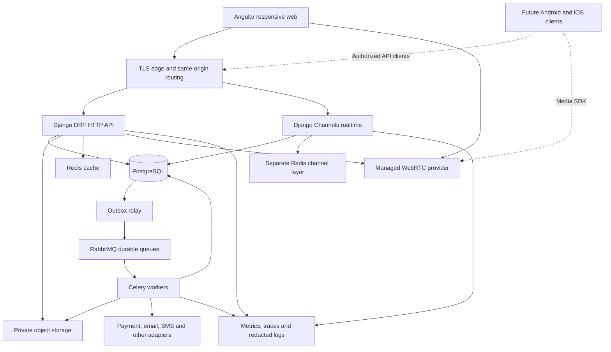

# Eduma — Architecture and Decisions

**Baseline:** 12 October 2026 · **Status:** proposed implementation architecture; not approved or implemented.

Read with [roles and tenancy](02_Roles_Tenancy_and_Permissions.md), [data model](08_Data_Model_and_Dictionary.md), [API contracts](09_API_Events_and_Integrations.md), and [decision register](14_Decisions_and_Assumptions.md). Confirmed product requirements take precedence over recommendations. All four institution categories belong in the launch product; implementation sequence does not silently remove any category.

## 1. Architectural intent

Build one centrally operated, configurable education product. The platform onboards institutions and manages service availability, entitlements and operations. Each Institution Admin manages their institution within those entitlements. Group oversight and university affiliation require explicit grants; they are not permission inheritance from an organization tree.

The proposed foundation is an Angular application, a Django/DRF modular backend and PostgreSQL. Choose a modular monolith initially so admissions, enrollment, fees and academic publication can use clear transactional boundaries without distributed transaction machinery. Separate process types for HTTP, realtime and workers do not require separate business microservices. Extract a service only when measured scale, ownership or isolation requirements justify the operational cost.

The architecture must preserve official academic and financial history, support responsive task-oriented interfaces, and make subsequent Android/iOS clients possible through stable contracts. It does not assume that a web wrapper automatically delivers reliable native incoming calls.

## 2. Proposed component map

| Component | Proposed responsibility | Explicit boundary |
|---|---|---|
| Angular + Material/CDK | Accessible components, routing, forms, design tokens, permission-aware workspaces | Menus and disabled buttons never enforce authorization alone |
| Django + DRF | Business commands, validation, permissions, transactions, REST contracts | Avoid business rules duplicated in serializers, views and jobs |
| PostgreSQL | Authoritative records, constraints, audit/outbox and transactional subledger | Redis or browser state never becomes the official balance/result |
| Channels + Redis channel layer | Presence hints, typing, message notifications, call signaling metadata | Persist messages first; channels are not a message archive |
| Celery + RabbitMQ | Imports, exports, notifications, reconciliation, scheduled work | Queue delivery is not proof of business completion |
| Separate Redis cache | Short-lived computed data and rate-limit support | Keys include institution and applicable permission/configuration version |
| Private S3-compatible storage | Images, attachments, generated documents and import files | Authorization before upload/download; no public student-document bucket |
| Managed WebRTC adapter | Audio/video rooms, participant tokens and media transport | Django is not an SFU or TURN server |
| Observability stack | Operational evidence, alerts and correlation | No message bodies, credentials or unrestricted student data in logs |

Select supported compatible stable dependency versions when implementation starts, record exact versions and lockfiles, and establish upgrade ownership. Avoid hard-coding today's newest version in a long-lived planning document. Angular publishes an explicit release/support policy; verify the selected line and dependent libraries together. [Angular release guidance](https://angular.dev/reference/releases)

## 3. Module boundaries and dependency rules

| Module | Owns | May consume |
|---|---|---|
| Platform | Institution lifecycle, service plans, entitlements, subscription records, support grants | Operational projections; not routine private academic content |
| Identity/access | Login identity, institutional membership, role grants, relationships, sessions | Institution active status and scoped policies |
| Organization/configuration | Campuses, departments, templates, typed settings and revisions | Platform entitlements; approved defaults |
| Admissions/registry | Applicants, offers, people, guardian links, enrollment, transfer | Configuration and academic catalog |
| Academic structure | Years, terms, curricula, courses, offerings, registrations, timetables | Registry and identity |
| Teaching/assessment | Attendance, assignments, assessments, results and publication | Offering assignments, rule versions and enrolled learners |
| Finance | Fee plans, invoices, concessions, receipts, allocation, refunds and reconciliation | Enrollment and approved fee rules |
| Communication | Conversations, messages, call requests, class sessions, delivery records | Membership, guardian/teaching relationships and policy |
| Institutional operations | HR, library, hostel, transport, procurement, assets, placements, research | Shared identity and accounting interfaces; each owns its records |
| Integration/reporting | Provider adapters, import/export jobs, authorized read models | Versioned domain interfaces and events |

Modules expose application services and events. A service responsible for enrollment orchestrates admission acceptance, seat allocation and enrollment inside a transaction; it does not allow unrelated modules to mutate its tables freely. Shared utilities contain identifiers, money/time value types, authorization context and observability primitives, not a second hidden domain layer.

Reporting uses reviewed query services/read models with the same data scope. A dashboard may lag and must display its freshness. Publication, payment status and seat allocation read authoritative transaction state rather than a dashboard cache.

## 4. Tenant isolation and cross-institution access

**Proposed isolation boundary: one `institution_id`.** Campus and department are scopes inside that institution. Do not introduce an interchangeable `tenant_id` that sometimes means a group, campus or institution. Independent affiliated colleges keep distinct institution IDs. One university institution can own constituent departments and campuses when governance matches that model.

Every institution-owned record has a non-null `institution_id`. Global login identities and platform commercial records are separate, deliberately global families. Institution data references use institution-aware constraints; UUID randomness is not an isolation control. Cross-institution associations exist only through named grant/exchange tables with source, recipient, purpose, allowed data, validity and revocation.

The service derives context from an authenticated membership or approved service grant, compares it with the route institution, and evaluates action, scope, relationship and record state. Body/header IDs alone do not authorize access. Group reports enumerate approved institutions and allowed measures; they do not run an unrestricted query merely because the user belongs to a group.

Add PostgreSQL row-level security as defense in depth. PostgreSQL documents that table owners normally bypass RLS, and superusers/BYPASSRLS roles bypass it; therefore ordinary application runtime accounts must neither own tables nor have those privileges. Use a separate migration owner and consider forced RLS on tenant tables. RLS is not a substitute for field, relationship or approval authorization. [PostgreSQL row security](https://www.postgresql.org/docs/current/ddl-rowsecurity.html)

Each database unit of work begins an explicit transaction, sets its verified institution context transaction-locally, performs authorized operations and ends the transaction. Missing context fails closed. Never leave institution context attached to a pooled connection. A WebSocket connection is not one long database transaction: each message handler/service call opens its own scoped unit. Workers carry institution ID plus actor/service purpose, revalidate grants and use the same transaction wrapper. Tests must alternate two institutions on reused connections, including failures and rollbacks. Backend code possessing arbitrary SQL credentials remains a trusted component; RLS limits mistakes and access paths, not every consequence of a fully compromised backend.

## 5. Authentication and client separation

Use first-party web session authentication with a Secure, HttpOnly session cookie, deliberately configured SameSite behavior, CSRF protection and restricted origins. Prefer serving `/api` behind the same origin as the Angular app. Rotate sessions at authentication/privilege changes; invalidate appropriate sessions after membership revocation. Login and recovery endpoints need their own CSRF/abuse controls, not only authenticated endpoint defaults. DRF explicitly documents CSRF requirements for session-authenticated unsafe requests and warns about login-view handling. [DRF authentication](https://www.django-rest-framework.org/api-guide/authentication/)

Privileged roles require MFA, and sensitive approval actions require recent authentication where appropriate. Authentication proves the user; authorization selects which institution, children, course offerings or records they may access. A guardian with children in two institutions switches context explicitly.

Future native clients need a separate reviewed authentication design, normally OAuth/OIDC authorization code with PKCE through the system browser and OS-protected token storage. Choose the identity provider and revocation/session model before implementing that client. Do not make browser localStorage bearer tokens the default merely to anticipate mobile. Enterprise SSO is an adapter capability, not an assumption that every institution already owns an identity provider.

## 6. Configuration and institution flexibility

Settings use registered typed definitions: key, data type, validation, scope, inheritance, default, sensitivity, permitted editors, effective date and migration behavior. Proposed precedence is non-overridable platform constraint, explicit institution policy, campus override where allowed, then default. Group templates are proposed/importable policy baselines unless a specific governance grant permits enforcement. They do not bypass institution boundaries.

Editing creates a draft revision. Validation and impact preview identify affected cohorts, forms, permissions or fee plans. Sensitive changes require approval. Publishing creates an immutable revision with effective dates and actor/reason. Existing transactions retain the rule revision they used. Rollback publishes a new revision; it does not erase change history or recalculate issued receipts/results silently.

Configuration can rename labels, add validated custom fields, choose permitted grading formulas and adjust workflows. It cannot execute arbitrary Python/JavaScript/SQL, disable tenant isolation, grant permissions the editor lacks, edit committed ledger entries, or replace academic evidence. A rule language, if adopted, must be declarative, bounded and versioned with worked examples.

## 7. Transactions, events and concurrent work

Write business state, audit metadata and an outbox event in one database transaction. A relay publishes durable work from the outbox. It may crash between publish and acknowledgment, so consumers deduplicate by event and operation IDs. After-commit callbacks are useful triggers, but callback dispatch alone is not a durable outbox. Django documents transaction and on-commit behavior; the outbox is an Eduma design choice built around those boundaries. [Django transactions](https://docs.djangoproject.com/en/stable/topics/db/transactions/)

Use optimistic `version` checks for editable resources and row locking/unique constraints for contested seats, receipt numbers and ledger posting. Return meaningful conflicts instead of last-write-wins overwrite. External network requests do not run while holding long database locks. Persist the intent, commit, call the provider, and reconcile the resulting state.

Jobs have timeout, retry classification, bounded exponential backoff, deduplication, dead-letter handling and authorized replay. Split long imports/exports from short transactional notifications so one workload cannot starve the other. Celery documents task acknowledgment and redelivery tradeoffs; configure workers around idempotent commands rather than claiming exactly-once execution. [Celery tasks](https://docs.celeryq.dev/en/stable/userguide/tasks.html)

## 8. Messaging, calls and online classes

Message submission checks membership and relationship, saves durable content and sequence number, then broadcasts a notification. Reconnecting clients fetch missing messages by sequence. Redis loss can interrupt live delivery, but must not lose acknowledged persisted messages. Channels' documented production channel-layer options inform infrastructure choice; persistence remains a separate Eduma requirement. [Channels channel layers](https://channels.readthedocs.io/en/stable/topics/channel_layers.html)

Teacher–parent and staff calls respect availability, quiet hours and permitted relationships. Student meeting participation is through teacher-hosted sessions governed by institution policy; no default student-to-student or unrestricted adult-to-student calling. Tokens are short-lived and bound to room, identity and role. Revalidate admission, revoke tokens/participants when access ends, and have a defined teacher-disconnect/end-session policy. Recording defaults off; actual provider recording and participant notices must follow the approved institution policy.

A managed media provider is proposed, not selected. Validate TURN connectivity, host controls, regional processing, accessibility, mobile SDK compatibility, webhook integrity and usage cost before commitment. Unconfigured integration must display a truthful disabled/setup-required state. A demo may use explicitly labeled synthetic call states but cannot be accepted as a working call integration.

## 9. Deployment, scaling and recovery boundaries

Use distinct development, test/staging and production environments, separate secrets and nonproduction synthetic data. Proposed deployment is containerized application process types on a managed platform with managed PostgreSQL and private networking; hosting vendor and region remain open. Begin with one suitable Indian region if contractual/provider requirements support it, while keeping timezone, locale, currency and institution residency configuration explicit.

Scale stateless HTTP and realtime processes independently. Size database connections across all replicas/workers, not per process in isolation. Separate cache and channel Redis workloads to prevent cache eviction policy or memory pressure disrupting realtime delivery. Do not add search clusters, data lakes, read replicas or Kubernetes simply because the product is described as enterprise; introduce them against evidence.

Monitor API latency/errors, database saturation and locks, queue age, outbox backlog, import failures, reconciliation lag, realtime reconnects, provider failures, storage growth and backup age. A health page distinguishes process alive, dependencies ready and actual synthetic business transaction success. Institution users see their service condition without hostnames, credentials or other institutions' metrics.

Backups, point-in-time recovery, object versioning, restore rehearsal and export are separate capabilities. Shared database recovery is a whole-system operation; selective institution recovery needs a reviewed extraction/reconciliation procedure and must not overwrite other institutions. Targets, retention and costs are proposals until agreed and tested; see [operations](10_Security_Privacy_and_Operations.md).

## 10. Architecture decision register

| ADR | Proposed choice | Alternative and tradeoff | Revisit when |
|---|---|---|---|
| A-01 | Angular + Material/CDK | React/Next adds a different frontend ecosystem; Flutter favors shared native UI but changes web implementation | Team expertise or validated UX needs favor another stack |
| A-02 | Django/DRF modular monolith | FastAPI or NestJS are viable but require equivalent admin/domain/security conventions | Team skills, measured bottleneck or service ownership changes |
| A-03 | PostgreSQL shared schema + institution keys/RLS | Schema/database per institution improves some isolation/restore properties but complicates fleet operations | Contracts require dedicated infrastructure |
| A-04 | Durable outbox, Celery/RabbitMQ | Simpler single queue is possible; distributed workflow engine adds operating and modeling cost | Cross-service durable orchestration genuinely emerges |
| A-05 | Managed WebRTC | Self-hosting improves infrastructure control but creates specialist media operations obligations | Cost/residency requirements justify staffing and testing |
| A-06 | Responsive web, then mobile feasibility study | Capacitor can reuse web technology; Flutter/native can suit deeper device integration | Device prototype establishes call, push and background reliability |
| A-07 | Fee subledger with external accounting adapter | Full general ledger/payroll product adds substantial rules and compliance | Product owner explicitly commits scope and finance ownership |

Capacitor describes a native runtime and plugin approach, not proof that every required communication feature works in every OS state. Test locked screen, terminated app, revoked microphone permission and weak-network recovery before choosing the mobile implementation. [Capacitor documentation](https://capacitorjs.com/docs)

## 11. Evidence required before calling the architecture ready

1. Confirm representative institution rules and launch module scope across all four categories.
2. Review two-institution isolation, explicit affiliation exchange and revoked-access scenarios.
3. Independently check fee/refund and academic result examples against immutable history requirements.
4. Validate component accessibility and responsive complex tables/forms against actual screen specifications.
5. Resolve hosting scale/budget, provider contracts and operating ownership; distinguish known facts from assumptions.
6. During implementation, demonstrate integration failures, concurrency, restore and mobile feasibility with evidence rather than architectural promises.

No source code, deployment or successful integration is implied by this document. Decisions become approved only through recorded review in the decision register.
