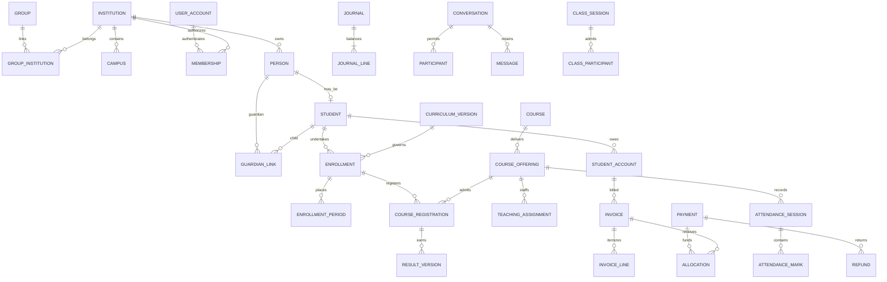

# Eduma — Data Model and Dictionary

**Baseline:** 12 October 2026 · **Status:** proposed logical schema and critical integrity contract; not a generated database or final migration specification.

Use [architecture](07_Architecture_and_Decisions.md), [business rules](03_Workflows_and_Business_Rules.md) and [API contracts](09_API_Events_and_Integrations.md) together. The dictionary defines concrete core records and boundaries for the full catalog. Detailed physical indexes and every optional module column are to be finalized with that module's implementation specification; this is not a claim of a complete production DDL schema.

## 1. Universal conventions

| Convention | Contract |
|---|---|
| Identifier | UUID primary key `id`; human codes separate and scoped |
| Institution ownership | Non-null `institution_id` on each institutional row; never interchangeable with group/campus |
| References | Institutional references constrained by `(institution_id, referenced_id)` against a unique `(institution_id,id)` target pair |
| Mutable record metadata | `created_at`, `updated_at` in UTC; actor reference; positive integer `version` incremented atomically |
| Dates | Birth, due and local academic dates use date type; instants use timezone-aware timestamps; institution timezone is an IANA identifier |
| Amounts | Fixed-precision decimal in database; proposed `numeric(20,6)` storage; currency-aware permitted precision and rounding; decimal strings + ISO currency in APIs |
| Enums | Stable machine codes with configurable display labels; allowed state changes through services |
| History | Published results, posted journals and effective configurations immutable; corrections reference originals |
| Deletion | Archive/reference protection by default for institutional masters; category-specific lawful erasure is a separate process |
| Custom fields | Versioned typed definitions and validated values; critical relational keys are never hidden inside JSON |
| Nullability | Only explicitly optional fields nullable; absence differs from zero, unknown and not applicable |

Amounts cannot be binary floating point. An INR API value has two fractional digits; a three-minor-unit currency follows its approved currency metadata. FX is an explicit conversion transaction with rate/source/time and rounding account, not implicit mixing inside one invoice or journal. Contact numbers are normalized contact attributes, never universal person identifiers. Use Unicode names without assuming all people have first/last-name splits.

## 2. Relationship overview

The diagram simplifies junctions and temporal relationships. A guardian link does not automatically grant every record category. An affiliation is deliberately absent from direct person ownership: it provides an approved exchange contract, not shared ownership of student rows.

## 3. Platform, organization and access dictionary

All institution-owned rows inherit the universal metadata unless immutable evidence uses creation-only metadata.

| Entity | Essential fields | Integrity/lifecycle |
|---|---|---|
| Institution | `id`, code, legal_name, display_name, category, country_code, timezone, base_currency, lifecycle_status | Category school/college/engineering_college/university; active state separate from billing/health |
| Group / GroupInstitution | group ID/name; group ID, institution ID, relationship, valid_from/to | Membership in group does not authorize data access |
| Campus / Department | institution, code, name, active dates; department optional parent/campus | Unique institution+code; prevent hierarchy cycles |
| AffiliationAgreement | source/recipient institution IDs, academic scope, permitted exchange types, dates, approvals | Deliberate cross-institution record; expire/revoke without deleting prior exchanges |
| UserAccount | global ID, login identifiers, credential/SSO metadata, state | Holds authentication identity; no global shared student dossier |
| Membership | institution, user ID, optional person ID, state, valid_from/to | One logical membership per institution+user; role assignments separately repeatable |
| RoleDefinition / PermissionGrant | institution, role code, revision; membership, action, scope type/IDs, validity | Editor cannot grant powers outside delegation authority; scoped references verified |
| RelationshipGrant | institution, subject, resource/relationship, permitted actions, dates, basis | Guardian/advisor access can differ per child and record category |
| SupportAccessGrant | institution, platform actor, purpose, allowed actions, approvers, expiry | Time limited; routine System Admin account is not student-content superuser |
| InstitutionEntitlement | institution, module, limit, effective dates, status | Platform allocation; distinct from institution's enabled setting |
| SettingDefinition / SettingRevision | key, type/schema, permitted scopes; scope, revision, values, status, effective_from | Immutable published revision and provenance/inheritance |
| BrandingAsset | institution, file ID, purpose, alt text, approved revision | Initial assets uploaded by onboarding admin; ongoing management delegated institutionally |

Global tables require their own access controls; lack of `institution_id` does not mean public. Explicit cross-institution tables validate both ends and only expose permitted fields. Ordinary institutional queries still run in one institution context.

## 4. People, admission and enrollment

| Entity | Essential fields | Integrity/lifecycle |
|---|---|---|
| Person | institution, full_name, preferred_name, date_of_birth optional, contact/address references | Institution-owned profile; restricted sensitive fields isolated |
| Student | institution, person ID, student_number, admission_date, state | Unique institution+student_number; person-to-student one-to-one within institution |
| GuardianLink | institution, guardian person ID, student ID, relationship, authority basis, access flags, start/end | Duplicate concurrent equivalent link prevented; verify consent/legal authority where applicable |
| Employee | institution, person ID, employee_number, joining/leaving dates, status | Unique institution+employee_number; person can also be learner/guardian |
| AdmissionCycle / PublishedApplicationForm | institution, cycle+campus/program, window, status; cycle, public slug, published revision, public field schema and notices | Public slug resolves only sanitized published configuration; no applicant, internal-review or unpublished field data |
| Application | institution, cycle, applicant person/draft profile, owner membership ID, form revision, stage, submitted_at | Self-service creation assigns institution and owner on server; submission freezes revision; owner cannot set reviewer decisions or admission outcome |
| ApplicationAuthority | institution, application, subject membership, kind (owner/guardian/delegate), allowed actions, authority basis, verified_by, valid_from/to, revoked_at | Explicit per-application authority; sharing a contact number, URL or household does not grant access |
| ApplicationSubmission / InformationRequest | application, revision, applicant-visible answers/file references, submitted_at; requested fields, due date, visible request text, response revision | Applicant edits only permitted fields in draft/requested-information state; internal review notes stored separately |
| ApplicationDocument / Review | application, file, requirement code, verification state; reviewer, decision, reason | Scanned file access scoped; reviewer cannot fabricate provider verification |
| Offer / AdmissionDecision | application, offered track, expiry, conditions; acceptance/rejection reason, approval | Seat commitment and acceptance transactionally consistent |
| Enrollment | student, track ID, program optional, curriculum revision optional, entry_date, exit_date, status | One active episode per institution+student+track; concurrent distinct programs require policy |
| EnrollmentPeriod | enrollment, academic_year ID, period_key, term optional, campus, grade/section/cohort, state | Unique enrollment+academic_year+non-null period_key; canonical period_key avoids null uniqueness gaps |
| Transfer / ProgressionDecision | source enrollment/period, target, rule revision, outcome, reason, approver | Prior enrollment preserved; cross-institution transfer imports approved evidence separately |

`Enrollment` describes a study-track episode; `EnrollmentPeriod` describes its placement during an academic year/term. This prevents duplicating a student's identity each year. The active-episode constraint excludes draft/rejected/historic episodes. A repeat-year learner receives a new period with explicit repeat status rather than a duplicate active episode. Registration and result history remain attached to the original episode/period.

Admission source records may begin without an institutional Student row; conversion links the application to a verified Student/Enrollment exactly once. Duplicate detection assists review; it does not automatically merge people based only on names or phone numbers.

The public `/apply/{institution_slug}/...` journey reads only an active published admission form. After authentication, a server-controlled creation operation resolves its institution/cycle, creates or reuses a limited applicant membership and records the application owner in the same transaction. That membership grants only applicable `application.own_create`, `application.own_view`, `application.own_edit`, `application.own_submit` and `application.own_accept` actions on owned or explicitly delegated applications. It never grants student-directory, employee or institution-configuration access. An applicant person may be a child represented by an authorized guardian; the submitting login identity and the prospective learner are separate fields. Guardian/delegate authority is purpose-specific, verified as policy requires, revocable and audited; adult-student authorization follows the approved policy. Staff-created unclaimed applications have no applicant access until a verified ownership claim/invitation completes.

Applicant acceptance acknowledges an existing approved offer; it cannot approve its own admission. `application.review` and `application.request_information` belong to scoped staff, while `admission.approve` controls the decision/offer authorization. Internal notes, risk indicators, reviewer identities where restricted and deliberations remain staff-only in list, detail, export, attachment and notification projections. Application UUIDs and routes are identifiers, not ownership evidence.

## 5. Academic structure, learning and official results

| Entity | Essential fields | Integrity/lifecycle |
|---|---|---|
| AcademicYear / Term | institution, code, local start/end dates; year ID, kind, ordinal | End >= start; overlaps governed by institutional calendar policy |
| GradeLevel / Section / Cohort | institution, code/name; period/campus; intake and track | School grade and HE program remain distinct concepts |
| Program / CurriculumVersion | code, qualification, department; program, regulation code, revision, effective cohort, status | Published curriculum immutable; new regulation creates revision |
| Course / CurriculumCourse | course code/title/type/credits; curriculum, course, category, term recommendation, prerequisites | Unique institution+course code; curriculum relation carries versioned rules |
| CourseOffering | course, term, campus, delivery_group, capacity, status | Code unique institution+term; capacity >= confirmed registration count |
| TeachingAssignment | offering, employee/membership, teaching role, valid dates | Authorization follows active assignment; multiple instructors allowed |
| CourseRegistration / CourseAttempt | enrollment, offering, state, approved_at; enrollment, course, attempt_no, registration, outcome | One registration per enrollment+offering; attempt numbers unique per enrollment+course |
| TimetableSlot | term, room, instructor, offering/section, recurrence, exception dates | Room/instructor collision checked across actual occurrences |
| AttendanceSession / Mark | offering/section, local_date, slot, policy revision; session, learner enrollment, code, reason | One session per scope/date/slot; one mark per session+enrollment; unmarked is not absent |
| AttendanceCorrection | mark ID, previous/new value, reason, requester/approver | Preserve original and correction history after lock |
| Assignment / Submission | offering, deadline, rubric revision; learner registration, attempt, files, submitted_at | Late policy and extensions explicit; no overwrite of assessed submission |
| Assessment / Component / Mark | offering, scheme revision, publication scope; weight/max/pass rules; component, registration, score/status | Absent/exempt/withheld distinct from numeric zero; validations against max and revision |
| ResultVersion / PublicationBatch | registration, revision, calculated totals/grade/credits, inputs hash, rule revision; scope, approver, published_at | Immutable after publication; correction supersedes while preserving prior version |
| OutcomeMapping / AttainmentRun | curriculum/course outcomes, assessment mappings; revision, method, inputs and calculation | Engineering OBE result traceable to marked evidence, not manually claimed accreditation |
| Award / Transcript | enrollment, approved qualification, issue date, document ID, verification token | Issued artifact preserved; revoke/reissue explicitly with reason |

School reporting aggregates subject outcomes for a period. Higher education adds attempted/earned credits, prerequisites, elective capacity and repeat rules. Engineering adds laboratory, project, internship and outcome evidence. University central examinations/awards consume explicitly approved affiliation exchanges. One generic `marks` JSON field cannot encode these distinctions safely.

Academic rounding occurs at defined calculation stages, never wherever a UI happens to display fewer digits. Store raw marks and method/rule revision. Publish is an atomic state transition for the intended batch, or an explicitly represented partial batch with unresolved records; never silently omit failures.

## 6. Fee subledger: exact financial contract

Eduma's proposed core is an institutional fee subledger, not a complete statutory general ledger. A qualified finance owner must approve account mapping and treatment; student fees and Eduma subscription billing are separate books.

| Entity | Essential fields and constraint |
|---|---|
| StudentAccount | student, currency, status; unique institution+student+currency |
| FeePlanVersion | fee heads, schedule, rounding, concessions policy, effective cohort; published immutable |
| Invoice / InvoiceLine | account, number, issue/due dates, currency, state; head, quantity, amount, tax treatment reference; issued lines immutable |
| CreditNote | original invoice/line, amount, concession/cancellation reason, approver, posting journal; positive reduction, never a receipt |
| Payment | account, amount/currency, channel, provider/account IDs, external transaction ID, state; external uniqueness scoped to provider account |
| Allocation / AllocationReversal | payment, invoice, positive amount, posted journal; original allocation, reversed amount/reason |
| Receipt | payment, institution sequence, issued_at, immutable document/hash; unique receipt number and source issuance operation |
| Refund | payment, amount, reason, request/approval, provider_ref, state; sum successful/reserved refunds cannot exceed refundable amount |
| RefundAllocationReversal | refund, original allocation, amount; ties reopened invoice debt to particular refund |
| Journal / JournalLine | source type/ID, posting key, date, currency, state; account, debit/credit, student/invoice dimensions |
| Settlement / SettlementLine | provider batch, bank reference, gross, fee, tax, net; linked payment/refund/chargeback IDs |
| ReconciliationCase | source reference, expected/observed amount, discrepancy, assignee, resolution evidence |

Every posted journal has at least two lines, each line has exactly one positive debit or credit, and total debits equal total credits in one currency. Posting is transactional and has a unique source-operation key. Enforce balancing in the posting service plus a database-level deferred verification/controlled posting mechanism; a simple row check cannot validate a multi-row sum. Posted journals are append-only under runtime permissions. Reversal journals identify the original; no direct update/delete endpoint exists.

Proposed account classes: student receivables (asset), provider clearing/bank/cash (asset), unapplied student funds (liability), fee income, concession/fee reversal (contra-income or approved mapping), provider expense and rounding. Final income-recognition and tax policy are configurable approved mappings, not legal assumptions.

| Operation | Debit | Credit |
|---|---|---|
| Issue charge 10,000 | Student receivable 10,000 | Fee income 10,000 |
| Approved concession credit 1,000 | Concession/reversal account 1,000 | Student receivable 1,000 |
| Confirm receipt of 6,000 | Provider clearing/cash 6,000 | Unapplied student funds 6,000 |
| Allocate payment 6,000 | Unapplied student funds 6,000 | Student receivable 6,000 |
| Refund 1,000 of allocated money: first reverse allocation | Student receivable 1,000 | Unapplied student funds 1,000 |
| Complete refund 1,000 | Unapplied student funds 1,000 | Provider clearing/cash 1,000 |

For one invoice, `net_charges = issued_charges − posted_credit_notes`; `net_allocated = posted_allocations − posted_allocation_reversals`; `outstanding = net_charges − net_allocated`. Enforce `0 <= net_allocated <= net_charges`. The example therefore moves from 9,000 net charges to 3,000 outstanding after payment, then **4,000 outstanding after the refund**. A refund does not forgive the charge. Reducing the charge requires a separate approved credit note. Do not subtract refunds a second time after already reversing their allocations.

Payments exceeding charge balances remain unapplied liability. Refunds consume unapplied funds first or explicitly reverse specified allocations; policy determines the selection, with user-visible impact preview. Refund requests reserve refundable capacity under lock. Pending/failed provider refunds do not prematurely post completed cash movement. Approved credit notes that reduce charges below existing allocations must deallocate the excess into unapplied funds atomically; refunding that balance is a separate operation. Chargebacks are distinct provider adjustments with dispute state, allocation reversal and journal evidence, not deletion of the original payment.

A browser payment-success redirect cannot create a `succeeded` payment. Trusted provider confirmation/reconciliation does. Bank settlement is separate: provider settlement moves clearing to bank and records fees; it does not collect the student's fee again. Invoice balances reconcile to the receivable subledger, and unapplied balances to liabilities. Never combine invoice totals and journal totals as if both were new revenue.

## 7. Communication, files and operational evidence

| Entity | Essential fields and constraint |
|---|---|
| Conversation / Participant | kind, policy revision, context; membership, joined/left, permitted history window |
| Message | conversation, sender, monotonic sequence, client_message_id, body/file references, state; unique conversation+sequence and sender+client_message_id |
| MessageReceipt | message, participant, delivered/read timestamps; separate delivery from read acknowledgment |
| CallRequest | participants, policy revision, requested/expiry time, state, provider room reference; permitted teacher-parent/staff relationships only |
| ClassSession / ClassParticipant | offering/cohort, host assignment, start/end, policy revision, room; attendee role, admitted/joined/left, evidence source |
| FileObject | institution, opaque object key, original_name, MIME, byte size, checksum, scan state, classification, uploader |
| AuditEvent | actor/service, institution, action, resource, time, reason, safe before/after summary, trace ID; append-only |
| OutboxEvent / ConsumerReceipt | event ID/type/schema/resource/version/payload; consumer ID+event ID unique |
| ImportJob / ImportRow | file, template revision, scope, mode, status, totals; source key, normalized values, validation errors and resulting ID |
| ExportJob | requester, allowed scope, filter snapshot, status, file/expiry; permission rechecked at creation and download |

Message content and recordings have separate access/retention rules from operational call duration. File rows must pass malware/content validation before becoming downloadable attachments. A user-controlled file name never becomes the storage key or authorization rule.

## 8. Full-catalog operational entity boundaries

L1/L2 sequencing is a proposal for dependency order, not permission to omit the full web catalog. These records need their own business/UI/acceptance contracts before their slice is called complete.

| Domain | Records with required links | Critical invariants |
|---|---|---|
| Library | BibliographicItem, Copy(barcode), Loan(copy,borrower,due), Reservation, Fine | One active loan per copy; return/reversal auditable; fine integrates fee subledger |
| Transport | Vehicle, Route, Stop, StudentRouteAssignment, Trip, BoardingEvent, Handover | Valid assignment and authorized pickup; location not public; corrections retain safety evidence |
| Hostel/mess | Hostel, Room, Bed, Allocation(student,start/end), LeavePass, MealPlan | No overlapping confirmed occupancy per bed; capacity and release dates enforced |
| HR/leave/payroll | EmployeeContract, LeavePolicyVersion, LeaveRequest, LeaveBalanceEntry, PayrollRun, Payslip, PayrollExport | Approved leave and balance postings atomic; payroll revisions/approval separated from external accounting export |
| Procurement/assets | Supplier, Requisition, PurchaseOrder, GoodsReceipt, StockMovement, Asset, CustodyAssignment, Maintenance | Receipt cannot exceed permitted ordered quantity; immutable stock movements and custody history |
| Laboratory booking | Laboratory(campus,department,capacity), LabResource(lab,asset/exclusive resource), LabBooking(requester,offering/purpose,start/end,participants,state,policy revision), BookingResource, BookingApproval, UsageIncident | Institution-aware references; end after start; approved bookings cannot exceed capacity or overlap exclusive resources; qualifications/safety approvals and cancellations recorded |
| Placement/internship | Employer, Opportunity, EligibilityRule, StudentApplication, Offer, Internship, Evaluation | Access limited to consent/purpose; no public student CV directory |
| Services/grievance/wellbeing | ServiceCase(case_type,requester,subject,classification,state,assigned team,policy revision), CaseParticipant, CaseNote(visibility), AssignmentHistory, Escalation, Resolution, Appeal | Case-specific permissions; ordinary academic roles have no blanket access; requester-visible and internal notes have separate projections and file grants |
| Research | ScholarEnrollment, SupervisorAssignment, Milestone, EthicsApproval, Grant, Disbursement | Approval validity and evidence traceable; grant accounting via approved adapter/subledger boundaries |
| Accreditation | EvidenceItem, CriterionMapping, ReviewCycle, SubmissionSnapshot | Evidence versions preserved; export is not a certification claim |

Lab booking corresponds to SCR047 and requires `lab_booking.create` for eligible requests and `lab_booking.approve` for scoped approval. A request is not an approved reservation. Approval transactionally checks the current timetable, resource availability and prerequisites; a stale availability preview cannot authorize an overlap. Staff override, when allowed, records the reason and accountable approver rather than editing conflict evidence away.

Generic services and grievances share the `ServiceCase` aggregate for SCR049, discriminated by `case_type` and classification. `service_case.create/read/update/assign/resolve/appeal` each retain actor, relationship, state and case-scope checks. A requester can update only permitted submission fields or visible replies; assignment, internal triage, resolution and appeal outcomes use their authorized commands. `CaseNote.visibility` is an allowlisted audience such as `requester_visible` or `internal`; server-side serialization, search, counts, attachments, exports and notifications honor that audience. Restricted safeguarding/health cases can narrow staff visibility further. An appeal creates new review evidence and never overwrites the original resolution.

## 9. Indexing, retention and verification

Start with institution-prefixed access-path indexes for status/date lists, parent relationships, offering registrations, unread conversation sequence and outstanding reconciliation. Foreign-key indexes, selective unique constraints and query plans must be reviewed using realistic volume. Partition only when measured volume/lifecycle warrants it; partitioning complicates uniqueness and operational recovery.

Classify data as public branding, internal operations, personal educational, restricted welfare/health, financial, credential/security or operational telemetry. Define retention per category, contract and applicable law in [security/operations](10_Security_Privacy_and_Operations.md). Archived is not erased; backup expiry is not immediate deletion. Legal holds and official financial/academic retention can limit erasure and require restricted processing rather than blind cascade deletion.

Mandatory schema tests include cross-institution references rejected; active enrollment duplicates rejected; repeated course attempts preserved; concurrent seat allocation bounded; duplicate payment confirmation posted once; refund math above reconciled; published results immutable; membership revocation respected by export/file jobs; applicant ownership cannot be reassigned through submitted fields; revoked delegates lose application/file access; conflicting lab approvals cannot both succeed; internal case notes cannot enter requester-visible outputs; and selective restore preserving other institutions. Use synthetic fixtures covering all four institution categories and an independently governed affiliated college.
