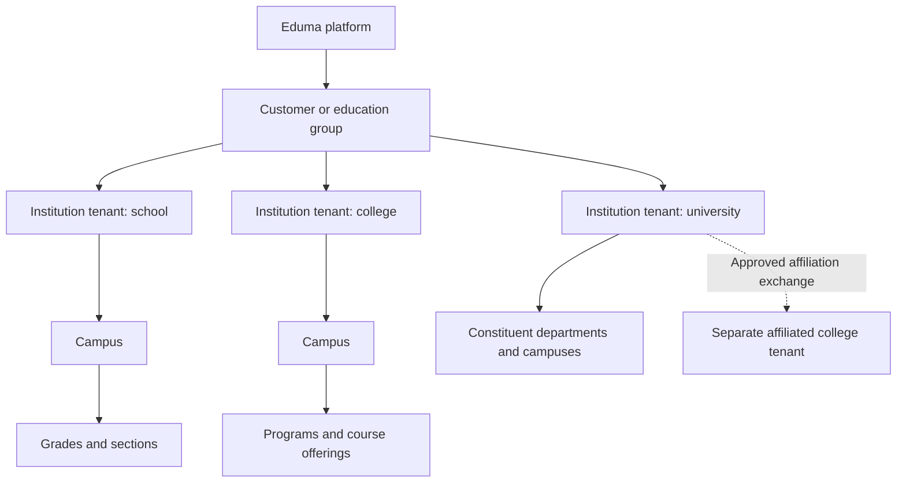
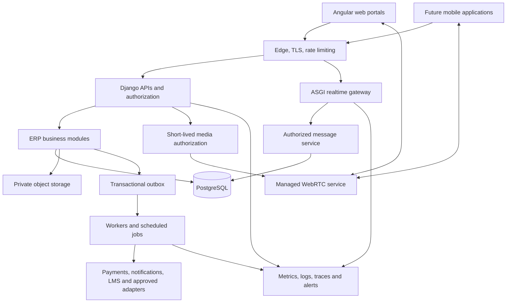

# Eduma — Enterprise Education ERP Knowledge Document

> **Pack context:** This is the source-linked research baseline preserved from the earlier planning work. Use [00](00_README.md) for the consolidated handoff and [14](14_Decisions_and_Assumptions.md) for confirmed decisions and open proposals. The detailed specifications 01–13 refine this baseline; its suggested phases, defaults and references do not constitute design approval, successful tests or implementation evidence. Time-sensitive legal, provider and version facts need revalidation before dependent implementation or launch.

**Version:** 1.0 — research and product-planning baseline  
**Prepared:** 12 October 2026  
**Initial market:** India, with international expansion  
**Launch institution types:** Schools, colleges, engineering colleges, and universities  
**Deliverable:** Knowledge document only; no application project has been generated.

### Contents

- [1. Purpose, confirmed requirements, and recommendations](#1-purpose-confirmed-requirements-and-recommendations)
- [2. Research findings and product positioning](#2-research-findings-and-product-positioning)
- [3. Organization, tenancy, and academic structure](#3-organization-tenancy-and-academic-structure)
- [4. Identity, roles, and authorization](#4-identity-roles-and-authorization)
- [5. System Admin console — complete operational scope](#5-system-admin-console--complete-operational-scope)
- [6. Institution onboarding, activation, and offboarding](#6-institution-onboarding-activation-and-offboarding)
- [7. Institution Admin workspace](#7-institution-admin-workspace)
- [8. Dynamic configuration without customer-specific code forks](#8-dynamic-configuration-without-customer-specific-code-forks)
- [9. Shared functional catalog](#9-shared-functional-catalog)
- [10. School-specific academic requirements](#10-school-specific-academic-requirements)
- [11. College, engineering college, and university requirements](#11-college-engineering-college-and-university-requirements)
- [12. In-app messaging, calling, and teacher-led online classes](#12-in-app-messaging-calling-and-teacher-led-online-classes)
- [13. Representative end-to-end workflows](#13-representative-end-to-end-workflows)
- [14. Dashboards, reporting, and metric definitions](#14-dashboards-reporting-and-metric-definitions)
- [15. Stack recommendation and alternatives](#15-stack-recommendation-and-alternatives)
- [16. Logical architecture and module boundaries](#16-logical-architecture-and-module-boundaries)
- [17. Multi-tenant isolation and core data model](#17-multi-tenant-isolation-and-core-data-model)
- [18. Mobile strategy and client experience](#18-mobile-strategy-and-client-experience)
- [19. Integration strategy and India-specific ecosystem](#19-integration-strategy-and-india-specific-ecosystem)
- [20. Privacy, security, and compliance planning](#20-privacy-security-and-compliance-planning)
- [21. Reliability, recovery, and operational standards](#21-reliability-recovery-and-operational-standards)
- [22. Data migration and institutional adoption](#22-data-migration-and-institutional-adoption)
- [23. Commercial model, usage, and cost planning](#23-commercial-model-usage-and-cost-planning)
- [24. Delivery plan that supports all institution types at launch](#24-delivery-plan-that-supports-all-institution-types-at-launch)
- [25. Acceptance criteria and enterprise readiness](#25-acceptance-criteria-and-enterprise-readiness)
- [26. Risks, unresolved decisions, and next planning artifacts](#26-risks-unresolved-decisions-and-next-planning-artifacts)
- [27. Requirement traceability](#27-requirement-traceability)
- [28. Glossary and research notes](#28-glossary-and-research-notes)

## 1. Purpose, confirmed requirements, and recommendations

Eduma is a centralized education platform that onboards independent institutions, education groups, universities, campuses, and affiliated colleges. It combines a student information system (SIS), academic administration, institutional operations, communication, and enterprise platform management.

### 1.1 Confirmed requirements

| Area | Agreed direction |
|---|---|
| Product name | Eduma |
| Market | India first; architecture supports international expansion |
| Initial segments | Schools, colleges, engineering colleges, and universities together |
| Central administration | Eduma System Admin onboards institutions, uploads initial institution images/details and Institution Admin information, and activates or deactivates institutions |
| Institutional ownership | Institution Admin manages institution operations, branding, academic configuration, users, and institution feature settings |
| Organizational structure | Education groups, multiple campuses, and affiliated colleges under appropriately authorized central accounts |
| Communication | Teacher–parent communication, staff communication, and teacher-conducted student meetings for online classes, controlled by institution policy |
| Client platforms | Web first; Android and iOS later |
| Proposed stack | Angular + Django + PostgreSQL; evaluate alternatives before implementation |
| Flexibility | Configurable fields, workflows, roles, academic rules, templates, and modules |

### 1.2 Recommended product direction

Keep **Angular + Django REST Framework + PostgreSQL** as the default. Build one modular product with a shared foundation and institution-specific academic capabilities. Evaluate **Ionic + Capacitor** for mobile reuse through an early calling prototype. Use managed WebRTC infrastructure for calls and classes unless scale, residency, or contractual requirements justify operating it yourselves.

The distinction between the two admin levels is fundamental:

- **Eduma System Admin:** Operates the platform, commercial entitlements, onboarding, availability, security, and technical support.
- **Institution Admin:** Operates their institution and configures features available to it. They can delegate scoped responsibility to campus, department, academic, finance, and other administrators.

“Everything editable” should mean **controlled configuration**, with validation, history, approval, and rollback. It must not allow arbitrary changes to issued receipts, published results, audit evidence, tenant boundaries, or security controls.

### 1.3 How to read this document

The requirements below are **proposed Eduma requirements**, synthesized from research and the confirmed product scope. They are not claims that every competitor provides every feature. Source-backed facts have links near the relevant discussion. Numeric service targets are planning proposals, not measured performance or contractual promises.

This is a comprehensive baseline, not a claim that every board, university regulation, or jurisdiction is fully specified. Detailed rules must be validated with representative institutions before development.

## 2. Research findings and product positioning

School ERP products commonly connect admissions, student records, attendance, timetables, examinations, fees, HR, transport, library, hostel, communication, and reports. Higher education adds program and curriculum management, course registration, progression, institutional examinations, and graduation. Learning management adds teaching content, assignments, quizzes, and learning activity. Eduma needs clear ownership across these overlapping areas.

For example, Fedena's official feature catalog includes core school operations, communication, finance, transport, hostel, library, and multi-school capabilities. These are useful baseline categories, not evidence of implementation quality or a recommendation to copy the product. [Fedena feature catalog](https://fedena.com/feature-tour)

Outcome-based education introduces a separate need to map course outcomes, program outcomes, and assessments. Eduma should preserve the underlying evidence and approved calculation method. [Academia ERP OBE overview](https://www.academiaerp.com/faq/how-does-an-academic-erp-help-automate-outcome-based-education/)

Additional reference models help define boundaries: Frappe Education links student records to guardians, enrollment, attendance, assessment and fees; Moodle documents course-management workflows; Ellucian emphasizes higher-education advising and degree planning. Eduma should own authoritative institutional records and explicitly define any LMS integration boundary. [Frappe Education student model](https://docs.frappe.io/education/student), [Moodle course management](https://docs.moodle.org/en/Managing_a_Moodle_course), [Ellucian SIS](https://www.ellucian.com/products/student/student-information-systems)

Recommended differentiation for Eduma:

1. One coherent platform across school and higher education, with distinct academic models.
2. Institution-controlled configuration that does not require customer-specific code forks.
3. Strong separation of institutional data, including within groups and affiliations.
4. Integrated parent communication and teacher-led classes with clear permissions.
5. Reliable finance reconciliation, examination auditability, and migration tools.
6. Operational visibility and automation that reduce onboarding and support effort.
7. India-ready reporting and identifiers, with integration availability represented honestly.

## 3. Organization, tenancy, and academic structure

### 3.1 Do not treat organization hierarchy and data access as the same thing

| Concept | Meaning in Eduma | Example |
|---|---|---|
| Platform | The complete Eduma service | All customers and shared operations |
| Customer/group account | Commercial or management relationship | A trust operating 12 institutions |
| Tenant | A contractual and data-isolation boundary | One independently administered college |
| Institution | An education organization | School, engineering college, university |
| Campus | A physical or administrative location | North campus and city campus |
| Faculty/school within a university | Academic organizational unit | School of Engineering |
| Department | Academic or administrative unit | Computer Science, Finance |
| Program | Qualification or structured course of study | B.Tech CSE, B.Com, M.Sc |
| Curriculum/regulation version | Rules applying to an intake/cohort | B.Tech CSE 2026 regulations |
| Course/subject | A taught academic unit | Mathematics VIII or Data Structures |
| Course offering | A course delivered in a particular term | Data Structures, semester 3, section A |
| Cohort/batch | Students grouped by intake or academic progression | B.Tech 2026 intake |
| Class/section | School grouping or teaching section | Grade 8, section B |
| Affiliation | An academic relationship with another institution | College affiliated to a university |

**Default:** an independently governed institution is a tenant; campuses sit within that tenant. A university with constituent units may be one tenant when governance and contractual responsibilities align. An independently governed affiliated college normally remains a separate tenant.

A central group or university account receives explicit grants for approved cross-institution functions. Affiliation alone never grants unrestricted access to student records, finance, messages, or employee data. A group contract can cover multiple tenants without merging their databases logically.

### 3.2 Recommended relationship model

### 3.3 Academic modeling rules

- Support annual, semester, trimester, and other approved term structures.
- Keep academic year, financial year, admission cycle, and examination cycle separate.
- Store dates and timestamps appropriately: a date of birth is a date; a meeting is a timezone-aware event.
- Version curricula and grading schemes by cohort, effective date, and institution.
- Provide academic-year/term rollover with preview, exception lists and approval. Carry forward approved enrollments, balances and assignments without rewriting historical records; handle repeaters, leavers and unresolved results explicitly.
- A student can have multiple enrollments over time; a person record is not the same as an enrollment.
- Cross-listed courses, shared electives, transfers, repeat courses, and changing regulations require explicit relationships.
- Use configurable labels in the interface without changing the underlying meaning of entities.

## 4. Identity, roles, and authorization

### 4.1 Platform roles

| Role | Responsibility | Default boundary |
|---|---|---|
| Platform Owner / Super Admin | Platform governance and privileged administration | Small, named group with MFA; emergency access is audited |
| System Operations Admin | Service health, deployment visibility, incidents, capacity | Operational metadata; no routine academic-record editing |
| Institution Onboarding Admin | Provisioning, branding setup, import coordination, admin invitations | Assigned institutions; no unrestricted finance or message access |
| Support Agent | Tickets and approved troubleshooting | Masked information; time-limited support access when justified |
| Platform Billing Admin | Eduma subscriptions, invoices, plans, quotas | Platform commercial records, separate from student fees |
| Security / Privacy Officer | Security events, access reviews, privacy requests, breach coordination | Approved investigations and audit evidence |
| Platform Auditor | Review platform controls and changes | Read-only, scoped, time-limited access |

“System Admin” can initially group these duties in the interface, but permissions must support separation as the company grows.

### 4.2 Institution and group roles

| Role | Principal functions |
|---|---|
| Group Management / Trust / University Management | Approved consolidated dashboards, policies, shared services, oversight |
| Institution Admin | Institution setup, modules, users, permissions, workflows, branding, integrations |
| Campus Admin | Campus operations within delegated scope |
| Principal / Director / Vice Chancellor | Leadership dashboards and designated academic/administrative approvals |
| Registrar / Academic Office | Official enrollment, regulations, progression, transfers, academic records, awards |
| Dean / Head of Department / Program Coordinator | Department programs, workload, curriculum, course offerings, approvals |
| Academic Coordinator / Timetable Officer | Academic calendar, scheduling, substitutions, room allocation |
| Teacher / Faculty | Assigned teaching, attendance, content, assessments, parent communication, classes |
| Class Teacher / Mentor / Advisor | Assigned cohort welfare, consolidated progress, mentoring, parent coordination |
| Admissions Officer | Enquiries, applications, document checks, eligibility, offers, admission |
| Examination Controller / Exam Cell | Exam setup, eligibility, scheduling, evaluation, moderation, publication |
| Evaluator / Moderator / External Examiner | Assigned assessment tasks with restricted identity/result visibility |
| Finance Manager / Accountant | Fee plans, reconciliation, accounting, concessions and refund approvals |
| Cashier | Authorized collections and receipts; separate approval for refunds/reversals |
| HR / Payroll Officer | Employee records, leave, contracts, payroll processing |
| Librarian | Catalog, circulation, reservations, fines, inventory |
| Transport Manager / Driver / Attendant | Routes, vehicles, assigned trips, safe boarding and handover |
| Hostel Warden / Mess Manager | Allocation, leave, attendance, visitors, meals, issues |
| Store / Procurement / Asset / Lab Manager | Purchasing, stock, assets, bookings, maintenance, laboratory resources |
| Counselor / Health Officer | Restricted wellbeing or medical records and referrals |
| Placement / Internship / Alumni Officer | Employers, opportunities, applications, internships, alumni relations |
| Research Office / Supervisor | Research scholars, supervision, milestones, grants and ethics workflows |
| IQAC / Accreditation Coordinator | Evidence collection, reporting, outcome assessment, review cycles |
| IT / Integration Admin | Institution SSO, devices, import/export and integration settings within scope |
| Grievance / Safeguarding Officer | Confidential case routing and case-specific access |
| Student | Own academic and service records; teacher-led class participation |
| Parent / Guardian | Specifically authorized children and permitted interactions |
| Applicant / Applicant Guardian | Own application and admission tasks |
| Auditor / Inspector | Approved read-only records for a defined period |
| Vendor / Recruiter / Guest | Narrow portal access for assigned transactions or meetings |

Roles are templates. Institutions may rename roles and create combinations using approved permissions. A job title alone never grants access.

### 4.3 Permission design

Evaluate access using **role + action + institution/campus/department scope + relationship + record state**. Examples:

- A teacher marks attendance only for assigned offerings and allowed dates.
- A guardian sees only linked children, with separate permissions for fees, records, communication, and pickup.
- A faculty evaluator edits draft marks for assigned scripts but cannot publish final results alone.
- A finance user may create a refund request while a different authorized user approves it.
- A group manager can see approved aggregates without automatically seeing counseling notes.

Support view, create, edit, approve, publish, export, delete/archive, configure, and impersonation/support-session permissions separately. Enforce them in APIs, WebSockets, background jobs, reports, search, and file downloads, not only menus.

Default protections:

- Deny access unless explicitly granted; do not let admins grant permissions they do not control.
- Require MFA for privileged accounts; re-authenticate for sensitive changes.
- Prevent removal of the last active Institution Admin without an approved recovery path.
- Detect conflicting duties, especially refunds, payroll, bank details, and examination publication.
- Make temporary assignments expire automatically; revoke access when employment or enrollment ends.
- Keep multiple institutional memberships separate, even if one user has one login.
- Do not use a shared family phone number as the sole student or guardian identity key.
- For adult students, parent access must follow approved authorization and applicable rules; fee payment alone does not grant full academic access.

### 4.4 Selected authority matrix

| Action | System Admin | Institution Admin | Domain officer | Teacher / guardian / student |
|---|---|---|---|---|
| Create or suspend tenant | Authorized platform role | Request only | No | No |
| Set commercial module entitlement | Authorized platform role | View/request | No | No |
| Enable entitled institution module | Set availability/override with reason | Yes | If delegated | No |
| Change academic rules | Provide versioned templates | Authorize | Configure within scope | No |
| Edit student information | Approved support procedure only | Scoped authority | Assigned records | Own permitted fields/request corrections |
| Publish results | No routine authority | Designated approval only | Exam authority | View published own/linked records |
| Read private conversation content | No blanket access | No blanket access | Approved safeguarding case only | Authorized conversation participants |
| View service infrastructure health | Yes | Institution service status only | No | Status notice if relevant |
| Delete audit trail | No ordinary role | No | No | No |

## 5. System Admin console — complete operational scope

### 5.1 Institution portfolio and lifecycle

- Search and filter institutions by type, group, status, location, plan, onboarding stage, account owner, and health.
- Create institutions and group/campus relationships; prevent duplicate institutions and identifier conflicts.
- Upload initial logos, banners, campus images, institution metadata, and primary admin details.
- Invite, replace, or recover Institution Admin accounts through verified workflows.
- Activate, place into maintenance, restrict, suspend, archive, reactivate, and offboard institutions with reason and effective time.
- Set plan entitlements, user/student/storage limits, communication quotas, trial periods, and authorized add-ons.
- View onboarding progress, data import quality, training status, support cases, and renewal readiness.
- Support controlled bulk actions with preview, impact counts, exclusions, and audit history.

### 5.2 Product configuration and release management

- Maintain institution-type starter templates and a module/dependency catalog.
- Separate commercial entitlements from release flags and security emergency switches.
- Stage rollouts by internal test tenant, pilot cohort, institution type, region, and general release.
- Track schema/configuration compatibility, migration status, release version, rollback readiness, and affected tenants.
- Maintain notification templates, supported languages, approved integration providers, default policies, and feature documentation.
- Give institutions advance visibility of changes that affect their workflows.
- Publish maintenance notices and product updates through approved communication workflows.

### 5.3 Support, audit, and incident operations

- Ticketing with institution, severity, module, owner, SLA clock, attachments, and diagnostic correlation ID.
- Institution-visible support history and escalation path.
- Time-limited support sessions with reason, approver where required, visible banner, and action log.
- Read-only diagnostics first; no unrestricted “login as anyone” button.
- Incident register with impact, start/end times, affected services/tenants, actions, and follow-up tasks.
- Security event review, suspicious login patterns, role changes, bulk exports, and unusual tenant activity.
- Consent/privacy request tracking and legal-hold administration through authorized workflows.
- Audit export with integrity verification and restricted delivery.

### 5.4 Health and capacity dashboard

Monitoring should combine user experience and service internals. Google's SRE guidance emphasizes latency, traffic, errors, and saturation; OpenTelemetry supplies traces, metrics, and logs that can be correlated during investigation. [Google SRE monitoring](https://sre.google/workbook/monitoring/), [OpenTelemetry signals](https://opentelemetry.io/docs/concepts/signals/)

The following is the proposed Eduma monitoring catalog:

| Area | Required signals | Operational response |
|---|---|---|
| User journeys | Login, attendance save, fee receipt, result view, message delivery, class join | Detect a broken workflow even if servers are running |
| Frontend | JavaScript errors, page load, failed requests, stale client versions | Identify browser/device/release regressions |
| API/backend | Request rate, p50/p95/p99 latency, error rate, timeouts, worker utilization | Route-specific diagnosis and bounded scaling |
| Hosts/containers | CPU, memory, restarts, disk, network, deployment health | Capacity alerts and resource correction |
| PostgreSQL | Connections, pool wait, slow-query fingerprints, locks, deadlocks, transaction age, replication lag, storage growth | Diagnose contention, query regressions, exhaustion |
| Database maintenance | Vacuum/analyze status, backup freshness, WAL archive failures, restore-test status | Prevent hidden recovery and maintenance failures |
| Cache | Hit rate, memory, evictions, latency, unavailable cache behavior | Detect inefficient caching and dependency failures |
| Background work | Queue depth, oldest-job age, retries, failed jobs, scheduler heartbeat | Avoid silently delayed reminders, reports, imports |
| WebSockets/chat | Active connections, rejected authorization, reconnects, delivery delay | Detect communication degradation |
| Calls/classes | Join success, setup time, packet loss, jitter, drop rate, relay/media usage | Distinguish app issues from device/network/provider issues |
| Storage/CDN | Per-tenant usage, growth, failed uploads, malware scan backlog, download errors, egress | Quota warnings, capacity planning, cost control |
| Integrations | Provider status, webhook age, signature failures, retries, rate limits, credentials nearing expiry | Escalate delayed payments, messages, or record exchange |
| Security | Privileged changes, failed logins, anomalous downloads, scan findings, key/certificate expiry | Route security events without exposing sensitive content |
| Business | Active institutions, onboarding completion, adoption, support burden, quota use, collections for Eduma subscriptions | Prioritize customer and product work |

PostgreSQL exposes activity/statistics views, while `pg_stat_statements` provides planning and execution statistics useful for query diagnosis. Limit access to these diagnostics and redact query content where necessary. [PostgreSQL statistics](https://www.postgresql.org/docs/current/monitoring-stats.html), [pg_stat_statements](https://www.postgresql.org/docs/current/pgstatstatements.html)

Show **healthy, degraded, unavailable, maintenance, and unknown/stale** states with last-check time and affected capabilities. A green database ping is not proof that fee collection or examination publication works.

### 5.5 Automation that reduces manual work

- Idempotent tenant provisioning with resumable steps and cleanup of failed partial provisioning.
- Scheduled quota forecasts and notices before storage or communication limits are reached.
- Retry recoverable jobs with bounded backoff; route repeated failures to a review queue.
- Automatically reconcile successful provider events that arrived late.
- Detect expired integrations, missed schedules, stale imports, and overdue onboarding tasks.
- Automate backups, integrity checks, restore drills, and evidence collection.
- Expire temporary access and request periodic privileged-access reviews.
- Trigger approved scaling, throttling, or feature degradation when documented thresholds are met.

Automated actions need an owner, maximum scope, audit record, rate limit, and stop condition. Destructive data fixes and production database restores require controlled operator procedures.

## 6. Institution onboarding, activation, and offboarding

### 6.1 Onboarding wizard

1. **Establish customer and scope:** legal/display names, institution type, ownership/group, contacts, campuses, affiliations, country, timezone, language, and intended modules.
2. **Capture identifiers where applicable:** board/affiliation code, UDISE code, AISHE code, regulator identifiers, tax/billing details. Validate format and applicability; do not make every identifier mandatory for every type.
3. **Record agreement and responsibilities:** service terms, institutional contacts, data-processing arrangements, support and recovery tier.
4. **Provision tenant:** unique internal ID, permitted domains, storage namespace, initial settings, audit context, and quotas.
5. **Upload initial branding:** logo, favicon, cover images, colors, contact details, address, website and document-header information.
6. **Invite primary Institution Admin:** verified email/phone, expiring single-use invitation, MFA enrollment and recovery details. Never email a permanent shared password.
7. **Select academic template:** school, general college, engineering college, university; configure actual rules before use.
8. **Institution Admin completes setup:** calendar, structure, staff, roles, subjects/programs, fee plans, communication policy, templates and integrations.
9. **Import and validate data:** staged mapping, duplicate checks, preview, trial import, reconciliation and sign-off.
10. **Complete readiness checklist:** permissions, finance test, academic workflows, communication, backups, training, and approved migration totals.
11. **Activate:** record approver, activation date, enabled features, initial configuration version and support ownership.

### 6.2 Institution lifecycle

| State | Meaning | Required behavior |
|---|---|---|
| Draft | Institution details entered | No user access to production records |
| Provisioning | Resources and settings being prepared | Resumable, observable, safe to retry |
| Setup / trial | Admin completing setup | Clearly identified limitations and expiry |
| Active | Institution operating | Normal entitled access |
| Restricted | Specific functions limited | Explicit rules; show reason and remediation |
| Suspended | Access suspended under an authorized policy | Revoke affected sessions/tokens; preserve records |
| Archived | Operations ended, retained records remain | Defined authorized retrieval and retention |
| Deletion pending | Approved offboarding and retention review | Export, holds, dependency and backup checks |
| Deleted | Approved deletion completed | Evidence of deletion process and remaining legal retention |

Maintenance can be a separate time-bounded service condition instead of permanently changing business status. Reactivation must validate integrations, memberships, and configuration before reopening access.

Billing suspension, security suspension, and institution closure require different playbooks. Do not delete records on deactivation. Define contractual and lawful access to essential records during restrictions and offboarding. Process legitimate in-flight payment confirmations even if new payment initiation is temporarily disabled.

### 6.3 Branding and file handling

Institution Admin can replace institution images and edit permitted information after onboarding. Store files in private object storage by tenant; generate public variants only for approved public branding. Validate file type, dimensions, size and content; scan uploads, strip unnecessary metadata, generate thumbnails, track ownership and revision, and avoid breaking historical issued documents when branding changes.

## 7. Institution Admin workspace

The Institution Admin is responsible for day-to-day institution configuration and delegation.

| Workspace | Capabilities |
|---|---|
| Institution profile | Branding, contacts, addresses, campuses, identifiers, authorized signatories |
| Academic setup | Years/terms, grades/programs, subjects/courses, curricula, grading and attendance rules |
| Users and permissions | Invite/import users, role templates, scopes, guardian links, deactivation, access reviews |
| Modules and features | Enable entitled modules, campus rollout, allowed actions, visible navigation |
| Workflows | Approval chains, delegations, deadlines, escalation, separation of duties |
| Communication | Allowed relationships, staff office hours, classroom policy, channels, templates, consent |
| Finance configuration | Fee structures, scholarships, concessions, approved gateways and reconciliation mappings |
| Documents | Admission forms, ID cards, receipts, certificates, report cards, letterheads |
| Integrations | Authorized SSO, accounting, LMS, payment, transport and statutory adapters |
| Data management | Imports, quality checks, scheduled exports, retention requests and migration status |
| Dashboards | Role dashboards, report visibility, KPI definitions, permitted scheduled delivery |
| Audit and support | Institution audit logs, support tickets, service status, approved support access |
| Subscription and usage | Plan, enabled entitlements, quota consumption and upgrade requests |

Institution Admins see their own service impact and usage. They do not receive raw platform logs, database credentials, or other customers' metrics.

## 8. Dynamic configuration without customer-specific code forks

### 8.1 Configuration layers and authority

Use this hierarchy: **platform policy → institution-type template → group policy where authorized → institution configuration → campus/department override where delegated**.

The most specific applicable value wins only when its parent allows an override. Mandatory security/privacy constraints cannot be weakened by a lower layer. Show the effective value, origin, lock reason, and allowed editor.

Effective feature access requires all of the following:

> Feature deployed and available + institution entitled + institution enabled + campus/user scope permitted + action authorized + record/workflow state permits action.

A feature flag is not an authorization check. Hiding a menu is not sufficient to disable its API.

### 8.2 Configuration catalog

| Configurable area | Examples | Required guardrails |
|---|---|---|
| Forms and fields | Admission questions, student/staff custom fields, document requirements | Types, validation, sensitivity, indexing limits, translation, permissions |
| Academic structure | Terms, sections, programs, electives, credits | Referential integrity and effective academic periods |
| Academic rules | Pass rules, weights, attendance thresholds, progression | Versioned formulas, sample calculations, approved publication |
| Finance | Fee heads, installments, late fees, concessions, receipt format | Approval, currency precision, tax review, immutable posted transactions |
| Workflows | Admission, leave, refund, marks moderation, procurement | Allowed states, no bypass of required controls, delegation expiry |
| Communication | Office hours, message categories, call limits, class policies | Relationship checks, consent, safeguarding, usage caps |
| Documents | Layouts, logos, fields, signatures, QR verification | Sanitized templates, controlled signing authority, historical version preservation |
| Reports | Approved fields, filters, charts, schedules | Row/field security, export limits, no arbitrary production SQL |
| Localization | Labels, languages, date/number display, calendar terms | Consistent translations and stable underlying identifiers |
| Notifications | Event, audience, channel, timing, templates | Deduplication, quiet hours, required-service notices, opt-out rules |
| Integrations | Approved provider connection and mapping | Vault-held secrets, scopes, test connection, audited rotation |

### 8.3 Configuration lifecycle

Every significant change supports draft → validation → preview/simulation → approval if needed → scheduled publication → audit → rollback or superseding version.

Record author, approver, version, effective date, scope, before/after values, rationale and affected records. Show impact before enabling or disabling a dependency. Preserve data when a module is disabled; explain retained read access and outstanding workflows.

Example: changing the pass mark from 40 to 45 for the 2027 intake must not silently recalculate 2026 published results. Correcting an old result requires a dedicated revision workflow with a new issued version.

### 8.4 Boundaries to configurability

- Core tenant identifiers, audit integrity, encryption policy and platform security boundaries are protected.
- Use typed custom fields and controlled rule expressions; do not allow arbitrary Python, JavaScript, SQL, shell commands, or unrestricted templates from admin screens.
- Core academic and financial relationships remain structured relational data; avoid placing the entire ERP in unvalidated JSON or generic key/value tables.
- New business capabilities can still require development. Configuration cannot safely invent any conceivable workflow.
- Publish compatibility rules, migration tools and supported extension APIs instead of maintaining a separate codebase for each institution.

## 9. Shared functional catalog

All institution types use this shared foundation. Institutions enable relevant modules; not every school needs research administration or a hostel.

### 9.1 Enquiries, admissions, and enrollment

- Enquiry capture, follow-ups, source tracking, counselor assignment, application forms and admission campaigns.
- Online/offline applications, application fees, document checklist, verification, corrections and status tracking.
- Configurable eligibility, seats, categories/quotas where applicable, entrance/interview steps, merit lists, waitlists and offers.
- Offer acceptance, fee confirmation, approved concessions, enrollment number generation, class/program allocation.
- Transfers, lateral entry, readmission, withdrawal, cancellation, refunds and record retention.
- Separate applicant records from enrolled student records; retain decision reasons and approved exceptions.
- Controlled duplicate detection and merge review; never automatically merge students only because names or phone numbers match.

### 9.2 Student information and lifecycle

- Personal/contact information, enrollment history, academic identifiers, emergency contacts, guardian relationships and documents.
- Prior education, approved credit transfer, language and accommodation requirements.
- Promotions, repeating a year/course, transfers, program changes, leave of absence, withdrawal, graduation and alumni transition.
- ID cards, certificates, transfer/leaving certificates, bonafide letters, conduct certificates, transcripts and verification.
- Restricted medical, counseling, disciplinary and safeguarding information in separately protected records.
- Correction requests with evidence and approvals; preserve legally important historical values.

### 9.3 Calendar, timetable, and resource scheduling

- Institution/campus calendars, holidays, academic events, teaching days, exams, staff duties and parent meetings.
- Teacher workload, room/lab capacity, equipment, accessibility, availability and conflict checking.
- Manual timetable editor and optional automated scheduling with declared constraints and human approval.
- Rotating weeks, split batches, practical/tutorial sessions, electives, substitutions, cancellations and makeup classes.
- Versioned timetable publication and targeted change notifications.
- Room/resource bookings, online-class links, meeting slots and examination room allocation.

### 9.4 Attendance and leave

- Daily, session/period, course, laboratory, hostel and staff attendance as separate contexts.
- Present, absent, late, excused, leave and institution-defined statuses with explicit calculation rules.
- Correction window, reason, approver and audit; no silent overwriting of finalized attendance.
- Leave requests, medical evidence, attendance thresholds, warnings and authorized condonation.
- Teacher offline capture with safe sync and conflict review where required.
- QR/RFID/biometric/device adapters only when justified; detect duplicates and provide manual correction paths.
- Guardian absence notices routed to authorized contacts; no sensitive message previews by default.

### 9.5 Teaching and learning

- Lesson plans, syllabus coverage, learning resources, homework, assignments, submissions and rubrics.
- Question banks, quizzes, feedback, accommodations and learning progress.
- Teacher-led live classes, schedules, attendance evidence and controlled recordings where permitted.
- Resource access by active enrollment and course assignment.
- Integrate an established LMS when advanced content sequencing, assessment delivery or learning analytics is required; define which system owns each grade and record.
- Online meeting attendance is evidence to review, not an automatic guarantee of academic attendance.
- Keep activity completion, competency achievement, LMS course completion, approved credits and official results as separate states. A completion flag must not automatically award academic credit. Moodle's completion model illustrates why completion criteria need an explicit mapping to institutional rules. [Moodle course completion](https://docs.moodle.org/en/Course_completion)

### 9.6 Assessment, examinations, and results

- Exam cycles, components, weights, grading scales, pass conditions and assessment blueprints.
- Eligibility checks, exam applications, fees, hall tickets, seating, invigilation and accommodations.
- Question-paper workflow, secure document access, distribution logs and separation of duties.
- Marks entry/import, absence/withheld/malpractice states, validation, moderation and approval.
- Result computation using pinned regulation versions; publication preview and scheduled release.
- Recounting, revaluation, supplementary exams, repeat attempts, corrections and result revision history.
- Report cards, grade sheets, transcripts, rank/merit reports where permitted and award eligibility.
- Published results must be reproducible from source marks, approved rules and calculation versions.

### 9.7 Student fees, collections, and accounting

- Fee heads, plans, installments, due dates, optional services, category/program-specific rates and deposits.
- Scholarships, sponsorships, concessions, waivers, fines and approved exceptions.
- Online gateway collection, cash, cheque, bank transfer and verified offline collection workflows.
- Partial payments, multiple payers, advances, refunds, reversals, chargebacks and settlement tracking.
- Receipts with controlled numbering; canceled receipts remain traceable.
- Student receivables subledger, reconciliation, arrears, collection summaries and accounting export.
- Maker/checker approval for bank changes, refunds, large concessions and manual payment adjustments.
- Explicit treatment of bounced cheques, failed payments, duplicate webhooks and money received after withdrawal.
- Institution student fees and Eduma subscription invoices are separate financial domains.
- Default launch boundary: fee subledger plus accounting integration. Offer full general ledger, AP/AR, budgeting and financial statements only as a separately validated finance module.

### 9.8 HR, payroll, and staff administration

- Employee records, qualifications, employment contracts, documents, joining and exit clearance.
- Recruitment workflow where needed, positions, departments, reporting lines and assignments.
- Leave, attendance, shifts, workload, substitution and expense claims.
- Salary structures, earnings/deductions, arrears, advances, payroll approval, payslips and bank export.
- Institution-specific statutory payroll/tax treatment through reviewed rules or specialist integration.
- Performance reviews, training and qualification-expiry reminders with restricted visibility.
- Staff separation automatically revokes assignments, communication rights and privileged access.

### 9.9 Library, resources, and digital access

- Catalog, copies, accession identifiers, barcode/RFID adapters and catalog imports.
- Issue/return, reservation, renewal, fines, lost/damaged items and clearance.
- Role-based borrowing limits and holidays in due-date calculations.
- Stock verification, acquisitions, supplier and subscription management.
- Digital-resource entitlement links and integration with specialist library systems when required.

### 9.10 Transport and safe handover

- Routes, stops, vehicles, drivers, attendants, contracts, permits and maintenance.
- Student allocation, transport charges, route changes, pickup/drop authorization and trip rosters.
- Boarding/deboarding events, missed-stop alerts, trip incidents and guardian notifications.
- GPS-provider integration where justified; access only to relevant active trips and authorized viewers.
- Location retention and staff/student tracking limited to the approved transport purpose.
- Emergency contacts and manual procedures for device/network failure.

### 9.11 Hostel, mess, and campus services

- Buildings, rooms, beds, eligibility, allocation, deposits, occupancy and transfers.
- Hostel attendance, leave/out-pass, visitor permissions, incidents and warden approvals.
- Mess plans, menus, meal counts, dietary requirements, purchases and charges.
- Maintenance requests, service tickets and exit clearance.
- Canteen, parking or stored-value services only with a separately reviewed payment/accounting design.

### 9.12 Procurement, inventory, assets, and laboratories

- Requisitions, budgets, quotations, approvals, purchase orders, receipt and supplier invoices.
- Stock locations, issue/return, transfers, consumables, reorder levels and stock counts.
- Asset tags, custodians, warranty, maintenance, disposal and accounting-system mappings.
- Laboratory equipment booking, experiment resources, calibration, safety checks and damage records.
- Limit external vendor accounts to assigned requests/orders.

### 9.13 Student services, wellbeing, and institution engagement

- Counseling referrals, appointments, accommodations and carefully separated confidential notes.
- Grievance intake, confidential routing, response deadlines, appeals and case-specific permissions.
- Discipline and safeguarding workflows with fair review, evidence access control and escalation.
- Clubs, sports, events, competitions, participation and achievements.
- Visitor management, reception appointments, gate passes and authorized pickup.
- Surveys, feedback, parent meetings, announcements and institution helpdesk.
- Emergency broadcasts with authorized senders, acknowledgment, drills and approved fallback channels.

### 9.14 Documents, workflows, reporting, and audit

- Searchable document metadata, versions, expiry, approvals, signatures and access restrictions.
- Document generation from published templates; QR/public verification reveals only necessary information.
- Generic approval tasks, delegation, reminders, escalations, service deadlines and task history.
- Report builder over approved datasets with row/field security and versioned metric definitions.
- Scheduled exports, authorized recipients, expiring download links and export audit.
- Data quality dashboards and institution-wide correction queues.
- Search respects the same access rules as opening the record; hidden data must not appear in result snippets or counts.

## 10. School-specific academic requirements

- Board, medium, grades, sections, subject groups, streams and academic-year structure.
- Class teacher assignments, subject teachers and age-appropriate student access.
- Subject and co-scholastic evaluation, rubric/grade-based reporting and approved promotion rules.
- Board-specific report-card layouts through reviewed templates; do not assume CBSE, CISCE and every state board share the same schema.
- Parent/guardian linking, sibling navigation, custody/contact restrictions, pickup permissions and emergency contacts.
- Daily attendance, homework diary, teacher notes, parent acknowledgments and parent–teacher meeting booking.
- School transfer/leaving certificates, enrollment registers and applicable reporting exports.
- Transport, student safety and school calendar integration.
- Adaptable support for special education and accommodations without exposing diagnoses to all teachers.

The first school pilot must validate an actual board/grade combination end to end. A configurable label called “board” is insufficient proof of academic support.

## 11. College, engineering college, and university requirements

### 11.1 General colleges

- Departments, programs, specializations, academic regulations, batches and terms.
- Course catalog, credits, prerequisites/corequisites, elective baskets and credit limits.
- Registration, add/drop, waitlists, advisor approval and seat allocation.
- Registration windows, academic/administrative holds, documented override authority and time-limited exceptions. Distinguish approved restrictions from arbitrary denial of essential records.
- Transaction-safe seat allocation under concurrent registration; coordinate linked lecture/lab/tutorial choices and prevent duplicate or incompatible registration.
- Validate deadlines, holds, prerequisites/corequisites, capacity and schedule conflicts separately; exception authority is specific to the failed condition. These are established registration concerns, not a single generic eligibility flag. [Ellucian registration documentation](https://anthology-help.ellucian.com/prt/26.2/admin/content/studentportal/degreeauditregistration.htm)
- Major/minor/honors structures and flexible pathways only where the applicable institution regulations support them.
- Multiple entry/exit, approved intermediate awards, re-entry and curriculum/credit mapping on return where permitted. Verify the applicable program rules rather than hardcoding one national threshold. [UGC multiple-entry/exit initiative](https://www.ugc.gov.in/KeyInitiative?ID=0wBmFB1Rb4JGVzq9UP%2FiOg%3D%3D)
- Attendance eligibility, internal/external assessment, grading, SGPA/CGPA, progression and graduation audit.
- Degree audit with credit-category requirements, equivalence, repeated-course treatment and controlled double-counting rules. Separate advisory progress estimates from formally certified award eligibility.
- Include approved substitutions/waivers, transfer-credit limits and residency requirements where applicable. Keep optional advisory “what-if” scenarios separate from the official student record. [Ellucian degree-audit guidance](https://anthology-help.ellucian.com/prt/26.2/admin/content/studentportal/DegreeAudit.htm)
- Backlogs, supplementary exams, repeat courses, grade replacement rules and maximum completion duration.
- Credit transfer, equivalence, mobility and previous-learning recognition with approval evidence.
- Scholarships, internships, placements, alumni, hostels and student services.

### 11.2 Engineering colleges

- Laboratory/tutorial batches, equipment constraints, practical sessions and faculty/lab-assistant assignments.
- Projects, mini-projects, capstones, teams, guides, reviews, rubrics and external evaluation.
- Internships, industrial visits, training, industry mentors and completion evidence.
- Course outcomes (CO), program outcomes (PO), program-specific outcomes (PSO), assessment mapping and attainment methods.
- Direct/indirect attainment evidence, calculation versions, gap analysis and improvement actions.
- Accreditation evidence management; collecting evidence does not establish accreditation or guarantee compliance.
- Regulation changes, autonomous versus affiliated exam authority, lateral entry and course equivalence.
- Placements: eligibility, consented profiles, employer drives, applications, shortlist, offers and accepted placements.

### 11.3 Universities and groups

- Faculties/schools, constituent colleges, departments, campuses and explicitly linked affiliated institutions.
- Governance and academic approval records: boards of studies, academic council and authorized curriculum publication.
- Affiliation/renewal workflows, program approvals and approved data exchange with affiliated colleges.
- Centralized examination registration, centers, evaluators, moderation, results and award processing where the university is the authority.
- Cross-campus offerings, shared electives, inter-department teaching and consolidated approved reporting.
- Credit transfer and equivalence across programs/institutions with documented academic authority.
- Convocation, degree eligibility, award registers, verification and alumni transition.
- Research scholars: supervisor/co-supervisor allocation, coursework, committees, milestones, thesis submission, examination and award.
- Grants, projects, publications, ethics approvals and research administration as enabled modules.

### 11.4 Critical modeling distinction

A university is not a school with more classes. Course registration, credit accumulation, regulation versions, repeated attempts, affiliation authority and award eligibility must be modeled explicitly from the first release that serves higher education.

For engineering and university pilots, demonstrate a student with a failed course, a later repeat attempt, a changed curriculum mapping, and a correctly reproduced transcript. This exposes weaknesses that a simple marks-entry demonstration misses.

## 12. In-app messaging, calling, and teacher-led online classes

### 12.1 Confirmed communication boundaries

| Relationship | Initial behavior | Conditions |
|---|---|---|
| Teacher ↔ parent/guardian | Messages and app-to-app audio calls | Verified child relationship, assigned teacher, active institution policy |
| Authorized staff ↔ staff | Messages, calls, approved staff groups | Role, department and institution scope |
| Teacher → students in scheduled class | Teacher-conducted online meetings | Assigned students, teacher host, institution policy |
| Student interaction during class | Moderated class chat/questions and requested audio/video participation | Teacher and institution controls |
| Student direct/peer communication | Disabled in initial scope | Any future change requires an explicit product/policy decision |
| Institution → audience | Announcements and service notices | Approved sender, scoped audience and templates |

For college/university students, a parent's communication relationship must be explicitly authorized; use school defaults only for the appropriate age and context. Staff availability and institution working hours apply to parent contact.

Default one-to-one calling is audio. Enable video where approved; teacher-led online classes need an audio/video design with an audio-only fallback for weak networks. Phone-network/PSTN calling is a separate optional capability, not implied by in-app calling.

### 12.2 Messaging requirements

- Persistent conversations with explicit participants, topic/context and membership history.
- Teacher–guardian conversations linked to the relevant child and academic assignment.
- Direct staff conversations, moderated staff groups and announcement-only groups as permitted.
- Text, approved file types, images and optional voice notes; attachment scanning and size limits.
- Sent, delivered, failed and read states with clearly defined meaning and configurable read receipts.
- Retry without duplicate messages; offline drafts; safe reconciliation after reconnect.
- Message edit/retraction policy with revision evidence where retention is required.
- Search within authorized conversations; no global cross-institution message search for ordinary admins.
- Mute, report, contact restrictions and safeguarding escalation with defined responsibilities.
- Contact-hour policy, scheduled messages, out-of-office state and parent meeting requests.
- Minimal push previews; protected content retrieved only after authentication.
- Departed staff lose access promptly; reassignment of institutional conversations follows an explicit handover policy.
- A newly added participant does not automatically gain the entire prior conversation history.
- Define retention per message category, attachments, reports and legal holds.

Chat history needs durable storage. LiveKit's text streams, for example, do not provide long-term message persistence, so media-room chat is not a replacement for the ERP's persistent messaging model. [LiveKit text streams](https://docs.livekit.io/transport/data/text-streams/#no-message-persistence)

### 12.3 Calling lifecycle

1. Initiator selects an authorized contact or scheduled meeting.
2. Backend checks active memberships, relationship, entitlement, policy, availability, rate limits and sanctions.
3. Create an expiring call session with permitted participants and an idempotency key.
4. Send an in-app event and supported incoming-call push to registered devices.
5. Recipient accepts, declines or lets the invitation expire; cancellation propagates to every device.
6. Recheck permission and issue short-lived, room-scoped media tokens.
7. Connect audio/video through the media service; handle reconnection, network changes and device interruptions.
8. End the session consistently; record outcome and reconcile provider events.

Required states: requested, ringing, accepted, connecting, connected, reconnecting, declined, canceled, missed/expired, failed and ended. Define who can transition each state and ensure stale notifications cannot revive ended calls.

Revocation must affect active sessions: disconnect or reauthorize existing WebSocket subscriptions and media participants when relevant memberships, guardian relationships or institution access change. Expiring a future join token alone does not remove someone already connected.

Call logs record participants, institutional context, start/end, outcome and technical quality indicators. Do not store audio merely because a call took place. Use in-app identities so personal phone numbers need not be revealed.

### 12.4 Teacher-led online classes

- Schedule from the timetable or approved meeting workflow.
- Restrict join to assigned students and approved guests; links alone do not authorize participation.
- Teacher/co-host controls, waiting room, admission/removal, lock meeting and end for everyone.
- Microphone/camera defaults, hand raise, moderated questions, controlled screen sharing and participant permissions.
- Prevent students from starting the class, creating unsupervised breakout rooms, or privately contacting arbitrary participants.
- If the last authorized teacher/co-host disconnects, pause student participation or end the session after a bounded grace period; do not leave an unsupervised student meeting running.
- Reconnect safely after network loss; distinguish late join, reconnect and genuine attendance duration.
- Record session attendance evidence with timezone, join/leave events and manual review.
- Prevent attendance spoofing from being treated as proof of engagement; the teacher approves academic attendance.
- Guest/external lecturer permissions expire with the meeting.
- Optional recordings require a separately enabled policy, visible indication, appropriate notice/consent, access controls and expiry.

### 12.5 Media architecture and provider selection

Use WebRTC media infrastructure for connectivity, NAT traversal, relay and multiparty delivery. Django handles authorization, schedules, room access and call metadata. Do not route audio/video through ordinary Django HTTP workers or PostgreSQL.

| Candidate | Why evaluate | Procurement and prototype checks |
|---|---|---|
| LiveKit Cloud | Managed realtime rooms and a potential self-hosting path | Regions, web/mobile SDK support, Capacitor integration, concurrency, recordings and total usage cost |
| Agora | RTC options across multiple client platforms | Target-network audio quality, SDK support, privacy settings, regions and support terms |
| Twilio | Voice SDKs and a possible future telephony path | App-to-app versus PSTN scope, Indian availability, native integration, pricing units and contractual handling |

This is a shortlist, not a completed provider benchmark. Compare like-for-like audio, video, messaging persistence, recording, support and residency requirements. [LiveKit deployment options](https://docs.livekit.io/transport/self-hosting/), [Agora SDK catalog](https://docs.agora.io/en/api-reference/sdks), [Twilio Voice SDKs](https://www.twilio.com/docs/voice/sdks)

Assess media routing, stored messages, recordings, logs, backups, support access and subprocessors separately. A region setting for media does not prove every data category stays in that region. [LiveKit region pinning](https://docs.livekit.io/deploy/admin/regions/region-pinning/)

Keep recording off by default. Transport encryption and end-to-end encryption are different promises; key management and compatibility with recording/transcription must be designed explicitly. [LiveKit encryption model](https://docs.livekit.io/transport/encryption/)

### 12.6 Communication abuse and reliability controls

- Per-user/institution call rate limits, maximum session duration, concurrency quotas and spend alerts.
- Block/report workflow that preserves necessary safety/service escalation paths.
- Teacher assignment and guardian relationship checks at invitation and join time.
- Consent and permissions cannot be silently bypassed by a generic admin toggle.
- Recording access and export are audited; administrative role alone does not grant access.
- Provider outage fallback is an unavailable notice and a message/appointment workflow; external SMS or telephony fallback only if enabled and budgeted.
- Emergency messaging has an operational fallback; do not promise delivery solely because an app notification was queued.

## 13. Representative end-to-end workflows

| Workflow | Happy path | Important exception |
|---|---|---|
| Onboard institution | System Admin creates tenant → invites Institution Admin → configuration/import → readiness review → activation | Partial provisioning can resume without duplicate tenant/assets |
| School admission | Application → verification → offer → payment → enrollment → section allocation → guardian link | Withdrawal after payment uses an approved refund/cancellation flow |
| College registration | Curriculum assigned → eligible offerings → advisor approval → seat allocation → timetable | Prerequisite failure or full elective routes to rejection/waitlist with reason |
| Attendance | Teacher loads assigned roster → marks → submits → guardian notice if required | Offline/stale roster changes are reconciled without overwriting a later correction |
| Online fee payment | Create order → provider payment → verified event → ledger posting → receipt → settlement reconciliation | Duplicate/out-of-order events do not duplicate posting or receipts |
| Examination result | Approved scheme → assessment → moderation → computation → preview → publish | Revaluation creates a tracked revised result, retaining the original |
| Teacher–parent call | Authorized contact → request → accept → media session → completion record | Teacher transfer/deactivation revokes further communication access |
| Online class | Scheduled offering → teacher starts → students admitted → moderated participation → attendance review | Reconnection events do not inflate attendance minutes |
| Curriculum change | New rule draft → impact preview → approval → future effective cohort | Existing cohort stays on its approved rules unless formally migrated |
| Institution offboarding | Notice → export/reconciliation → disable integrations/access → retain/delete by schedule | Legal hold prevents premature deletion and is documented |

## 14. Dashboards, reporting, and metric definitions

Every dashboard needs a named audience, data scope, source records, calculation, refresh time and drill-down permissions. Preserve historical reporting snapshots where later corrections would change submitted figures.

| Audience | Proposed metrics and work queues |
|---|---|
| Platform management | Active tenants, onboarding progress, adoption, subscription status, support backlog, cost by tenant/module |
| Platform operations | User-journey availability, latency, errors, queue lag, backup status, incidents, capacity and provider failures |
| Group/university management | Approved institution comparisons, enrollment, staffing, finance summaries, academic outcomes and pending approvals |
| Institution leadership | Attendance, admission pipeline, fee collection, timetable coverage, results, incidents and action items |
| Academic office | Missing registrations, curriculum exceptions, progression, transcript requests and award eligibility |
| Teacher | Today's sessions, pending attendance/marks, assignments, parent requests and scheduled meetings |
| Finance | Amount due, collections, overdue balances, unreconciled payments, pending refunds, deposits and settlement differences |
| Student | Own schedule, attendance, learning tasks, registration, published grades, fees and service requests |
| Parent | Authorized children's schedule, attendance, fees, announcements, progress and teacher contact |
| Exam cell | Missing marks, moderation exceptions, eligibility holds, publication readiness and revaluation |
| Quality/accreditation | Missing evidence, approved outcome calculations, review deadlines and improvement actions |

Example definitions to formalize before implementation:

- **Attendance rate:** eligible attended units divided by scheduled eligible units, with explicit handling of excused absence, canceled sessions and partial attendance.
- **Fee collection rate:** receipts applied to a defined billed/due cohort divided by that cohort's net collectible amount; specify date basis, waivers and refunds.
- **Pass rate:** passing eligible attempts/students divided by the specified assessed population; define absences, withheld results and repeat attempts.
- **Placement rate:** placed eligible/participating graduates divided by the explicitly defined eligible/participating cohort, with period and offer-status rules.
- **Message delivery rate:** messages delivered to a defined application/device state divided by eligible attempted messages; provider acceptance is a separate metric.
- **Call connection rate:** connected sessions divided by accepted valid call attempts; distinguish declined/missed calls from technical failures.

Avoid rankings that mix incompatible boards, regulations or student populations. AI-generated summaries, risk indicators or recommendations are optional future features requiring explainability, access controls and human review; they must not autonomously decide admissions, disciplinary outcomes or published grades.

## 15. Stack recommendation and alternatives

### 15.1 Recommended stack

| Layer | Recommendation | Purpose |
|---|---|---|
| Web frontend | Angular + TypeScript | Role-based portals, complex forms, tables, reports and configuration |
| UI system | Accessible component library and shared design tokens | Consistent desktop/mobile layouts and branded themes |
| API | Django + Django REST Framework | Business rules, permissions, transactional workflows and versioned contracts |
| Database | Managed PostgreSQL | Student/academic/financial records with relational integrity |
| Realtime events | Django ASGI + Channels, with supported channel backend | Chat delivery events, presence, call signaling and live updates |
| Jobs | Celery + durable broker; select RabbitMQ or a carefully configured supported alternative | Imports, reports, notifications, document generation and reconciliation |
| Cache/channel transport | Redis or a compatible supported service chosen after licensing/operations review | Ephemeral cache, throttling and supported channel transport |
| Files | Private object storage + signed downloads; CDN for approved public assets | Documents, images, evidence and exports |
| Calls/classes | Managed WebRTC service | Media connectivity and conferencing |
| Observability | OpenTelemetry + chosen metrics/logs/traces/error backend | Correlated operational diagnosis |
| Deployment | Managed compute/containers, managed database, infrastructure as code and CI/CD | Repeatable releases and lower operational burden |
| Mobile candidate | Ionic Angular + Capacitor | Reuse selected web logic/UI while integrating native functions |

Angular's reactive forms support model-driven controls; DRF provides API tooling; Channels extends Django through ASGI for realtime protocols. These fit the proposal but do not replace Eduma-specific business rules or security design. [Angular reactive forms](https://angular.dev/guide/forms/reactive-forms), [Django REST Framework](https://www.django-rest-framework.org/), [Channels](https://channels.readthedocs.io/en/stable/)

Use supported, mutually compatible versions chosen at implementation. A supported Django release, including an LTS where appropriate, is preferable to selecting versions solely because they are newest. [Django release/support information](https://www.djangoproject.com/download/)

### 15.2 Alternatives and when they become preferable

| Alternative | Reason to consider | Cost or tradeoff |
|---|---|---|
| React web + React Native mobile + Django | Existing React expertise; mobile interactions dominate | Web and native UI still differ; moving from Angular adds learning/migration work |
| Angular web + Flutter mobile + Django | Dedicated mobile team wants Flutter | Adds Dart and a separate UI codebase while reusing backend APIs |
| Angular + NestJS + PostgreSQL | Team strongly prefers TypeScript across frontend/backend | Rebuild backend conventions/tooling around Node; no automatic ERP advantage |
| Angular + Spring Boot or ASP.NET Core + PostgreSQL | Team/customer ecosystem already centers on Java or .NET | Different staffing and operating model; more expertise needed if unfamiliar |
| Native Swift/Kotlin mobile + existing web/backend | Maximum control of calls, audio, devices and OS behavior is decisive | Two native applications to build and maintain |
| Adopt/extend an existing ERP/LMS | Standard workflows meet most needs and speed outweighs product ownership | Fit-gap, upgrade, licensing, UX and tenant-model constraints need evaluation |

**Recommendation:** there is no clear reason to replace the proposed stack based on the requirements currently known. Mobile client choice can change later without replacing Django/PostgreSQL if APIs and authorization are designed well. React Native uses native components, while Flutter brings a separate framework/rendering architecture. [React Native components](https://reactnative.dev/docs/intro-react-native-components), [Flutter architecture](https://docs.flutter.dev/resources/architectural-overview)

## 16. Logical architecture and module boundaries

Start with a **modular monolith**: one governed backend codebase with well-defined business modules. Scale API processes, realtime processes and background workers independently. Extract services only when actual scaling, security, team ownership or deployment requirements justify them.

The diagram is logical; not every box needs its own service or database.

Recommended domain modules:

1. Tenant lifecycle, subscriptions and configuration.
2. Identity, relationships, permissions and audit.
3. People, admissions and enrollment.
4. Academic structure, curriculum and registration.
5. Calendar, scheduling and attendance.
6. Teaching, assignments and LMS integration.
7. Examination, results, progression and awards.
8. Fees, reconciliation and finance adapters.
9. HR and institutional operations.
10. Communication, calls and online classes.
11. Documents, workflow tasks and notifications.
12. Integrations, reporting and analytics.

Rules belong to domain services used by every client and background job. Avoid implementing fee calculations or academic eligibility independently in the browser and mobile app.

### 16.1 Transaction and integration reliability

- Commit financial/academic changes atomically in the database.
- Keep atomic workflows inside supported synchronous Django transaction boundaries and adapt calls from asynchronous handlers where needed; ASGI does not make every ORM transaction natively asynchronous. [Django async transaction guidance](https://docs.djangoproject.com/en/stable/topics/async/#queries-the-orm)
- Use a transactional outbox for committed changes that must trigger external work.
- Assume jobs and webhooks may arrive more than once or out of order.
- Enforce idempotency with unique event/business keys and transactional checks.
- Retry transient errors, isolate poison messages, and expose failed work for review.
- Use timeouts, circuit breakers, bounded concurrency and provider-specific rate limits.
- Store API contract versions and support controlled client compatibility windows.

Celery documents why task idempotency matters; task retries alone cannot ensure business correctness. [Celery task guidance](https://docs.celeryq.dev/en/stable/userguide/tasks.html)

### 16.2 Database and reporting performance

- Design tenant-aware indexes around measured access paths and pagination.
- Avoid loading entire student/fee/result datasets into a browser or API response.
- Offload large imports, exports, PDFs and analytics to workers.
- Use query budgets and inspect query plans before adding infrastructure.
- Cache permitted summaries with tenant/user scope and correct invalidation.
- Avoid stale cache decisions for payment posting, authorization or result publication.
- Introduce read replicas/materialized summaries when measurement justifies them; define freshness and read-after-write behavior.
- Keep large analytical workloads from overwhelming operational transactions.
- Partition large event/attendance tables only when volume and access patterns justify the added complexity.

## 17. Multi-tenant isolation and core data model

### 17.1 Tenancy options

| Model | Strength | Tradeoff |
|---|---|---|
| Shared schema with tenant keys | Efficient operations and shared migrations | Requires rigorous isolation, fair-use limits and careful tenant restoration |
| Separate schema per tenant | Namespace separation | More migration/connection complexity; still shares database resources |
| Separate database per tenant | Stronger operational isolation and customization of recovery | Higher cost, provisioning, reporting and fleet-management burden |
| Hybrid | Shared default plus dedicated options | Requires tenant routing, migration tooling and consistent contracts |

Separate databases on the same PostgreSQL cluster still share compute, storage and failure boundaries. Dedicated instances/clusters provide a different level of resource isolation and must be specified separately in contracts and architecture.

Recommended starting direction: shared PostgreSQL schema for suitable customers, with explicit tenant keys and row-level security as defense in depth; preserve a route to dedicated databases for customers that need it. Validate this choice against scale, contracts and operational maturity before building. [AWS PostgreSQL tenancy tradeoffs](https://docs.aws.amazon.com/prescriptive-guidance/latest/saas-multitenant-managed-postgresql/matrix.html)

### 17.2 Required isolation controls

- Resolve tenant membership on the server; never trust a tenant ID sent by a browser as authorization.
- Scope uniqueness and relationships so one tenant's records cannot reference another tenant's records accidentally.
- Use application authorization plus database policies; neither replaces the other.
- Run production applications with restricted database roles, separate from migration/owner credentials.
- PostgreSQL superusers and `BYPASSRLS` roles bypass row policies; owners normally bypass them unless forced. Test policies with the actual runtime role. [PostgreSQL row security](https://www.postgresql.org/docs/current/ddl-rowsecurity.html)
- Set and clear tenant context safely with pooled connections; test concurrent reuse and failure paths.
- Include tenant/authorization context in workers, WebSockets, storage authorization, caches, search, reports and export delivery.
- Signed file URLs must follow a permission check and have bounded lifetime; object path naming alone is insufficient.
- Keep global identity data minimal. Academic, financial and sensitive records remain institution-scoped.
- Explicitly authorize cross-tenant group dashboards and affiliation exchanges; record purpose and allowed fields.
- Apply fair-use limits so one institution cannot exhaust shared query, worker, storage or media capacity.

### 17.3 Core entity families

| Domain | Principal records |
|---|---|
| Platform | Customer account, tenant, institution, campus, affiliation, plan, entitlement, subscription, usage |
| Identity | User, institution membership, role, permission, scope, invitation, session, device, consent, guardian relationship |
| Configuration | Template, configuration version, override, feature state, approval and effective period |
| People | Applicant, student/person, employee, enrollment, contact, document and restricted case record |
| Academics | Academic year, term, department, program, curriculum, course, offering, section, registration and equivalence |
| Scheduling | Room, resource, timetable version, session, staff assignment and substitution |
| Attendance | Roster snapshot, attendance event, correction, leave and eligibility decision |
| Assessment | Scheme version, assessment, exam attempt, mark, moderation, computed result, publication and award |
| Finance | Fee plan, charge, concession, payment order, transaction, allocation, receipt, refund, settlement and journal mapping |
| Communication | Conversation, membership, message, attachment, announcement, call session, meeting and participation event |
| Operations | Asset, purchase, stock movement, library loan, route, trip, hostel allocation, employee leave/payroll record |
| Governance | Audit event, approval task, support case, privacy request, legal hold and retention action |
| Integrations | Connection, mapping version, external identifier, inbound event, outbox event, sync run and error |

Use immutable internal IDs, explicit status transitions and historical versions where needed. Store money with exact decimal/minor-unit handling and currency; never binary floating-point amounts. Record which curriculum/fee/policy version produced an outcome. Sensitive records need classification and restricted field access.

## 18. Mobile strategy and client experience

### 18.1 Web first, mobile-ready from the beginning

- Build responsive task-focused web screens and stable versioned APIs.
- Design separate experiences for administrators, teachers, parents and students.
- A single Eduma mobile app with authorized institution/role switching is the default recommendation; branded per-institution apps are an optional commercial decision.
- Share types, validation, translations and selected components; redesign large administrative tables for small screens.
- Keep authorization and business decisions on the server.
- Plan deep links, secure token storage, push registration, file upload/download and camera permissions.
- Preserve tenant context on every deep link and notification; a push for one institution must not open a record in another.

Ionic integrates with Angular and Capacitor exposes native capabilities through plugins. Neither makes native signing, store review, operating-system behavior or device testing disappear. [Ionic Angular](https://ionicframework.com/docs/angular/overview), [Capacitor](https://capacitorjs.com/docs)

### 18.2 Native incoming-call decision gate

Prove the chosen SDK and plugin path before committing to mobile architecture. Apple VoIP notifications require appropriate PushKit/CallKit handling; Android offers Core-Telecom integration for calls and audio coordination. [Apple incoming VoIP handling](https://developer.apple.com/documentation/pushkit/responding-to-voip-notifications-from-pushkit), [Android Core-Telecom](https://developer.android.com/develop/connectivity/telecom/voip-app/telecom)

Test foreground, background, locked screen, OS-terminated app, user force-stop behavior, denied permissions, expired tokens, poor connectivity, Wi-Fi/mobile handover, Bluetooth, another incoming phone call, multiple devices, cancellation and stale pushes. Document platform limits instead of promising calls always ring.

If Ionic/Capacitor fails this gate, keep Angular for web and select a supported React Native, Flutter or native mobile SDK path. Backend APIs and institutional policy remain reusable.

Browser/PWA calls are suitable for active-session use but should not be promised as equivalent to reliable native background calls. [Twilio browser SDK limitations](https://www.twilio.com/docs/voice/sdks/javascript?display=embedded)

### 18.3 Offline, accessibility, and localization

- Permit selected offline tasks such as teacher attendance drafts; show last sync and pending changes.
- Define conflict rules, stale-roster behavior and expired-permission handling before syncing writes.
- Keep payments, final marks publication and sensitive approvals online and server-authoritative.
- Minimize encrypted local storage and purge institution data on logout or revoked access where feasible.
- Design for low-bandwidth Indian networks and shared devices; avoid assuming every parent has email or a recent phone.
- Start with agreed English/Indian-language coverage, Unicode, configurable timezones and accessible PDFs; select launch languages with pilot institutions.
- Support keyboard access, screen readers, adequate contrast, focus states, clear validation and accessible tables. Target WCAG 2.2 AA and verify with users and testing. [WCAG 2.2](https://www.w3.org/TR/WCAG22/)
- International expansion requires country-specific addresses, currencies, tax rules, calendars, translations and possibly right-to-left layouts, rather than a single language toggle.

## 19. Integration strategy and India-specific ecosystem

Build integrations as versioned adapters with a named owner, credentials, field mapping, source-of-truth rules, consent/authorization, sync schedule, retries and reconciliation. A public website or published identifier does not imply permission to automate submissions or use a private API.

### 19.1 India education integration matrix

| System / authority | Eduma capability | Applicability and boundary |
|---|---|---|
| UDISE+ | School/student/teacher/infrastructure data mapping, validation and reporting exports | School reporting; confirm current fields and permitted submission method. Do not promise an unrestricted write API. [Official UDISE+ portal](https://udiseplus.gov.in/ud/homePage/index.jsp) |
| AISHE | Versioned annual higher-education reporting datasets and frozen submission snapshots | Institution applicability and authorized submission vary. Covers institutional, staffing, program, enrollment and other survey data. [AISHE survey](https://aishe.gov.in/about-survey/) |
| APAAR | External identifier, source, status, verification, consent/refusal evidence and correction workflow | Keep an internal Eduma ID. Check current board/year requirements; do not universally block admission or ERP access for absence of APAAR. [APAAR resources](https://apaar.education.gov.in/resource), [APAAR privacy policy](https://apaar.education.gov.in/privacy-policy) |
| Academic Bank of Credits | Credit records, source, equivalence, transfer decision and institution approval | Implement applicable UGC rules and authorized integration. Transferred credits do not themselves authorize Eduma to grant an award. [UGC regulations](https://www.ugc.gov.in/Regulations) |
| DigiLocker / NAD | Award issue/verification workflows, signed document metadata and status reconciliation | Institution/nodal-officer and partner onboarding are required; distinguish issuer authority from verifier access. [NAD FAQ](https://nad.digilocker.gov.in/faq) |
| AICTE | Applicable program/intake approvals, faculty/facility evidence, renewals and disclosures | Version the relevant approval framework and verify institution applicability. [Approval Process Handbook 2024–2027](https://www.aicte.gov.in/sites/default/files/APH%20Final.pdf) |
| NBA | Program-level accreditation evidence, CO/PO/PSO attainment and SAR preparation | NBA accredits programs; do not model it as blanket institution accreditation. [NBA accreditation](https://www.nbaind.org/accreditation) |
| NAAC | Institutional quality evidence, IQAC workflows, evidence periods and review ownership | Confirm the institution's current assessment route and methodology; do not hardcode an outdated framework. [NAAC official accreditation portal](https://www.assessmentonline-basic.naac.gov.in/) |
| Boards and affiliating universities | Report formats, exam rules, enrollment/result exports and approved exchanges | Each board/university/regulation version needs validation; no universal adapter is assumed |

An example of why rules need versioning: a CBSE circular for the 2025 cycle explicitly accommodated parental refusal in its APAAR workflow. This historical circular is evidence against hardcoding a universal rule, not a claim about every future cycle. [CBSE circular, September 2025](https://www.cbse.gov.in/cbsenew/documents/Apaar_Id_Relaxation_2025_11092025.pdf)

### 19.2 Other integrations

| Category | Recommended approach |
|---|---|
| Payment provider | Approved merchant onboarding, hosted payment collection, signed events, reconciliation and refund APIs |
| Accounting | Map fee subledger and journals to the institution's accounting system; reconcile exported batches |
| SSO | Standards-based institution identity integration; keep authorization and tenant membership in Eduma |
| LMS / learning tools | Decide system of record for rosters, assignments and grades before syncing |
| SMS / email / push | Provider abstraction, delivery state, approved templates, retry limits and budget controls |
| Attendance hardware | Device identity, secure ingestion, clock checks, deduplication and manual corrections |
| Transport GPS | Trip-scoped authorization, bounded retention and provider outage handling |
| Library | Catalog/circulation boundaries and established library-system integration if needed |
| E-signature/document verification | Authorized signer, signature evidence, verification and revocation workflow |
| BI / warehouse | Governed exports or replication with field restrictions, freshness labels and tenant isolation |
| External websites | Optional admission/notice publishing with separate public-data approval |

1EdTech standards provide useful interoperability directions: OneRoster for school rostering/gradebook exchange, LTI for learning-tool integration, and Edu-API for higher-education enterprise data. Confirm applicable versions, maturity and partner support before promising compatibility or certification. [1EdTech standards](https://standards.1edtech.org/), [OneRoster specification](https://standards.1edtech.org/oneroster/specifications/standards/v1p2), [Edu-API](https://www.1edtech.org/standards/edu-api)

### 19.3 Payment boundary

Recommended model: tuition settles to the institution through the payment provider's approved merchant arrangement; Eduma charges its own subscription separately. Do not introduce pooled tuition custody, a wallet, or manual onward settlement without a separate payment-regulatory design. Verify provider authorization and current requirements during procurement; this document does not resolve Eduma's legal classification under every payment model. [RBI Payment Aggregators Directions, 2025 — reference for design review](https://www.rbi.org.in/Scripts/BS_ViewMasDirections.aspx?id=12896)

Never trust the browser's “payment successful” screen as proof of settlement. Verify provider signatures, persist events, use idempotent posting, reconcile transactions and settlements, and provide an unresolved-payment queue. Avoid storing card details; use provider-hosted flows and confirm the remaining payment-security obligations with the provider.

## 20. Privacy, security, and compliance planning

This section identifies implementation requirements and verification work; it is not a legal compliance certification. An India-qualified legal/privacy review must confirm applicability, commencement, contractual roles and retention before launch. Assess other current laws and sector requirements during the DPDP transition as well.

The transition does not create a period without privacy duties. Assess existing IT Act section 43A and SPDI Rules 2011 applicability, including the distinction between outsourced contractual processing and direct collection. The placement of the section 43A omission in the later commencement group follows from reading DPDP Act section 44(2) with the commencement notification; confirm the transition in legal review. [Official SPDI clarification](https://www.pib.gov.in/newsite/erelcontent.aspx?lang=2&reg=48&relid=74990), [DPDP Act](https://www.meity.gov.in/static/uploads/2024/06/2bf1f0e9f04e6fb4f8fef35e82c42aa5.pdf), [Commencement notification](https://www.meity.gov.in/static/uploads/2025/11/c56ceae6c383460ca69577428d36828b.pdf)

### 20.1 DPDP status as of 12 October 2026

The November 2025 commencement notification stages the Act: specified provisions start on publication, another set after one year, and core processing duties after eighteen months. The Rules also have staged commencement. Therefore this document does **not** assume every substantive DPDP duty is already in force on its preparation date. Recheck the Gazette publication basis and subsequent amendments before assigning exact compliance deadlines. [Official commencement notification](https://www.meity.gov.in/static/uploads/2025/11/c56ceae6c383460ca69577428d36828b.pdf), [Official DPDP Rules 2025](https://www.meity.gov.in/static/uploads/2025/11/53450e6e5dc0bfa85ebd78686cadad39.pdf)

The Act defines children as under 18 and provides child-processing protections, including verifiable parental consent and restrictions subject to prescribed exceptions. Determine Eduma's and each institution's roles by processing purpose; do not label the entire relationship uniformly without analysis. [DPDP Act, particularly sections 2, 8 and 9](https://www.meity.gov.in/static/uploads/2024/06/2bf1f0e9f04e6fb4f8fef35e82c42aa5.pdf)

The Rules contain limited education/safety and transport-related exceptions with conditions. They are not a blanket exemption for an ERP vendor, commercial profiling or unrelated tracking. Map each proposed use to the applicable provision and commencement stage. [DPDP Rules, Fourth Schedule](https://www.meity.gov.in/static/uploads/2025/11/53450e6e5dc0bfa85ebd78686cadad39.pdf)

### 20.2 Proposed Eduma privacy controls

- A processing inventory covering student, guardian, employee, applicant, media and platform-analytics data.
- Clear responsibility for institution-controlled purposes versus Eduma's own billing/security purposes.
- Versioned notices and purpose-specific consent records where required; distinguish consent from other applicable grounds.
- Verified guardian links, custody restrictions, age transition workflows and adult-student authorizations.
- Access/correction/erasure/grievance request handling with identity verification, ownership and deadlines.
- Data minimization: collect only necessary identifiers and supporting documents; mask sensitive identifiers.
- Keep Aadhaar optional in Eduma's core identity model; do not use it as the universal login/student key. Provide alternative identity workflows and verify any scheme-specific requirement separately. If Aadhaar verification is introduced, confirm the authorized UIDAI route, consent and role-specific collection/storage rules before implementation. [UIDAI offline verification guidance](https://www.uidai.gov.in/en/ovse)
- Restricted health, disability, counseling and safeguarding data with case-specific access.
- No targeted advertising or sale of student data.
- Processor/subprocessor inventory, contractual safeguards and cross-border data-flow review.
- Separate policies for message content, call metadata, recordings, academic records, financial records and logs.
- Expiring access and export links, audit of sensitive access, and safe disposal procedures.
- Human review for exceptions and a record of the legal/policy basis.

### 20.3 CERT-In and incident response

For covered entities and specified incidents, CERT-In directions include reporting within six hours of noticing or being informed, a designated contact, synchronized clocks, and secure ICT log retention for a rolling 180 days within India. Confirm coverage and response responsibilities with counsel/security owners. This process is separate from DPDP breach notification. [CERT-In directions](https://www.cert-in.org.in/PDF/CERT-In_Directions_70B_28.04.2022.pdf), [CERT-In FAQs](https://www.cert-in.org.in/PDF/FAQs_on_CyberSecurityDirections_May2022.pdf)

Create an incident process for detection → triage → containment → evidence preservation → required notifications → recovery → review. Assign platform and institution contacts, after-hours coverage, approved communications and regulator-reporting responsibility. Store security evidence separately from ordinary application debugging logs.

### 20.4 Security baseline

Use OWASP ASVS as a verification framework and define an appropriate target such as Level 2, with selected stronger controls for privileged and high-impact flows. This is a proposed assurance target, not an OWASP certification claim. [OWASP ASVS](https://owasp.org/projects/asvs)

- TLS, encryption at rest, managed secrets, key rotation and tested access revocation.
- Secure session management, MFA for privileged access, controlled recovery and account enumeration resistance.
- Object-, field- and function-level authorization; tenant isolation tests are release blockers.
- CSRF protection for cookie-authenticated flows, restricted CORS, secure headers and appropriate content-security policies.
- Input validation, safe database queries, safe HTML rendering and sanitized document/report templates.
- Upload validation, malware scanning, archive/decompression limits and private storage defaults.
- Rate limits and abuse controls for login, OTP, search, export, uploads, messages and media tokens.
- Webhook signature checks, replay protection, secret rotation and integration credential scoping.
- Audit of role changes, exports, results, financial actions, configuration, support sessions and data deletion.
- Dependency inventory, supported versions, vulnerability scanning, patching and independent penetration testing before launch.
- Production data excluded from ordinary development/test environments; use synthetic or appropriately de-identified test datasets.
- Mobile secure storage and device/session revocation with platform-specific testing.

Audit records should be append-only for application users, protected from ordinary administrator edits, and copied to an independently controlled retention mechanism where required. Absolute “tamper-proof” claims need evidence beyond a database table.

### 20.5 Retention, deletion, and public records

Create a retention register with **record category, purpose, responsible owner, applicable rule, duration, trigger, legal-hold behavior, deletion/anonymization method and backup treatment**. Do not invent one duration for the whole ERP.

Suggested categories to decide separately: applications, academic transcripts/awards, attendance, finance, HR/payroll, medical/counseling, messages, media recordings, security logs, audit evidence and temporary exports.

Deletion must cover primary records, attachments, search, cache and downstream processors according to the approved schedule. Backup expiry and restore procedures must prevent deleted data from silently becoming active again. A legal hold is an authorized, logged exception rather than an unlimited retention default.

### 20.6 External communication and international expansion

External SMS/telecom templates and sender identities may require registration and provider approval under applicable TRAI rules. Model those templates separately from freely editable in-app notices. [TRAI advice to senders](https://www.trai.gov.in/advice-to-senders)

For every new country, review student/child privacy, residency/transfer rules, educational record access, accessibility, payment/tax/payroll, recording, messaging and document-retention requirements. Country packs can hold configuration, but legal applicability still requires review. Do not market Indian controls as proof of global compliance.

## 21. Reliability, recovery, and operational standards

### 21.1 Proposed service targets

These are starting targets to validate against budgets and load tests, not universal industry standards or customer SLAs.

| Measure | Proposed initial target | Definition to validate |
|---|---|---|
| Core service availability | 99.9% monthly | Define eligible requests/journeys, measurement point, maintenance treatment and dependency impact |
| Common API response | p95 under 800 ms for ordinary reads; under 2 s for ordinary writes | Specify payload, dataset, concurrency, region and network boundary; exclude queued report generation |
| Online chat delivery | p95 under 2 s to an online authorized client | Measure application receipt separately from push/provider acceptance |
| Backup recovery point (RPO) | At most 15 minutes for the agreed disaster scenario | Validate actual backup/WAL behavior; stricter tiers may be needed for particular workloads |
| Recovery time (RTO) | At most 4 hours for the agreed disaster scenario | Includes restore, validation, keys, object access and operational readiness |
| Auditability | All defined privileged/financial/result-publication actions logged | Coverage is checked by explicit acceptance tests |

Application availability, provider availability and end-user connectivity should be reported separately and also reflected in end-to-end experience. An RPO is a potential data-loss limit, not a guarantee of zero loss; finance reconciliation and critical-record recovery need their own documented procedure.

### 21.2 Backup and recovery requirements

- Automated encrypted database backups and point-in-time recovery with monitored archive freshness.
- Object versioning/backups and recovery of file metadata together with files.
- Backups isolated from routine application credentials; protected against accidental deletion and ransomware.
- Regular restore drills with measured RPO/RTO and reconciled sample records.
- Recovery of configuration, secrets access, identity integration, queues and provider connections.
- Separate whole-platform disaster recovery from individual-tenant recovery.
- In pooled databases, restore to an isolated environment first, extract/reconcile approved tenant data, and apply controlled corrections. Never overwrite all tenants to recover one.

PostgreSQL's continuous archiving supports point-in-time recovery, but Eduma must design and test the complete operational procedure. [PostgreSQL PITR](https://www.postgresql.org/docs/current/continuous-archiving.html)

### 21.3 Operations and release controls

- Separate development, test, staging and production; protect production access and changes.
- CI/CD validates migrations, permissions, critical workflows and backward compatibility.
- Use progressive rollout, automated smoke checks, roll-forward/rollback procedures and release audit.
- Plan database changes using compatible expand/migrate/contract steps where appropriate.
- Keep runbooks for database pressure, queue failures, payment backlog, message outages, media incidents and tenant suspension.
- Alerts have an owner, severity, user impact, deduplication and a runbook link.
- Separate liveness from readiness and dependency checks to avoid restart storms during outages.
- Provide independent monitoring/status visibility so a failed application does not hide its own outage.
- Prefer controlled throttling or disabling expensive optional reports over degrading attendance or payment correctness.
- Conduct disaster recovery and incident tabletop exercises with platform and institutional contacts.

## 22. Data migration and institutional adoption

Migration is a product capability, not a one-time engineering script.

1. Inventory sources: spreadsheets, old ERP exports, documents, fee balances, exam history and user accounts.
2. Assign institutional data owners and authoritative sources for each domain.
3. Map fields, formats, academic periods, IDs, statuses and code lists.
4. Stage imports; validate required values, references, duplicates and permissions.
5. Produce row-level error reports and reversible preview batches.
6. Trial-import representative data for every institution type.
7. Reconcile counts, fee balances, historical marks, guardian links and document ownership.
8. Agree cutoff, delta capture, freeze windows, rollback criteria and old-system access.
9. Complete institutional sign-off; record provenance and import version.
10. Train roles and monitor adoption/support issues after activation.

Do not silently invent missing historical marks, balances or identifiers. Mark unknown/unverified data explicitly. Never assume a legacy password export can or should be reused; use secure invitation/reset or approved identity migration.

Provide onboarding checklists, role-specific guides, sample templates, a searchable help center and a sandbox/training institution. Track completion of setup and successful core workflows, not just login counts.

## 23. Commercial model, usage, and cost planning

### 23.1 Commercial configuration

- Institution/group contracts, billing contact, term, renewal, plan and enabled modules.
- Explicit billing units: active enrollment, institution, staff seat, storage, media usage or a defined combination.
- Define active-student counting, academic-year rollover, archived/alumni records and mid-period changes.
- Separate included quotas, overages, warning thresholds and hard/soft limits.
- Maintain plan versions so a pricing change does not silently rewrite existing contracts.
- Support trial, credit notes, institutional purchase orders and approval workflows where needed.
- White-label mobile apps, dedicated infrastructure and premium support require explicit scope and cost.

### 23.2 Cost drivers

Track compute, database/backup storage, object storage, egress/CDN, observability, messaging, media, provider support, onboarding, migration and customer support.

Illustrative media usage: a 45-minute class with 1 teacher and 60 students is **2,745 participant-minutes** if everyone participates for the full period. Providers differ in billing units; confirm actual audio/video/recording/network pricing instead of assuming a fixed cost per call.

Useful planning formula:

> Total operating cost = shared platform cost + tenant-specific infrastructure + storage/egress + external communication/media usage + onboarding/support effort + security/reliability overhead.

A reliable budget needs expected institution counts, enrollments, concurrent users, concurrent classes, participant counts, daily calls, file volume, retention and support hours. These inputs are currently unconfirmed; no defensible hosting quote or delivery estimate is implied by this document.

## 24. Delivery plan that supports all institution types at launch

The following phases describe implementation sequencing. They do **not** defer colleges, engineering colleges or universities to a school-only launch.

### 24.1 Pre-development decisions and prototypes

- Interview and map workflows with at least one representative school, college, engineering college and university.
- Confirm tenant/group/affiliation boundaries and responsible academic authorities.
- Collect actual anonymized/sample forms, report cards, transcripts, fee plans and regulation examples.
- Prove tenant isolation, grading/credit rules, payment reconciliation and media SDK behavior.
- Select hosting region, recovery tier, payment model, communication provider and target mobile approach.
- Produce detailed requirements, permission matrix, data dictionary, screen map and architecture decision records.

### 24.2 First production release: shared foundation and complete segment workflows

| Release area | Minimum complete scope |
|---|---|
| Platform | Tenant onboarding/lifecycle, System Admin health, entitlements, audit, support and quotas |
| Institution setup | Branding, structure, roles, configuration versions, import, templates and feature management |
| Shared operations | Admissions, enrollment, timetable, attendance, fees/reconciliation, documents, notifications and reports |
| School academics | Grades/sections, guardian links, school assessment/report card and promotion |
| College academics | Program/curriculum, course offerings/registration, credits, grading, progression and transcript |
| Engineering academics | Lab batches, project/internal-practical assessment and an initial approved outcome/evidence workflow |
| University academics | Constituent/campus structure, scoped affiliations, approved central exam/result/award workflow |
| Communication | Persistent teacher–parent/staff messaging, web calling and teacher-led online classes under institution controls |
| Security/operations | Isolation, backups/restore, incident process, access control, monitoring and critical workflow tests |

Select specific boards, university regulations and supported integration routes for the first pilot contracts. Support for an institution type is not a promise to support every regulation or every specialized program on day one.

### 24.3 Enabled operational modules and later depth

Library, transport, hostel, HR/payroll, procurement, full accounting, placements, advanced research, comprehensive accreditation workflows, sophisticated scheduling and deeper LMS integration can be delivered as optional modules according to launch contracts and readiness. Their complete product catalog remains in this document.

If a pilot contract requires one of these modules, it becomes part of that institution's launch acceptance scope. Record module status explicitly as planned, prototype, pilot, generally available or deprecated; never display a planned module as production-ready.

### 24.4 Mobile release and expansion

Release Android/iOS after the validated web/API foundation and native calling prototype. Complete device testing, notification setup, privacy/store disclosures, accessibility and support procedures. International expansion follows separately validated country packs and contracts.

### 24.5 Build versus integrate

| Capability | Recommended ownership |
|---|---|
| Institution model, academic rules, fee subledger, permissions and configuration | Build as core Eduma product logic |
| Payments, telecom delivery and WebRTC transport | Integrate qualified providers |
| Advanced LMS, accounting, payroll or library depth | Integrate initially when a mature product fits; build only with clear requirements |
| Observability, secrets, backups and deployment platform | Use established infrastructure/tooling and own the operational procedures |
| Statutory/education submissions | Build mappings/validation; integrate only through authorized channels |

## 25. Acceptance criteria and enterprise readiness

Testing must validate business outcomes and failure paths, not merely screen rendering. Each requirement needs an owner and evidence before a production claim.

| ID | Acceptance condition |
|---|---|
| TEN-01 | An institution cannot read, change, search, export or download another tenant's records through APIs, jobs, files, reports or WebSockets |
| TEN-02 | Group/affiliation accounts can perform only explicitly granted cross-institution actions |
| IAM-01 | Revoking membership or a guardian relationship removes relevant access, active sessions and further communication rights |
| CFG-01 | A new academic/fee rule is previewed and versioned; historical published outcomes remain reproducible |
| ONB-01 | Provisioning/import retries are safe; institution activation requires completed checks |
| SCH-01 | A school completes admission → guardian link → attendance → fee receipt → report card → promotion |
| COL-01 | A college completes admission → curriculum assignment → registration → assessment → credit/progression → transcript |
| COL-02 | Concurrent registration cannot over-allocate seats; linked lecture/lab selections, holds and authorized overrides remain consistent |
| ACA-01 | Academic rollover preserves history, exposes unresolved cases and produces no duplicate enrollment or unintended balance transfer |
| ACA-02 | Degree audit applies the correct regulation and cannot count the same credit twice unless an explicit approved rule permits it |
| ENG-01 | An engineering college completes lab/project assessment and verifies an approved outcome-attainment calculation |
| UNI-01 | A university processes a scoped affiliated/constituent academic exchange and controlled result/award workflow |
| FIN-01 | Duplicate/out-of-order gateway events cannot create duplicate ledger postings or receipts |
| FIN-02 | Refund, failed payment, manual payment and settlement mismatch paths reconcile correctly |
| EXM-01 | Published marks cannot be silently overwritten; revaluation/reissue retains history and authority |
| COM-01 | Only authorized teacher–parent/staff conversations and teacher-led student sessions can be created/joined |
| COM-02 | Removed participants, expired invitations and stale call pushes cannot reopen access |
| MOB-01 | Native call behavior passes the agreed device/state/network matrix before mobile launch claims |
| SEC-01 | Privileged actions require appropriate authentication and generate protected audit evidence |
| REC-01 | A restore drill meets agreed targets and reconciles database records and files |
| MIG-01 | Imported student counts, fee balances and academic histories reconcile with approved source totals |
| PERF-01 | Agreed peak attendance, results, payment and class workloads meet measured targets without tenant starvation |
| ACC-01 | Critical journeys are usable with keyboard/screen reader and on representative mobile devices |
| OPS-01 | Synthetic journey failure triggers a useful alert with owner/runbook and visible service impact |
| PRIV-01 | Consent/relationship changes, retention holds and deletion requests follow the approved purpose-specific policy |

Capacity tests must specify data size, active tenants, concurrent users, requests/second, import/export volume, media participants, device/network conditions and provider limits. Define success before testing. Include burst events such as morning attendance, exam registration deadlines and result publication.

Before enterprise launch, also complete migration rehearsal, permission review, independent security testing, institutional UAT, training, support coverage, incident tabletop, recovery drill and approved operating agreements.

## 26. Risks, unresolved decisions, and next planning artifacts

### 26.1 Major risks and mitigations

| Risk | Consequence | Mitigation |
|---|---|---|
| Treating all institution types identically | Incorrect registration, results and transcripts | Separate school and higher-education academic models with real pilot cases |
| Unbounded customization | Unmaintainable forks and inconsistent behavior | Versioned configuration, extension boundaries and dependency checks |
| Weak tenant isolation | Cross-institution data exposure | Server authorization, database controls and automated adversarial tests |
| Unlimited administrator power | Unauthorized record access or financial/result changes | Scoped roles, approval, immutable history and audited support access |
| Late discovery of native call limitations | Mobile redesign and unreliable calls | Early SDK/device prototype |
| Unreconciled payment events | Incorrect balances and duplicate receipts | Idempotency, settlement checks and exception queues |
| Assuming government APIs are open | Blocked integrations and misleading sales promises | Authorized onboarding plus honest export/manual fallback |
| Poor migrated data | Incorrect guardian links, balances and academic history | Staging, provenance, reconciliation and institutional sign-off |
| Media/storage costs without quotas | Uncontrolled operating expense | Metering, budgets, duration/concurrency limits and retention |
| No demonstrated restore process | Backups fail when needed | Scheduled restore drills and tenant recovery procedures |
| First-release scope too broad | Long delivery and shallow workflows | Preserve all four segments but define complete, contract-specific launch workflows |
| Incorrect compliance assumptions | Product restrictions or contractual exposure | Dated requirements register and qualified review before launch |

### 26.2 Decisions still needed before implementation

These questions do not block this knowledge document, but they affect the detailed specification:

1. Which boards, university regulations, degree programs and representative pilot institutions will launch first?
2. How many institutions, students, active staff, concurrent users and concurrent classes should the first production tier support?
3. Which launch languages and accessibility accommodations are required?
4. Which optional operational modules are contractually necessary for the first customers?
5. Is the default one Eduma mobile app acceptable, and is institution-specific branding limited to in-app themes initially?
6. What team, budget, timeline, hosting preference and support coverage are available?
7. Which institutions are separate contractual/data tenants within groups or university affiliations?
8. Which payment, accounting, SMS, LMS, media and government integrations already have approved accounts or access?
9. What recording policy, retention periods, recovery objectives and data-location commitments will contracts require?
10. Is Eduma expected to provide a full accounting/payroll engine, or integrate with existing institutional systems?

### 26.3 Next documents to create after this knowledge baseline

- Product requirements and launch scope by institution type.
- Detailed permission/action/scope matrix and delegation rules.
- Module-by-module workflows and acceptance criteria.
- Data dictionary, conceptual ER diagram and retention register.
- System Admin and Institution Admin screen/navigation specifications.
- Configuration schema and academic-rule versioning design.
- API/event contracts and integration responsibility matrix.
- Native calling feasibility report and provider comparison.
- Architecture/security decisions, capacity assumptions and cost model.
- Pilot migration plan, UAT scripts, operating runbooks and phased backlog.

## 27. Requirement traceability

| User requirement | Main sections |
|---|---|
| Centralized Eduma for all four institution types | 1, 3, 9–11, 24 |
| System Admin onboarding and activation/deactivation | 5–6 |
| Institution images and initial admin upload/setup | 6.1, 6.3 |
| Institution Admin owns operations and feature management | 4, 7–8 |
| Groups, campuses and affiliated colleges | 3–4, 11, 17 |
| Health, database, services, logs, storage and metrics | 5.4–5.5, 14, 21 |
| Broad school/college ERP roles and functions | 4, 9–11 |
| Flexible, editable settings | 7–8 |
| Teacher–parent and staff messages/calls | 12 |
| Teacher-conducted student online classes | 12.1, 12.4 |
| Angular + Django + PostgreSQL assessment and alternatives | 15–17 |
| Later Android and iOS | 18, 24.4 |
| India first and international expansion | 19–20, 18.3 |
| Enterprise reliability and reduced manual work | 5, 16, 21–25 |
| Markdown knowledge document; no generated application | This deliverable |

## 28. Glossary and research notes

| Term | Meaning |
|---|---|
| ERP | Enterprise resource planning: connected administration and operations |
| SIS | Student information system: student/enrollment/academic records |
| LMS | Learning management system: teaching content, activities and assessments |
| Tenant | Defined customer data-isolation boundary |
| RBAC / scoped authorization | Role-based permissions combined with institutional/resource relationships |
| Entitlement | Feature or quota commercially/administratively available to an institution |
| RLS | PostgreSQL row-level security policies |
| ASGI | Interface supporting asynchronous Python application protocols |
| WebRTC | Realtime browser/native media communication technology |
| SFU / TURN | Media forwarding and connectivity-relay infrastructure used in RTC systems |
| SGPA / CGPA | Semester/cumulative grade-point averages under a specified regulation |
| CO / PO / PSO | Course, program and program-specific outcomes |
| OBE | Outcome-based education |
| IQAC | Internal Quality Assurance Cell |
| SLI / SLO / SLA | Measured service indicator, internal objective, contractual service agreement |
| RPO / RTO | Maximum targeted data-loss window / recovery duration |
| PITR | Point-in-time database recovery |
| Idempotency | Retrying an operation does not duplicate its intended business effect |
| Transactional outbox | Committed event record used to reliably initiate follow-on processing |
| DPA | Data-processing agreement allocating responsibilities |
| PII / personal data | Information relating to an identifiable person, subject to applicable definitions |

**Research date:** 12 October 2026. Primary product documentation, standards bodies, and official Indian government/regulator sources are linked at their relevant claims. Vendor feature catalogs establish available categories, not independently measured performance. Recommendations, target architecture, role design and acceptance criteria are proposed for Eduma.

**Evidence limits:** Government integration access, exact legal applicability, changing accreditation routes, provider prices, region guarantees, mobile SDK compatibility and institution-specific academic rules require validation before procurement or implementation. This document intentionally does not claim API partnerships, regulatory certification, measured scale, or a completed application.

